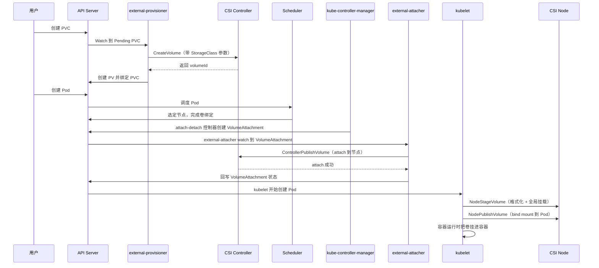
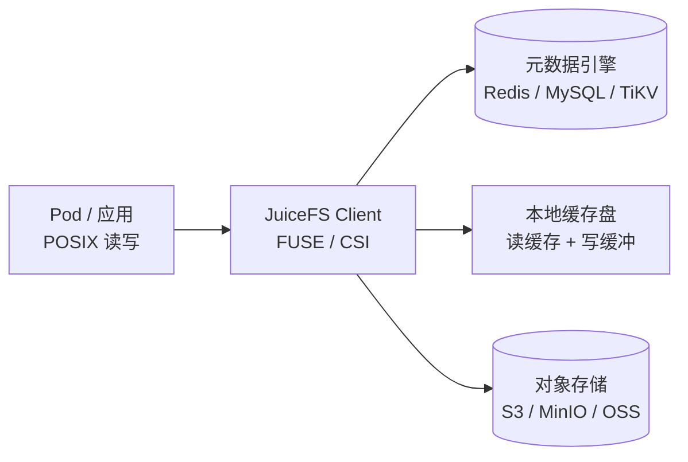
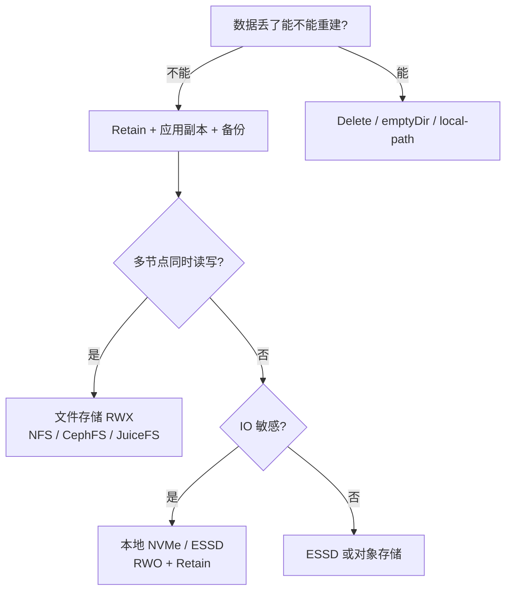

## 先分清三种存储

K8s 里的 PV/PVC 只是"接入层"，真正决定能力的是后端存储。块、文件、对象三类存储的边界必须先划清楚，后面的选型才不会乱。

| 维度 | 块存储 | 文件存储 | 对象存储 |
| --- | --- | --- | --- |
| 访问方式 | 裸块设备 `/dev/vdb`，要先格式化文件系统 | 挂载点，POSIX 语义 | HTTP API（S3/OSS），无挂载概念 |
| 典型产品 | 云盘 ESSD、Ceph RBD、本地 NVMe | NFS、CephFS、云 NAS、JuiceFS | S3、MinIO、OSS、Ceph RGW |
| K8s 接入 | CSI + PV/PVC，访问模式通常 RWO | CSI + PV/PVC，可 RWX/ROX | 应用 SDK；JuiceFS/s3fs 可套一层文件视图 |
| 延迟/IOPS | 最低延迟、最高 IOPS | 受网络和协议影响，中等 | 高吞吐、高延迟，不适合随机小 IO |
| 容量扩展 | 单盘有上限，靠加盘 | 容量池化，弹性 | 近乎无限 |
| 典型场景 | 数据库、Kafka、etcd、缓存持久化 | 共享上传目录、CI 缓存、AI 数据集 | 备份、静态资源、数据湖、日志归档 |

一句话：**块存储给"一个进程独占的高性能盘"，文件存储给"多台机器共享的目录"，对象存储给"海量非结构化数据和备份"**。绝大多数选型错误，都是把该放块存储的数据库放到了 NFS，或者把该走对象存储的备份挂成了文件系统。

还有两类非持久卷顺带提一下：`emptyDir` 随 Pod 创建和删除，适合缓存、临时文件、sidecar 之间共享；`hostPath` 直接挂节点目录，Pod 漂移后数据就不对了，还有安全风险，生产环境除日志采集、CSI 这类必须访问宿主机的 DaemonSet 外不要用。

## PV/PVC 的两种挂载方式

PV 是集群里的一块实际存储，PVC 是用户对存储的申请，Pod 只认 PVC。PV 从哪来，分为静态供应和动态供应。

### 静态 PVC 挂载：管理员先建 PV，用户再申请

静态供应是管理员手工写好 PV，PVC 按条件去匹配认领。生产中**极少用**，只在两类场景出现：一是接入存量存储——已有 NFS、本地盘或从别的集群迁移过来的卷，CSI 创建不出来，只能手写 PV 接进来；二是需要人工精确控制后端参数或容量、把某块盘预留给指定业务的场景。

要注意的坑点：

- 匹配条件必须全部满足：`storageClassName` 一致、PV 的 `accessModes` 覆盖 PVC 申请、PV 容量 ≥ 申请量、`volumeMode` 相同（默认都是 `Filesystem`，静态场景一般不用写，只有给应用裸块设备时才显式配 `Block`）、PV 未被占用。缺前面任何一条，PVC 就永远 Pending。
- 一个 PV 只能绑一个 PVC，也没有按需扩缩：容量估大了闲置，估小了只能重建。
- 建议建 PV 时预置 `claimRef`，把卷钉给目标 PVC。不预置的话，多个条件匹配的申请会抢卷，业务可能挂上别人的数据目录；反过来 namespace 或名字写错，这块 PV 就一直绑不上，只能改 `claimRef` 或删掉重建。

### 动态 PVC 挂载：StorageClass + CSI 按需造卷

动态供应只需要提前建一个 StorageClass，PVC 创建时由 CSI 驱动去后端真正创建存储，再自动生成 PV 并绑定。以阿里云 ESSD 为例：

```yaml
apiVersion: storage.k8s.io/v1
kind: StorageClass
metadata:
  name: essd-pl1
provisioner: diskplugin.csi.alibabacloud.com
parameters:
  type: cloud_essd
  performanceLevel: PL1
  fsType: ext4
reclaimPolicy: Retain
allowVolumeExpansion: true
volumeBindingMode: WaitForFirstConsumer
---
apiVersion: v1
kind: PersistentVolumeClaim
metadata:
  name: mysql-data
spec:
  storageClassName: essd-pl1
  accessModes: ["ReadWriteOnce"]
  resources:
    requests:
      storage: 100Gi
```

PVC 绑定后（`WaitForFirstConsumer` 时要等 Pod 创建），`kubectl get pv` 会看到一个名字形如 `pvc-<uuid>` 的 PV——它不是手写的，是 CSI 驱动创建出来的，生命周期跟 PVC 绑定。

`volumeBindingMode` 这里单独说，因为它是云上最容易踩的坑：

- `Immediate`：PVC 一创建立刻建卷。云盘是**可用区级**资源，CSI 驱动按自己的策略挑一个可用区建盘；如果 Pod 因为资源或亲和性被调度到别的可用区，就会挂不上，报 `FailedAttachVolume` 或一直 Pending。
- `WaitForFirstConsumer`：等 Pod 调度到某个节点后，再在节点所在可用区建卷。多可用区集群**必须用它**，顺带还能避免"卷建好了但 Pod 因为资源不足永远调度不上去"的浪费。

### 为什么生产几乎都采用动态供应

- **容量按需**：动态供应按 PVC 的申请量**精确创建**；静态供应则是从预先建好的固定大小 PV 里挑一块，PVC申请 50Gi 只能绑 ≥50Gi 的整块 PV，多出来的容量用不满也拆不给别人。
- **生命周期闭环**：卷由 CSI 驱动创建、绑定、回收，删 PVC 后按 `reclaimPolicy` 自动清理后端盘，不需要人工维护"PV 对应哪块云盘"的登记表。静态 PV 的账本只能靠人记，人一换就断。
- **参数收敛在 StorageClass**：`fsType`、性能档位、加密、可用区策略写一次，所有 PVC 继承，不会出现手写 PV 时 zone 写错、参数漂移；平台也能按 StorageClass 做准入策略和成本分账。
- **多租户自助**：用户只提交 PVC，不碰 PV 和后端 API，RBAC 收在 PVC/StorageClass 这一层。申请不用开单找管理员，CI 临时环境、Helm Chart、GitOps 才能真正自动化。
- **编排模型的硬要求**：StatefulSet 的 `volumeClaimTemplates`、有状态应用的扩缩容，前提都是"声明即创建"，静态 PV 支撑不了。

代价只有一个：回收动作也一起自动化了。所以数据库、消息队列这类不能丢数据的 StorageClass 必须显式设 `Retain`，并另外做备份——`Retain` 只防误删 PVC，防不了盘和机房故障。

### StatefulSet 用 volumeClaimTemplates

有状态应用不要手写 PVC，用 StatefulSet 的 `volumeClaimTemplates`，每个副本自动得到一块独立 PVC：

```yaml
apiVersion: apps/v1
kind: StatefulSet
metadata:
  name: mysql
spec:
  serviceName: mysql
  replicas: 3
  selector:
    matchLabels:
      app: mysql
  template:
    metadata:
      labels:
        app: mysql
    spec:
      containers:
        - name: mysql
          image: mysql:8.0
          volumeMounts:
            - name: data
              mountPath: /var/lib/mysql
  volumeClaimTemplates:
    - metadata:
        name: data
      spec:
        accessModes: ["ReadWriteOnce"]
        storageClassName: essd-pl1
        resources:
          requests:
            storage: 100Gi
```

三个副本会生成 `data-mysql-0`、`data-mysql-1`、`data-mysql-2` 三块独立的盘。注意：**删掉 StatefulSet 默认不会删这些 PVC**，数据保留是好事，但也很容易留下一堆没人认领的云盘持续计费，后面坑点里会细说。

## 访问模式：RWO / ROX / RWX / RWOP

访问模式决定"这块卷能被多少个节点、以什么方式挂载"。名字很直白，但**RWO 是节点级限制，不是 Pod 级限制**，这一点必须记死。

| 模式 | 语义 | 典型后端 | 适用场景 | 关键坑 |
| --- | --- | --- | --- | --- |
| `ReadWriteOnce`（RWO） | **单个节点**读写挂载 | 云盘 ESSD、Ceph RBD、local-path、本地 NVMe | 数据库、Kafka、etcd 等有状态集群，每个副本独占一块盘 | 多个 Pod 挂同一 PVC（如 Deployment 多副本共用一个盘）就会同时写坏；集群模式要用 StatefulSet 每副本单独挂载一个PVC |
| `ReadOnlyMany`（ROX） | **多个节点**只读挂载 | NFS、CephFS、云 NAS、对象存储文件网关 | 模型文件、静态资源、只读数据集 | 只读是存储层保证；块存储后端大多不支持真正的多节点只读 |
| `ReadWriteMany`（RWX） | **多个节点**读写挂载 | NFS、CephFS、云 NAS、JuiceFS、SMB | 共享上传目录、CI 缓存、AI 训练数据、多 Pod 共享配置 | 存储支持并发写不等于应用支持并发写，仍需目录隔离或分布式锁 |
| `ReadWriteOncePod`（RWOP） | **单个 Pod** 读写挂载 | 支持该模式的 CSI 驱动 | 需要严格单写者的有状态应用 | 依赖集群版本和 CSI 支持，使用前先确认 |

### RWX 不是什么都能给

RWX 必须后端本身支持多节点并发读写。云盘 ESSD 普通盘**不支持** RWX；Ceph RBD 也不支持，CephFS 才支持。想在 K8s 里用 RWX，可选的基本就是 NFS、CephFS、云 NAS、JuiceFS、SMB 这几类文件存储。

而且 RWX 只解决"能同时挂"，不解决"同时写不冲突"。NFS 上的文件锁、JuiceFS 的 POSIX 语义都只是提供机制，业务仍要按目录隔离——比如每个 Pod 写自己的子目录，或者用分布式锁。

### 一块 ESSD 云盘能同时挂多台 ECS 吗？

**不能。** 普通 ESSD 是单挂载的块设备，同一时刻只能挂到一台 ECS，换机器必须先卸载再挂载。

限制来自文件系统层：云盘上一般是 ext4/xfs，它们不是集群文件系统，没有跨主机的锁和一致性机制。两台 ECS 同时挂载并写入，元数据会互相踩踏，文件系统直接损坏。

所以 K8s 里普通云盘只能当 RWO 卷用，需要多机共享目录就用 CephFS/JuiceFS 这类文件存储。

## 回收策略：删了 PVC，数据留不留

`reclaimPolicy` 决定 PVC 删除后，PV 和它背后的真实存储怎么处理。

| 策略 | 行为 | 适用场景 | 坑 |
| --- | --- | --- | --- |
| `Delete` | 删 PVC → 删 PV → 调 CSI 删后端存储（云盘、NFS 子目录等） | 无状态缓存、临时数据、可重建的数据 | 手滑删 PVC 数据直接没了；云盘删除有延迟，可能短暂计费 |
| `Retain` | 删 PVC → PV 保留，状态变 `Released`，后端数据不动 | 数据库、etcd、Kafka 等一切不能丢的数据 | 不会自动清理，PV 不能自动被新 PVC 复用，云盘持续计费 |

几条生产纪律：

1. **数据库、消息队列、etcd 一律 `Retain`**。动态供应的 StorageClass 默认往往是 `Delete`，必须显式改。数据比磁盘钱贵得多。
2. **`Retain` 不等于备份**。它只防"误删 PVC"，防不了节点故障、误删云盘、机房事故。备份必须另做，通常是备份到对象存储。
3. **改 StorageClass 的 `reclaimPolicy` 只影响之后新建的 PV**。已经存在的 PV 要在 PV 对象上逐个改，别以为改一次 StorageClass 就全生效。

```yaml
apiVersion: apps/v1
kind: StatefulSet
metadata:
  name: mysql
spec:
  persistentVolumeClaimRetentionPolicy:
    whenDeleted: Retain   # 删 StatefulSet 时保留 PVC
    whenScaled: Retain    # 缩容时保留 PVC
  # ...
```

`whenDeleted` / `whenScaled` 默认都是 `Retain`，改成 `Delete` 才能跟着清理。生产数据库建议保持 `Retain`，但要配合定期巡检清理孤儿 PVC，否则云盘账单会慢慢长出来。

另外两个删除时的保护机制：

- `kubernetes.io/pvc-protection` finalizer：PVC 还被 Pod 使用时删不掉，会卡在 `Terminating`，先确认 Pod 已停止。
- `kubernetes.io/pv-protection` finalizer：PV 被 PVC 绑定时删不掉，防止误删正在使用的卷。

## CSI：K8s 和存储之间的标准接口

前面一直说"CSI 驱动去建卷"，这里把它拆开讲清楚。CSI（Container Storage Interface）本质是一套 **gRPC 接口标准**：K8s 只负责按标准调用，存储厂商负责实现。云盘、Ceph、NFS、JuiceFS 各写各的驱动，K8s 核心代码一行不用改。

在 CSI 之前，存储插件是写在 K8s 源码里的（in-tree），加一个存储后端要改 K8s 主干、跟着 K8s 版本发布，厂商和社区都痛苦。CSI 把这些实现全部挪出核心，变成可独立升级的 Pod，这就是现在所有存储接入 K8s 的唯一标准路径。

### 两种部署形态

一个 CSI 驱动通常由两个组件组成：

- **Controller Plugin**：以 Deployment 部署（常见 1~3 副本，带 leader election），负责"集群级"操作——建卷、删卷、挂载到节点、快照、扩容。它一般需要调用云厂商 API 或分布式存储的管理接口，所以不跑在业务节点上。
- **Node Plugin**：以 DaemonSet 部署在**每个节点**上，负责"节点级"操作——格式化、挂载、卸载。它需要访问宿主机的 `/dev`、`/sys`、`/var/lib/kubelet`，通常是 privileged 容器。

### 三个 gRPC 服务

CSI 规范把接口分成三个服务，记住每个服务管什么，排查问题时就不会乱：

| 服务 | 关键 RPC | 干什么 |
| --- | --- | --- |
| Identity | `GetPluginInfo`、`GetPluginCapabilities`、`Probe` | 身份与健康检查，kubelet 用 `Probe` 判断驱动是否活着 |
| Controller | `CreateVolume`、`DeleteVolume`、`ControllerPublishVolume`、`ControllerUnpublishVolume`、`CreateSnapshot`、`ControllerExpandVolume` | 建/删卷、attach/detach、快照、扩容 |
| Node | `NodeStageVolume`、`NodeUnstageVolume`、`NodePublishVolume`、`NodeUnpublishVolume`、`NodeExpandVolume`、`NodeGetVolumeStats` | 节点上的格式化、挂载、卸载、容量统计 |

这里最容易混的是 **attach 和 mount 的区别**，拆成三步看：

1. `ControllerPublishVolume`：**把云盘挂到 ECS 上**（attach）。这一步是云 API 操作，盘会出现在节点的 `/dev/vdb`，但还没格式化、没挂到任何目录。
2. `NodeStageVolume`：**格式化并挂到节点的全局目录**。比如把 `/dev/vdb` 格式化成 ext4，挂到 `/var/lib/kubelet/plugins/kubernetes.io/csi/.../globalmount`。同一个卷在节点上只 stage 一次。
3. `NodePublishVolume`：**把全局目录 bind mount 到 Pod 的卷目录**，即节点上的 `/var/lib/kubelet/pods/<pod-UID>/volumes/kubernetes.io~csi/<pv名>/mount`；之后容器运行时再把它 bind 进容器的 `mountPath`（如 `/var/lib/mysql`）。多个 Pod 用同一个卷时，每个 Pod 做一次 bind mount，底层指向同一个 global mount。

卸载时反着来：`NodeUnpublishVolume` → `NodeUnstageVolume` → `ControllerUnpublishVolume`，最后才会 `DeleteVolume`。

### Sidecar：官方提供的一堆"小助手"

CSI 驱动本身只实现上面三个服务，真正跟 K8s API 打交道的是官方 sidecar 容器。它们和驱动一起部署，各盯一种资源：

| Sidecar | 监听什么 | 调用什么 |
| --- | --- | --- |
| `external-provisioner` | 未绑定的 PVC | `CreateVolume` / `DeleteVolume` |
| `external-attacher` | `VolumeAttachment` 对象 | `ControllerPublishVolume` / `ControllerUnpublishVolume` |
| `external-resizer` | PVC 扩容请求 | `ControllerExpandVolume` |
| `external-snapshotter` | `VolumeSnapshot` 对象 | `CreateSnapshot` / `DeleteSnapshot` |
| `node-driver-registrar` | 无（启动时注册） | 把驱动 socket 注册给 kubelet |
| `livenessprobe` | 无 | 调 `Probe` 做健康检查 |

所以看到 `csi-provisioner`、`csi-attacher` 这些容器名，不要以为是不同的存储驱动，它们只是同一个驱动旁边的标准配件。

### 一次 Pod 挂盘的完整链路



几个关键点：

- **`VolumeAttachment` 是 attach 的状态记录**，由 kube-controller-manager 里的 attach-detach controller 创建。卡在 attach 阶段时，`kubectl get volumeattachment` 能看到它，`kubectl describe` 里的 events 通常就是云 API 的报错。
- **`WaitForFirstConsumer` 改变的是顺序**：不是"先建卷再调度"，而是"先调度 Pod，再在 Pod 所在可用区建卷"，所以 PVC 会先 Pending，等 Pod 创建后才 Bound，这是正常的。
- **kubelet 通过 Unix socket 调 CSI Node**，路径在 `/var/lib/kubelet/plugins/<driver>/csi.sock`；节点插件没起来时，Pod 会报 `FailedMount`，不是 `FailedAttach`。

### 挂载失败怎么查

按阶段定位，不要一上来就重启：

| 现象 | 大概率原因 | 查什么 |
| --- | --- | --- |
| PVC 一直 `Pending` | StorageClass 不存在、CSI provisioner 没跑、配额/容量不足、可用区无库存 | `kubectl describe pvc`、provisioner 日志 |
| Pod `Pending` | 调度失败、节点资源不足、PV 的 nodeAffinity 与节点不匹配 | `kubectl describe pod` 的 Events、`kubectl get pv -o yaml` |
| `FailedAttachVolume` | 云盘和节点不在同一可用区、attach 数量到上限、云 API 限流 | `kubectl get volumeattachment`、attacher 日志、云控制台 |
| `FailedMount` | 节点插件没就绪、格式化失败、文件系统损坏、权限问题 | `journalctl -u kubelet`、node plugin 日志、`mount` 输出 |

常用命令：

```bash
kubectl get pvc,pv
kubectl describe pvc <name>
kubectl get volumeattachment
kubectl -n kube-system logs deploy/csi-<driver>-controller --tail=200
kubectl -n kube-system logs ds/csi-<driver>-node --tail=200
journalctl -u kubelet -n 200 --no-pager
# 节点上确认 CSI socket 和挂载点
ls -l /var/lib/kubelet/plugins/kubernetes.io/csi/
mount | grep -i csi
```

### 常见 CSI 驱动

| 存储 | 驱动名（StorageClass provisioner） | 说明 |
| --- | --- | --- |
| 阿里云云盘 | `diskplugin.csi.alibabacloud.com` | ESSD/ESSD AutoPL，块存储，RWO |
| 腾讯云云硬盘 | `com.tencent.cloud.csi.cbs` | CBS，块存储，RWO |
| AWS EBS | `ebs.csi.aws.com` | gp3/io2，块存储，RWO |
| Ceph RBD | `rbd.csi.ceph.com` | 块存储，RWO |
| CephFS | `cephfs.csi.ceph.com` | 文件存储，RWX |
| NFS | `nfs.csi.k8s.io` | 文件存储，RWX，需单独部署 NFS CSI 驱动 |
| JuiceFS | `csi.juicefs.com` | 基于对象存储的 POSIX 文件系统，RWX |

注意：**`local-path` 不是 CSI 驱动**。它是 Rancher 的 `local-path-provisioner`，一个监听 PVC、在节点本地目录里建子目录、然后生成 hostPath/local PV 的外部 provisioner。它没有 CSI 的 attach/stage 流程，也不支持快照和扩容，这是后面 local-path 单独讲的原因。

## 云盘 CSI ESSD 动态卷

云盘是最典型的块存储：一块盘就是一个块设备，格式化后挂到节点上，性能最好、延迟最低，但**只能挂一台 ECS**，而且和 ECS 必须在同一个可用区。

### ESSD 的档位怎么选

ESSD 按性能分档，容量和性能要一起看：

| 档位 | 单盘最大 IOPS（参考） | 单盘最大吞吐（参考） | 适用场景 |
| --- | --- | --- | --- |
| PL0 | 1 万 | 180 MB/s | 开发测试、小型业务、低负载 |
| PL1 | 5 万 | 350 MB/s | 通用生产、中小型数据库 |
| PL2 | 10 万 | 750 MB/s | 中大型数据库、Kafka、ES |
| PL3 | 100 万 | 4000 MB/s | 核心数据库、极高 IOPS 场景 |

注意"最大"两个字，有两层限制：一是 ESSD 的 IOPS/吞吐按**容量**线性增长，容量越小封顶值越低，表里的上限要盘到一定大小才拿得到；二是还受 **ECS 实例规格的存储带宽**限制，买了一块 PL3 但实例存储带宽只有 1 Gbps，实际也跑不到标称值。容量规划时先看业务峰值 IOPS，再反推盘的大小和档位，别只看容量。

### 一个多可用区可用的 StorageClass

```yaml
apiVersion: storage.k8s.io/v1
kind: StorageClass
metadata:
  name: essd-pl1-multi-az
provisioner: diskplugin.csi.alibabacloud.com
parameters:
  type: cloud_essd
  performanceLevel: PL1
  fsType: ext4
reclaimPolicy: Retain
allowVolumeExpansion: true
volumeBindingMode: WaitForFirstConsumer
allowedTopologies:
  - matchLabelExpressions:
      - key: topology.kubernetes.io/zone
        values:
          - cn-hangzhou-h
          - cn-hangzhou-i
          - cn-hangzhou-j
```

`allowedTopologies` 不是必须的，但多可用区集群加上它更稳：明确告诉 CSI 只能在哪些可用区建盘，避免调度器把 Pod 放到一个没有云盘库存的可用区。更常见的做法是**每个可用区一个 StorageClass**，配合 nodeAffinity 让业务落到指定 AZ。

### 扩容

云盘支持在线扩容，但只能**变大，不能变小**：

```bash
# 1. StorageClass 必须 allowVolumeExpansion: true
# 2. 直接改 PVC 的 requests.storage
kubectl patch pvc mysql-data -p '{"spec":{"resources":{"requests":{"storage":"200Gi"}}}}'

# 3. 观察状态
kubectl get pvc mysql-data -w
# 可能短暂出现 FileSystemResizePending，等 kubelet 完成文件系统扩容
```

扩容分两步：CSI 先把云盘扩大，kubelet 再做文件系统 resize。ext4/xfs 都支持在线扩容，但**应用不一定能立刻感知**，有些场景需要重启 Pod 才会看到新容量；`subPath` 挂载的卷更是典型的重灾区，后面坑点会讲。

缩容没有捷径：新建一块小盘 PVC，停业务，把数据拷过去，再切回来。数据库尤其麻烦。

### 快照

云盘快照通过 `VolumeSnapshot` 做，需要 CSI 驱动支持并部署 `external-snapshotter`：

```yaml
apiVersion: snapshot.storage.k8s.io/v1
kind: VolumeSnapshotClass
metadata:
  name: essd-snapshot
driver: diskplugin.csi.alibabacloud.com
deletionPolicy: Retain
---
apiVersion: snapshot.storage.k8s.io/v1
kind: VolumeSnapshot
metadata:
  name: mysql-data-20261122
spec:
  volumeSnapshotClassName: essd-snapshot
  source:
    persistentVolumeClaimName: mysql-data
```

快照是**崩溃一致性**的，不是应用一致性。MySQL 在快照瞬间如果有未落盘的事务，恢复出来可能要做 crash recovery。要打应用一致性快照，就在低峰停写或 `FLUSH TABLES WITH READ LOCK` 后立刻打快照、打完马上解锁；要长期保留的备份，用 xtrabackup 做物理备份直接写到对象存储，不依赖快照。快照只适合"快速回滚到某个时间点"，不能替代备份。

### 云盘特有的坑

- **跨可用区挂不上**：云盘是 AZ 级资源，Pod 调度到别的 AZ 就是 `FailedAttachVolume`。用 `WaitForFirstConsumer`，或按 AZ 拆 StorageClass。
- **一块盘只能挂一台 ECS**：普通 ESSD 不支持多挂；共享盘要配集群文件系统，别拿来当 RWX 用。
- **挂载数量有上限**：每台 ECS 能挂的云盘数量有限（常见十几块），大量小 PVC 会把节点挂满，后续 Pod 调度上来也挂不上盘。能合并的合并，共享文件用 NFS/JuiceFS。
- **性能受实例规格限制**：盘的 IOPS/吞吐上限只是上限，ECS 的存储带宽、队列深度、CPU 都会成为瓶颈。
- **`Retain` 的盘会一直计费**：删了 PVC 不等于删了云盘，定期清理 `Released` 的 PV。
- **`fsType` 建完就定了**：已有卷改 StorageClass 的 `fsType` 不会重新格式化，别指望切 ext4/xfs 生效。

## local-path / 本地盘

local-path 是很多轻量集群（k3s、Rancher、单节点测试环境）的默认存储。它的实现非常朴素：**在节点本地目录下建一个子目录，生成一个带 nodeAffinity 的 PV**。所谓"本地盘"很多时候只是节点系统盘上的一个目录，并不是独立的 NVMe。

```yaml
apiVersion: storage.k8s.io/v1
kind: StorageClass
metadata:
  name: local-path
  annotations:
    storageclass.kubernetes.io/is-default-class: "true"
provisioner: rancher.io/local-path
volumeBindingMode: WaitForFirstConsumer
reclaimPolicy: Delete
```

它只有一个节点本地目录，所以：

- **Pod 必须调度到数据所在节点**。PV 上有 nodeAffinity，Pod 换节点就挂不上，除非应用自己能把数据迁走。
- **节点故障 = 数据不可用**。数据在节点盘上，节点挂了、盘坏了，PV 里的数据就没了。RAID 只能防单盘坏，防不了整机/机房故障。
- **PVC 的容量不生效**。local-path 只是建目录，不做 quota，PVC 写 100Gi 不代表只能用 100Gi，实际能写满整个节点盘。这是它和真正的 local PV 最大的区别之一。
- **不支持快照、扩容**。它不是 CSI 驱动，没有 `CreateSnapshot`、`ControllerExpandVolume` 这些能力。

### 适合谁

local-path 不是"不能用于生产"，而是**只适合数据可重建、或有应用层副本的场景**：

- 单节点集群、边缘节点、开发测试环境
- 本地缓存、临时构建目录、可重建的中间数据
- Kafka、Elasticsearch、ClickHouse、MinIO 这类**自带多副本**的分布式系统，每个副本用自己的 local-path PVC，坏一个节点靠副本恢复
- 有状态但数据可从对象存储/数据库重新拉取的场景

**不适合**：单实例 MySQL、单副本 Redis 持久化、etcd 这类"数据只有一份且必须保命"的场景。

### 真正的本地 NVMe 怎么用

如果节点上真的有独立 NVMe，别用 local-path 的默认目录，用 **local PV** 把盘显式管起来：

```yaml
apiVersion: v1
kind: PersistentVolume
metadata:
  name: pv-node1-nvme0
spec:
  capacity:
    storage: 1Ti
  accessModes: ["ReadWriteOnce"]
  persistentVolumeReclaimPolicy: Retain
  storageClassName: local-nvme
  local:
    path: /mnt/nvme0
  nodeAffinity:
    required:
      nodeSelectorTerms:
        - matchExpressions:
            - key: kubernetes.io/hostname
              operator: In
              values: ["node1"]
```
生产上本地盘的典型用法是：**本地 NVMe 给数据库/消息队列，应用层做副本，备份到对象存储**。本地盘坏了换节点，数据从副本重建，而不是指望盘不死。

## JuiceFS：对象存储之上的一层 POSIX

JuiceFS 解决的是"既想要对象存储的容量和成本，又想要文件系统的 POSIX 语义"这个矛盾。它把文件系统拆成两层：



- **元数据引擎**：存目录树、inode、权限、文件锁、切片映射，必须有高可用
- **对象存储**：存真正的数据块（chunk/block），容量几乎无限、成本低
- **本地缓存**：客户端把热点数据缓存在本地 SSD/内存，减少回源

它的能力很全：POSIX 兼容、HDFS 兼容、S3 网关、K8s CSI 驱动、RWX、快照、回收站、配额。典型场景是 AI 训练数据集、大数据作业、多 Pod 共享文件、日志集中存储、跨云数据共享。

**坑也很明确**：

- **元数据引擎是命门**。Redis 单点挂了或者数据丢了，整个文件系统就不可用。生产至少 Redis Sentinel/Cluster，规模大用 TiKV。
- **延迟高于本地盘**。一次读要查元数据再拉对象存储，小文件密集或高并发元数据操作时压力很大，缓存盘要给足。
- **不要跑数据库数据目录**。POSIX 兼容不代表低延迟，MySQL 的 redo log fsync 走 JuiceFS 性能会很差，老老实实用本地盘或 ESSD。
- **凭证管理**：对象存储的 AK/SK 要放 Secret，别写进 StorageClass 明文。

## 对象存储：MinIO 与 S3

对象存储的模型和文件系统完全不同：数据以 object 为单位放在 bucket 里，通过 HTTP API 做 PUT/GET，没有目录（只有 key 前缀）、没有随机写、没有原子 rename、没有文件锁、没有 mmap。它擅长的是海量、一次写多次读、按对象访问的场景。

MinIO 是兼容 S3 API 的对象存储，支持纠删码、分布式部署、版本控制、生命周期，K8s 里通常用 Operator 部署，后端挂 local PV 或独立磁盘。它适合自建对象存储、备份、数据湖、镜像仓库后端、日志/指标长期存储。

### S3 能不能像文件系统一样 mount，提供 POSIX？

**先明确什么是 POSIX 语义**：它是文件系统对上层应用承诺的一套标准行为——有真实的目录树和路径解析；能按字节偏移随机读、写、追加；`rename` 是原子操作；支持文件锁、`mmap`、软硬链接、权限位和属主；`fsync` 返回后数据真正落盘。数据库、Git、包管理器都是按这套契约写的，缺一条就可能出错。

**原生的 S3 不能**，因为它根本不是文件系统，数据模型对不上：

- **没有目录**：只有 bucket + key，`/` 只是 key 里的一个字符，所谓"目录"是按前缀模拟的，没有真实层级、没有 inode
- **权限模型不同**：bucket/前缀级的访问策略，不是文件的 POSIX 权限位
- 
所以结论很直接：**要 POSIX 语义就用文件存储（NFS/CephFS/JuiceFS），要对象存储就直接用 S3 SDK。** 

对象存储最适合的位置是：备份仓库（Velero、数据库备份）、静态资源 + CDN、Harbor 镜像后端、Loki/Thanos 长期存储、数据湖、AI 只读数据集。

MinIO 的坑：
- **数据目录不要放 NFS**。MinIO 的纠删码和一致性假设要求本地盘/JBOD，NFS 上的锁和延迟会导致各种异常。
- **生产至少 4 块盘起步做纠删码，最好多节点部署**，单机单盘只适合开发测试。
- **权限最小化**。AK/SK 泄露等于整个 bucket 泄露，按 bucket/前缀做策略，定期轮换。

## 生产选型对照：MySQL、Redis、Kafka 怎么放

选型不是比哪个存储"先进"，而是看三件事：**这个组件对 IO 延迟有多敏感、数据丢了能不能重建、应用层有没有副本**。按这个逻辑，常见组件的选择基本是固定的：

| 组件 | 首选存储 | 访问模式 | reclaimPolicy | 关键理由 |
| --- | --- | --- | --- | --- |
| MySQL / PostgreSQL 主库 | ESSD PL2 | RWO | Retain | 事务提交依赖 fsync，对延迟极敏感；主从/组复制做冗余，不要单实例 |
| MySQL 从库 | ESSD PL1 | RWO | Retain | 从库可以放宽；备份直接写 S3/MinIO，不要挂成文件系统 |
| Redis 纯缓存 | emptyDir | - | - | 缓存丢了能回源，不需要 PV，别浪费云盘 |
| Redis 持久化 | ESSD | RWO | Retain | AOF fsync 频繁，NFS 不可用；配主从 + Sentinel/Cluster |
| Kafka | 本地 NVMe | RWO | Retain | 顺序写 + page cache + fsync；NFS 不支持；副本 3 自带冗余 |
| etcd | 本地 SSD | RWO | Retain | fsync 延迟直接决定集群稳定性；容量不用大，IOPS 必须高 |
| Elasticsearch / OpenSearch | 本地 NVMe | RWO | Retain | 高吞吐；用副本保证可用性，不要共享存储 |
| Prometheus | ESSD | RWO | Retain | TSDB 写本地盘；长期存储用 Thanos + S3 |
| RabbitMQ | ESSD | RWO | Retain | 持久化消息；用 Quorum Queue |
| 文件上传 / 共享 | 云 NAS（NFS） | RWX | Retain | 多 Pod 共享；注意权限和目录隔离 |
| CI 缓存 / 构建产物 | 对象存储（S3/MinIO） | 对象 | Delete | 可重建，允许清理 |
| 日志（Loki） | 对象存储（S3） | 对象 | Delete | 日志直接写对象存储，不需要本地热盘 |
| AI 训练数据集 | JuiceFS | RWX | Retain | 大文件高吞吐；只读数据集用 ROX |
| 备份 / 归档 | 对象存储（S3/MinIO） | 不挂载 | - | 应用直接写对象存储 |
| 静态资源 | 对象存储（S3） | 不挂载 | - | 配合 CDN 分发，根本不需要 PV |

### 三个真实场景

**MySQL 主从**

```yaml
# 每个副本一块独立 ESSD，RWO + Retain，Pod 反亲和打散到不同 AZ
volumeClaimTemplates:
  - metadata:
      name: data
    spec:
      accessModes: ["ReadWriteOnce"]
      storageClassName: essd-pl2
      resources:
        requests:
          storage: 500Gi
```

主库用 ESSD PL2 起步，半同步复制保证至少一个从库收到日志；备份用 xtrabackup 落到对象存储。不要为了"云原生"把 MySQL 数据目录放 NFS 或 JuiceFS，事务提交延迟会教你做人。

**Kafka 集群**

3 个 broker，每个 broker 一块本地 NVMe（优先 local PV；local-path 只适合测试），`replication.factor=3`、`min.insync.replicas=2`。坏一个节点，数据从另外两个副本重建；节点修好后新 broker 加入，Kafka 自动选主并补齐副本。**不要用 NFS，也不要用 RWX 共享目录**——Kafka 的日志段是顺序追加 + fsync，共享文件系统既保证不了语义，性能也扛不住。

**共享上传目录**

多 Pod 需要读写同一批用户上传文件，用 NFS/CephFS/JuiceFS 的 RWX PVC，按租户/业务分目录。这种场景不要用云盘——普通云盘挂不了多台，共享盘又要配集群文件系统，纯属给自己找麻烦。

## 最后：选型的决策顺序

不用背表格，按这个顺序问自己四个问题就够了：



一句话总结：**块存储保性能，文件存储保共享，对象存储保容量；访问模式决定谁能挂，回收策略决定删了留不留。真正保命的是副本和备份，不是某一种存储类型。**
