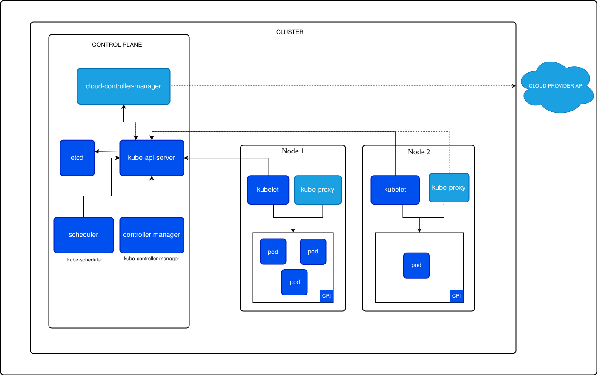

## 定义
k8s是一个开源的容器编排平台，利用它可以非常方便，高效地管理多个容器。对比一下不用k8s的情况。
| 痛点                      | k8s 的解法                                                      |
| ------------------------- | --------------------------------------------------------------- |
| 容器挂了没人管            | **自愈**：自动重启失败的容器，替换不健康的节点                  |
| 流量大了扛不住            | **自动伸缩**：根据 CPU/内存或自定义指标水平扩展 Pod 数量（HPA） |
| 部署新版本要停机          | **滚动更新**：逐个替换旧版本，随时可以回滚                      |
| 服务之间怎么找到彼此      | **服务发现 + 负载均衡**：通过 Service/DNS 自动路由流量          |
| 配置和密钥散落各处        | **ConfigMap / Secret** 统一管理，随应用挂载                     |
| 服务器资源浪费            | **调度器**把 Pod 合理分配到各节点，最大化资源利用率             |
| 多环境（测试/生产）不一致 | **声明式配置**（YAML 描述期望状态），集群自动收敛到该状态       |

## 结构
k8s 属于主从模型，构成集群的机器分成两类角色：控制平面 Control Plane和工作节点 Worker Node。对照架构图：最外层的大框是一个 CLUSTER 集群，左侧是控制平面，右侧是 Node 1、Node 2 两台工作节点，右上角云朵代表云厂商 API。

### 控制平面 Control Plane
控制平面是集群的"大脑"，负责整个集群的调度、管理与运维。高可用集群建议至少部署 3 台（etcd 依赖奇数节点做多数派选举，后文详述）。图中控制平面里画了 5 个组件：
- **kube-apiserver**：集群唯一入口。注意图中的连线走向——scheduler、controller manager、kubelet、kube-proxy 全都连向它，组件之间互不直接通信，所有交互都要经过 apiserver 中转
- **etcd**：分布式 KV 存储，集群所有状态记录在这里；它只被 apiserver 读写（图中 etcd 与 apiserver 的连线），其他组件要存取数据都必须通过 apiserver
- **kube-scheduler**：调度器，从 apiserver 监听新创建、还没分配节点的 Pod，为它选出最合适的一个节点
- **kube-controller-manager**：所有内置控制器的集合，持续对比"期望状态"与"实际状态"，驱动集群向期望状态收敛
- **cloud-controller-manager**：对接云厂商的控制器（图右上角的 CLOUD PROVIDER API 云朵），负责负载均衡、云盘挂载、节点生命周期这类云资源相关的事；自建集群没有云厂商，通常不部署它
若控制平面不可用，集群进入"管理停摆"：无法增删改资源、无法调度新 Pod，但已经运行在节点上的存量 Pod 不受影响，会继续提供服务——这就是控制平面必须做高可用的原因。
### 工作节点 Worker Node（旧称 Slave）
工作节点承载真正的业务负载，业务以 Pod 为单位运行（图中 Node 1、Node 2 内部的 pod 方块）。每个节点上运行三类组件：
- **kubelet**：节点上的"管家"，与 apiserver 保持不间断通信：一边接收 apiserver 的指令、维护本节点 Pod 达到预期状态，一边持续把本节点和 Pod 的状态汇报上去、存入 etcd。真正创建容器时，通过 CRI 接口调用容器引擎完成（图中的 CRI 标注）
- **kube-proxy**：在节点上维护 Service 的流量转发规则（它从 apiserver watch service 和 endpoint 的变化），让访问服务的流量在多个 Pod 副本之间负载均衡
- **容器引擎**：真正拉起容器的运行时，支持 Docker、containerd、CRI-O 等一切实现 CRI 接口的软件
当某个 Node 宕机，kubelet 的心跳上报中断，控制平面将该节点标记为不可用，其上的工作负载被自动转移到其他节点——故障转移的决策在控制平面（controller-manager + scheduler），实际重建则由目标节点上的 kubelet 动手执行。
各组件的详细工作原理见后文"核心组件简介"。


## 核心概念
### 名称空间
我们在部署完k8s集群后，该集群会管理一系列k8s相关的资源，例如控制器、pod、svc、ingress、
serviceAccount、psp、存储卷、configmap等，为了能够很好地将这些资源组织起来，k8s引入了
namespace。
namespace本质就是一个隔离的空间，用于将一组资源组织起来，并与其他名称空间相隔离，这么做的
好处很明显  
- 当很多人共用一套k8s集群时，可以用namespace将彼此使用的资源隔离开，互不干扰
- 一组资源被组织到一个namespace中后，更方便k8s进行统一性的管理配置，例如资源配额、访问控制等  
名称空间-----》多租户的资源隔离、还能结合k8s的资源配额管理限定不同租户能占用的资源（如cpu使
用量、内存使用量）
### POD
Pod是Kubernetes的最小工作单元。每个Pod包含一个或多个容器。
#### 为什么要有POD
```text
k8s是用来管理容器的，即底层跑应用程序的一定是容器，既然如此，那k8s直接管理容器就好了，为什么还要
搞出来一个POD的概念迷惑众生。
有两个原因
1、封装-》屏蔽底层不同的容器引擎
因为你创建出容器的引擎可能五花八门，导致创建出的容器可能也有所不同，k8s为了能够兼容这些不同的容
器，干脆在容器之上做了一层封装，这层封装的结果就是POD，即无论你是用什么引擎创建出的容器，k8s都会
将其扔进到一个POD里，POD是k8s自己的概念，基于PODk8s开发了很多管理功能，如此，k8s只需要管理自
己的POD即可，这体现的就是一种封装与解耦的思想
举个栗子：
你把容器想象成一条条鱼，不同的容器引擎会创建出不同的容器，这就好比是鱼有不同的品种
POD就好比是盛鱼的箱子，有了POD把鱼封装起来，外部在调用的时候就很容易统一标准了，外部看到的就是一
箱一箱的鱼，如果把k8s当成一个鱼贩子，那有POD的组织之后，鱼贩子的工作就变得简单统一，只需要管理
POD即可。
2、一个应用可能拆解成多个容器，想直接通过本地的IPC空间进行通信
容器的设计思想-》一个容器只启动一个前台进程，只负责干一件事
一个应用有很多事要做，那便需要创建多个容器，这多个容器不想通过网络进行通信，而是直接本地ipc通
信，那就需要放在一起，pod这种可以把多个容器放在同一个Pod里、共享同一套命名空间（网络ns、IPC ns）
的机制便应运而生
```
### 通信与资源共享
Pod中的所有容器使用同一个网络namespace，即相同的IP地址和Port空间。它们可以直接用
localhost通信。同样的，这些容器可以共享存储，当Kubernetes挂载volume到Pod，本质上是将
volume挂载到Pod中的每一个容器

### 静态 Pod

**静态 Pod 是由 kubelet 直接管理、不经过 API Server 创建的 Pod**：kubelet 监听节点本地目录（默认 `/etc/kubernetes/manifests/`），放进去一个 YAML 就拉起对应 Pod，改文件自动重建，删文件就删除。kubelet 启动时也会扫描该目录，所以节点重启后控制面能自动恢复。

| 对比项 | 普通 Pod | 静态 Pod |
| --- | --- | --- |
| 管理者 | Deployment、ReplicaSet 等控制器 | **kubelet** |
| 创建方式 | `kubectl apply -f xxx.yaml` | 把 YAML 放进 manifests 目录 |
| 能否 `kubectl delete` | 能 | **不能**，删了会被 kubelet 立刻重建 |
| 名字特征 | 随机后缀 | 带节点名后缀，如 `kube-apiserver-master01` |
| 在 apiserver 中的形态 | 真实对象 | 只读的 Mirror Pod，`kubectl edit` 改不生效 |

Mirror Pod 是 kubelet 在 apiserver 里为静态 Pod 创建的**只读影子对象**：名字是 `<静态Pod名>-<节点名>`，带 `kubernetes.io/config.mirror` 注解，作用只是让 `kubectl get/logs/describe` 能查到它。它的 spec 由 kubelet 单向同步，不受控制器和调度器管理，真正决定它跑不跑的是节点上的源文件。

**为什么存在（自举）**：控制面组件 apiserver、etcd、scheduler、controller-manager 本身也是容器，但创建 Pod 又依赖 apiserver——集群初始化时这是个死循环。静态 Pod 让 kubelet 直接读本地文件拉起容器，绕过 apiserver，kubeadm 就是靠它自举控制面的。`kubectl get pods -n kube-system` 里名字带节点后缀的，基本就是静态 Pod。

**别理解偏**："不经过 API Server"指的是**创建和管理的入口**，不是说静态 Pod 直接写 etcd。kubelet 从不直连 etcd（整个集群只有 apiserver 能读写 etcd），静态 Pod 的事实来源始终是节点上的 YAML 文件；apiserver 可达时，kubelet 会额外创建一个只读的 Mirror Pod 对象走正常 API 流程落进 etcd，作用只是让 `kubectl` 能查询和看日志。apiserver 挂了，静态 Pod 照常运行，只是集群里查不到。

**两个操作坑**：

- **删不掉**：`kubectl delete` 删的只是 apiserver 里的 Mirror Pod，kubelet 会立刻重建；要下线只能删 `/etc/kubernetes/manifests/` 里的源文件。
- **改不动**：`kubectl edit` 改的是 Mirror Pod，会被 kubelet 覆盖回去；要改配置就改源文件，kubelet 检测到变化后自动重建。

另外，静态 Pod 不能依赖其他 API 对象（ServiceAccount、ConfigMap、Secret 等），所以控制面组件的配置都是本地文件或启动参数，不靠 ConfigMap 下发。

## 核心组件简介
### 从节点上部署的组件
#### 容器引擎
负责具体后端容器运行时的软件，kubernetes支持多个容器运行环境：Docker，Containerd，CRI-O以
及任何实现kubernetes CRI（容器运行环境接口）。
#### kubelet

kubelet 是跑在**每个节点**上的节点代理，负责把调度到本节点的 Pod 真正运行起来，并把节点和 Pod 的状态持续汇报给 apiserver。它不参与调度，只对自己的节点负责。
核心功能就这几项：
- **管 Pod 生命周期**：拉镜像、建 sandbox、调 CRI 起容器，按 `restartPolicy` 重启，处理删除。
- **执行健康检查**：运行 liveness/readiness/startup 三类探针，liveness 失败重启容器，readiness 失败只摘流量。
- **挂存储、配网络**：调 CSI 完成卷的格式化与挂载，调 CNI 给 Pod 分配 IP、接进网络。
- **管资源和驱逐**：按 requests/limits 落到 cgroup，节点资源紧张时按 QoS 驱逐 Pod。
- **镜像与容器 GC**：定期清理不再使用的镜像和已退出的容器。
**边界**：不调度、不管 Service 转发规则、不采业务日志。所以 Pod 起不来时，先看 `kubectl describe pod` 的 events 和 `journalctl -u kubelet`。

#### kube-proxy组件与service资源
运行有kubelet的节点都会运行kube-proxy组件，kube-proxy负责管理service资源以实现pod的负载均
衡代理，至于service资源为何种物，详解如下
为了实现应用的高可用
- 传统情况，我们会将应用部署为多个副本，然后用一个负载均衡例如nginx来代理这些副本，并且要
监测副本的故障，故障副本要从代理中剔除。  
```text
                                  |------同一个应用的副本1
                                  |
人工维护------>负载均衡（例如nginx）--------同一个应用的副本2
                                  |
                                  |------同一个应用的副本3
```
- 而在k8s中，内置了service资源，你只需要按需创建service来代理你的pod即可，service与nginx代
理的作用一样
```text
                                           |------同一个应用的POD副本1
                                           |
kube-proxy自动维护------>负载均衡（service）--------同一个应用的POD副本2
                                           |
                                           |-------同一个应用的POD副本3
```
至于副本的故障检测、负载均衡代理目标端点的更新均由k8s自动完成（kubelet检测pod状态汇报给
apiserver组件，然后kube-proxy可以获取pod的状态变化，自动完成service代理目标端点的上下线）  
**注意** ：kube-proxy为pod提供的是代理服务，而不是网络，pod的网络是kubelet调用网络插件实现的  
#### ingress资源

**一、ingress 的层级定位**

前面我们讲了 service：service 是一份声明（yaml），由 kube-proxy 真正执行，工作在**网络4层（IP+端口）**，负责把一个应用的多个 POD 副本"聚合成一个稳定的访问入口"，并且只在集群**内部**生效。

可 service 有两个天生的短板：
1. 它只认 IP:端口做转发，**看不懂 HTTP 的域名和 URL 路径**，做不到"a.com 走前端、a.com/api 走后端"这种7层分流；
2. 它默认只在集群内可达，要暴露给外网要么用 NodePort（端口难管理），要么用 LoadBalancer（每个都要外部IP和费用）。

ingress 就是为了解决"**外部用户如何通过域名/URL路径，访问到集群内的 service**"而生的，它的层级定位可以这样理解：

```text
 外部用户 (浏览器)
      |
      |  HTTP/HTTPS (带域名、路径)
      v
 [ ingress ]    ← 7层路由：按 Host(域名) + Path(路径) 决定转给谁
      |            本质是一份规则声明(yaml)，由 ingress controller 真正执行
      v
 [ service ]    ← 4层负载均衡：把流量分摊给多个 POD 副本
      |            一份规则声明(yaml)，由 kube-proxy 真正执行
      v
 [ POD 副本 ]   ← 真正跑应用的容器
```

可以看到：**ingress 是包在 service 外面的一层"7层入口网关"**，它不替代 service，而是在 service 之上工作——ingress 只负责"按域名/路径把外部请求引到正确的 service"，之后的事（分摊给哪个 POD、健康检查上下线）还是 service + kube-proxy 的活。

跟 service 一样，**ingress 本身也只是一份声明（一段 yaml），自己不会转发流量**。真正干活的7层代理叫 **ingress controller**（如 ingress-nginx、Traefik，底层通常还是个 nginx），它才是实际运行的负载均衡器。二者的关系和"service(声明) + kube-proxy(执行者)"完全对称。

**二、从输入 URL 到后端服务的完整流程**

为了讲清楚，我们用一个具体场景：你在集群部署了博客后端 `blog-api`（监听 8080，起了3个副本，配了同名 service `blog-api`），并写了一条 ingress 规则——"`a.com/api/*` 转发给 `blog-api` 的 8080 端口"。现在用户在浏览器输入 `https://a.com/api/health` 回车，发生了什么？

**第1步：DNS 解析**
浏览器先查 DNS，把域名 `a.com` 解析成一个 IP。这个 IP 通常就是 ingress controller 对外暴露的地址：
- 云上一般是 ingress controller 的 `LoadBalancer` 类型 service 分配到的外部 IP；
- 自建集群可能是某个节点的 IP + `NodePort`，直接用的节点 IP。
总之，这个 IP 指向的是 **ingress controller 所在的 Pod**，而不是你的应用 Pod。

**第2步：建立 TCP 连接 + TLS 握手（HTTPS）**
浏览器与该 IP 的 443 端口建立 TCP 连接，然后进行 TLS 握手。ingress controller 上配置的证书（可以来自 cert-manager 自动签发，或手动挂的 Secret）会返回给浏览器，双方协商出加密通道。如果是 HTTP 则跳过 TLS，直接到 80 端口。

**第3步：发送 HTTP 请求**
浏览器发出 HTTP 请求，关键字段包括：
- `Host: a.com`（请求的是哪个域名）
- `Path: /api/health`（请求路径）
- `Method: GET` 等。
注意：这俩字段（Host + Path）正是 ingress 能做7层路由的"原材料"——纯 service 是看不到这些的。

**第4步：请求到达 ingress controller**
数据包到达 ingress controller 的 Pod。它通常以 Deployment 部署，里面跑着一个真正的7层代理（如 nginx），监听 80/443。

**第5步：ingress controller 匹配路由规则（7层路由核心）**
ingress controller 启动后，会通过前面讲过的 **list-watch 机制持续监听 API Server 上的 Ingress 资源**。当你 `kubectl apply` 那条 ingress 规则时，controller 就把规则翻译成自己内部的代理配置（比如 nginx 的 `server`/`location`），并 reload 生效。
所以当请求到来，它手里有张"路由表"，根据 `Host: a.com` + `Path: /api/health` 一查，命中规则："`a.com/api/*` → service `blog-api` 的 8080 端口"。**这一步就是 ingress 比 service 强的地方——它能读懂 HTTP 域名和路径。**

**第6步：定位后端 service（ClusterIP）**
ingress controller 现在知道目标是一个叫 `blog-api` 的 service、端口 8080。在集群里，`blog-api` 这个 service 有一个**虚拟 IP（ClusterIP，例如 10.96.0.20）**和映射端口。ingress controller 把请求的目标地址设为 `10.96.0.20:8080`，准备转发。

**第7步：交给 service，由 kube-proxy 做4层负载均衡**
`10.96.0.20` 是个**虚拟 IP，并不对应任何真实网卡**。真正把"发往这个虚拟 IP 的流量分摊到多个 POD 副本"的，是 **kube-proxy**——这正是前面说的"service 只是一份声明，kube-proxy 才是执行者"的体现。kube-proxy 会监听 service 和 Endpoint 的变化，在**每个节点**上把负载均衡规则写成内核级的转发规则；包到达节点时，内核直接按规则挑一个后端 POD 转发，根本不需要把流量再绕回某个中心负载均衡器。

kube-proxy 有两种工作模式，负载均衡的实现方式不一样：

- **iptables 模式（默认）**：kube-proxy 给每个后端 POD 写一条 iptables 的 DNAT 规则，并用 `statistic --mode random --probability` 把它们串成一条"概率链"。以 `blog-api` 有 3 个健康副本为例：
  - 第 1 条：以 1/3 的概率命中，把目标 DNAT 成 POD-1（`10.244.1.15:8080`）；没命中（剩 2/3）就继续往下；
  - 第 2 条：在剩下的流量里以 1/2 的概率命中，DNAT 成 POD-2（`10.244.2.23:8080`）；没命中就继续；
  - 第 3 条：无条件（100%）命中，DNAT 成 POD-3（`10.244.3.7:8080`）。
  
  长期统计下来每个 POD 大约分到 1/3 流量，实现了**近似随机的负载均衡**。注意 iptables 模式不是严格轮询，而是靠概率分摊；请求量够大时各 POD 趋于均匀，但单个连接级别不够"公平"。

- **ipvs 模式**：kube-proxy 用 Linux 内核的 LVS（IP Virtual Server）来干活。它为 `blog-api` 的 ClusterIP:Port 建一个"虚拟服务"，下面挂 3 个真实服务器（就是 3 个 POD 的 IP:Port），并支持真正的调度算法：
  - `rr`（轮询 round-robin）：请求一个一个轮流分给各 POD；
  - `lc`（最少连接 least connection）：优先发给当前连接数最少的 POD；
  - `sh`（源地址哈希 source hashing）：同一客户端 IP 总落到同一 POD，实现**会话保持**；
  - 另有 `dh`、`sed`、`nq` 等。
  ipvs 是内核态转发、性能远高于 iptables，集群 service 数量很大时推荐开启。

不管哪种模式，最终效果一致：从 `blog-api` 的多个 Endpoint 里挑出一个 POD 的真实 IP:端口（如 `10.244.1.15:8080`），对包做 **DNAT（目标地址转换）**，把目标地址改写掉。

至于"此刻有哪些后端 POD 可用"，由 Endpoints Controller 根据 POD 健康状态维护（`blog-api` 的 3 个副本对应 3 个 Endpoint）。kube-proxy 会据此动态刷新上面的转发规则——某副本挂了，它会被自动移出负载均衡池，流量不再被打到它身上。

**第8步：到达 POD 网络（CNI）**
改写后的包，通过集群网络插件（CNI，如 Calico、Flannel）提供的网络，跨节点路由到目标 POD 所在节点，再送进具体的容器。`blog-api` 容器里监听 8080 的进程收到请求。

**第9步：应用处理并返回响应**
`blog-api` 处理 `/api/health`，生成响应体（比如 `{"status":"ok"}`）。

**第10步：响应原路返回**
响应沿原路径回去：容器 →（CNI 网络）→ 节点 → kube-proxy 规则做反向 NAT 还原源地址 → ingress controller →（经 TLS 加密）→ 浏览器。浏览器收到 `{"status":"ok"}`，渲染或处理。

#### cert-manager：自动化证书的第三方控制器

第2步 TLS 握手里那张证书从哪来？手动流程是：`openssl` 生成私钥和 CSR → 提交给 CA（或 Let's Encrypt 网站）→ 拿到证书 → `kubectl create secret tls` 存成 Secret → ingress 的 `tls` 字段引用它。这套流程有两个必翻车的点：**证书会过期**（Let's Encrypt 只有 90 天），忘了续期业务直接 TLS 报错；**每加一个域名都要人肉走一遍**。cert-manager 就是把这件事变成"声明 + 调谐"的控制器。

**核心 CRD 声明意图**（和 ingress 一样，自己不干活，只写 yaml）：

```yaml
# 1. Issuer：签发者（ns 内）；ClusterIssuer 跨 ns，一般用这个
apiVersion: cert-manager.io/v1
kind: ClusterIssuer
metadata:
  name: letsencrypt-prod
spec:
#http01是ACME 的域名验证方式，Let’s Encrypt 用.letsencrypt.org是一个根CA，可以免费签发证书，时限90天
  acme:
    server: https://acme-v02.api.letsencrypt.org/directory
    email: ops@a.com
    privateKeySecretRef: { name: letsencrypt-account-key }
    solvers:                            # 域名验证方式，二选一
      - http01:
          ingress: { class: nginx }     # ACME 往 /.well-known/acme-challenge/ 放凭据
---
# 2. Certificate：要什么证书
apiVersion: cert-manager.io/v1
kind: Certificate
metadata:
  name: blog-cert
spec:
  dnsNames: [a.com, www.a.com]   #证书对哪些域名有效
  issuerRef: { name: letsencrypt-prod, kind: ClusterIssuer }
  secretName: blog-tls                  # 证书落地成这个 Secret
```

**SAN（Subject Alternative Name，主题备用名称）——`dnsNames` 落到证书里的形态**：

上面 `dnsNames: [a.com, www.a.com]` 签出来的证书里，这两个域名就写在 SAN 字段。它是浏览器握手时校验的核心：CA 签发证书 → 浏览器拿到证书后**只查 SAN**——访问的域名不在 SAN 里就报"证书名称不匹配"。
**多域名和通配符都是 SAN 的写法**：一张证书可放多个 SAN（`a.com` + `www.a.com` 一张证搞定，即"SAN 证书"），`*.a.com` 通配符也是 SAN 里的一种模式。

**调谐流程**（list-watch 监听 Certificate → 调谐，和 kube-controller-manager 同一套模型）：

1. **apply 与校验**：`kubectl apply` 提交 Certificate 时，CR校验后 → 存 etcd → controller 通过 **list-watch 监听**到新建的 Certificate。
2. **对接签发账户**：controller 读 `issuerRef` 找到 ClusterIssuer，ACME account key 是和 Let’s Encrypt 通信的账号密钥
3. **本地生成私钥与 CSR（证书签名请求）**：在 cert-manager Pod 内存里现生成一对密钥（私钥 + 公钥），然后用这把新私钥对请求内容做签名，拼出 CSR：
   ```text
   CSR= 公钥 + 申请的域名（SAN 扩展）+ 申请人信息 + 用自己私钥做的签名
   ```
   末尾那个签名的作用是**自证持有私钥**——CA 能用 CSR 里的公钥验签通过，就证明生成者手里确有对应私钥。这份 CSR 随后进第 4 步 Order 资源的 `csr` 字段，作为申请材料提交给 CA。
4. **落成内部资源 Order + Challenge**：
   ```text
   Certificate（你声明的）
     └─ Order（每张证书一个，cert-manager 内部资源，状态机 Pending→Valid/Failed）
          └─ Challenge（每个域名一个，域名验证过程，Pending→Valid）
               └─ 全部 Valid → finalize → 写回 Secret
   ```
5. **执行域名验证（走哪条由 ClusterIssuer 的 solvers 决定，二选一）**：
   - **HTTP-01**：ACME 返回一个 token，cert-manager 算出验证值，创建临时 Challenge Pod + 临时 Ingress，暴露路径：`http://域名/.well-known/acme-challenge/<token>`，CA服务器访问这个路径，拿到验证串，校验正确 → 域名验证通过；之后自动清理临时 Pod、Ingress。**限制**：80 端口、公网可访问、不支持通配符
   - **DNS-01**：ACME 同样下发一个 token，但 cert-manager 不碰任何端口，而是**拿着配好的 DNS 服务商 API 凭据**（对应 ClusterIssuer 里的 dns01 provider 配置）往 `_acme-challenge.域名` 写一条 TXT 记录（内容为 token 校验值）→ 等记录传播到权威 DNS（几十秒到几分钟，Challenge 会卡在 pending 等待）→ CA 向权威 DNS 查询这条 TXT，对得上 → 验证通过 → cert-manager 再调 API 删掉记录。**特点**：不要 80 端口、不要公网可达（纯内网服务也能签）、CA 验证的是"整个域名区域归你管"，所以**通配符 `*.a.com` 只有这一条路**；

   **两条分支的应用场景（怎么选）**：

   | | **HTTP-01** | **DNS-01** |
   | --- | --- | --- |
   | 典型场景 | 公网业务的具体域名：官网、博客、公网网关（`a.com`、`www.a.com`，一张证只护几个明确域名） | ① **通配符** `*.a.com`——内部服务一堆子域名（`api.`、`admin.`、`grafana.`），一张证全罩住，不用每个域名签一次；② **不暴露公网的服务**——内网 API、测试环境、只开 443 不开 80 的入口；③ 入口在云 LB/安全组后面，80 不方便对 CA 放行 |
   | 前提 | 域名解析指向集群入口，**80 端口公网可达** | 集群持有 **DNS 服务商 API 凭据**，能增删解析记录 |
   | 不适合 | 通配符（机制上做不到）；80 打不通的内网服务 | 不愿交出 DNS 权限的高安全场景；|
   | 选择倾向 | **默认选它**：零凭据、链路直观、故障一眼可见 | 只在有通配符/内网诉求时上，凭据按最小权限给、定期轮换 |
   
6. **finalize 签发（叶子证书此刻才诞生，中间证书本来就有）**：该 Order 下所有 Challenge 都 Valid → controller 把第 3 步的 CSR 提交给 CA 的签发服务器，CA 现场做两件事：
   - **现签叶子证书**：从 CSR 里取出公钥和 dnsNames，配上有效期、序列号等字段拼成证书主体，用**中间 CA 的私钥**做数字签名——这张就是你的终端实体证书（叶子证书）；
   - **附带中间证书**：它**不是为你现生成的**——CA 的中间签发者（如 Let's Encrypt 的 R11/E5/E6）早已由根 CA 预先签好，私钥常年锁在 CA 的 HSM 硬件安全模块里；签发 API 的响应里直接附上"叶子 + 中间"，让客户端能顺链找到根：
   整条链回传 → Order 变为 Valid。
7. **写回 Secret 并生效**：controller 把 CA 返回的证书链（**叶子在前、中间在后**拼成 PEM）写进 `tls.crt`、第 3 步本地生成的私钥写进 `tls.key`，创建/更新成 `kubernetes.io/tls` 类型的 Secret `blog-tls`（就是 ingress `tls.secretName` 引用的那个）。ingress-nginx watch 到 Secret 变化 → 热 reload nginx 的 SSL 配置 → 443 端口换上新证书，浏览器刷新即可看到。
8. **状态回填**：每一步 controller 都把进展写回 `Certificate.status`
9. **持续续期（核心价值）**：controller 每天巡检所有 Certificate，当到达 `renewalTime`（默认约为有效期的 1/3 处，90 天证书即剩约 30 天）→ 自动重复第 3-7 步签一张新证书 → 覆盖同一个 Secret → nginx reload，业务全程无感。

**排障按资源链逐层下钻**：

```bash
kubectl describe certificate blog-cert        # 看 Ready 条件、renewalTime，先确认卡在哪层
kubectl get order                             # Order 层：卡 Pending 说明还没走完验证
kubectl describe challenge -l cert-manager.io/certificate-name=blog-cert   # Challenge 层：90% 的故障在这
kubectl get secret blog-tls                   # 最终产物在不在
```

Challenge 常见死因就：**HTTP-01**——安全组没有放行80端口。**DNS-01**——TXT 记录没传播完（`NXDOMAIN`，多等几十秒重试）；

##### 补充：
- `tls.crt` ：内容是"域名信息（SAN）+ 公钥 + CA 的数字签名"，通常还带中间 CA 链（叶子证书拼上中间证书）。握手时服务端把它明文发给客户端——它本来就是给人验证的，泄漏无所谓；
- `tls.key` ：与叶子证书配对的私钥，在 TLS 握手中证明身份、完成密钥协商——业务流量本身用协商出的会话密钥加解密，不走这把钥匙。
- 浏览器的校验链：拿到 `tls.crt` → 查 SAN（域名在不在列表里）→ 验 CA 签名（证书没被篡改、确实是 CA 签的）→ 顺证书链找到自己内置信任的根 CA → 握手放行，任一环不过就报证书错误。
- **CA**：CA是一个概念，代表一个机构/角色。一般代指后面这2个文件：`ca.crt`别人拿到叶子证书 tls.crt，用 ca.crt 里的公钥校验签名，确认这个叶子证书是咱们这个 CA 签发。`ca.key`签名签发证书。只有持有 ca.key，才能签发新的叶子证书（tls.crt）或者中间证书。一旦泄露，攻击者可以伪造任意证书。
- **叶子证书**：终端业务证书，绑定业务域名 SAN；`CA:FALSE`，不能签发别的证书，TLS 握手时发给对端。包括`.crt`和`.key`文件。
- **中间证书**：根 CA 签发的二级 CA 证书；`CA:TRUE`，负责签发叶子证书；拼接在叶子后面补齐证书链。包括`.crt`和`.key`文件。
- **静态加密**：K8s 特指 apiserver 在写入 etcd 前对 Secret、ConfigMap 等资源加密，落盘到 etcd 的是密文；防止 etcd 数据目录、快照备份被拖走后直接读取明文。

### 主节点部署的组件
#### etcd分布式数据库
Etcd是用go语言开发的一个分布式的k/V存储系统，etcd相当于整个k8s集群的记事本/存储中心，k8s集
群的所有状态都记录在etcd数据库集群中。
ETCD核心使用了RAFT分布式一致性算法，因此通常部署奇数个  
```text
了解raft协议：
一个分布式系统，是由多个节点/实例组成一个整体对外提供服务的，而实际运行过程中，经常会因为各种不可
用因素引发某个节点或实例不可用，进而引发整个集群节点的状态不一致，导致整个集群不可用。
我们需要解决问题的就是：在某个节点故障时，整个集群各个节点的状态能重新一致，从而继续对外提供服
务，raft算法就是用来实现这一点的
为了以容错方式达成一致，我们肯定不可能要求所有服务器100%都达成一致状态，只要超过半数的大多数服务
器达成一致就可以了，假设有N台服务器，N/2+1就超过半数，代表大多数了，这就是raft算法的核心原理
```
**注意**：etcd数据库对数据量大小是有限制的，这会影响到集群规模的扩大，node节点增多，相应的master节点
也要增多，master节点上其他组件都不是限制集群规模
的要素，etcd的性能决定了集群可以扩到多大
#### apiserver
k8s所有的状态信息都存放在etcd集群中，而etcd只能被apiserver操作，所以k8s所有其他组件运行时都
只能去访问apiserver才能间接地访问到etcd数据库，因此apiserver是整个K8S集群入口、是k8s所有模
块之间相互通信和数据交互的中心、相当于整个k8s的大脑/大总管/中央枢纽
#### kube-scheduler
实际环境中会有多台机器用于跑容器，如何从中选取最合适的那一台，这就用到了k8s的组件：kube-scheduler
scheduler选节点分两个阶段：**Filter（过滤）**淘汰不满足条件的节点（资源不够、有污点等），**Score（打分）**
给剩下的节点按规则打分、选最优的一个，然后把nodeName写回apiserver——该节点上的kubelet通过
watch发现有Pod调度到本机，再调用容器引擎创建pod
#### kube-controller-manager
##### 什么是控制器controller
在K8S集群中，几乎每种特定资源都有特定的Controller控制器负责维护管理。
我们以POD这种资源为例，POD启动后，k8s需要对其进行自动化管理，例如故障监控与自愈，这都需
要有专门的程序负责维护，这个程序就是k8s的控制器，控制器有内置的、后续你也可以自定义，内置的
控制器种类有deployment、statefulset，daemonset、cronjob等，不同的控制器的有不同的特性，这
是我们后续介绍的一个重点。
##### 什么是控制器的管理器controller-manager
为了把诸多种类的Controller聚合起来进行统一管理、抽取冗余实现降低Controller的实现复杂度，k8s
中诞生了一个contoler-manager的组件，即控制器管理器，它是K8S集群里所有资源对象的自动化控
制中心、是K8S集群中处理常规任务的后台线程。
Controller Manager的负责把所有的Controller聚合起来，一方面可以提供基础设施降低Controller的实
现复杂度，另外一方面就是负责启动和维持Controller的正常运行，监听api-server的事件,然后对不同的
Controller分发事件通知。
控制器管理器与控制器的关系如下：
```text
controller-manager------>多种控制器（deployment、statefulset、cronjob等）------>POD
```
controller-manager负责监视着每一个控制器（控制器通过API Sever监控整个集群的状态），如果控制
器不健康无法工作，那么controller-manager会及时发现并执行自动化修复流程来确保控制器的健康，
使得集群处于预期的工作状态。多台Master会部署多个controller-manager副本，但通过leader
election（领导者选举）选出一个active实例真正干活，其余热备待命——避免多副本同时执行同一套调谐逻辑产生冲突。  
##### 常见控制器（了解）
k8s中有几十种Controller，这里简单罗列一些Controller
| 控制器                                                          | 作用                                                                                                                                                                                                                                                                         |
| --------------------------------------------------------------- | ---------------------------------------------------------------------------------------------------------------------------------------------------------------------------------------------------------------------------------------------------------------------------- |
| **Node Controller**（节点控制器）                               | 负责在节点出现故障时进行通知和响应                                                                                                                                                                                                                                           |
| **Replication Controller**（副本控制器）                        | 负责为系统中的每个副本控制器对象维护正确数量的 Pod                                                                                                                                                                                                                           |
| **Deployment Controller**（部署控制器）                          | 监听 Deployment，管理其名下的 ReplicaSet：创建新 RS、调整旧 RS 副本数实现滚动更新，回滚就是把副本指回旧 RS                                                                                                                                                                    |
| **ReplicaSet Controller**（RS 控制器）                           | 监听 ReplicaSet，保证实际 Pod 数量始终等于 spec.replicas，多了删、少了建                                                                                                                                                                                                     |
| **Endpoints Controller**（端点控制器）                          | 一个 Pod 的 IP+Port 对应一个 Endpoint 资源。K8s 将多个副本的 Endpoint 加入 Service 管理，这与配置 Nginx 是同样的道理；不同的是，Pod 的下线、重启等引起的 IP 地址变化（即 Endpoint 变化），都会被 K8s 监听到，然后动态更新到 Service 中，负责控制这件事的就是 Endpoint 控制器 |
| **Service Account & Token Controllers**（服务账户和令牌控制器） | 为新的命名空间创建默认账户和 API 访问令牌                                                                                                                                                                                                                                    |
| **ResourceQuota Controller**（资源配额控制器）                  | 确保指定的资源对象在任何时候都不会超量占用系统物理资源                                                                                                                                                                                                                       |
| **Namespace Controller**（命名空间控制器）                      | 管理 Namespace 的生命周期                                                                                                                                                                                                                                                    |
| **Service Controller**（服务控制器）                            | 属于 K8s 集群与外部的云平台之间的一个接口控制器                                                                                                                                                                                                                              |
**控制器进程**都只存在于主节点

结合前面的组件知识，把几个高频原生资源"谁存、谁管、谁执行"理清楚：

| 资源            | 谁存                         | 谁监听并干活                                                                                     |
| --------------- | ---------------------------- | ------------------------------------------------------------------------------------------------ |
| Pod             | apiserver 存对象与 status    | kubelet 监听分配给自己的 Pod，调 CRI/CNI 拉起容器                                                 |
| Deployment      | apiserver 存期望状态         | DeploymentController 管 RS，支持滚动更新/回滚                                                     |
| ReplicaSet      | apiserver 存期望状态         | ReplicaSetController 保证指定数量 Pod 存活                                                        |
| Service         | apiserver 存对象             | kube-proxy 监听 Service & Endpoints，在节点生成 iptables/ipvs 规则实现负载均衡                    |
| ConfigMap/Secret | apiserver 存数据            | 没有控制器参与：kubelet 在 Pod 启动时把它挂载成文件或注入环境变量                                 |
| Namespace       | apiserver 存对象             | NamespaceController 管生命周期（配额清理、删除回收）                                              |
#### 客户端工具
kubectl这个客户端程序的调用操作都是过kube-apiserver提供的HTTP Restful API接口进行。

## 一个 apply 的完整流程（以 Deployment 为例）
### 核心模型：apply 原生资源到底发生了什么
K8s 原生资源（`Deployment`/`Service`/`Pod`/`ConfigMap` 这类内置 kind），你 apply YAML，本质是两件事：
1. **把资源对象提交给 apiserver 存到 etcd**——这只是存了一份"期望状态"；
2. **对应的控制器（controller）持续 watch 这个资源的变更，去调底层能力干活**。

> **和 Istio CR 的区别只在"谁监听"**：原生资源是 K8s 自带的各个 controller 负责（跑在 kube-controller-manager 里）；Istio 的 VirtualService 这类 CR 则是 istiod 监听并翻译下发（见 Istio 文章 post45）。CRD 本身只是"注册一种新资源"的机制，资源对象（YAML）永远只是躺在 etcd 里的数据，**注册完还得有自己的控制器来干活**。

### 完整流程（8 步）
1. `kubectl apply -f deploy.yaml`
   kubectl 先读取 `~/.kube/config` 拿访问凭证和 apiserver 地址，把 YAML 转成 JSON，发 HTTP 请求给 **kube-apiserver**
2. apiserver 做校验（身份认证 Auth、字段合法性、权限），校验通过 → **写入 etcd 持久化存储**
   此时集群里就有了这个 Deployment 对象。**还没有 Pod**，etcd 里只存了一份期望状态（副本数 3、镜像 xxx、标签 xxx）
3. **kube-controller-manager 里的 DeploymentController** 通过 list-watch 监听到 Deployment 新增，读到期望状态
4. DeploymentController 对比现状：还没有对应的 ReplicaSet，Pod 数量是 0，不满足期望
   → 它创建对应的 **ReplicaSet（RS）** 对象（RS 也是原生资源），写入 etcd（每次改 Deployment 的 spec 换镜像，都会新建一个 RS——滚动更新/回滚的来源）
5. ReplicaSetController 监听到 RS 新增，发现当前 Pod 不够
   → 按 RS 里的 Pod 模板创建 **Pod** 对象，写入 etcd（此时 Pod 处于 Pending，还没选节点）
6. **kube-scheduler** 调度器监听到未绑定节点的 Pod
   看 Pod 的资源请求、亲和、污点，走 Filter（过滤）+ Score（打分）选一个合适节点，把 nodeName 写回 etcd
7. 目标节点上的 **kubelet** 一直 watch 分配给自己的 Pod
   kubelet 发现有新 Pod 调度到本机，按顺序落地（CRI/CNI/CSI 都由它调用）：
   - **挂卷**：有 PVC 就调 CSI 完成 attach/stage 和挂载
   - **拉镜像**：通过 CRI 的 ImageService 拉取镜像
   - **建 sandbox**：调 CRI `RunPodSandbox` 创建 pause 容器，拿到 Pod 的 netns
   - **配网络**：调 CNI 在 netns 里建 veth、分配 Pod IP
   - **起容器**：调 CRI `CreateContainer` / `StartContainer`，依次启动 init 容器和业务容器
8. 容器启动后，kubelet 持续上报 Pod 状态给 apiserver，更新 etcd 里 Pod 的 status

每一步都是"**写 etcd → 下一个组件 watch 到变更 → 继续写**"，组件之间从不直接通信，全部经 apiserver 中转（list-watch 机制一节详述）。

> 整个模型叫：**声明式 API + 控制器调谐（Reconcile）**
> 你写 YAML 是写【期望状态】，控制器无限循环：`期望状态 vs 实际状态`，缺啥补啥，偏差就纠正。spec 由你写、status 由控制器回填，就是这套模型在 YAML 上的体现。

**注意**：上面 8 步中并没有提到 kube-proxy 组件，没错，如果你只是创建Deployment/pod的话，其实
kube-proxy并不会工作。你需要知道pod只是k8s集群管理的诸多资源中的一种，除了pod外还有很多其
他资源，比如service资源。只有在你用kubectl命令提交创建service资源的时候，kube-proxy组件才会
工作-帮你创建出service资源用于代理pod，此时，外部访问者就可以通过internet->防火墙->kube proxy访问到你的容器

### 一个很关键的误区
❌ **不是 apply yaml 直接创建容器！**
✅ apply 只是把期望状态存在 etcd；**控制器是异步的调谐引擎**，是控制器循环去补齐现实。所以 `kubectl apply` 返回成功 ≠ 容器已经跑起来——中间隔着"控制器创建 RS → RS 创建 Pod → 调度 → kubelet 起容器"好几跳异步链条，排障要看 events 定位卡在哪一跳。


## List-watch机制
在Kubernetes中，list和watch是两种主要的API操作、是一种异步消息处理机制，它们用于让客户端获
取和观察资源的状态。
```text
1、List操作：
List操作是一次性的操作，用于获取集群中某种类型资源的当前状态列表。
例如，你可以列出所有的Pods，或者只列出某个namespace的Pods。
这个操作返回的资源每一项都包括一个resourceVersion字段，表示资源的版本。
2、Watch操作：
Watch操作：Watch操作用于订阅资源的更新事件。客户端在执行watch操作时，可以通过
resourceVersion参数指定开始监听的资源版本，从而避免漏掉在List和Watch操作之间发生的更新。
```
k8s中各组件间协同都采用list-watch机制进行通信。  
这种机制可以确保客户端获取到最新的资源状态，且避免了频繁的轮询造成的开销。  
大致流程如下： 
```text
1、客户端首先执行一次list操作来初始化资源状态
2、然后通过watch操作来持续接收后续的更新
与简单的短轮询相比，这种机制可以更有效地获取资源状态的更新，并减少了网络流量和API服务器的负载。
```
- 首先在controller-manager/scheduler/kubelet启动的时候都会去watch自己关注的资源。
- 用户kubectl创建一个ReplicaSet请求调用Api-server，Api-server将创建replicaSet存储到etcd
中,Api-server同时也获取到创建replicaset的created事件
- controller-manager此刻watch到replicaset创建时间后通过pod模版进行pod创建并持久化到etcd中
- scheduler watch到创建的pod创建事件通过Filter过滤和Score打分策略为pod选定运行的node，并更新pod的
nodeName字段
- 之后kubelet watch到在自己上需要运行pod，调用cri/cni/csi创建pod。
###  List-watch是如何实现的
List的实现比较容易理解其本质就是一简单的列表操作（采用的是短连接），那么Watch是如何实现的
呢? Watch是如何通过HTTP长连接接收apiserver发来的资源变更事件呢?
秘诀就是Chunked transfer. encoding(分块传输编码)，它首次出现在HTTP/1.1。  
```text
相比于http1.0协议的短链接，HTTP/1.1默认所有请求都保持长链接，或称之为持久链接，以便同一个客户
端反复请求需要重复多次建立链接所带来的访问效率低的问题
而持久链接需要服务器在开始发送消息体前先发送Content-Length消息头字段，但是对于动态生成的内容来
说，在内容创建完之前是不可知的，也就是说对于一些很耗时的动态操作，服务器需要等到所有操作完成后，
才能发送数据，显然这样的效率不高。更好的处理方法是，产生一块数据，就发送一块，采用流模式来取代缓
存模式，这就是HTTP/1.1的chunked分块传输。
HTTP/1.1使用分块传输编码，数据会被分解成一系列数据块，并以一个或多个块发送，每一个数据块带上本块长度，最后一个块显示0长度，代表一次响应结束。
```
当客户端调用watch API时, apiserver在response的HTTP Header中设置Transfer Encoding的值为
chunked,表示采用分块传输编码,客户端收到该信息后,便和服务端保持该链接（长连接），并等待下一
个数据块,即资源的事件信息，直到客户主动断链。  
**controller-manager负责启动和维持Controller的正常运行，watch监听api-server,然后对不同的Controller分发事件通知**：
- Controller manager与api-server的通信主要通过两种方式: List和Watch；controller首先通过list
全量获取到关注的资源，存储到本队缓存中，之后通过最新的resourceversion来对资源进行
watch，获取资源的add/update/delete的事件。
- client-go：实现统一管理每种Controller的List和Watch，将收到的event事件放到缓存中，异步分
发给每个Controller的注册的eventHandler。后期通过事件的类型，回调用户注册进来的
eventHandler进行对应事件类型的业务逻辑处理
- List是短连接实现，用于获取该资源的所有object
- Watch是长连接实现，用于监听在List中获取的资源的变化
- api-server检测到资源产生变更时，会主动通知到Controller manager (利用分块传输编码)。
用curl模拟watch:  
```bash
#终端1，在本地机器起一个HTTP 代理，把你本机的请求自动带上集群认证信息，转发给 kube-apiserver，用自己处理认证和证书
$ kubectl proxy
#终端2，list出default名称空间下的pods
$ curl "127.0.0.1:8001/api/v1/namespaces/default/pods"
#终端2：watch default 下的 Pod 变化
$ curl "127.0.0.1:8001/api/v1/namespaces/default/pods?watch=true"
#终端3：创建
$ kubectl run nginx --image=nginx
```

### List-watch设计理念
一个异步消息的系统时，对消息机制有至少如下四点要求
#### 消息可靠性
首先消息必须是可靠的，list和watch一起保证了消息的可靠性,避免因消息丢失而造成状态不一致场景。
具体而言，
List API可以一次性获取某类资源当前的全部对象，对象里既有spec（期望状态）也有控制器回填的status
（实际状态），客户端拿期望与实际对比，纠正状态不一致的资源。
Watch API和apiserver保持一个长链接，接收资源的状态变更事件并做相应处理。
如果仅调用watch API,若某个时间点连接中断，就有可能导致消息丢失，所以需要通过list API解决消息
丢失的问题。
从另一个角度出发,我们可以认为list API获取全量数据，watch API获取增量数据。虽
然仅仅通过轮询list API,也能达到同步资源状态的效果，但是存在开销大，实时性不
足的问题。
#### 消息实时性
消息必须是实时的，list- watch机制下，每当apiserver的资源产生状态变更事件,都会将事件及时的推送
给客户端，从而保证了消息的实时性。
#### 消息顺序性
消息的顺序性也是非常重要的，在并发的场景下，客户端在短时间内可能会收到同一个资源的多个事件,
对于关注最终一致性的K8S来说，它需要知道哪个是最近发生的事件，并保证资源的最终状态如同最近
事件所表述的状态一样。
K8S在每个资源的事件中都带一个resourceVersion的标签,这个标签是递增的数字，所以当客户端并发
处理同一个资源的事件时，它就可以对比resourceVersion来保证最终的状态和最新的事件所期望的状
态保持一致。
#### 高性能
List-watch还具有高性能的特点，
虽然仅通过周期性调用List API也能达到资源最终一致性的效果，但是周期性频繁的轮询大大的增大了
开销，增加apiserver的压力。
而watch作为异步消息通知机制，复用一条长链接,保证实时性的同时也保证了性能。  


## 补充
### ReplicaSet 在哪一层
Deployment、ReplicaSet、Pod 是三层套娃的关系：
```text
Deployment（最外层，你 apply 操作的对象）
    ↓ 管理
ReplicaSet（中间层，真正管副本数量的控制器）
    ↓ 管理
Pod（最底层，实际跑容器）
```
- 你 apply 的 Deployment → 控制器创建 ReplicaSet → ReplicaSet 保证 Pod 始终有 `replicas: 3` 个
- 每次改 Deployment 的 spec（如换镜像）都会**新建一个 ReplicaSet**，滚动升级就是新旧 RS 交替扩缩容，回滚就是让控制器把 Pod 指回旧 RS
- ReplicaSet 一般不直接写 yaml 使用，它没有滚动更新/回滚能力，所以被 Deployment 包一层间接管理
- 一句话：**Deployment 管发布，ReplicaSet 管副本，Pod 跑业务**

### 控制器是不是都在主节点
- 是的。所有内置控制器（Deployment、ReplicaSet、Node、Namespace、Endpoint 等几十种）都集中在 **kube-controller-manager 一个进程**里并发跑，并不是"每类控制器一个进程"
- 主节点上的控制平面组件：kube-apiserver、kube-controller-manager、kube-scheduler、etcd，生产环境以静态 Pod 形式运行在主节点上
- 工作节点上跑的是 kubelet、kube-proxy、容器引擎；kubelet 才是真正"动手"的，控制器的命令最终都落到各节点的 kubelet 上执行（拉镜像、起容器、上报状态）
### controller-manager 管调谐，scheduler 管调度
容易混淆的点：**controller-manager 不负责调度**，调度是独立的 kube-scheduler 组件干的。
```text
kube-controller-manager  → 调谐（Reconcile）：副本够不够、滚动更新、回滚
kube-scheduler           → 调度（Schedule）：新 Pod 放哪个节点
```
对应前面的 apply 完整流程：controller-manager 里的控制器生成"创建 Pod"的动作 → scheduler 选好节点 → 节点上的 kubelet 创建容器。两者分工不同、缺一不可。


**更深层次剖析请看[这篇博客](https://bbs.huaweicloud.com/blogs/334436)**