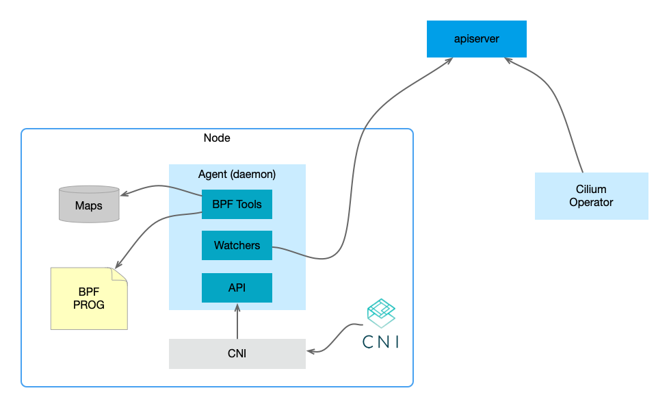
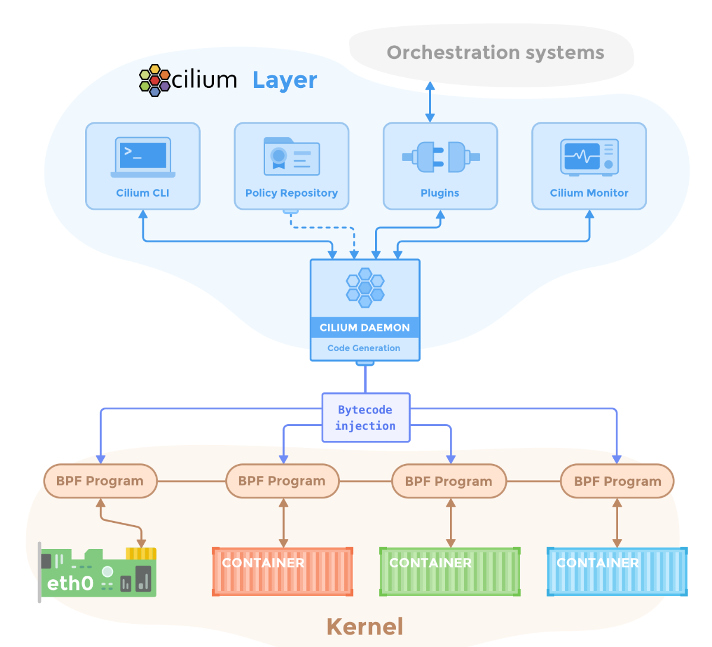

## 先立主线：云上 k8s 网络要管什么

上云之后，物理交换机、VLAN、BGP 这些手段基本用不上了，但网络问题只会更多：网段规划、ENI 配额、安全组、跨 VPC、出网、策略治理，每一项都直接决定集群能不能稳定扩容。

全文按一条主线走：**地址 → 连通（含跨 VPC）→ 入口 → 出网 → 隔离治理**。自建机房的 VLAN/VXLAN/BGP 原理保留，但只作为理解云上数据面的对照，不占主线。

### 分层地图：出了问题先找谁

| 层 | 谁负责 | 出问题先看 |
| --- | --- | --- |
| VPC 底座 | 云平台 + 公司网络组 | 子网、VPC 路由表、安全组 / ACL、NAT / EIP |
| 节点网络 | 云平台 + 运维 | 节点 ENI、安全组、MTU |
| Pod 数据面 | CNI（Terway / flannel / calico / cilium） | CNI 状态、Pod 网段、隧道 / ENI 配额 |
| Service 与入口 | kube-proxy / cilium + 云 LB + Ingress | Endpoints、DNAT、SLB 后端与健康检查 |
| 出口与 DNS | NAT / EIP + CoreDNS / PrivateZone | 出网策略、NAT 带宽、DNS 解析 |
| 隔离治理 | 安全组 + NetworkPolicy + 租户模型 | 策略是否被 CNI 支持、selector、方向 |
| 可观测 / 成本 | flow log / Hubble / 账单 | 跨 AZ 流量、NAT 处理费、LB 规格 |

出问题时按这张表从 Pod 内往外走，逐层确认，不要一上来就抓包。

### 云上的三个硬约束

先记住这三条，后面所有选型都是它们的推论：

1. **VPC 是三层网络，没有大二层**：没有广播 / 组播，VLAN、免费 ARP 探测这类玩法不可用，ARP 广播出不了 vSwitch；
2. **VPC 路由表只认"网段 → ENI / 网关"**：不能把单个 Pod IP 或 PodCIDR 指向某台节点。这是 calico BGP 模式上云失效的根本原因，云上跨节点只剩两条路——overlay 封装或 ENI 直通；
3. **地址是全局稀缺资源**：VPC、vSwitch、Pod、Service 四段地址两两不能重叠，ENI 直通模式下 Pod 直接消耗 vSwitch 地址，配额和容量必须提前算。

> 典型事故：两个集群都用了 CNI 默认的 `10.244.0.0/16`，平时各自相安无事；某天业务要用 CEN 打通，路由直接冲突，只能重建其中一个集群的网络。多集群规划时，Pod/Service 网段必须像 VPC 一样统一分配。

### VPC 名词对齐（以阿里云叫法为例）

| 云概念 | 是什么 | 对应自建机房 |
| --- | --- | --- |
| VPC | 一组隔离的虚拟网络，自带网段和路由表 | 一整套机房网络 |
| vSwitch（子网） | VPC 内按可用区切出的子网，节点网卡挂在这里 | 一个 VLAN / 网段 |
| 可用区 AZ | 同地域内电力、网络独立的机房 | 一栋机房楼 / 一个机架区 |
| 路由表 | VPC 三层路由，只认节点 / 网关 IP，不认 Pod IP | 核心交换机路由 |
| 安全组 | 挂在 ENI 上的有状态防火墙 | 物理防火墙 ACL |
| NAT 网关 + EIP | 节点 / Pod 出公网的固定出口 | 出口路由器 + 公网 IP |
| SLB / CLB | 托管负载均衡，给 apiserver / Ingress 提供固定入口 | F5 / keepalived VIP |

一句话本质：云产品就是把机房硬件（服务器、硬盘、交换机）打包成 API / 控制台可调用的资源；ECS 是 KVM 虚拟化，VPC 是虚拟化网络，同 AZ 共享底层基础设施。

云上 k8s 的典型网段规划（四层，两两不能重叠）：

```text
VPC：10.0.0.0/16                       ← 云上最大的网段，由网络组统一分配
  ├─ vSwitch-A（AZ-A）：10.0.1.0/24    ← 节点网卡从这里分 IP
  ├─ vSwitch-B（AZ-B）：10.0.2.0/24
  └─ vSwitch-C（AZ-C）：10.0.3.0/24
Pod 网段：172.20.0.0/16                ← CNI 分配，每个节点一块 /24
Service 网段：10.96.0.0/12             ← 虚拟 IP，不落在任何 vSwitch
```

跨 AZ 部署的取舍：**节点和 Pod 尽量打散到多个 AZ**，单个 AZ 故障不会带走整个集群；但跨 AZ 流量走 VPC 骨干，延迟和流量费都要计入规划。同一个 AZ 内的 ECS 共享底层机房基础设施，AZ 故障会一起挂——跨 AZ 才是云上最基础的容灾手段。

## 地址规划：云上落地第一件事

### CIDR 核心（背景快速过）

早期 IPv4 按 IP 的前几个 bit 把地址分成 A、B、C 三类，每类对应固定的默认掩码：

| 类别 | 判断规则 | 默认掩码 | 每个网络可用主机数 |
| --- | --- | --- | --- |
| A 类 | 第 1 位是 0（1~126 开头） | /8 | 1677 万+ |
| B 类 | 前 2 位是 10（128~191 开头） | /16 | 65534 |
| C 类 | 前 3 位是 110（192~223 开头） | /24 | 254 |

这种"一刀切"带来三个问题：地址大量浪费（要 300 个 IP，C 类不够、B 类一次给 6.5 万个）、子网粒度太粗（局域网只能选 /24，点对点链路也要占一整段）、路由表爆炸（C 类零散发放，一个网段一条路由）。

CIDR（Classless Inter-Domain Routing）把"类别"彻底扔掉：地址 = **网络前缀 + 主机位**，前缀长度任意（/13、/22、/27 都行）。它同时解决两个方向的问题：

- **向内拆分（VLSM）**：同一网络里允许不同长度的掩码，按需切分。一个 /24 按部门切：

| 需求 | 分配 | 可用主机数 |
| --- | --- | --- |
| 服务器区约 100 台 | 192.168.1.0/25 | 126 |
| 研发约 60 台 | 192.168.1.128/26 | 62 |
| 财务约 20 台 | 192.168.1.192/27 | 30 |
| 点对点链路 | 192.168.1.224/30 | 2 |

这样 300 个 IP 的需求，给一个 /23（510 个地址）就够了，再也不是"C 类不够、B 类浪费"二选一。

- **向外聚合**：连续且对齐的多个网段合并成一条前缀对外宣告。例如 4 个连续 /24，第三字节前 6 位相同，聚合成一条 /22：

```text
192.168.0.0/24  ─ 第三字节 000000|00 ─┐
192.168.1.0/24  ─ 第三字节 000000|01 ─┤
192.168.2.0/24  ─ 第三字节 000000|10 ─┼─→ 192.168.0.0/22 一条路由
192.168.3.0/24  ─ 第三字节 000000|11 ─┘
```

配套规则是**最长前缀匹配**：多条路由都匹配时选前缀最长（最精确）的那条，所以聚合路由和明细路由可以共存。再加上层次化地址分配（IANA → 区域注册局 → 运营商 → 企业，每层只向上宣告一条聚合路由），今天的互联网路由表才没有爆炸。

计算公式：可用主机数 = `2^(32-前缀) - 2`（减去网络地址和广播地址）。

IPv6（128 bit）生来就是无类的，习惯按 16 bit 对齐划分：

| 前缀 | 含义 |
| --- | --- |
| /128 | 单个地址 |
| /64 | 一个标准子网（前 64 位网络位、后 64 位接口标识） |
| /48 | 一个站点（含 65536 个 /64 子网） |
| /32 | 运营商一级的分配单位 |

地址多到一个 /64 就有 2^64 个地址（比整个 IPv4 还多），不需要抠着用。例如运营商给企业分 `2001:db8:1::/48`，企业内部切出 `2001:db8:1:1::/64`、`2001:db8:1:2::/64`...每个 VLAN 一个 /64；运营商再把这些客户的 /48 聚合到自己 /32 下对外宣告。

### 云上真正要规划的五段地址

| 网段 | 典型值 | 谁分配 | 规划要点 |
| --- | --- | --- | --- |
| VPC | 10.0.0.0/16 | 网络组 | 与 IDC、其他 VPC 全局不重叠，预留扩容空间 |
| vSwitch（节点） | 10.0.1.0/24 每 AZ 一个 | 网络组 | 按 AZ 切分；ENI 模式下还要给 Pod 留地址 |
| Pod CIDR | 172.20.0.0/16 | 集群 / CNI | overlay 模式独立规划；ENI 模式从 vSwitch 分配，不再单独占一段 |
| Service CIDR | 10.96.0.0/12（kubeadm 默认） | 集群 | 纯虚拟地址，不落在任何网卡；创建后不可改 |
| 链路本地 | 169.254.0.0/16 | 系统 | calico 网关、云元数据服务占用，禁止规划进业务网段 |

Pod CIDR 还会再按节点切一层：

```text
集群 Pod CIDR：10.244.0.0/16（flannel 默认）
  ├─ node1：10.244.0.0/24 → Pod IP 10.244.0.x/32
  ├─ node2：10.244.1.0/24 → Pod IP 10.244.1.x/32
  └─ ...
```

每个节点的 Pod 网段连续对齐，所以其他节点只需一条 `10.244.1.0/24 → node2` 的聚合路由，不用给每个 Pod IP 记一条。

容量怎么算：

- **overlay 模式**：Pod CIDR 容量 ≥ 节点数 × 单节点 Pod 上限，并留 30% 以上扩容余量。默认每节点 /24（254 个地址），但实际受 `max-pods`（默认 110）限制，一个 /16 最多 256 个节点子网；
- **ENI 直通模式**：Pod IP 来自 vSwitch，可用 Pod 数 ≈ 节点数 × 单节点 ENI 数 × 每 ENI 辅助 IP 数。**瓶颈通常不是网段大小，而是节点规格的 ENI/IP 配额**；
- **Service**：ClusterIP 数量远小于网段容量，/12 足够；但要注意它不能与 VPC、vSwitch、Pod 任何一段重叠，否则会出现"部分 Service 随机不通"的诡异故障。

一个实际例子：100 台节点、平均每节点 30 个 Pod、峰值 60 个。

- overlay：每节点一个 /24 就够，Pod CIDR 用 /16 可以支撑 256 个节点子网，留足余量；
- ENI 直通：假设单节点规格支持 2 张 ENI、每张 10 个可用辅助 IP（实际还要扣掉系统占用），约 20 个 Pod；100 台节点需要约 2000 个地址，一个 /20 的 vSwitch（4091 个可用地址）够用，但必须先确认**单节点 ENI / IP 配额**能撑到 20，否则加节点也扩不出 Pod。

规划顺序固定为：先定 VPC（避开 IDC 和其他 VPC）→ 按 AZ 切 vSwitch → 选 CNI 模式再定 Pod 段 → Service 段避开以上所有 → 全部登记到 IPAM / CMDB，禁止手工分配。

云上比自建机房更严格：VPC 网段往往由公司网络组定死，Pod / Service 只能在剩余空间里规划。

四个高频坑：

1. Service CIDR 创建后不可改，改只能重建集群；
2. Pod 段与 Service 段重叠，表现为"大部分正常、个别 Service 不通"，极难排查；
3. 多集群复用同一 Pod CIDR，单集群没事，一打通 CEN 就冲突；
4. ENI 模式子网切得太小，扩容时报 `InsufficientFreeAddresses`，只能换子网重建节点。

## Pod 网络：从创建到跨节点

### 创建 Pod 时，网络是怎么初始化的

网络初始化涉及三方：

| 角色 | 干什么 |
| --- | --- |
| kubelet | 监听到 Pod 调度到本节点，串联整个流程 |
| CRI（containerd） | 创建容器，先创建 Pause 沙箱 |
| CNI 插件 | 把 Pause 的网络命名空间"配好网" |

先起 Pause（infra 容器）的唯一目的是**持有 netns**：Pod 内所有业务容器加入它的 netns，共享 IP 和端口，`localhost` 直接互通；业务容器重启网络不用重配；Pause 死了才算 Pod 真死（重启 Pause 等于重启整个 Pod）。

```text
kubelet watch 到 Pod 调度到本节点
  ▼
CRI 创建 Pause 沙箱 → 得到一个空的 netns
  ▼
kubelet 读 /etc/cni/net.d/*.conflist，决定用哪个 CNI、从哪个网段分 IP
  ▼
调 CNI 插件（/opt/cni/bin/ 下的 bridge、flannel 等二进制）：
  1. 创建一对 veth
  2. 一端留在宿主机（插网桥或直接挂路由），另一端塞进 Pause 的 netns 改名 eth0
  3. IPAM 从本节点 Pod 网段分一个 IP 配到 eth0
  4. 容器内写默认路由，网关指向网桥或链路本地地址
  ▼
Pod 网络就绪 → 启动业务容器，逐个加入 Pause 的 netns
```

kubelet 自己不碰网络，只按 CNI 标准调插件——所以换 CNI 不用动 kubelet。

### 同节点：网桥还是 veth 直连

节点内部没有物理网络的事，全在宿主机内核完成，只有两种做法：

- **网桥模式（flannel 的 cni0）**：所有 Pod 的 veth 对端插进同一个 Linux 网桥，同节点互访是二层转发（查 MAC 表）。cni0 有 IP，是 Pod 的网关，节点内存在二层广播域（有 ARP）；
- **veth 直连模式（calico）**：不建网桥，每个 Pod 的 veth 对端（caliXXX）直接挂在宿主机，宿主机为每个 Pod 写一条 /32 直连路由。同节点互访是三层路由转发，没有二层广播域。

这两种在自建和云上完全一样——云上节点内部同样是宿主机内核转发，和 VPC 无关。

### 跨节点：自建集群的三条路

自建集群网络自己说了算，跨节点有三条路：

| 方案 | 对物理网络的要求 | 原理 | 代价 |
| --- | --- | --- | --- |
| VLAN 大二层 | 节点在同一广播域 | 借物理二层跑容器流量，打 VLAN tag | 不能跨三层；VLAN 只有 4094 个 |
| GRE / VXLAN 隧道 | 节点间三层可达 | 原始二层帧整体封进 IP 包 | 封装开销、MTU 缩小 |
| BGP 直接路由 | 交换机 / 路由器配合 | 把 PodCIDR 宣告给物理网络 | 需要网络设备权限 |

#### VLAN 模式：借物理二层

思路：所有节点本来就接在同一组交换机上，把容器流量打上 VLAN tag 直接在物理网里跑。

工作方式（Linux bridge + VLAN 子接口）：

1. 物理网卡上按 VLAN 划出子接口：`eth0.100`、`eth0.200`...；
2. 每个子接口挂一个网桥，一个网桥对应一个 Pod 网段；
3. 容器的 veth 插进对应网桥，流量出物理网卡时带上 VLAN tag；
4. 交换机 trunk 口放行对应 VLAN → 两个节点的同 VLAN Pod 天然二层互通。

```text
node1 Pod(网段A) ─veth→ br-A ─→ eth0.100(VLAN 100 tag) ─┐
                                                        ├─ 物理二层交换机(trunk)
node2 Pod(网段A) ─veth→ br-A ─→ eth0.100(VLAN 100 tag) ─┘
```

- 优点：零封装开销，性能最好；
- 缺点：强依赖同一广播域，跨机房直接没戏；VLAN ID 12 bit，上限 4094；二层域越大，广播风暴和 ARP 表膨胀越严重；
- 适合：物理网络完全自己掌控的小规模集群。

#### GRE / VXLAN 模式：借物理三层

物理节点之间只要三层可达，就把 Pod 发出的**原始二层帧整体打包**，套一个新 IP 头，经物理三层网络传输，到对端拆包还原。封包 / 拆包由宿主机内核的隧道模块完成，容器无感知。

| | GRE | VXLAN |
| --- | --- | --- |
| 封装格式 | 新 IP 头 + GRE 头 + 原始二层帧 | 新 IP 头 + UDP 头 + VXLAN 头 + 原始二层帧 |
| 隔离标识 | 按 key 区分 | 24 bit VNI，约 1677 万 |
| 额外开销 | 约 24 字节 | 约 50 字节（Pod MTU 常见 1450） |
| 现状 | 较老，生产少用 | 主流（flannel、calico 的 VXLAN 模式都用它） |

跨节点通信时，Pod 的原始二层帧在宿主机上的 **VTEP**（VXLAN 隧道端点，flannel 里就是 flannel.1 设备）被封装成"节点 IP + UDP 4789 + VXLAN 头 + 原始帧"，经物理网络送到对端节点，再由对端 VTEP 解封装、交给本节点网桥送到目标 Pod。封解包都在内核里完成，Pod 完全无感知。外层用 UDP 是为了穿透性好：UDP 普遍被防火墙 / NAT 放行，而 IPIP（协议号 4）常被中间设备丢弃。

flanneld 会把"Pod 网段 → 对端 VTEP → 真实节点 IP"的映射写进内核。其中 ARP 是静态写死的：如果让内核自己发 ARP 广播，overlay 会把广播头端复制给所有 VTEP，节点一多就放大成广播风暴。

新节点加入时，controller-manager 从 Pod CIDR 切一个 /24 给新节点，各节点 flanneld 在 FDB 里加一条"新节点网段 → 新节点 IP"，自动互通。**加节点 = 分一个 /24 + 各节点 FDB 加一条，不需要手动布线。**

VXLAN 的优缺点：

**优点：**

- **对物理网络零要求**：封装后就是普通 UDP 包，节点间三层可达即可，跨机房、跨 VPC 都能跑——这是 overlay 方案通吃各种环境的根本原因；
- **隔离规模大**：24 bit VNI 理论上支持约 1677 万个虚拟网络，远超 VLAN 的 4094；
- **内核原生、生态成熟**：Linux 内核自带 VXLAN 模块，flannel / calico 都以它为主流方案，不需要改造物理交换机。

**缺点：**

- **封装开销大**：外层头约 50 字节，封装 / 解封装消耗内核 CPU，每次跨节点转发都要"套壳 / 拆壳"；
- **MTU 被迫缩小**：Pod 的 MTU 常见只能设 1450，大包传输效率下降；
- **广播被放大**：BUM 流量（广播 / 未知单播 / 组播）靠头端复制群发给所有 VTEP，节点一多，流量随节点数平方级膨胀；
- **排障更难**：中间物理设备只看得见外层 IP，抓包看到的是隧道流量，Pod 真实报文被"藏"了一层。

> VNI 在 k8s 集群里默认是 1：集群内所有 Pod 本来就在同一个扁平网络，不需要用不同 VNI 区分租户。多租户隔离是 NetworkPolicy 或独立集群要解决的问题，不是 VXLAN 的默认职责。

## 云上跨节点：只有两条路

上了云，判断标准只有一个：**VPC 会不会替一个独立的 PodCIDR 维护路由**。不会。所以只剩两条路：把 Pod 包封成节点 IP（overlay），或者让 Pod IP 直接落在 VPC 子网里（ENI 直通）。

先看自建和云上的本质差别：

| 维度 | 自建集群 | 云上集群（VPC） |
| --- | --- | --- |
| 底层网络 | 自己的交换机 / 路由器，可以让物理网络认识 Pod 网段 | 租来的 VPC，路由表只认"网段 → ENI / 网关" |
| 默认跨节点方案 | BGP 直达或隧道，自己选 | 只能 overlay 封装或 ENI 直通 |
| 想要无封装 | 交换机开 BGP，或规划大二层 | 只能用 ENI 直通，消耗 VPC 地址和 ENI 配额 |
| 跨故障域 | 跨机房要自己拉专线、配路由 | 跨 AZ 默认走 VPC 骨干，跨 VPC 才要 Peering / CEN |
| 排障能看到什么 | VXLAN 外层、物理链路都能抓 | 只能看到节点 ENI 上的流量，VPC 内部不可见 |

### 路线一：overlay 封装（最通用）

Pod 包封在"节点 IP → 节点 IP"的隧道里，VPC 路由表只看到节点 IP。flannel VXLAN、calico IP-in-IP / VXLAN、cilium tunnel 模式都是这个思路。

- 任何 VPC 都能跑，不依赖云厂商能力；
- 跨 VPC 时只要节点 IP 互通即可，对端 VPC 不需要认识 Pod 网段；
- 代价是封装开销和 MTU 缩小（VXLAN 后 Pod 网卡通常 1450，IP-in-IP 通常 1480）。

### 路线二：ENI 直通（性能最好）

ENI（弹性网卡）是云上挂载到实例的虚拟网卡，有独立 MAC、IP，可以绑安全组。直通模式下 Pod 直接使用 ENI 或其辅助 IP，**Pod IP 就是 VPC 地址**：

- 跨节点走 VPC 原生路由，无封装、无 MTU 损失，性能最好；
- 可以给 Pod 绑独立安全组（Terway、AWS Security Groups for Pods），隔离粒度比 overlay 细；
- 代价一：Pod IP 直接消耗 vSwitch 地址，子网必须留够；
- 代价二：受单节点 ENI 数量和辅助 IP 配额限制，**单节点 Pod 上限由实例规格决定，不是 `max-pods` 说了算**；
- 代价三：Pod 生命周期频繁创建 / 销毁时，IP 回收和 ENI 挂载有延迟，扩容可能卡在 IP 不足。

```text
overlay：Pod 包 = [节点IP][隧道头][Pod包]   ← VPC 只路由外层节点 IP
ENI 直通：Pod 包 = [Pod IP 就是 VPC IP]      ← VPC 原生路由，无封装
```

### 两种模式对比

| 维度 | overlay | ENI 直通 |
| --- | --- | --- |
| Pod IP 来源 | 独立的 Pod CIDR | vSwitch 子网 |
| 跨节点路径 | 隧道封装，VPC 不感知 Pod IP | VPC 原生路由 |
| 性能 | 有封装开销，MTU 1450 / 1480 | 无封装，MTU 1500 |
| 地址消耗 | 只吃 Pod CIDR | 吃 vSwitch 地址，受子网大小限制 |
| 单节点 Pod 上限 | `max-pods`（默认 110） | 实例规格的 ENI / IP 配额 |
| 隔离粒度 | 节点安全组 + NetworkPolicy | 可到 Pod 级安全组（视云厂商） |
| 排障 | 多一层隧道，要看 FDB / 路由 | 直接看 ENI、安全组、VPC 路由 |
| 适用 | 通用、跨云、跨 VPC | 性能敏感、Pod 级安全组、大规模 |

选型建议：**默认从 overlay 起步**，简单、可移植；当出现"封装开销扛不住、需要 Pod 级安全组、单集群规模很大"时再评估 ENI 直通。部分云厂商 CNI 支持两种模式混合（普通 Pod 走 overlay，特定业务走 ENI），落地前先确认配额和子网容量。

### BGP 为什么在云上跑不起来

自建机房最优雅的方案是 BGP：节点把 PodCIDR 宣告给交换机，物理网络直接路由，零封装。云上不行，原因不是技术不会配，而是 VPC 的产品模型不允许：

1. **VPC 路由表只接受"网段 → ENI / 网关"**，不能把 PodCIDR 指向某台节点；
2. **租户隔离**：PodCIDR 是节点内部的自定义网段，如果允许用户随便写进 VPC 路由，可能打破 VPC 的隔离边界；
3. **路由条目数量**：所有集群的所有 Pod 网段都写进 VPC 路由表，规模上不可接受。

所以 calico 上云一般退化成 IP-in-IP 或 VXLAN；想无封装，只能用云厂商的 ENI 直通。

## 云上节点网络：VPC 已经做了一半

云上节点就是 VPC 里的普通云主机，节点间通信不归 CNI 管，但安全组默认会拦。同 VPC 内不同 vSwitch、不同 AZ 默认三层互通：VPC 系统路由表自带整个 VPC 网段的 local 路由，节点网卡只需要一条指向 vSwitch 网关的默认路由。

最小放行集合：

| 端口 / 协议 | 用途 | 说明 |
| --- | --- | --- |
| 10250/TCP | kubelet API | apiserver 反连 exec / logs / metrics |
| 2379-2380/TCP | etcd | 仅自建控制面；托管集群不需要 |
| 6443/TCP | apiserver | 仅自建控制面；托管集群走云厂商 ENI |
| 4789/UDP | VXLAN | overlay 模式的节点间隧道 |
| IP 协议号 4 | IP-in-IP | calico IP-in-IP；安全组默认常丢弃 |
| 179/TCP | BGP | 云上一般用不到 |
| 53/UDP + TCP | DNS | NodeLocal DNSCache、节点侧解析需要 |

跨 AZ 默认走 VPC 骨干，延迟通常在毫秒级，etcd 跨 AZ 一般没问题；对延迟极敏感的场景再考虑同 AZ 优先。节点间不通，先查安全组入方向，再查网络 ACL（无状态，双向都要配）。

## 云上 CNI 选型

### flannel：能用，但生产在退场

- flannel 是基于 CNI 的 k8s 网络插件，给每个节点分配一个 Pod 网段，并把节点间的 Pod 流量打通；
- 只做转发，不做策略：**原生不支持 NetworkPolicy**，写了也不生效；
- 默认 VXLAN，节点级 /24，静态 ARP + FDB，原理简单、排障直观；
- 适合学习、小集群、对策略无要求的场景；中大型生产一般不会只用它。

### calico：策略引擎是云上的真正价值

calico 的 BGP 模式是自建机房的性能王者，但云上基本用不了（原因见上）。云上落地通常是 IP-in-IP 或 VXLAN 模式，**真正值钱的是它的 NetworkPolicy 引擎**——Felix 把策略翻译成 iptables 链 + ipset，成熟、稳定、覆盖标准 NetworkPolicy 全部语义。

#### BGP 模式（自建场景）

核心组件（每个节点都跑）：

| 组件 | 角色 |
| --- | --- |
| Felix | 每节点 agent，把 Pod 路由、ACL 写进内核（路由表、iptables / ipset） |
| BIRD | 每节点 BGP 客户端，宣告本节点 Pod 网段、接收别人的路由 |
| datastore | 只存配置、IPAM、策略等元数据，不参与转发 |

工作方式：Felix 把本节点的 Pod 路由和策略写进内核；BIRD 通过 BGP 把本节点 Pod 网段宣告给邻居，也接收别人的路由。节点之间直接对等交换，转发时只查本地路由表，不查 etcd。小规模用全互联 mesh（连接数按平方增长，O(n²)），大规模用路由反射器 RR（连接数降到 O(n)）。这套方案无隧道封装、性能好，但要求节点间三层可达，跨三层 / 云 VPC 必须退回隧道。

#### IP-in-IP 模式（云上常见）

外层再套一个 IP 头，协议号 4，没有 UDP、没有 VXLAN 头，比 VXLAN 轻量。它的路由同样由 BGP 学习——节点之间宣告 Pod 网段，只是转发时多套一个 IP 头。两种策略：

- `always`：全程封装，最稳；
- `cross-subnet`：同网段发裸包、跨网段才封装——在 VPC 上会直接不通，因为裸包要求 VPC 认识 PodCIDR，而 VPC 不允许。

以 `always` 为例：Pod 包到宿主机后，由 `tunl0` 设备在外面再套一个节点 IP 头（协议号 4），经物理网络送到对端节点，对端 `tunl0` 解封装后按 /32 路由送到 Pod。没有 UDP、没有 VXLAN 头，也没有 VNI，所以做不了多租户隔离；云上安全组默认常丢弃协议号 4，必须显式放行；MTU 一般 1480。

#### calico 的优缺点

- 优点：策略成熟；IP-in-IP 比 VXLAN 轻；BGP 模式在自建环境零封装、性能最好；
- 缺点：BGP 强依赖物理网络配合，云上退化；全互联规模受限；IP-in-IP 协议号 4 常被安全组默认丢弃；排障要懂 BGP / 路由，门槛高。

### cilium：eBPF 数据面，云上可观测性最好

cilium 换了一个玩法：数据面不用内核现成的 iptables / 路由，而是由 Agent 现场生成 eBPF 程序注入内核。

eBPF 是内核里的一台**字节码虚拟机**：程序经校验后加载进内核，挂到网络栈的固定钩子（收包、发包、socket 层）上执行，可以在内核态完成过滤、转发、改写、监控——不用改内核源码、不用写内核模块。传统 CNI 是"用内核已有的模块拼装转发逻辑"，cilium 是"把需求编译成专属程序，让内核现学现卖"。



| 组件 | 位置 | 职责 |
| --- | --- | --- |
| cilium-agent | 每节点 DaemonSet | watch apiserver，把 Pod / Service / 策略编译成 BPF 程序和 Map |
| Cilium Operator | 集群级 | 分配 PodCIDR、处理节点事件，不参与转发 |
| CNI 插件 | 每节点 | kubelet 调它配网，向 Agent 要 IP、注册 Endpoint |
| Hubble | 附加组件 | 实时流量、策略命中 / 丢弃原因，相当于 eBPF 的行车记录仪 |

两个核心抽象：

- **Endpoint**：一个 Pod 的 netns，veth 两端都挂 BPF 程序，进出 Pod 的第一站就是 cilium；
- **Identity**：把 Pod 标签哈希成 16 位身份，策略写"允许 prod-frontend"，不写 IP——Pod 重建、IP 变了策略照旧生效。

数据怎么走（Pod A node1 → Pod B node2）：



```text
Pod A eth0
  ▼ veth 出端 lxc-xxx 的 eBPF 程序
  │ 查 endpoint map：目的 IP → Pod B 的 identity
  │ 查 policy map：源 identity → 目的 identity 是否放行（L3/L4 决策）
  ▼ node1 路由：下一跳 node2（native routing 或 VXLAN 隧道）
  ▼
node2 入站：lxc-yyy 的 eBPF 程序再做一次策略检查 → 直送 Pod B
```

和 flannel / calico 的差异：

| | flannel | calico | cilium |
| --- | --- | --- | --- |
| 数据面 | 内核 vxlan 模块 | 内核路由表 | **eBPF 程序 + BPF Map** |
| Service 转发 | kube-proxy iptables | kube-proxy iptables / ipvs | **自己用 eBPF 做 DNAT，替代 kube-proxy** |
| 策略执行 | 无 | iptables 链（O(n)） | **BPF Map 哈希查找（O(1)）** |
| L7 能力 | 无 | 无 | 有（socket 层 hook，可看 HTTP 语义） |

Service 这一层也一样：Cilium 连劫持规则都不写，ClusterIP 只是 BPF Map 里的一个 key，既不需要 kube-ipvs0，也没有 KUBE 规则链。

- 优点：大规模下延迟稳定；身份制策略；Hubble 可观测性强；可替代 kube-proxy；
- 缺点：内核要求 4.19+（高级特性要 5.x）；eBPF / identity 一套新心智模型；小集群收益不明显；
- 云上：支持 tunnel 和 native routing（配合 ENI 直通），GKE Dataplane V2 就是 cilium 内核。

趋势上 cilium 是明确的下一代方向（eBPF 数据面也被各家吸收），但落地前先确认内核版本和团队学习成本。

### 云厂商 CNI：省事，但绑定云

| CNI | 云 | 模式 | 特点 |
| --- | --- | --- | --- |
| Terway | 阿里云 | ENI 直通 / 混合 | Pod 用 ENI 或辅助 IP，支持 NetworkPolicy，性能好 |
| VPC CNI | AWS | ENI 辅助 IP | Pod IP 即 VPC IP，配合 Security Groups for Pods |
| Azure CNI | Azure | 子网直通 / overlay | 与 Azure 网络深度集成 |
| GKE Dataplane V2 | GCP | eBPF（cilium） | 托管 kube-proxy 替代与可观测性 |

选型一句话：**要可移植、要自建也能跑 → calico；要极致性能和可观测、团队能吃下 eBPF → cilium；已经在某朵云上、追求省心和网络性能 → 云厂商 CNI；只想快速跑起来 → flannel，但别指望策略。**

> 无论选哪个，MTU 都要单独确认：VPC 底层一般 1500，VXLAN 后 Pod 设 1450，IP-in-IP 后设 1480，ENI 直通保持 1500。配错的典型症状是**小请求正常、大文件或 TLS 握手卡死**。

## Service 与南北向入口

### 先分清：内核原生 vs 用户态

数据面真正干转发 / 封装的是内核原生能力：VXLAN、IP-in-IP、veth、网桥、路由表、FDB、ARP 表、iptables、IPVS，都是内核模块或内核网络栈的一部分。

控制面跑在用户态：BGP 协议本身内核不认识，是 BIRD / gobgp 算好路由再写进内核；flanneld、calico、cilium-agent、kube-proxy 也都是用户态进程，负责把期望状态翻译成内核表项，自己不转发包。

分清这条线，排障时就知道该看"内核表"还是"用户态进程日志"。

### Service 的本质：一个从不落在网卡上的虚拟地址

ClusterIP 不属于任何网卡、任何主机，它只是"被劫持的目的地址"。三种实现，同一个本质：

| 实现 | 存放位置 | 查找复杂度 | 说明 |
| --- | --- | --- | --- |
| iptables | KUBE-SERVICES 等规则链 | O(n)，逐条匹配 | Service 多了规则爆炸，每个新连接首包都要遍历 |
| IPVS | 内核哈希表 + kube-ipvs0 哑网卡 | O(1) | 支持 rr / lc / sh 等 10+ 调度算法 |
| cilium eBPF | BPF Map | O(1) | socket 层 `connect()` 时改写，包还没发出去就完成 DNAT |

iptables 模式下，每个新连接的首包都要从 `KUBE-SERVICES` 链第 1 条开始逐条匹配，复杂度 O(n)；Service 一多规则就爆炸（1000 个 Service × 10 个后端 ≈ 上万条规则），负载均衡也只有随机概率一种。

IPVS 换成内核哈希表：每个 Service 是一个虚拟服务，每个后端是一个 real server，按 `ClusterIP:Port` 哈希直接命中，O(1)；调度算法有 rr（轮询）、lc（最少连接）、sh（源地址哈希）等 10+ 种。**DNAT 只发生在连接的第一个包**，后续包和回包靠 conntrack 转换；SNAT、filter、NetworkPolicy 仍靠 iptables。`ipvsadm` 和 kube-proxy 只是用户态工具，真正干活的是内核的 `ip_vs`、`ip_vs_rr`、`nf_conntrack` 等模块。

kube-proxy 和 CNI 是两个独立层次：把 calico 换成 flannel VXLAN，IPVS 的 DNAT 逻辑一字不变，只是"DNAT 之后怎么送到后端"从 BGP 直路由变成走隧道。

### 云上暴露服务：NodePort、LoadBalancer 与 Ingress

| 方式 | 入口 | 适用 | 关键点 |
| --- | --- | --- | --- |
| ClusterIP | 集群内 | 服务间调用 | 跨集群不可达 |
| NodePort | 节点 IP:30000-32767 | 临时调试、自建 LB 后端 | 端口范围固定，暴露面大，生产少用 |
| LoadBalancer | 云 SLB / CLB / NLB | 生产南北向入口 | 每个 Service 一个 LB，数量和费用要控制 |
| Ingress / Gateway | 一个 LB + 七层路由 | 多域名、多服务共享入口 | TLS 卸载、限流、WAF 都在这一层 |

**externalTrafficPolicy** 是云上最容易踩的坑：

- `Cluster`（默认）：流量到任意节点都能转发到后端，但跨节点转发时会做 SNAT，**后端通常看不到真实客户端 IP**，且多一跳；
- `Local`：只转发给本节点 Pod，保留源 IP，但节点间负载可能不均，且需要健康检查配合；
- 需要真实源 IP（风控、审计、白名单）就选 `Local`，同时让 LB 的健康检查指向节点端口。

其他云上约束：

- LB 后端数量、监听端口数有配额，Service 数量多时优先收敛到 Ingress；
- 跨 AZ 的 LB 流量可能产生跨 AZ 流量费，入口层尽量同 AZ 或确认 LB 的跨 AZ 行为；
- 云 LB 健康检查失败先看安全组是否放行健康检查网段，再看 `targetPort` 和 readiness。

### ClusterIP 不能跨集群

Service 虚拟 IP 只在本集群的 kube-proxy / eBPF 里有意义，对端集群不认。跨集群服务调用只有三条路：走 Ingress / 公网 / 专线到具体 Pod；用 Submariner 这类多集群方案打通 Service；或者在上层做服务发现（DNS / 服务网格）。

## 跨 VPC 与混合云组网

两个 VPC 默认完全隔离，即使网段不冲突也不通。这一节先把术语解释清楚，再看 k8s 怎么落地。

### 术语解释

- **VPC**：云上隔离的虚拟网络，自带网段、路由表、安全组。VPC 之间默认互不相通，跨 VPC 必须显式打通。
- **对等连接（Peering）**：把两个 VPC 点对点接起来。两端都要在各自的路由表里加一条"对方网段 → 对等连接"的路由，流量只在这两个 VPC 之间走。
- **路由传递（Transitive Routing）**：A 连 B、B 连 C，A 能不能自动到 C？Peering 不支持，必须 A-C 再建一条；CEN / Transit Gateway 支持，因为它是一个中心网关，路由会向所有接入者传播。
- **CEN（Cloud Enterprise Network）/ Transit Gateway**：企业级中心网关。所有 VPC、IDC（自建机房）、其他云都接到这个中心，由它统一转发和传播路由，适合多 VPC、多地域的 hub-spoke（一个中心 hub 连接多个分支 spoke）组网。
- **VPN 网关**：在公网上建一条 IPsec（一种标准的加密隧道协议）加密隧道，把 VPC 和 IDC / 另一个云连起来。开通快、成本低，但走公网，延迟和抖动不可控。
- **专线（Direct Connect / Express Connect）**：从机房拉一条物理线路接到云上，不走公网。带宽大、延迟低、稳定，但价格高、开通周期长。
- **回程路由**：请求包从 A 到 B、响应包从 B 回 A，是两条独立的路由。只配了去程、没配回程，表现就是"请求能过去、响应回不来"。
- **网段重叠**：两个 VPC 用了相同 CIDR（比如都用了 `10.0.0.0/16`）。Peering 会直接拒绝；即使 CEN 打通，相同地址也无法判断该往哪边送。
- **带宽包 / 流量费**：Peering、CEN、VPN、专线通常按带宽或流量计费，跨地域、跨 AZ 流量可能单独收费。

一个例子：VPC-A 连 VPC-B、VPC-B 连 VPC-C。Peering 下 A 访问不了 C，必须在 A-C 之间再建一条；CEN 下三者都接入中心，路由自动打通。

### 三条打通路径怎么选

| 方式 | 本质 | 适用 | 代价 |
| --- | --- | --- | --- |
| 对等连接 Peering | 两个 VPC 点对点互联，各自加路由 | 少量 VPC 两两互联 | 不支持路由传递；网段不能重叠；VPC 多了连接数按平方增长（O(n²)） |
| CEN / Transit Gateway | 所有 VPC、IDC 接到中心网关，路由自动传播 | 多 VPC、多地域、混合云 | 按流量计费；要规划路由策略，避免环路 |
| VPN / 专线 | 加密隧道或物理专线连 IDC / 另一个云 | 混合云、跨云 | VPN 受公网质量影响；专线贵、开通慢 |

一句话：**两个 VPC 用 Peering，三个以上用 CEN，连机房用 VPN 或专线。**

### 对 k8s 的三个关键点

1. **网段不能重叠是硬约束**：两个集群的 Pod CIDR、Service CIDR、节点网段都要全局唯一。Peering 会直接拒绝重叠网段；即使 CEN 打通，重叠地址也没法路由。这是多集群组网规划的第一件事；
2. **overlay 模式：跨 VPC 通的是节点 IP**：Pod 包封在"节点 IP → 节点 IP"的隧道里，外层是节点的 VPC 地址。只要节点 IP 跨 VPC 可达（Peering / CEN + 两端路由表 + 安全组放行 4789/UDP），Pod 就能通；对端 VPC 不需要认识 Pod 网段；
3. **ENI 模式：Pod IP 就是 VPC 地址**：跨 VPC 时对端路由表必须有回程路由指向 Pod 所在子网，否则请求能过去、响应回不来；Pod IP 消耗 vSwitch 地址，子网要预留够大。

多集群规划建议：每个集群分配独立的 Pod / Service 段（例如按环境、地域、集群编号切分），统一登记；不要把 CNI 默认网段直接用于生产；CEN 打通前先做一次全局网段冲突扫描。

## 出网与 DNS：最容易被忽略的治理面

### Pod 怎么访问公网

节点默认没有公网 IP，Pod 出公网的标准路径是 **Pod → 节点 → NAT 网关 → EIP**：

- NAT 网关做 SNAT，所有 Pod 共享出口 IP，适合拉镜像、调外部 API；
- 给每个节点绑 EIP 既增加暴露面又浪费地址，不推荐；给 Pod 直接绑 EIP 更不要做；
- 需要固定出口做白名单时，用 NAT 网关的 EIP + 出口白名单，不要用节点 EIP；
- NAT 网关按流量和处理能力计费，大流量拉镜像 / 备份会明显推高账单，能走 VPC 端点就走端点。

**拉镜像**是最典型的出网场景：优先用云厂商的容器镜像服务 VPC 端点（PrivateLink / endpoint），流量不出 VPC、不走 NAT、不花公网流量费；跨境拉镜像再考虑加速器。

### DNS 治理

- CoreDNS 是集群内 DNS 入口，Service 发现、外部域名解析都经过它；
- `ndots:5` 会让短域名先尝试多个 search 域，产生大量无效查询，跨集群 / 外部域名场景要评估调小；
- 大规模集群建议上 **NodeLocal DNSCache**，把 DNS 查询拦在节点本地，降低 CoreDNS 压力和解析延迟；
- 云上内部域名（RDS、OSS、中间件）用 PrivateZone 解析，不要写死 IP；
- 出网策略收紧后，**第一件事是放行 DNS**（UDP/TCP 53），否则域名解析和所有外部调用一起挂。

出网治理清单：固定出口 IP、出口白名单、禁止 Pod 绑 EIP、镜像走 VPC 端点、DNS 统一走 CoreDNS / PrivateZone、每月审计一次出网域名和流量。

## 网络治理：四层模型

云上网络治理不是"写几条 NetworkPolicy"就完了，而是四层各管一段：

| 层 | 手段 | 作用范围 | 状态 | 谁维护 |
| --- | --- | --- | --- | --- |
| 云边界 | 安全组 / 网络 ACL | ENI / 子网 | 安全组有状态，ACL 无状态 | 云平台 / 运维 |
| Pod 东西向 | NetworkPolicy | Pod | 白名单，只有 allow | 应用 / 平台 |
| 七层 | Ingress / 服务网格 / WAF | 应用流量 | L7 规则 | 平台 / 安全 |
| 租户 | namespace + 配额 + 独立集群 / VPC | 租户 | - | 平台 |

### 安全组与 NetworkPolicy 的分工

这是云上最容易混淆的一对概念：

| | 安全组 | NetworkPolicy |
| --- | --- | --- |
| 绑在哪 | ENI / 节点网卡 | Pod |
| 谁能管 | 云平台控制台 / IaC | k8s API |
| 能力 | L3/L4，有状态，可引用其他安全组 | L3/L4 白名单，只有 allow |
| overlay 模式 | Pod 继承节点安全组 | 按 Pod 标签精细控制 |
| ENI 模式 | 可给 Pod 绑独立安全组（视云厂商） | 同样生效，两者串联 |

一个包要**同时**通过安全组和 NetworkPolicy 才能到达 Pod：安全组管"谁能进这张网卡"，NetworkPolicy 管"哪个 Pod 能访问哪个 Pod"。排障时先看安全组（连接超时、ICMP 通但 TCP 不通，优先怀疑安全组），再看策略。

网络 ACL 是无状态的：放行入方向不代表放行回程，必须双向都配，生产上很容易在这里漏掉临时端口。

### NetworkPolicy 的四条关键语义

| 语义 | 说明 |
| --- | --- |
| 没有策略 = 全通 | 只有被策略 `podSelector` 选中的 Pod 才受限；一旦被某条 Ingress 策略选中，入站就变成"默认拒绝，只放开规则里写的" |
| 只能 allow，没有 deny | 多条策略选中同一 Pod 时取并集。"拒绝"只能靠不写 allow 实现——所以落地顺序永远是先铺"默认拒绝"的伞 |
| namespaceSelector 匹配标签，不是名字 | 1.21+ 每个 namespace 自动带 `kubernetes.io/metadata.name=<名字>`；`namespaceSelector: {}` 匹配所有 namespace（含 kube-system） |
| 同一 from 元素内 AND，多个元素 OR | `namespaceSelector` + `podSelector` 写在同一个 `from` 元素里 = "那个 ns 里带这个标签的 Pod"；拆成两个元素 = 两种来源都放行。这是最高频的配置事故 |

还有一个联动点：**策略检查的是 DNAT 之后的真实 Pod IP**。`ipBlock` 里写 ClusterIP 网段没有意义（那个网段里根本没有地址），要写后端 Pod 的 CIDR，或者直接用 `podSelector`。

### 落地顺序：先关门，再开窗

1. **划分 namespace + 定标签规范**：`app`、`tier`、`owner` 三个标签先统一，后面所有策略都依赖它；
2. **每个 namespace 先上默认拒绝入站**（生产环境建议连出站一起拒绝）；
3. **放行 DNS**：出站一收紧，第一个挂的就是域名解析；
4. **按业务逐条放行**：数据库只允许 API 访问、监控只允许 Prometheus 抓取；
5. **验证 + 观察**：selector 反查、实测连通性、看策略丢弃日志，确认没有"选不中"的假策略。

```yaml
# ① 基座：namespace 默认拒绝入站
apiVersion: networking.k8s.io/v1
kind: NetworkPolicy
metadata:
  name: default-deny-ingress
  namespace: prod
spec:
  podSelector: {}
  policyTypes: [Ingress]
---
# ② 跨 namespace：只放行 frontend 里带 app=web 的 Pod 访问 api:8080
apiVersion: networking.k8s.io/v1
kind: NetworkPolicy
metadata:
  name: api-allow-frontend
  namespace: prod
spec:
  podSelector:
    matchLabels: {app: api}
  policyTypes: [Ingress]
  ingress:
    - from:
        - namespaceSelector:
            matchLabels:
              kubernetes.io/metadata.name: frontend   # 同一元素 = AND
          podSelector:
            matchLabels: {app: web}
      ports:
        - protocol: TCP
          port: 8080
---
# ③ 出站白名单：DNS 必须第一个放行
apiVersion: networking.k8s.io/v1
kind: NetworkPolicy
metadata:
  name: api-egress
  namespace: prod
spec:
  podSelector:
    matchLabels: {app: api}
  policyTypes: [Egress]
  egress:
    - to:
        - namespaceSelector:
            matchLabels:
              kubernetes.io/metadata.name: kube-system
          podSelector:
            matchLabels: {k8s-app: kube-dns}
      ports:
        - protocol: UDP
          port: 53
        - protocol: TCP
          port: 53
    - to:
        - podSelector:
            matchLabels: {app: postgres}
    - to:
        - ipBlock:
            cidr: 10.20.0.0/16
            except: [10.20.5.0/24]
```

另外两类高频策略：**同 namespace 互访**——`podSelector: {}` 选中本 ns 所有 Pod，`from` 里只写一个 `podSelector: {}`，就等于"只允许本 namespace 内任意 Pod 进来"，数据库最典型；**监控抓取**——只允许 monitoring 命名空间里 `app=prometheus` 的 Pod 访问业务暴露 metrics 的端口。数据库则是"只允许 `app=api` 访问 `app=postgres` 的 5432"。套路一致，不再重复贴 YAML。

`ipBlock` 的硬限制：**它是静态 CIDR，不认 DNS 解析结果**。要按域名放行（对象存储、第三方 API），标准 NetworkPolicy 做不到，只有 CiliumNetworkPolicy 的 `toFQDNs` 能。

### 验证：别只看 "apply 成功"

`kubectl apply` 成功只代表对象存进了 etcd，不代表生效。三层验证：先用策略里的 selector 反查，确认选中了预期的 Pod（选不中 = 策略悄悄失效）；再从另一个 Pod 实测连通性；Cilium 环境直接看 Hubble 的 DROPPED 事件，能告诉你哪条策略、什么原因。

### 常见坑

| 坑 | 现象 | 原因 |
| --- | --- | --- |
| CNI 不支持策略 | apply 成功，一切照旧全通 | flannel 只做转发不做策略，要有 calico / cilium 这类策略引擎 |
| selector 选不中 | 策略"看起来"没生效 | 标签写错 → 选中 0 个 Pod → 策略等于不存在，而且不会报错 |
| 限制 Egress 后 DNS 全挂 | 域名访问超时，IP 直连正常 | 忘了放行 kube-dns 的 UDP / TCP 53 |
| 跨 ns 的 AND 写成 OR | 放行了整个 namespace，比预期宽 | `namespaceSelector` 和 `podSelector` 拆成了两个 `from` 元素 |
| `policyTypes` 省略 | Egress 没被限制住 | 不写 `policyTypes` 时，只有出现 `egress` 规则才启用 Egress；要"默认拒绝出站"必须显式写 `policyTypes: [Egress]` 且不给规则 |
| 来源 IP 对不上 | `ipBlock` 规则匹配不到 | NodePort / LB 默认 `externalTrafficPolicy: Cluster`，源地址被 SNAT 成节点 IP；改 `Local` 才保留真实源 IP |
| kubelet 探针被误杀 | Pod 一直 NotReady，事件里 probe 超时 | 探针从节点 IP 发起，部分 CNI 的 default-deny 会挡住；视实现决定是否放行节点 CIDR |
| hostNetwork Pod 逃逸 | 宿主机网络的 Pod 不受策略约束 | 标准 NetworkPolicy 只作用于 Pod 网络，host 侧要 CNI 的 host firewall 能力 |

### Cilium 的扩展：只记两条

- **按 identity 匹配**：策略选中标签而非 IP，Pod 重建、IP 变了照旧生效；
- **按域名出站（`toFQDNs`）**：Agent 通过 DNS 代理把解析结果动态映射成 IP 集合，解决"对象存储 IP 天天变"的问题。

L7 策略（按 HTTP 方法 / 路径放行）Cilium 也支持，但要把流量转给节点上的 Envoy 校验，有性能和排障成本——生产里 L7 治理通常交给服务网格（Istio / Linkerd），Cilium 只做 L3/L4 兜底。

### 多租户：软隔离与硬隔离

| 模型 | 隔离手段 | 强度 | 成本 | 适用 |
| --- | --- | --- | --- | --- |
| 共享集群 + namespace | RBAC + ResourceQuota + NetworkPolicy | 软 | 低 | 内部团队、互信业务 |
| 共享集群 + 独立节点池 | 污点 / 亲和 + 节点安全组 + NP | 中 | 中 | 业务线之间 |
| 独立集群 | 独立控制面、独立 CNI、独立网段 | 强 | 高 | 合规、高风险业务 |
| 独立 VPC | VPC 级网络隔离 | 最强 | 最高 | 对外 SaaS、强监管 |

共享集群的软隔离有几个天然缺口：hostNetwork / privileged Pod 可以绕过 NetworkPolicy；CNI、kubelet、容器运行时是共享攻击面；节点故障会影响所有租户。**能接受这些缺口就用 namespace + NP，接受不了就上独立集群或独立 VPC，不要指望策略能补上架构级的隔离。**

### 容量与配额治理

云上网络故障很大一部分不是"配错了"，而是"配额到了"：

- **ENI / IP 配额**：单节点 ENI 数、每 ENI 辅助 IP 数、vSwitch 剩余地址，任意一个到顶都会导致 Pod Pending；
- **LB / EIP / NAT 配额**：Service 类型 LoadBalancer 每个占一个实例，数量要提前申请；
- **conntrack 容量**：`nf_conntrack_count / nf_conntrack_max` 到 80% 要告警，满了表现为"新建连接随机失败"；
- **策略规模**：calico 的 ipset、cilium 的 BPF Map 都有内存上限，几千条策略要评估节点内存。

监控四件事：vSwitch IP 使用率、ENI 分配失败次数、conntrack 使用率、NAT 连接数与带宽。

### 可观测与成本

- **VPC flow log**：看 ENI 层面的 accept / reject，overlay 模式下看不到 Pod IP；
- **Hubble / cilium monitor**：看 Pod 级流量和策略裁决，排障效率最高；
- **SLB 访问日志**：看状态码、后端响应时间、健康检查；
- **成本**：跨 AZ 流量、NAT 处理费、LB 规格、flow log 存储，四项最容易在账单上失控。


## 速查：几个容易混的概念

- **veth 对**：纯软件模拟的网线，两端各在一个 netns。Pod 有自己的 netns，宿主机是另一个 netns，靠 veth 对打通；
- **隧道**：把一种网络包整个塞进另一种网络包的"数据"部分，让内层流量借外层网络的路走，从而跨越原本走不通、或不该感知它的网络；
- **cni0 vs veth 直连**：cni0 是网桥，同节点走二层、有广播域、路由粒度是整段 /24；veth 直连是三层、每 Pod 一条 /32 路由、没有广播域；
- **ClusterIP ping 不通**：它是虚拟地址，不落在任何网卡上，只处理 TCP / UDP 的 DNAT，不响应 ICMP；
- **Pod CIDR vs Service CIDR**：前者是真实分配到 Pod 网卡的地址，后者是纯虚拟的 Service 地址，两段不能重叠；
- **overlay vs ENI**：前者 VPC 只看到节点 IP，后者 Pod IP 就是 VPC IP；
- **安全组 vs NetworkPolicy**：前者绑网卡、云平台管、有状态；后者绑 Pod、k8s 管、只有 allow，两者串联生效。

## 一张总表收尾

| 模式 | 物理网络要求 | 封装 | 性能 | 云上可用 | 隔离手段 |
| --- | --- | --- | --- | --- | --- |
| VLAN | 同一广播域 | 无 | 最好 | 一般不可用 | VLAN ID（4094） |
| GRE | 三层可达 | IP + GRE | 有开销 | 支持不一，少用 | key |
| VXLAN | 三层可达 | IP + UDP + VXLAN | 有开销，MTU 1450 | 可用，最通用 | VNI（约 1677 万） |
| BGP | 物理设备配合 | 无 | 最好 | 基本不可用 | NetworkPolicy |
| IP-in-IP | 三层可达 | 仅多一个 IP 头 | 较好，MTU 1480 | 可用（协议号 4 要放行） | NetworkPolicy |
| ENI 直通 | 云平台支持 | 无 | 最好，MTU 1500 | 可用（Terway / VPC CNI） | 安全组 + NetworkPolicy |

选型顺序：能 BGP 直路由就选 BGP（性能最好、无封装）；云上受限于 VPC、又不需要租户隔离时选 IP-in-IP（最轻）；要跨三层且需要多租户大二层时用 VXLAN；想要无封装又不想管 BGP，就用 ENI 直通。

云上网络的核心从来不是"怎么把包送到"——那是 CNI 的事。真正决定集群能不能长期稳定的是三件事：**地址先规划对，数据面按场景选对，边界策略分层守住**。这三件事做不好，换再先进的 CNI 也只是把故障换个地方发生。