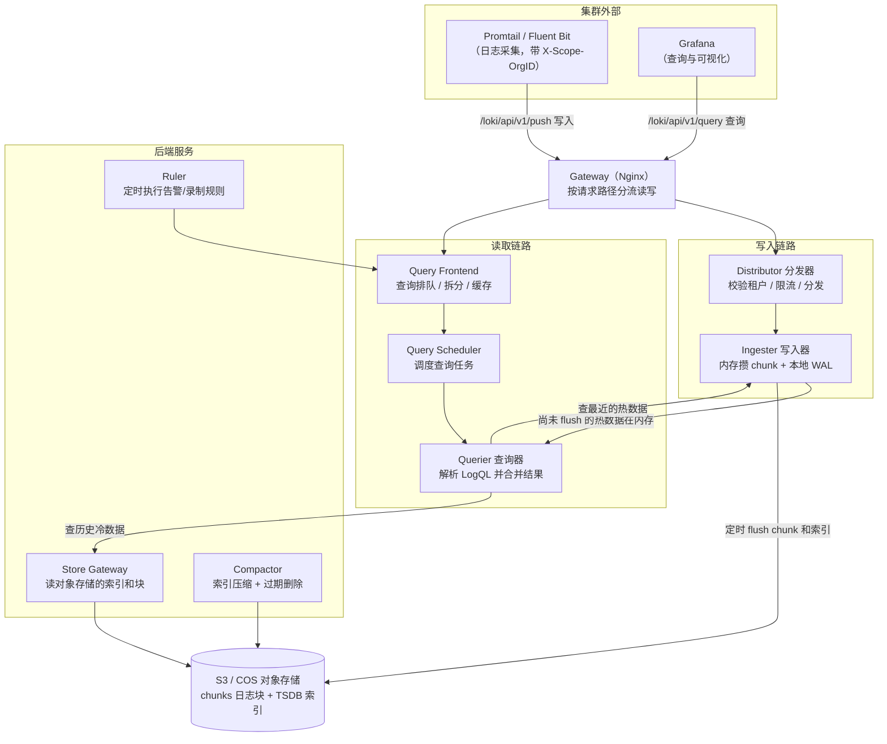
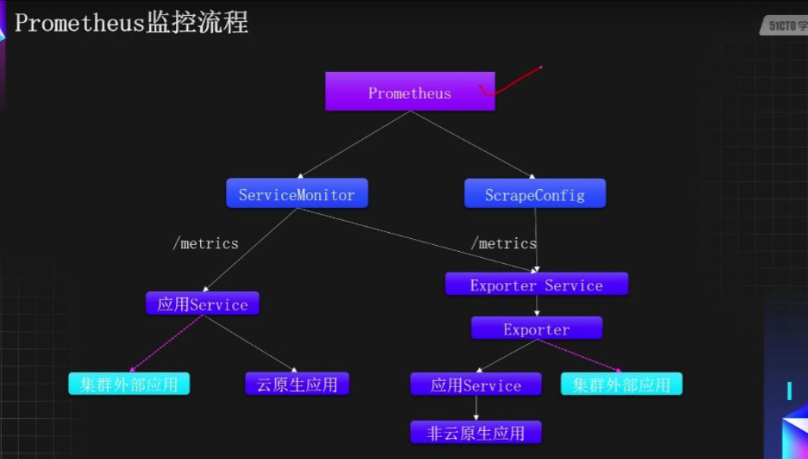
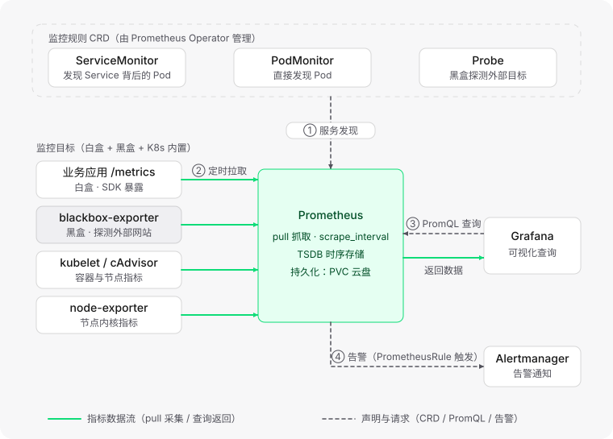
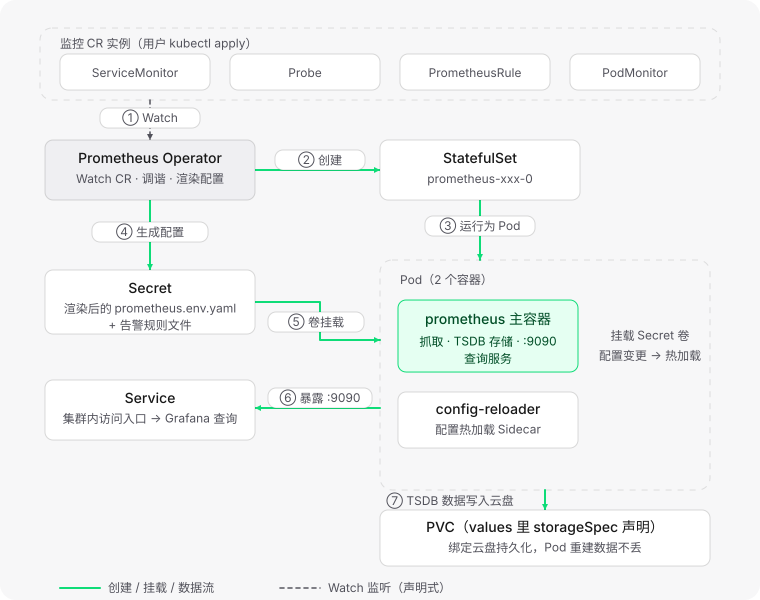
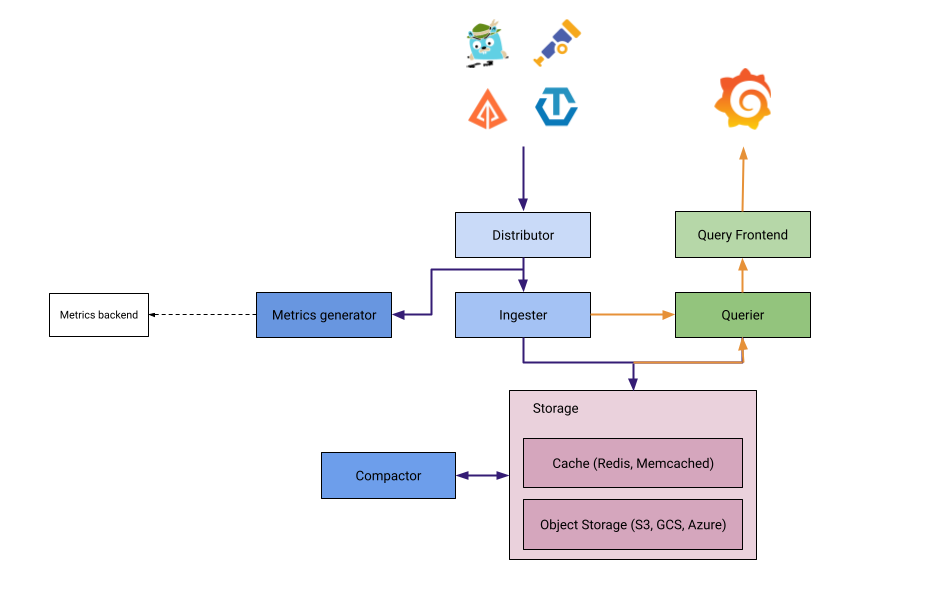

## 可观测性系统介绍（OpenTelemetry）
**可观测性系统有三大支柱**
- 日志（Logs）：带时间戳的离散事件记录，描述"某个时刻发生了什么"，信息最详细但数据量最大，适合排查具体问题。
- 指标（Metrics）：可聚合的数值型数据（如 QPS、延迟、CPU 使用率），描述"系统整体状态如何"，存储成本低、适合告警和趋势分析。
- 跟踪（Traces）：一次请求在多个服务间的完整调用链路，描述"请求经过了哪里、卡在哪一跳"，是微服务排障的关键。

三者互补：指标负责发现异常（告警），日志负责查看细节，链路负责定位跨服务瓶颈。

**OpenTelemetry（OTel）** 是 CNCF 推出的厂商中立标准，统一了三大支柱数据的采集 API、SDK 和协议（OTLP），让应用只需埋点一次，即可导出到任意后端（Jaeger、Prometheus、Loki 等），避免被单一厂商锁定。  


## 部署Loki和grafana
首先通过Terraform将公有云的虚拟机拉起，构建一个k3s集群（或者使用k8s集群）。  
Loki 是 Grafana Labs 推出的日志聚合系统，定位类似 Prometheus，但只处理日志；Promtail 是官方的日志采集 Agent；Grafana 负责可视化查询。三者关系：**Promtail 采集 → Loki 存储/索引 → Grafana 查询展示**。   

### 添加Grafana Helm仓库
```bash
helm repo add grafana https://grafana.github.io/helm-charts
helm repo update
```
创建统一的命名空间：
```bash
kubectl create namespace loki-stack
```

### 安装Loki
编写 `loki.values.yaml`：
```yaml
deploymentMode: SingleBinary
loki:
  auth_enabled: true               # 多租户开关，显式写出来与下文多租户章节对应
  querier:
    multi_tenant_queries_enabled: true
  commonConfig:
    replication_factor: 1
  storage:
    bucketNames:
      chunks: loki-1301578102
      ruler: loki-1301578102
      admin: loki-1301578102
    type: s3
    s3:
      endpoint: cos.ap-hongkong.myqcloud.com
      region: ap-hongkong
      # 密钥不写进 values（避免明文入库），先创建 Secret：
      # kubectl create secret generic loki-s3-credentials \
      #   -n loki-stack \
      #   --from-literal=access_key_id=<your-access-key-id> \
      #   --from-literal=secret_access_key=<your-secret-access-key>
      existingSecret:
        name: loki-s3-credentials
        type: s3                 # Secret 中需包含 access_key_id / secret_access_key 两个 key
  schemaConfig:
    configs:
      - from: "2026-09-01"   
        store: tsdb         #生产环境建议开启tsdb，采用新的索引格式，查询更快，内存占用更低
        index:
          prefix: loki_index_
          period: 24h        # 索引每24h滚动一个新周期（只是切分，不是删除）
        object_store: s3
        schema: v13
  # 日志保留策略：period只负责切分索引，过期删除需要单独开启compactor
  compactor:
    retention_enabled: true        # 开启保留期删除
    retention_delete_delay: 2h      # 标记删除后延迟2h再物理删除，给误删留缓冲
    delete_request_store: s3        # 删除请求记录存放到对象存储
  limitsConfig:
    retention_period: 720h          # 只保留最近30天（30×24h），过期的索引和日志块自动删除
singleBinary:
  replicas: 1
read:
  replicas: 0
backend:
  replicas: 0
write:
  replicas: 0
```

安装：
```bash
helm install loki grafana/loki -n loki-stack -f loki.values.yaml
```

### 日志轮转
日志轮转要分三层看，各层由不同组件负责，不要混为一谈：
| 层级               | 日志内容                                          | 谁负责轮转/删除                                                                  |
| ------------------ | ------------------------------------------------- | -------------------------------------------------------------------------------- |
| 容器业务日志       | Pod 写到 stdout/stderr，落到节点 `/var/log/pods/` | kubelet 自动轮转（默认单文件 10Mi、每容器保留 5 个），Promtail 只负责采集        |
| 节点宿主机系统日志 | 内核、SSH 登录、sudo、cron 等                     | rsyslog 负责落盘，logrotate 负责切分压缩，发行版默认已装好并配置，一般无需手动改 |
| Loki 后端存储      | COS 中的 chunk 和索引对象                         | 上面 values 里的 compactor retention，按保留期定期删除                           |
云原生时代业务都容器化跑在 K8s 上，前两层开箱即用，**真正需要主动配置的只有第三层**。注意 `index.period: 24h` 只是**切分**索引（每天滚动一张新表、旧表转只读），并不会删除数据；不开启 compactor，COS 桶会只增不减。values 里最关键的是 `storage` 段，它决定 Loki 数据存哪、怎么存。

 `filesystem`字段（本地存储）只适合 Demo：日志写在 Pod 所在节点的磁盘上，Pod 漂移或节点故障就会丢数据，且磁盘容量有限、无法多副本共享。生产环境一般换成 S3 兼容的对象存储(storage下面写对象存储的配置)，此外云平台上的对象存储的容量几乎是无限的

### 多租户
**实际用处**：一个公司往往只有一套 Loki 集群，但有多个业务线（电商、支付、游戏……），既要共用基础设施省钱，又不希望 A 业务组的人能翻到 B 业务组的日志——既涉及权限边界，也避免相互干扰。多租户就是用**逻辑隔离**解决这个问题：数据物理上存在同一套 Loki 里，但每条日志都带一个"租户"身份，查询时只能取到自己租户的那份。
**隔离原理**：
1. **写入时打标**：Promtail 配置 `tenant_id`，推送日志时把它放进 HTTP 请求头 `X-Scope-OrgID`。Loki 开启 `auth_enabled: true` 后，会把这个 ID 作为日志数据的一部分，连同标签索引、日志块一起存储——相当于每条日志都盖了"属于谁"的章。
2. **查询时鉴权过滤**：Grafana 数据源也必须配置 `X-Scope-OrgID` 请求头。Loki 收到查询请求后，**强制在最内层拼上租户条件**，只在该租户的索引和数据范围内检索，请求方无法通过修改查询语句跨越这个边界。
3. **没带头或头不合法**：请求直接被拒绝（401/400），拿不到任何数据。
**举例**：电商组和支付组各自部署一个 Promtail：
```yaml
# 电商组 Promtail：X-Scope-OrgID = 100
config:
  clients:
    - url: http://loki-gateway/loki/api/v1/push
      tenant_id: 100

# 支付组 Promtail：X-Scope-OrgID = 200
config:
  clients:
    - url: http://loki-gateway/loki/api/v1/push
      tenant_id: 200
```
- 电商组的 Grafana 数据源配置 `X-Scope-OrgID: 100`，即使查询条件写得很宽泛（如 `{namespace=~".+"}`），Loki 也只会返回租户 100 的日志，**支付组（200）的日志在服务端就被过滤掉了，根本不会返回给前端**——这不是"界面上藏起来"，而是查询引擎层面的数据隔离，所以电商组无法绕过。
- 支付组的 Grafana 配 `X-Scope-OrgID: 200`，同理只能看自己的。
- 平台管理员需要跨组排障时，可配置 `X-Scope-OrgID: 100|200` 并在 Loki 端开启多租户联合查询（`multi_tenant_queries_enabled: true`），权限由管理员侧统一控制。

### 安装Promtail
Promtail 以 **DaemonSet** 方式部署，保证每个 Node 节点运行一个实例，自动采集本节点所有 Pod 的日志。

编写 `promtail.values.yaml`：
```yaml
# promtail.values.yaml
config:
  clients:
    - url: http://loki-gateway/loki/api/v1/push   # 推送到 Loki 网关
      tenant_id: 100                              # 租户ID，必须配置，且要与 Grafana 数据源的 X-Scope-OrgID 请求头一致
```

安装： 
```bash
#grafana/promtail是仓库名/chart名
helm install promtail grafana/promtail -n loki-stack -f promtail.values.yaml
```

### 安装Grafana
```bash
helm install grafana grafana/grafana -n loki-stack
```

获取管理员密码（用户名默认 `admin`）：
```bash
kubectl get secret --namespace loki-stack grafana -o jsonpath="{.data.admin-password}" | base64 --decode ; echo
```

通过端口转发把 Grafana 暴露到本地：
```bash
kubectl port-forward --namespace loki-stack service/grafana 3000:80
```
浏览器访问 `http://localhost:3000`。

### LogQL查询语言
LogQL 是 Loki 的查询语言，语法由两部分组成：

**1）日志流选择器**：通过标签（K8s 工作负载 label 自动生成）圈定日志流范围，标签匹配符有 4 种：
- `=`：标签等于，如 `{app="loki"}`
- `!=`：标签不等于
- `=~`：标签正则匹配，如 `{app=~"loki|promtail"}`
- `!~`：标签正则排除

**2）日志管道操作符**：在选中的日志流内逐行过滤：
- `|=`：包含匹配，如 `{app="loki"} |= "metrics.go"`
- `!=`：排除包含关键字的日志行
- `|~`：正则包含，如 `{app="loki"} |~ "error|warn"`
- `!~`：正则排除

### 结构化日志与进阶查询
业务日志建议直接输出**结构化格式**，常见两种：
- **Logfmt**：`level=info ts=2023-11-05T08:26:20Z path=/api/users duration=200ms status=200`
- **JSON**：`{"path":"/api/users","duration":"200ms","status":"200"}`
结构化之后才能针对**字段值**做精确筛选和数值运算，原始非结构化文本只能做关键字 grep。

**用解析器提取字段**：
```text
{app="loki"} |= "metrics.go" | logfmt | duration > 10ms
{app="loki"} | json | status=200
```

**重写日志输出格式**（必须先经过解析器）：
```text
#重写后，单个日志内容只包括状态码和耗时
{app="loki"} |= "metrics.go" | logfmt | line_format "{{.status}} {{.duration}}"   
```

**从日志直接算指标**：
```text
quantile_over_time(0.99,
  {app="loki"} |= "metrics.go" | logfmt | unwrap duration(duration) [1m]
) by (status)
```
- `unwrap duration(duration)` 把 `duration` 字段从文本转为可计算的时长样本。
- `quantile_over_time(0.99, ... [1m])` 计算 1 分钟窗口内的 TP99（99% 的请求在该耗时内完成），`by (status)` 按状态码分组，Grafana 自动画出 200/500 各自的耗时曲线。
- 业务价值：无需额外埋点，靠日志就能监控 API 性能。也可换成 0.95 等分位数或调整时间窗口。


## Loki日志采集原理
### Pod日志存在哪里
K8s 中所有 Pod 写到 stdout/stderr 的内容，会被容器运行时（Docker/containerd）自动落到宿主机的日志目录`/var/log/pods/*`
### Promtail如何采集到这些日志
Promtail 以 DaemonSet 方式部署，保证集群**每一个节点上都会跑一个 Promtail Pod**，负责采集本节点上所有容器的日志。
容器的 stdout/stderr 日志，本质是容器运行时（containerd）直接写到宿主机磁盘上的；Promtail 通过 `hostPath` 把宿主机目录只读挂载进自身容器，只是读取宿主机上已经生成好的日志文件，不会修改、删除原始日志，也不会自己额外存储日志。
```yaml
volumeMounts:
  - name: pods
    mountPath: /var/log/pod_name   #容器内部的路径。
    readOnly: true            # 只读挂载，只采集不修改
volumes:
  - name: pods
    hostPath:
      path: /var/log/pods           #整个节点全部 Pod 的日志入口目录
```

### 完整数据流
```
Pod stdout/stderr
  → 节点 /var/log/pods/**/0.log
  → Promtail（DaemonSet，类似 tail -f 持续读新行）
  → HTTP POST  http://loki-gateway/loki/api/v1/push
  → Loki（建立标签索引 + 存储日志块）
  → Grafana 调用 Loki Query 接口查询展示
```
多租户隔离靠 Promtail 配置里的 `tenant_id` 实现，它最终体现在推送请求的 `X-Scope-OrgID` 头上。排查采集问题时，可以先到节点上 `ls /var/log/pods` 确认源头日志是否正常生成。
### Loki为什么轻量且成本低
- **只索引元数据，不做全文索引**：Loki 仅对时间戳和 Labels 建索引，日志正文以压缩块（chunk）原样存储。
- **存储成本极低**：相比 ELK/EFK 对全部文本做倒排索引，Loki 通常可节省约 90% 的存储空间，内存占用也更低。
- **查询分两步**：先用标签（Prometheus 风格的 key-value，如 `{app="loki", container="loki", job="loki-stack/loki"}`）快速定位日志流，再在少量匹配的流内做关键字 grep，而不是全局检索。
- 代价是**不擅长任意文本的全文检索**，因此要求日志带规范标签、正文尽量结构化。
### Loki的核心组件
Loki 的组件按**写入链路、读取链路、后端服务**三组划分。所有组件用的是同一个镜像，只是启动参数 `-target` 不同；单片模式下它们全部运行在一个进程里。

各组件作用：
- **Gateway（网关）**：一个 Nginx，按 URL 把写入请求（`/push`）转发给 Distributor、查询请求转发给 Query Frontend，是外部访问 Loki 的唯一入口。
- **Distributor（分发器）**：写入链路第一站，无状态。负责校验 `X-Scope-OrgID` 租户、限流、把日志按一致性哈希分发到多个 Ingester。
- **Ingester（写入器）**：有状态。接收日志后先在内存中攒成 chunk，并写一份本地 WAL 防宕机丢失；攒够一批或超时后 flush 成 chunk 对象和索引写入对象存储。**查询最近的"热数据"直接问它要**，不用访问对象存储。
- **Querier（查询器）**：无状态。解析 LogQL，同时向 Ingester 查内存中的热数据、向 Store Gateway 查对象存储中的历史冷数据，两边结果合并后返回。
- **Query Frontend（查询前端）**：无状态。负责查询排队、按时间范围拆分大查询、失败重试和结果缓存，避免慢查询把集群拖垮。
- **Query Scheduler（查询调度器）**：维护查询队列，把 Frontend 拆出的子任务公平地分发给空闲 Querier。
- **Store Gateway（存储网关）**：有状态。专门负责从对象存储读取 TSDB 索引和 chunk，并做本地磁盘缓存，让 Querier 不必各自直接访问 S3。
- **Compactor（压缩器）**：做索引合并压缩以加速查询，并执行前面配置的 retention 策略，定期删除过期的 chunk 和索引。
- **Ruler（规则器）**：定时执行 LogQL 告警规则和录制规则，结果推送到 Alertmanager。
- **对象存储（S3/COS）**：所有 chunk 日志块和 TSDB 索引的最终持久化位置，组件本地磁盘上只有 WAL 和缓存这类可重建的临时数据。

### Loki的三种架构
#### 单片模式
- 通过-target=all命令以单片模式启动
- 单个进程内以二进制文件方式运行所有核心组件
- 每天最多支持20GB左右的日志读写量（经验值，视硬件配置而定），适合demo
#### 简单可扩展模式
- 写入组件和读取组件可独立部署和扩展，需要部署反向代理(Nginx)分发读写请求
- 所有组件使用相同镜像，通过启动参数区分功能：
  - `-target=write`：启动写入组件（有状态）
  - `-target=read`：启动读取组件（无状态）
  - `-target=backend`：启动后端服务组件（有状态）
- 适用于每天几TB级别的日志量
- 默认包含Gateway(Nginx)负责请求分发
#### 微服务架构
- 所有组件单独部署，每个组件都可独立扩展
- 可通过Helm Chart配置实现微服务部署
- 通过-target=参数精确指定每个服务的功能
- 适用于每天日志量超过10TB的超大规模场景


## 部署Prometheus
上文 Loki 解决了**日志**这一支柱，接下来用 Prometheus 解决**指标**。

### K8s系统级指标从哪来
先搞清楚监控数据的源头。容器指标的采集链路是固定的：

```
容器运行时 → cAdvisor → kubelet → metrics-server → API Server → HPA / kubectl top
```

- **cAdvisor**：内置在 kubelet 中，负责收集、聚合、导出容器运行时指标
- **kubelet**：通过 `/metrics/resource` 和 `/stats` 端点暴露指标，提供 Summary API
- **metrics-server**：独立附加组件，聚合指标后提供 Metrics API，供 HPA 扩缩容和 `kubectl top` 消费

这些端点手动就能访问，可以先直观感受一下。启动本地代理后：
```bash
#因为kubectl没有对应获取这些指标的命令，所以只能采取这个方式
kubectl proxy   # 默认监听 127.0.0.1:8001
# 1. cAdvisor 指标 —— 容器级别的细节指标
curl http://127.0.0.1:8001/api/v1/nodes/node1/proxy/metrics/cadvisor
# 2. 资源使用指标 —— kubectl top 和 HPA 用的那份
curl http://127.0.0.1:8001/api/v1/nodes/node1/proxy/metrics/resource
# 3. 健康检查指标 —— 探针执行的耗时统计
curl http://127.0.0.1:8001/api/v1/nodes/node1/proxy/metrics/probes
```
输出全是 Prometheus 格式文本，**重点指标**：
- `container_cpu_usage_seconds_total`：CPU 使用时间（Counter 类型，通过 rate 算出使用率）
- `container_memory_working_set_bytes`：内存工作集——**这是 OOM 判断依据**，超过 limit 即被驱逐
- `container_start_time_seconds` / `container_last_seen`：容器启动时间与最后可见时间
- `prober_request_duration_seconds`：按 Liveness/Readiness 分类统计的探针耗时

### Prometheus Operator：用CRD管理监控
通过 CRD 把 Prometheus 和 Alertmanager 也变成 K8s 资源，并通过标签选择器自动发现监控目标，无需手写服务发现和认证配置。
| CRD                                              | 作用                                                                                                  |
| ------------------------------------------------ | ----------------------------------------------------------------------------------------------------- |
| `Prometheus` / `Alertmanager`                    | 部署类，以 StatefulSet 形式运行                                                                       |
| `ServiceMonitor`                                 | 声明要监控的 Service（有 Service 时首选）：通过 Service 背后所有健康 Pod 的 IP 列表，绕过负载均衡，直接对每个 Pod 的 IP:port 分别发 /metrics 请求 |
| `PodMonitor`                                     | 直接监控 Pod（无 Service 的 Job/DaemonSet 场景）                                                      |
| `ScrapeConfig`                                   | 抓取 K8s 之外的目标（静态 IP、云厂商托管服务的Exporter等）                                            |
| `Probe`                                          | 黑盒探测 Ingress 或静态目标                                                                           |
| `PrometheusRule`                                 | 告警/录制规则                                                                                         |
| `AlertmanagerConfig`                             | 自定义告警路由                                                                                        |

ServiceMonitor 和 PodMonitor 都只认 K8s 内的资源，目标在集群外面就轮到 **ScrapeConfig** 出场——它是"手写 scrape 配置"和"Operator 自动发现"之间的桥：传统方式要在 Prometheus 配置文件里写 `static_configs`、`kubernetes_sd_configs`，改一次配置就得动 Secret 或重启；ScrapeConfig 把这份能力做成 CRD，声明的目标由 Operator 自动渲染进 Prometheus 配置并热加载。典型场景：部署在虚拟机上的 MySQL/Redis exporter、云厂商托管的负载均衡指标、打在 LB 后面的黑盒探测目标。

```yaml
apiVersion: monitoring.coreos.com/v1
kind: ScrapeConfig
metadata:
  name: vm-exporters
  namespace: monitoring
  labels:
    release: kube-prometheus-stack   # 同样必须匹配 selector
spec:
  staticConfigs:                     # 静态目标：集群外虚拟机上的 exporter
    - targets:
        - 10.0.1.5:9104              # mysqld-exporter
        - 10.0.1.6:9121              # redis-exporter
      labels:
        env: prod
  scrapeInterval: 30s
  metricsPath: /metrics
```

它还支持 `httpSDConfigs`（基于 HTTP 的服务发现）、`kubernetesSDConfigs`（细粒度定制 K8s 发现规则）等，等于把原生 scrape 配置的全部能力搬进了 K8s 声明式世界。选型逻辑一句话：目标在集群内且有 Service 用 ServiceMonitor，无 Service 用 PodMonitor，目标在集群外用 ScrapeConfig，黑盒探测用 Probe。

### Prometheus 核心资源定义

表格里这些 CRD 各自的 YAML 长什么样？逐个写出最常用的几类。

**Prometheus：声明一个 Prometheus 实例本身**。Operator 会按它创建一个 StatefulSet 跑 Prometheus，字段的写法和原生工作负载很相似：

```yaml
apiVersion: monitoring.coreos.com/v1
kind: Prometheus
metadata:
  name: main
  namespace: monitoring
spec:
  replicas: 2                      # 副本数，两份各自抓全量数据实现 HA
  retention: 15d                   # 本地数据保留时长
  resources:
    requests:
      cpu: 500m
      memory: 2Gi
  serviceMonitorSelector:          # 关键：抓取哪些 ServiceMonitor
    matchLabels:
      release: kube-prometheus-stack
  ruleSelector:                    # 加载哪些 PrometheusRule 里的告警规则
    matchLabels:
      release: kube-prometheus-stack
  scrapeConfigSelector:            # 认领哪些 ScrapeConfig（集群外目标）
    matchLabels:
      release: kube-prometheus-stack
```

`serviceMonitorSelector` 是 Operator 模式的精髓：**抓取配置从"手写配置文件"变成了"按标签认领"**——任何 namespace 里的 ServiceMonitor，只要标签匹配这个 selector，里面的抓取目标就自动生效，Prometheus 配置由 Operator 重新渲染并热加载，全程不碰配置文件不重启。没被 selector 认领的 CR 写了也不生效，这是新手上手最常见的坑（kube-prometheus-stack 默认认领 `release: kube-prometheus-stack` 标签）。

**ServiceMonitor：声明"要抓哪些 Service"**。它通过标签选中 Service，再由 Service 拿到背后所有健康 Pod 的 Endpoints 列表，对每个 Pod 的 IP:port 分别抓取——绕过负载均衡，拿到的是每个实例各自的真实指标：

```yaml
apiVersion: monitoring.coreos.com/v1
kind: ServiceMonitor
metadata:
  name: web-monitor
  namespace: monitoring
  labels:
    release: kube-prometheus-stack # 必须匹配上面 Prometheus 的 serviceMonitorSelector
spec:
  selector:
    matchLabels:
      app: web                     # 选中带 app=web 标签的 Service
  namespaceSelector:
    matchNames:
    - prod                         # 只在 prod namespace 里找这些 Service
  endpoints:
  - port: metrics                  # 抓 Service 的哪个端口名（Service 里的 ports[].name）
    interval: 30s                  # 抓取间隔
    path: /metrics
```

**PodMonitor：绕过 Service 直接抓 Pod**。Job、DaemonSet 这类没有（或不需要）Service 的工作负载用它：

```yaml
apiVersion: monitoring.coreos.com/v1
kind: PodMonitor
metadata:
  name: sync-jobs
  namespace: monitoring
  labels:
    release: kube-prometheus-stack
spec:
  selector:
    matchLabels:
      app: data-sync               # 直接按标签选中 Pod
  podMetricsEndpoints:
  - port: metrics
    interval: 30s
```

**PrometheusRule：告警与录制规则**。传统方式写在规则文件里，现在是 CR；表达式语法与原生完全一致：

```yaml
apiVersion: monitoring.coreos.com/v1
kind: PrometheusRule
metadata:
  name: web-alerts
  namespace: monitoring
  labels:
    release: kube-prometheus-stack # 必须匹配 Prometheus 的 ruleSelector
spec:
  groups:
  - name: web.rules
    rules:
    - record: job:http_error_rate:5m          # 录制规则：把常用表达式存成新指标
      expr: |
        sum(rate(http_requests_total{status=~"5.."}[5m])) by (job)
        /
        sum(rate(http_requests_total[5m])) by (job)
    - alert: HighErrorRate                    # 告警规则：持续 10 分钟错误率超 5% 就触发
      expr: job:http_error_rate:5m > 0.05
      for: 10m
      labels:
        severity: warning
      annotations:
        summary: "{{ $labels.job }} 错误率过高"
        description: "5 分钟错误率 {{ $value | humanizePercentage }}，已持续 10 分钟"
```

**Alertmanager：接住告警并路由**。`Alertmanager` CR 声明实例本身，路由和接收器默认全在全局 Secret 里配置；想按 namespace/团队拆分路由权限时，再用 `AlertmanagerConfig` CR 声明局部路由——它按告警标签匹配，把特定告警发给特定接收器：

```yaml
apiVersion: monitoring.coreos.com/v1
kind: AlertmanagerConfig
metadata:
  name: team-a-routing
  namespace: monitoring
spec:
  route:
    matchers:
    - name: severity
      value: warning
    receiver: team-a-webhook
    groupWait: 30s                  # 同组告警聚合等待
    repeatInterval: 4h              # 未恢复时重复通知间隔
  receivers:
  - name: team-a-webhook
    webhookConfigs:
    - url: http://alert-gateway.monitoring/team-a
```

**ScrapeConfig 与 Probe：目标在集群外时**。这两类 CRD 补齐表格剩下的两个：`ScrapeConfig` 负责 K8s 之外的静态目标（虚拟机上的 MySQL/Redis exporter、云托管服务），上一节已给出完整 YAML；`Probe` 负责黑盒探测（站在用户视角探 URL 活不活），配套的 blackbox-exporter 和 YAML 在后面"黑盒监控"一节展开，这里先记住分工：**ServiceMonitor/PodMonitor 认集群内的 Service/Pod，ScrapeConfig 认集群外的静态目标，Probe 走探测**。

几个资源串起来的完整链路：**ServiceMonitor/PodMonitor/ScrapeConfig/Probe 提供数据源 → Prometheus 按 selector 认领它们并抓取 → PrometheusRule 定义告警表达式 → 触发的告警发给 Alertmanager → AlertmanagerConfig 决定发给谁**。每个环节都是"写 CR + 贴对标签"，这就是 Operator 模式的全部日常。

### 安装kube-prometheus-stack
[kube-prometheus-stack](https://github.com/prometheus-community/helm-charts/tree/main/charts/kube-prometheus-stack) 是 Prometheus Operator 的开箱即用全家桶：预置了 K8s 常用指标的抓取策略、relabel 规则和告警规则，并附带 kube-state-metrics（导出工作负载指标）、node-exporter（导出节点内核级指标）等组件。  
**注意**：它默认捆绑安装一套 Grafana，而上文已经装过 Grafana 了，直接复用即可，把捆绑的关掉。编写 `prometheus.values.yaml`，将 `grafana.enabled` 设为 `false`：
```yaml
grafana:
  enabled: false          # 复用上文已装的 Grafana，不重复部署
prometheus:
  prometheusSpec:
    retention: 15d        # 本地数据保留 15 天
```
安装：
```bash
helm repo add prometheus-community https://prometheus-community.github.io/helm-charts
helm repo update
helm upgrade -i kube-prometheus-stack prometheus-community/kube-prometheus-stack \
  -n monitoring --create-namespace -f prometheus.values.yaml
```
接入上文已装的 Grafana：在数据源设置里添加 Prometheus，URL 指向集群内服务：
```text
http://kube-prometheus-stack-kube-prom-prometheus.monitoring:9090
```
验证：端口转发后访问 Prometheus UI，**Status → Targets** 查看抓取目标是否 UP，**Service Discovery** 页面可确认各 ServiceMonitor/Probe 的活跃目标数量。再导入官方预置 Dashboard（如 Node Exporter/Nodes、Prometheus/Overview），开箱即得集群/节点/工作负载监控视图。

### 黑盒监控：网站可用性
白盒监控是应用自己暴露 `/metrics` 让 Prometheus 来抓；**黑盒监控则站在用户视角，从外部探测服务"活不活"**——即使应用内部一切正常，DNS 故障、证书过期、网关挂掉都会导致用户访问失败，这类问题只有黑盒才能发现。

安装 blackbox-exporter：
```bash
helm upgrade -i blackbox-exporter prometheus-community/prometheus-blackbox-exporter \
  -n monitoring --create-namespace --version 9.0.1
```

通过 **Probe CRD** 声明要探测的网站：
```yaml
apiVersion: monitoring.coreos.com/v1
kind: Probe
metadata:
  name: http-probe
  namespace: monitoring
  labels:
    release: kube-prometheus-stack   # 必须与 Prometheus 的 probeSelector 匹配
spec:
  interval: 10s                      # 探测间隔
  module: http_2xx                  # 检测模块：HTTP 返回 2xx 视为存活（blackbox-exporter 默认模块名）
  prober:
    url: blackbox-exporter-prometheus-blackbox-exporter.monitoring:9115  # exporter 地址
  targets:
    staticConfig:
      static:
        - https://example.com
        - https://www.infoq.com
```

**工作原理**（重点）：exporter 不存任何数据，只是"替 Prometheus 跑腿"去实际访问目标：
```
Prometheus →（携带 module + target 参数请求 /probe）
  → blackbox-exporter 实际访问目标网站，收集探测指标
  → 结果经 /metrics 返回，Prometheus 抓取存储
```
relabel 会把 `__param_target` 复制为 `instance` 标签，方便按目标网站查询。关键指标：`probe_http_status_code`（状态码）、`probe_duration_seconds`（探针耗时）、`probe_ssl_earliest_cert_expiry`（**SSL 证书过期时间**，可做提前告警）。

### 白盒监控：业务指标埋点
应用引入 Prometheus SDK，暴露 `/metrics` 端点供抓取。四种指标类型：

| 类型          | 用途         | 特点                                       | 典型场景             |
| ------------- | ------------ | ------------------------------------------ | -------------------- |
| **Counter**   | 累计值       | 只增不减                                   | 请求总数、错误总数   |
| **Gauge**     | 瞬时值       | 可增可减                                   | 内存使用量、队列长度 |
| **Histogram** | 数据分布     | 自动分桶（`_bucket` + `le`），可跨实例聚合 | 响应时间             |
| **Summary**   | 预定义分位数 | 客户端算好分位数，**不可跨实例聚合**       | 单实例精确分位数     |

让 Prometheus 抓到业务指标——部署 **ServiceMonitor**（重点）：
```yaml
apiVersion: monitoring.coreos.com/v1
kind: ServiceMonitor
metadata:
  name: go-app
  namespace: monitoring
  labels:
    release: kube-prometheus-stack   # 必须匹配，否则 Operator 不认（最常见的坑）
spec:
  selector:
    matchLabels:
      app: go-app                    # 通过 label 匹配 Service
  endpoints:
    - port: http                     # Service 的端口名（不是端口号）
      path: /metrics                 # 指标接口路径
      interval: 15s                  # 抓取间隔
```
匹配链路：ServiceMonitor 通过 label 选中 Service → 经 Service 的 Endpoints 定位后端 Pod → 对每个 Pod 的 IP:port 分别抓取 `/metrics`。**选型**：有 Service 用 ServiceMonitor（自动发现背后全部健康 Pod）；无 Service（Job/DaemonSet）直接用 PodMonitor。团队协作上，工程团队只需保证 `/metrics` 接口，基础设施团队负责 CRD 编写，二者解耦。

抓取生效后，Prometheus 会自动给指标附加 `instance`、`namespace`、`service`、`pod`、`container` 等标签，查询时可按这些维度分组定位，类似日志查询的用法。

### 云原生应用与 Exporter：谁有 /metrics，谁没有

上面所有抓取方式都指向同一个前提：目标必须自己暴露 `/metrics` 接口。这个接口不是 K8s 强制的，而是 Prometheus 社区把"暴露 Prometheus 格式文本"做成了事实标准——**云原生应用天生带这条路**：用 Go/Java/Python 写、引入 Prometheus SDK 的服务，几行代码就能挂上 `/metrics`；K8s 生态的组件（kubelet、node-exporter、etcd、CoreDNS）全部原生支持。应用自己在指标里报数，这是**白盒监控**的直接形态。

但 Redis、MySQL 这些**非云原生应用没有 `/metrics`**——它们是十几年前就定型的二进制程序，只说自己的方言协议（Redis 的 RESP、MySQL 的 MySQL 协议），不会说 HTTP，更不会输出 Prometheus 格式。而它们的运行状态又必须监控，怎么办？

**Exporter 就是翻译官**：一个独立运行的辅助进程，用自己的方言协议连上目标应用，定期查询它的内部状态，再把查询结果翻译成 Prometheus 指标，在自己的 `/metrics` 端点暴露出来：

```text
mysqld-exporter：
  用监控账号登录 MySQL → 执行 SHOW GLOBAL STATUS / SHOW SLAVE STATUS
  → 翻译成 mysql_up、mysql_global_status_threads_connected、mysql_slave_status_seconds_behind_master
  → 暴露在自己的 :9104/metrics

redis-exporter：
  向 Redis 发 INFO 命令 → 解析返回的键值
  → 翻译成 redis_up、redis_connected_clients、redis_memory_used_bytes
  → 暴露在自己的 :9121/metrics
```

Prometheus 社区已经为几乎所有主流软件写好了官方 exporter（MySQL、Redis、Kafka、RabbitMQ、Nginx、黑盒探测……），使用时不需要写代码，部署 exporter 并给它目标应用的连接凭证即可。exporter 本身以普通 Deployment 跑在集群里，前面挂一个 Service——这就是下面流程图里的 **Exporter Service** 这一层；集群外的 exporter（比如部署在虚拟机上监控 VM 里的 MySQL）则由 **ScrapeConfig** 声明抓取。

### Prometheus 监控全流程

一张图把两条抓取路径收拢：



对照图把完整链路走一遍：

```text
Prometheus（按 scrape 配置周期性 pull，一切以拉为主）
        │
        ├── 路径①（云原生应用）：ServiceMonitor 按 label 选中应用 Service
        │      → 拿到背后健康 Pod 的 IP 列表，逐个 Pod 直接 GET /metrics
        │      → 应用自己报数（请求量、延迟、错误率……）
        │
        └── 路径②（非云原生应用）：ScrapeConfig 声明 exporter 的地址
               → GET Exporter Service 的 /metrics
               → exporter 用方言协议查询目标应用（INFO / SHOW ...）
               → 把状态翻译成 Prometheus 指标返回
        │
        ▼
所有样本打上 job/instance/namespace 标签，存入 TSDB
        │
        ▼
Grafana 经 PromQL 查询出图；PrometheusRule 定义的表达式
被持续求值，超过阈值触发告警推给 Alertmanager
```

两条路径的分界线就一句话：**应用会说 Prometheus 的话就直接对话，不会就派 exporter 当翻译**——但对 Prometheus 而言二者没有区别，它抓到的永远是一个标准的 `/metrics` 端点。这也解释了为什么 node-exporter、blackbox-exporter 都叫"exporter"：节点、DNS、HTTPS 网站同样不会主动报数，同样需要翻译官。

### Prometheus+Grafana获取指标流程图



```text
node-exporter（DaemonSet，每个节点一个 Pod）
   挂载宿主机 /proc、/sys 目录 → 读出 CPU、内存、磁盘、网络等内核级数据
      ↓ Prometheus 定时 GET http://<节点IP>:9100/metrics
node_cpu_seconds_total、node_memory_MemAvailable_bytes ...
- - - - - - - - - - - - - - - - - - - - - - - - - - - - - - - - - - - - - - - - - - -
容器运行时（containerd）→ cAdvisor（内嵌在 kubelet 里，采集所有容器指标）
      ↓ kubelet 端点暴露
Prometheus 定时抓 kubelet 的 /metrics/cadvisor、/metrics/resource
      ↓
container_cpu_usage_seconds_total、container_memory_working_set_bytes、node_cpu_usage_seconds_total
- - - - - - - - - - - - - - - - - - - - - - - - - - - - - - - - - - - - - - - - - - -
Probe CRD（声明：探谁、怎么探、谁来探）
      ↓ ① Prometheus 服务发现，把探测目标转成抓取请求
Prometheus → GET http://blackbox-exporter:9115/probe?target=https://xxx.com&module=http_2xx
      ↓ ② exporter 替 Prometheus 真实访问目标网站（DNS→TCP→TLS→HTTP 全流程）
      ↓ ③ 以 /metrics 返回探测结果
probe_http_status_code、probe_duration_seconds、probe_ssl_earliest_cert_expiry
      ↓ Prometheus 像存普通指标一样存储
```

### Prometheus本身等相关资源的关系



`helm install` 之后集群里多出一堆资源，它们各司其职：**CR 实例**（ServiceMonitor/Probe 等）是用户声明的期望；**Operator** Watch 这些 CR，一边**创建 StatefulSet**（进而运行出 Prometheus Pod，内含 prometheus 主容器和 config-reloader Sidecar），一边把 CR **渲染成配置写进 Secret**，Secret 再以卷挂载进 Pod，reloader 检测到变化触发主容器热加载。对外的查询入口是 **Service（:9090）**，供 Grafana 发 PromQL 查询；指标数据则通过 **PVC** 落在云盘上，Pod 重建也不丢。

### PromQL查询指标
PromQL 与 LogQL 语法同源，都是"指标选择器 + 标签选择器"定位数据：

```text
# 1. 查特定指标
http_requests_total{app="go-app"}

# 2. 各接口平均QPS：rate计算1分钟变化速率（适用于Counter），sum by按接口路径分组
sum by(path) (rate(http_requests_total[1m]))

# 3. P95延迟：_bucket是直方图分桶数据，le是桶边界
histogram_quantile(0.95,
  sum by (path, le) (rate(http_response_time_seconds_bucket[1m]))
)
```
P95 的执行顺序：取原始分桶数据 → 计算各桶变化速率 → 按桶边界 `le` 聚合 → 用 `histogram_quantile()` 计算 95% 分位。在 Grafana 中可据此创建实时 QPS（Stat 面板）、QPS 趋势（Time series 面板）、总请求数按状态码分组、P95 延迟水位线等面板。

### 直方图的坑
**默认桶的缺陷**：当实际响应时间集中在某小区间时（如 100-200ms），默认桶粒度过粗（如 0-250ms 一档），插值法算出的分位数会明显偏离真实值，甚至超出实际值范围。
**选型建议**：
- 需要跨实例聚合、了解分布范围 → **Histogram**
- 需要精确分位数且不聚合 → **Summary**


## Tempo

**Tempo 是 Grafana Labs 出品的分布式追踪后端，专门解决"trace 存哪、怎么查"的问题**。它和前文采样、Collector 组成完整链路：SDK → OTLP → Collector（采样）→ Tempo（存储查询）。选型上对比 Jaeger：Jaeger 功能全但存储依赖 ES/Cassandra 这类重型索引系统；Tempo 把 trace 扔进便宜的对象存储、几乎不建索引，**运维只剩"给个 S3 地址"，成本低一个量级**——中小集群的默认选择。

### 架构：一写一查两条路径



```text
写入路径（接收 span）
SDK/Collector ──OTLP──→ Distributor（校验、打租户标签、按 trace_id 一致性哈希分片）
                            │ 双写
                            ├──→ Ingester（按 trace_id 在内存拼树，攒批成 block）
                            │        └──→ Object Storage（S3/GCS/Azure，trace 真正的家）
                            └──→ Metrics generator（旁路，派生 RED 指标 → Prometheus）

查询路径（Grafana 发起）
Grafana → Query Frontend（按时间切片排队/限流/缓存，防大查询打挂后端）
              → Querier（向 Ingester 要热数据 + 从对象存储拉 block 扫描，用完即弃）
Compactor（离线）：合并小块、按保留期删除过期块、维护 bloom filter
Cache（Redis/Memcached）：块元数据、bloom filter、查询结果，挡住对象存储的海量小读
```

### 组件逐一拆解

**Distributor（写入口，无状态）**
接收 OTLP（兼容 Zipkin/Jaeger 协议），干三件事：校验批量化、打上租户/集群标签、**按 trace_id 做一致性哈希**——集群里所有 Ingester 登记在一个环（ring）上，哈希决定这条 trace 归谁。它是写入分片的唯一决策点，也是**限流第一道闸**（租户级限流在这里挡住突发流量，保护 Ingester）。生产随便加副本。

**Ingester（唯一有状态组件）**
按 trace_id 接收分片来的 span，**在内存里按 parent_span_id 把零散 span 拼成完整 trace**，攒到时间/大小阈值切成 block 刷到对象存储。没刷盘的"热 trace"还在内存里，Querier 查询时会同时来问它。状态在内存是它唯一的运维敏感点：扩缩容触发环重分片，滚动重启有丢失未刷盘窗口的风险——生产靠多副本冗余兜底。

**Metrics generator（旁路，可选）**
Distributor 双写一份 span 给它（注意是从 distributor 分叉，不是 ingester 转发），按 service/route 聚合出 RED 指标，用 **Prometheus remote write** 协议推给 Prometheus。`span_metrics`、`service_graphs` 等处理器默认关闭，按租户开启。

**Query Frontend（查询入口，无状态）**
Grafana 实际打到这里。把一个大查询**按时间范围切成子查询排队执行**，加限流和结果缓存——保证"某人搜 7 天全量 TraceQL"不会拖垮整个集群，大查询只是自己排队。

**Querier（计算层，无状态）**
真正干活的：一个查询 = **两路合并**——向 Ingester 要还没刷盘的热数据 + 从对象存储拉已刷盘的 block 扫描（bloom filter 快速跳过不含目标的块），合并去重后返回。算完即扔，查询扩容就是加副本。

**Compactor（离线整理）**
周期性把小 block 合并成大 block（减少对象数、降低查询扫描次数）、按 retention 配置删过期数据、维护 bloom filter。它只影响整理效率，不参与读写路径——挂了也只是暂时的，数据不丢。

**Cache 与对象存储**
Memcached/Redis 缓存块元数据、bloom filter、查询结果——没有它，Querier 每次查询都对 S3 发海量小读，又慢又烧钱。对象存储是**唯一持久层**：容量、带宽、保留期全部外包，Tempo 组件全丢都能从它重建。

> 上图是经典架构。Tempo 3.0 把写入路径改为 distributor → Kafka → block-builder（刷块）+ live-store（供查近期 trace），**分片与持久化解耦的思路没变**，读到新文档时对号入座即可。

### 如何实现"真正的分布式"链路追踪

追踪系统要配得上"分布式"四个字，得同时解决四个问题，Tempo 的答案一一对应：

| 分布式追踪要解决的问题 | Tempo 的解法 |
| --- | --- |
| 跨服务、跨机器的 span 怎么拼回一条 trace | 按 trace_id 一致性哈希 → **同一 trace 的所有 span 永远进同一个 Ingester**，内存里按 parent_span_id 拼树；span 乱序到达、后到先到都没关系 |
| 写入量大了怎么扛 | 加 Ingester = 环上多认领一段哈希空间，Distributor 无状态水平扩 |
| 历史 trace 存不下怎么办 | 按时间切成 block 落对象存储——容量/带宽/保留期天然无限，永远不用"扩容存储集群"这件事 |
| 查询怎么不被大范围搜索拖垮 | Query Frontend 按时间切片并行 + bloom filter 剪枝，Querier 无状态随便加副本 |

一句话收拢：**trace_id 哈希分片解决"拼得回"，时间切块解决"存得下"，无状态副本 + 托管对象存储解决"扩得开"**——Tempo 不养分片集群、不建索引集群，把分片交给哈希算法、把容量交给 S3，这就是它比 Jaeger + ES 便宜一个量级还能横向扩展的根本原因。

### 核心设计：不建索引，靠 trace_id 直查

Tempo **只存 trace，不建"标签 → trace"的全量索引**（Jaeger/ES 的做法），换来极低的存储成本，查询分两种：

1. **已知 trace_id 直查**（90% 的使用场景）：日志或指标里发现了 trace_id，拿去 Tempo 精确定位——利用块的 bloom filter 快速跳过不含该 ID 的块，**这是 Tempo 的"舒适区"，O(块数) 级别，快且便宜**。
2. **TraceQL 条件搜索**（"找出所有 http.route=/settle 且 duration>1s 的 trace"）：没有索引兜底，只能挨个块扫，**块多时又慢又贵**——生产上要么限制时间范围，要么配合前文的采样从源头减块。

实战教训：**不要把 Tempo 当"按任意条件搜 trace 的搜索引擎"用**。正确的排障动线是"指标发现异常 → 从日志/告警里拿 trace_id → 直查"，而不是在 Tempo 里裸搜。这也解释了为什么三大支柱必须联动——TraceQL 只是补刀手段，不是入口。

### Metrics Generator 的价值与取舍

机制见上文组件拆解，这里只说它换来什么：

- **业务代码一行不改就有接口级 QPS、错误率、延迟分位**——埋点只埋了 trace，指标是免费送的；
- 派生的指标自带 **exemplar（示例 trace_id）**，Grafana 里从 P95 曲线一键跳到慢请求的那条 trace——这就是"指标 → trace"的关联通道。

代价是它常驻吃内存，小集群可以关掉，但只要在乎"从图表跳 trace"的排障体验就建议留着。

### 在 Grafana 里把三大支柱缝起来

Tempo 最大的卖点不是存 trace，而是**和 Prometheus/Loki 同属 Grafana 生态带来的互跳**：

| 起点 | 动作 | 终点 |
| --- | --- | --- |
| Loki 日志 | 点日志详情里的 trace_id 链接（derived fields） | Tempo 瀑布图 |
| Prometheus 指标 | 点数据点的 exemplar | 对应 trace |
| Tempo 瀑布图 | 点某个 span 的 log 属性 | 该请求的日志 |

生产排障的标准动线就靠这张表：**告警（指标）→ 看哪些请求慢（指标）→ 跳进一条具体 trace（Tempo）→ 定位到出错 span → 捞同一 trace_id 的日志（Loki）**——这正是下文"集成 OTEL SDK"要用 trace_id 缝合三者的原因。

部署上一句话：小规模用 **monolithic 模式**（单二进制跑全部组件），流量上来再拆成微服务模式——组件和图中一一对应，架构图看懂了拆分也就看懂了。


## 集成OTEL SDK
平台侧（Prometheus/Loki/Grafana）已就绪，现在轮到**应用侧**：接入 OpenTelemetry SDK，把三大支柱从应用里交出来，并用 trace_id 把它们缝在一起。分工原则：**组件监控靠配置（K8s 组件天生暴露 /metrics），业务可观测性必须代码埋点**（链路、业务指标、日志关联，配置变不出来）。

### 基础概念
#### Trace 与 Span
- **Trace**：一次请求的完整调用链，用全局唯一的 **trace_id** 标识
- **Span**：链里**一段操作**，比如：HTTP 入站、查 SQL、调用另一个微服务，有开始时间、结束时间、属性、状态

**Trace 是树，Span 是树上的节点，trace_id 是这棵树的根标签。** 以请求穿过三个服务为例：

```text
用户请求 app-a 的 /chain
│
├─ trace_id: e981ea46f9...（全程不变）
│
├─ Span A1: GET /chain（app-a）            ← 根 Span
│    ├─ Span A2: httpx 调用 app-b
│    │    └─ Span B1: GET /cpu_task（app-b）  ← 瀑布图上一眼看出瓶颈
│    └─ Span A3: httpx 调用 app-c
│         └─ Span C1: GET /io_task（app-c）
```

三个关键机制：
- **全程同一个 trace_id**：请求经过的所有服务的所有 Span 都带它——所以在 app-c 的日志里能查到"这次请求在 app-a 里长什么样"
- **span_id + parent_span_id 还原树形**：每个 Span 指向自己的父跳，Tempo 瀑布图就是按这层关系排出来的
- **跨服务传播靠 HTTP Header 自动完成**：app-a 调 app-b 时，SDK 自动把 trace_id 塞进请求头，无需手写

一句话：**trace_id 回答"是哪次请求"，span_id 回答"是这次请求里的哪一步"**——后文的一切关联都建立在这两个 ID 随请求流动、被各处记录之上。
#### 其它
**Tracer 创建 Span → Attribute 填细节 → Sampler 决定留不留 → Propagator（W3C TraceContext / traceparent）带它跨服务 → Baggage 顺带传业务元数据 → 数据用 OTLP 导出**。

- **Tracer（追踪器）**：OTel SDK 里负责**创建 Span** 的对象，来自全局单例 TracerProvider。代码里每次埋点——`tracer.startSpan("SELECT users")`——都是在开一个新 Span。一个进程可以有多个 Tracer（按组件命名，如 `httpx`），但它们产出的 Span 都汇入同一条 Trace。
```go
// 1. 全局唯一的 TracerProvider（整个程序一个）
tp := trace.NewTracerProvider(...)

// 2. 从 Provider 创建不同名字的 Tracer（按模块区分）
httpTracer := tp.Tracer("video-svc.http")
dbTracer := tp.Tracer("video-svc.db")

// 3. httpTracer 创建第一个 Span（http入口）,换不同 Tracer，只要传同一个 ctx，新 Span 就会挂载到这条 Trace 下
ctx, span := httpTracer.Start(ctx, "GET /video/{id}")
// 闭合这段追踪，导出span
defer span.End()

// 4. 往下走，用 dbTracer 新建 Span，**复用 ctx，trace_id 继承下来**
ctx2, dbSpan := dbTracer.Start(ctx, "SELECT video ...")
defer dbSpan.End()
```

- **Attribute（属性）**：挂在 Span（也可挂 Metric/Log）上的**键值对**，记录查询细节，如 `http.method=GET`、`http.status_code=200`、`db.statement="SELECT ..."`。作用等价于 Prometheus 的 label——后端按它做多维过滤聚合（"找出所有 5xx 的 Span"就是查 Attribute）。**生产提醒**：Attribute 会进存储，高基数字段（即每条请求的字段的值几乎都不一样）别当 key 滥用，否则查不动也存爆。

- **Sampler（采样器）**：决定**哪些请求真正被记录**的策略。全采（AlwaysOn）数据全但开销大；按比例采（TraceIdRatioBased，如 0.1）省量但会丢偶发慢请求。生产标配 **ParentBased**：跟着根 Span 的采样决定走，**保证一条链路所有服务要么全采、要么全不采**——否则 app-a 采了、app-b 没采，Trace 在 Tempo 里就是断的。
```go
package main

import (
	"go.opentelemetry.io/otel/sdk/trace"
)

func main() {
	// 1. 一直全采：测试环境用，流量大绝对不能上生产
	// sampler := trace.AlwaysOnSampler{}

	// 2. 单纯比例采样：10%随机采样，危险！微服务链路容易断
	// sampler := trace.TraceIdRatioBased(0.1)

	// 3. 生产推荐 ParentBased：根请求 10%概率采样；一旦根被采，整条链路全部跟着采
	sampler := trace.ParentBased(trace.TraceIdRatioBased(0.1))

	tp := trace.NewTracerProvider(
		trace.WithSampler(sampler),
		// ... exporter 配置
	)
}
```

- **Propagator（传播器）**："跨服务传播靠 HTTP Header 自动完成"背后的机制——负责注入、提取追踪上下文。app-a 调用 app-b 前，Propagator 将 trace_id 和自身当前 span 的 span_id 放进 HTTP 请求头；app-b 提取到该信息后，把收到的 span_id 作为新建 span 的 parent_span_id，形成父子关系，整条 Trace 树继续延伸。
```go
// propagator：默认使用 W3C tracecontext 规范实现
var propagator = otel.GetTextMapPropagator()

// 【上游服务：调用下游，Inject 注入上下文】
func callUserSvc(ctx context.Context) error {
	req, _ := http.NewRequest("GET", "http://user-svc/user/123", nil)

	// 把当前 ctx 里的 trace_id、当前 span_id 注入到请求 Header
	propagator.Inject(ctx, propagation.HeaderCarrier(req.Header))

	_, err := http.DefaultClient.Do(req)
	return err
}

// 【下游服务：接收请求，Extract 提取上下文】
func userSvcHandler(w http.ResponseWriter, r *http.Request) {
	// 从 http.Header 提取追踪上下文，拿到上游的 trace_id、上游 span_id
	ctx := propagator.Extract(r.Context(), propagation.HeaderCarrier(r.Header))

	tracer := otel.Tracer("user-svc.http")
	ctx, span := tracer.Start(ctx, "GET /user/{id}") // 继承，上游span_id作为自己的parent_span_id
	defer span.End()
	// ...业务逻辑
}
```

- **W3C TraceContext**：Propagator 的**标准化格式**（W3C 规范），取代早期 Jaeger/B3 等各家私有 header。不同厂商的 SDK 都认它，混用（Java 服务调 Go 服务）链路也能接上，是当前默认选择。

- **traceparent**：W3C TraceContext 定义的核心请求头，他是http请求头中的一个字段，形如：
  ```
  traceparent: 00-4bf92f3577b34da6a3ce929d0e0e4736-00f067aa0ba902b7-01
  #             版本  trace_id（16字节）        span_id（8字节）   采样标志
  ```

- **Baggage**：随请求传播的**业务键值对**（如 `user_type=vip`），同样是HTTP Header中的一个字段，但**不参与追踪逻辑**——trace 信息是给"记录调用链"用的，Baggage 是给"带过路参数"用的（各服务按用户打指标/日志、采样器按用户区分比例）。注意它是**明文随头走的，别放 token、手机号等敏感信息**。
```go
// 上游：往上下文添加 baggage
m1, _ := baggage.NewMember("user_type", "vip")
b, _ := baggage.New(m1)
//把这个 baggage 对象存入 context 上下文。现在这个 ctx 里面，除了 trace 的信息，还带上了 `user_type=vip`。
ctx = baggage.ContextWithBaggage(ctx, b)
// 下游用 baggage.FromContext(ctx) 读取
```

- **tracestate**：也属于tracecontext,是一个http header中的一个字段，用来给追踪组件、服务网格携带私有扩展信息，跟随 traceparent 跨服务流转；属于基础设施层面的扩展，业务一般不使用，丢失不影响链路主干。

- **OTLP**：OpenTelemetry 自定义的**数据导出协议**（基于 protobuf，走 gRPC 4317 或 HTTP 4318），把 SDK 产出的 traces/metrics/logs 统一推给后端——前文 Tempo"原生接收 OTLP"即指它。数据流向：**SDK → OTLP → Collector（可选，做缓冲/改写/分发）→ Tempo 等后端**；换后端只改导出地址，代码零改动。

- **Collector（收集器）**：OTel 官方的**数据中转站**，一个独立部署的 Go 进程，夹在 SDK 和后端之间。配置按 **receivers → processors → exporters** 三段式管道处理数据：收（OTLP receiver）、加工（`batch` 攒批压缩、`memory_limiter` 内存限流、`attributes` 补字段/脱敏、`tail_sampling` 采样）、发（otlp exporter 推 Tempo/Loki）。
```text
tracer.Start() → 生成span → 设置attribute → span.End() → 交给Batcher打包 → Exporter → OTel Collector → Tempo存储
```
### Metrics、Logs、Trace的差异
大致上报路径差不多，但是还有下面一些差异：  
#### 上报路径差异
- **Trace（链路）：事件驱动**  
一次请求 `span.End()` 才产出一条 span；请求结束才上报；
SDK 侧是异步 Batcher 攒 span。
- **Metrics（指标）：时间周期驱动**  
业务 `Counter.Add` / `Histogram.Record` 只是更新内存里的数值；
靠 `PeriodicReader` 定时（比如 10s）一次性读取当前聚合值打包上报。
不是每一次调用就发包，指标是**聚合统计值**。
- **Logs（日志）：事件驱动**   
生产主流方案不走 OTel Log SDK：而是业务打印到 stdout，由 Promtail 采集，不走业务代码上报这条路线。
#### 采样机制不一样
- Trace：有头部采样（SDK ParentBased）、尾部采样（Collector tail_sampling processor），可以丢弃整条链路；
- Metrics：**一般不用这种按 trace 的采样**；指标很少做采样，大多是全部上报；如果要降量，是做聚合降精度；
- Logs：日志采样是独立的过滤策略，**tail_sampling 处理器只对 trace pipeline 生效，metrics、logs 管道不能用它**。
#### 数据结构、标签约束不一样
- Trace：span 自带 `trace_id、span_id`；标签尽量低基数；
- Metrics：标签严格低基数，绝对不能放 trace_id，否则 series 爆炸；
- Logs：推荐正文带上 trace_id；大流量场景 trace_id 不能作为 Loki label，避免 stream 爆炸。
#### 用途不同
- Trace：还原单次请求完整调用路径，定位慢调用、报错链路；
- Metrics：宏观聚合统计，看 QPS、错误率、延迟分位，做告警；
- Logs：单行上下文文本，看详细报错内容。

## 采集策略
### 上报链路：直推 vs 文件中转
业界就两种基本架构：

**① 应用直推**：业务服务直接把数据推给可观测平台（SDK → OTLP → Collector/后端）。
- 实时性最好、架构最简单，不需要额外组件。
- 缺点：**采集开销跑在业务容器里**——流量洪峰时和业务抢 CPU/内存，业务异常时上报跟着异常，最需要数据的时刻恰恰最容易丢数据。

**② 文件中转**：数据先落本地文件，独立的采集 Agent 读文件再上报。
- **完整性最好**：写进文件就等于保住了，业务崩溃也不影响后续上报；采集资源与业务彻底隔离。
- 缺点：多一个组件，系统复杂度和维护成本上升，且引入落盘延迟。

K8s 上的实际分工（一个服务一个容器，采集必须从业务里拆出去）：
- **日志走②**：本文 Loki 方案即此——Pod 只写 stdout，kubelet 落盘到节点 `/var/log/pods/`，Promtail 独立 DaemonSet 按 At-Least-Once 语义搬文件，业务容器完全无感。
- **链路/指标走①，但中间垫一层 Collector**：SDK 只往本地端口批量推送，缓冲、重试、改写、分发全在独立部署的 Collector 里做——后端故障时 Collector 缓冲顶住，拿到②"不丢"的好处，又不占用业务 Pod 资源。

**实战例子**：大促洪峰时如果应用直接 HTTP 上报，CPU 打满的第一个牺牲品就是上报线程——恰好丢掉最需要复盘的数据。采集拆到 DaemonSet / Collector 后，业务再忙，采集组件也照常匀速搬数据。

### 该不该采样：先算三笔账
压测实证：采样率 1.0 全采时服务 QPS 损耗约 **16%**，采样率 0.1 时几乎无影响——流量再翻几倍，这 16% 就是压垮骆驼的最后一根稻草。经验阈值：**每秒几百条 trace 以上才需要考虑采样**，低于这个量级直接全采，把精力花在给 trace 补有用的 Attribute 上。

采样要付出三笔成本，多数团队只算了第一笔：

| 成本 | 含义 |
|---|---|
| 计算成本 | Collector 缓冲 span、评估策略消耗 CPU/内存 |
| 维护成本 | 策略会随真实流量漂移，没人管就形同虚设 |
| 漏采成本 | 出事时唯一有用的那条 trace 被概率规则丢掉——最贵的一笔 |

三种**不该采样**的场景：量太小、合规要求全量留存（审计/医疗）、**LLM/Agent 调用**——同样的 prompt 不保证同样的输出，丢掉的推理链无法复现。

### 头采、尾采、单元采样
按"什么时候做决定"分三类：

| 类型 | 决策时机 | 优点 | 代价 |
|---|---|---|---|
| 头采 Head-based | 请求入口处，源头决定 | 无状态、极便宜，SDK 侧决定连网络传输都省了 | 看不到结局，可能把错误/慢请求整条丢掉 |
| 尾采 Tail-based | trace 跑完后由 Collector 决定 | 按错误/延迟/稀有度筛选，留下的都是高价值数据 | 要缓存全量 span，有状态、吃内存，源头开销一点省不掉 |
| 单元采样 | 每个服务各管各的 | 灵活 | **链路不完整**，只留下残缺的几个 Span，生产基本不用 |

**头采**三要点（前文 Sampler 条目的展开）：
- `TraceIdRatioBased` 对 trace_id 做确定性哈希——同一个 trace 在任何实例上算出的结论都一致；配合 **ParentBased**（决定通过 traceparent 的采样标志位传播）保证整条链同采同不采。
- **按服务定比例，忌全局一刀切**：结算接口 50 QPS 全采 100%，搜索接口 2 万 QPS 采 1%——统一设 10% 会把结算的关键链路采丢、把搜索的量灌爆。
- **SDK 侧采样**省网络但改比例要发版；**Collector 侧采样**改配置即生效。生产常见组合：**SDK 全开（AlwaysOn）+ Collector 集中降量**，平台团队调策略零发版。

**尾采**的三个旋钮：

| 参数 | 控制什么 | 调错的后果 |
|---|---|---|
| `decision_wait` | 等多久收齐再决策 | 太短：异步/慢请求的迟到 Span 错过窗口，链路被拦腰截断；太长：内存占用升高 |
| `num_traces` | 缓冲区最多同时存多少条 trace | 太小：缓冲满后直接丢新 trace，或退化成粗暴的概率采样 |
| `expected_new_traces_per_sec` | 预估入流量（用于预分配） | 设小了：高峰期反复重新分配内存 |

内存估算一条公式：`num_traces × 平均 trace 大小 ≈ 内存下限`——5 万条 × 20KB ≈ **1GB**，还没算处理开销。

另一个硬约束：**同一条 trace 的所有 Span 必须落到同一个 Collector 实例**，否则谁也凑不齐完整链路做决策——多副本 Collector 前要加 `loadbalancingexporter` 按 trace_id 一致性路由。

### 生产标配：头尾混合
两段式：**头采在源头把量压进预算，尾采在 Collector 把关键链路捞回来**。策略自上而下匹配、命中即定，所以**具体规则在前、概率兜底在后**：

```yaml
# otel-collector-config.yaml（节选）：tail_sampling 处理器
processors:
  tail_sampling:
    decision_wait: 10s             # 同步请求 10~30s 足够；异步长任务调大
    num_traces: 50000              # 缓冲上限，直接决定内存占用
    expected_new_traces_per_sec: 200
    policies:                      # 顺序敏感：命中即定
      - name: keep-errors          # 1. 错误链路全留
        type: status_code
        status_code:
          status_codes: [ERROR]
      - name: keep-slow            # 2. 超 SLA 的慢请求全留
        type: latency
        latency:
          threshold_ms: 1000
      - name: keep-rare            # 3. 稀有操作全留（低频结算接口）
        type: string_attribute
        string_attribute:
          key: http.route
          values: ["/settle"]
      - name: sample-rest          # 4. 其余按 1% 概率兜底
        type: probabilistic
        probabilistic:
          sampling_percentage: 1

exporters:
  otlp/tempo:
    endpoint: tempo:4317
service:
  pipelines:
    traces:
      receivers: [otlp]
      processors: [tail_sampling]
      exporters: [otlp/tempo]
```

**顺序就是语义**：概率规则若放最前面，本该被"错误全留"接住的 trace 会被它静默吞掉。

配套三条提醒：
- **头采基线别定太低**：源头丢掉的 trace 根本到不了尾采缓冲区，尾采再聪明也无米下锅；基线还要高到自身能大致反映整体延迟分布，尾采失灵时才兜得住底。
- **监控采样器自己**：`traces_in_buffer`（缓慢上涨 = 缓冲泄漏前兆）、`dropped_traces`（缓冲撑爆的金丝雀）、决策吞吐。采样器哑火的典型症状是"看板一片正常，排障却没数据"。
- 其它策略类型按需叠加：`rate_limiting`（限每秒条数，防一个吵闹接口吃光预算）、`adaptive`（事故期自动拉高、平稳期回落）。

最后一句：**采样是成本问题，不是技术审美问题**。先量清楚自己真实的 trace 速率和存储账单，再定策略。

参考：[Sampling Strategies for Distributed Systems Observability](https://mlflow.org/articles/observability-sampling-strategies/)、[可观测系统实践：基于海量数据的采集优化方案](https://cloud.tencent.com/developer/article/2325402)