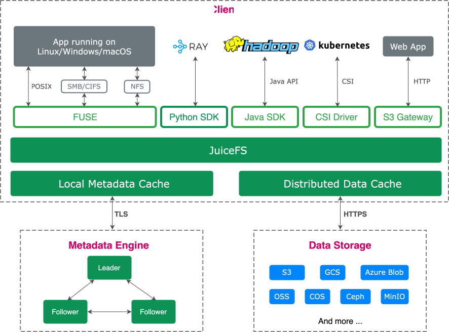
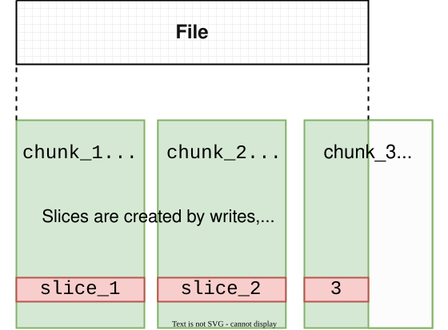
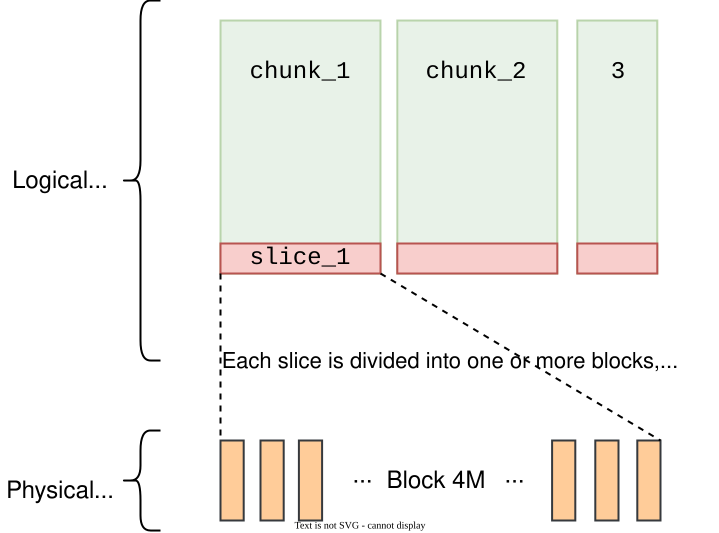
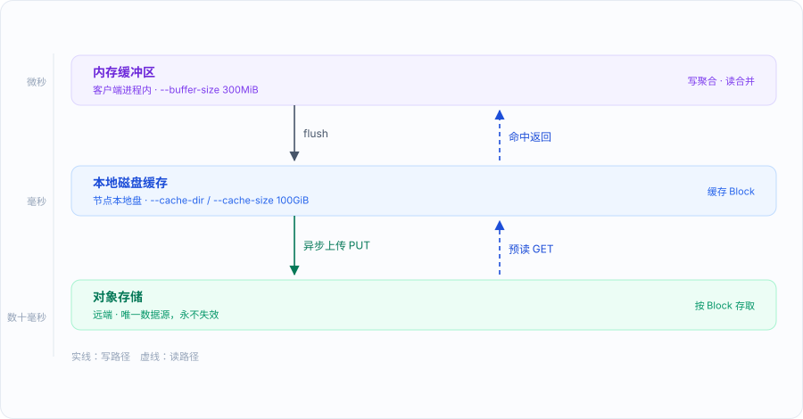
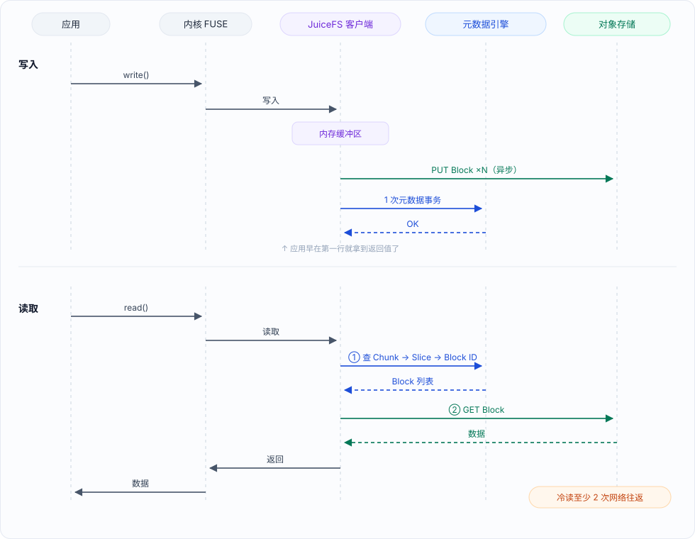
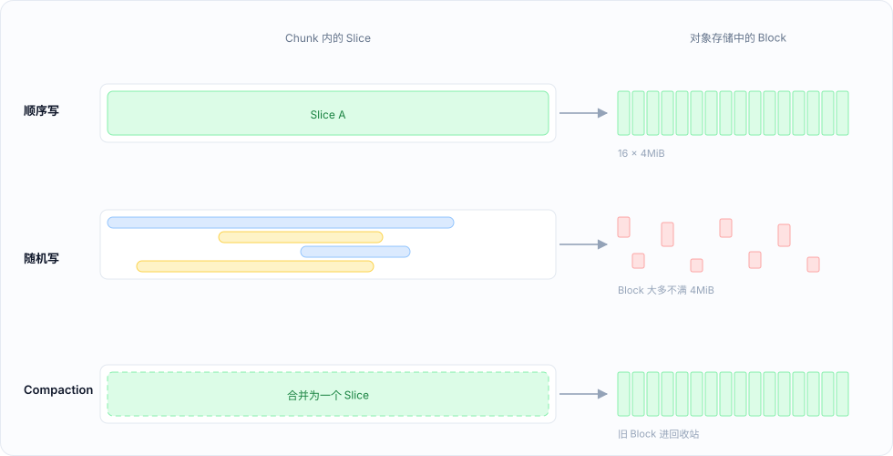
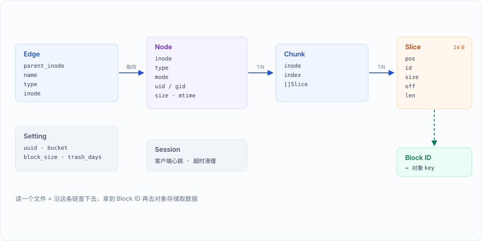
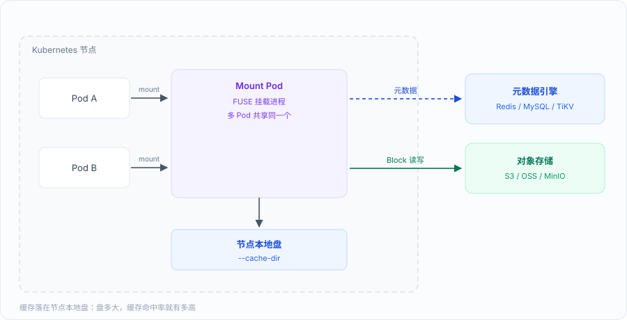
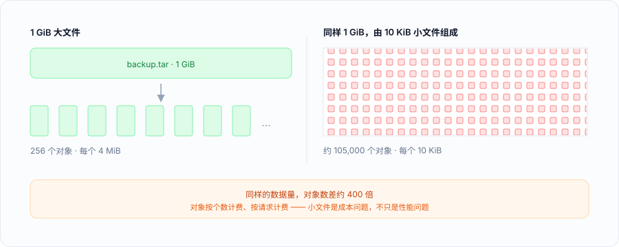

## 前置
### 集中式模式

理解分布式存储之前，先看看单机集中式是怎么走到瓶颈的。一台服务器装上 MySQL，所有数据、所有读写都落在它身上。业务量涨了怎么办？升级硬件——加内存、换 SSD、上更强的 CPU，这叫**垂直扩展**。但垂直扩展很快到头：单机内存有上限，单盘 I/O 有物理极限，更强的机器价格指数上涨。更致命的是，机器再好也是单点，磁盘坏了或者机器宕机，整个业务直接停摆。

垂直扩展不行，就试试水平拆分——把一份数据摊到多台机器上，这就是**分库分表**：

**分库——按业务竖着切**

原来所有业务共用一个 MySQL 实例，现在按业务域拆开：用户库、订单库、商品库各自一台机器。业务互相独立，拆开后各管各的，互不影响。这解决了"单实例扛不住所有业务的连接和 I/O"的问题。

**分表——按规则横着切**

拆完库还有一个问题：单一业务自己的数据量太大，比如订单表几十亿行。B+ 树索引太深，查询变慢；一张表的锁竞争激烈；单表备份恢复都要几个小时。于是把一张大表按规则横切成多张小表：

```
订单表（50亿行）
按 user_id 哈希取模切成 100 张表：
  orders_0   ← user_id % 100 == 0 的订单
  orders_1   ← user_id % 100 == 1 的订单
  ...
  orders_99
```

分库 + 分表组合起来，就是最常见的生产方案：先按业务分库，库内再按哈希或时间范围分表，中间靠 ShardingSphere、MyCat 这类中间件做路由——应用写着普通 SQL，中间件解析后改写 SQL、转发到对应分片。

看起来很分布式了对吧？多台机器、数据分摊、理论上还能继续加机器。**但这只是"切开的集中式"，不是真正的分布式集群**。下面逐条对比：

**1. 分片之间是"互斥"的，不是"互备"的**

真正的分布式集群里，同一份数据会有多个副本分布在不同节点上——任何一台机器挂掉，数据不丢、服务不停。而分库分表的每个分片持有**独一份**的数据：orders_0 所在的机器挂了，这 1% 用户的订单查询就真的不可用了。哪怕给每个分片配一主一从，主库一挂切从库，但写能力依然全押在单个新主上——**单点问题没有消失，只是从一个大单点变成了 N 个小单点**。

**2. 扩容要迁数据，扩不了"闲"容量**

真正的分布式存储加机器，重算一次分布，新数据自然流过去，存量数据靠后台慢慢挪。分库分表加机器则是另一回事：把 100 个分片改成 200 个，意味着几乎**所有存量数据都要按新规则重新洗一遍**——停服迁移或双写迁移，动辄数天，还要应用配合改路由规则。所以分片数往往一开始就按"未来好几年的量"预分好，宁可初期浪费也不能随便动。而"不敢动"本身就说明扩展性是假的。

**3. 路由靠外部中间件，"大脑"还是集中的**

每个分片自己不知道全局规则，"user_id=12345 该去哪个分片"这个问题要靠中间件回答。中间件这层是新的集中点：它要高可用、它有性能上限、它改规则要所有分片联动。而在真正的分布式存储里，"这份数据放在哪"要么由客户端自己算出来，要么查一个专门的元数据中心——路由不再是一个必须经过的中间件。

**4. 跨分片操作是应用的心智负担**

分片前一条 SQL 搞定的事，分片后变了：跨分片的 JOIN 要应用层自己聚合，跨分片事务要引入分布式事务（两阶段提交），全局唯一的自增 ID 要换成雪花算法。**拆分的复杂性转嫁给了应用代码**。真分布式存储里，这些问题对用户是透明的——你写 SQL/挂载文件/PUT 对象，底下怎么分布你完全不用管。

一句话总结：**分库分表是把一个集中式大库切成 N 个集中式小库，数据没有副本互备、扩容要迁移、路由仍需中心、复杂性转嫁应用——它的目标是"让单库撑得住"，而不是"让集群无限长大"**。真正意义上的分布式集群应该做到：数据多副本、节点对等、扩容即生效、故障自动自愈、对使用者完全透明。

这正是后面 JuiceFS 要回答的问题。只不过它的答案有点反直觉：**不自己造，借别人的**。

### 对象存储和CDN详解

#### 对象存储的应用场景与优势

对象存储的优势可以归结为三点：**容量近乎无限（扩容=加机器，无需预先规划）、单 key 一跳寻址（并发能力随机器数线性增长）、HTTP 直接访问（天然适合互联网分发）**。

常见场景按数据特点对号入座：

| 场景 | 数据特点 | 例子 |
|---|---|---|
| 静态资源托管 | 写一次读无数次 | 网站图片/JS/CSS、App 安装包 |
| 备份归档 | 写完基本不改 | 数据库备份、日志归档（Velero 备份进 MinIO 桶，归档存储采用低速大容量磁盘，此外一般如果要读取归档数据会收取高额读取费用） |
| 海量非结构化数据 | 个数以亿计 | 图片/视频库、网盘（OSS+网盘是经典组合） |
| 大数据湖 | 全量留存、多引擎读 | 数据湖存储底座，Spark/OLAP 直接读 |
| 云原生基础设施 | 写一次读多次 | 容器镜像仓库（Harbor）后端、K8s 集群备份 |

结合当下的发展看，对象存储已经从"存文件的另一种方式"变成了**云时代的默认存储底座**：AI 训练数据集几乎都放在对象存储上（容量弹性 + 多计算引擎共享读取）；媒体资产行业用"对象存储 + 转码服务 + CDN"替代自建视频站；连数据库的备份、Binlog 归档也默认往对象存储灌。判断标准就一条：**数据写进去之后基本不改、偶尔整读——满足就用对象存储**。反过来，需要频繁随机更新、强事务的数据（如订单库）依然是块存储/数据库的地盘。

#### 以 MinIO 为例看对象存储的实现

MinIO 是最流行的自建对象存储（S3 兼容），拿它拆解对象存储的内部实现，比讲云上黑盒更直观。

**存储结构：集群 → 池 → rack → server → 盘，object 落在哪由纠删码决定**

```
MinIO 集群（4 台机器，每台 4 块盘，共 16 块盘）
  └─ 每块盘是一个"物理盘池"，盘上按目录组织：
       /data/bucket名/对象key/xl.meta  ← 对象的元数据（key、大小、校验和、版本）
       /data/bucket名/对象key/part.1   ← 对象数据本体（大对象会切多个 part）
```

**多块磁盘、多台机器有什么用**

单机单盘有两个天花板：**容量上限**（一块 16T 盘装不下 100T 数据）和**可靠性上限**（盘一定会坏，坏就丢数据）。把 N 块盘、N 台机器组织成一个对象存储集群，解决的就是这两件事：

- **容量聚合**：16 台机器 × 8 块盘 = 一块"128T 的逻辑大盘"，业务感知不到盘的边界
- **冗余抗故障**：一个对象不放在一块盘上，而是**切开打散到多台机器的多块盘上**（MinIO 用纠删码：一个对象切 4 份数据片 + 若干校验片）。坏一台机器、坏几块盘，剩下的分片能把数据算回来——这就是"多块盘"真正的价值：**不是存得多，而是坏得起**
- **并发分摊**：不同对象的读写落在不同机器上，吞吐随机器数线性增长

**分布在多台机器上，怎么保证准确性**

先补两个核心名词。

**EC（Erasure Coding，纠删码）是什么**：一种用"数学冗余"代替"多副本"的容错方式。拿一个对象，切成 k 份数据分片，再用数学算法（和 RAID 5 的异或同宗但更通用）额外算出 m 份校验分片，k+m 份一起散到不同机器的不同盘上。**只要还有 k 份分片存活（不管坏的是数据片还是校验片），就能把原数据完整算回来**——这就是"允许坏 m 份"的含义。

用最直观的对比（以允许坏 2 块为例）：

```text
3 副本（拷贝 3 份）：        EC k=4, m=2：
  存储开销 200%               存储开销 50%（6 片里有 2 片是校验）
  坏 2 份还在                 坏 2 片还能算回来
  = 1T 数据占 3T 空间         = 1T 数据只占 1.5T 空间
```

冗余效果接近副本，空间省一半以上——代价是**读要凑齐 k 片解码（多一次计算）、写要算校验片**。所以纠删码适合"大对象、写一次读多次"的对象存储/归档场景，数据库这种高频随机小 IO 还是多副本合适。

**写仲裁（write quorum）是什么**：一次写操作要"多少盘确认成功"才算数。EC 组共 k+m 块盘，MinIO 的规则是——**k 份数据片必须全部写成功，且校验片写成功数过半**，才向客户端返回成功；凑不够就直接报错，**绝不出现"告诉客户端成功了、但部分机器还没写上"的中间状态**。读的门槛低一些：凑齐任意 k 片即可解码。

**key 即地址，定位靠算不靠查**。没有一个"账本"记录哪个对象在哪台机器上，任何机器在任何时刻都能从对象名独立算出它的位置：

```text
PUT my-bucket/logs/app.log
  → 对 key 做哈希 → 确定它属于哪一组盘（EC 组）→ 数据切片散到组内各盘
```

再靠三层机制保证数据正确不冲突：

1. **key 全桶唯一**：S3 协议保证同名 key 是"覆盖"而非"共存"——不存在一个 key 两个值各存一份的问题，最后一次成功写入就是唯一答案
2. **写仲裁把"成功"定义死**：上面的 quorum 保证了只要客户端收到成功，数据就已在"多数盘"上落定；任何后续读，要么读到旧值、要么读到新值，**绝不会读到几台机器各写了一半的中间态**（强一致）
3. **分片自带校验和**：每片存有校验和，读取时实时验证；某盘分片损坏，立刻从组内其余分片重新算出正确的片自动修复——数据"烂掉"会被自愈，不会以损坏状态扩散

对比一下这套设计的巧妙之处：传统主从复制要回答"主挂了谁说了算"，才需要选举、需要处理脑裂；而**"算出来的位置"没有主从之分，位置本身不会争抢**——冲突只可能发生在"同一个 key 被并发写"这一件事上，而 quorum 把裁决权交给了"多数盘"这个不可辩驳的事实。

**记住这个"算出来"的思路，后面会看到 JuiceFS 走了完全相反的一条路：查表。**

**如何访问对象存储**

统一走 **S3 API**（事实标准），三种姿势：

```bash
# 1. SDK（程序内嵌）：python/java/go 等语言，本质是签好名的 HTTP 请求
import boto3
s3 = boto3.client('s3', endpoint_url='http://10.1.1.50:9000',
                  aws_access_key_id='xxx', aws_secret_access_key='yyy')
s3.put_object(Bucket='backup', Key='logs/app.log', Body=f)

# 2. CLI 工具：运维常用（aws cli / mc / s3cmd）
mc alias set myminio http://10.1.1.50:9000 ACCESS_KEY SECRET_KEY
mc cp app.log myminio/backup/logs/

# 3. 任何支持 S3 协议的软件直连：Velero、Harbor、Loki、Dify 等
#    填上 endpoint + ak/sk + 桶名即可
```

认证机制是 **AK/SK 签名**：请求带上密钥算出的签名串，服务端验签——不是简单的"账号密码"，而是防止传输中被篡改的请求级签名。S3 兼容的价值就在这：**应用今天连 MinIO，明天迁阿里云 OSS/AWS S3 只改 endpoint，代码不动**。

#### 各大公有云的对象存储

公有云的对象存储和 MinIO 协议同源（都兼容 S3），差别在**地域化部署**：云厂商在全国/全球部署多个**地域（Region）**，每个地域是一套完整独立的基础设施（数据中心集群 + 孤立的故障域），这就是控制台上看到的"华东1（杭州）、华北2（北京）、华南1（深圳）"：

| 厂商 | 产品 | 地域示例 | 特点 |
|---|---|---|---|
| 阿里云 | OSS | 华东1、华北2、华南1... | S3 兼容 + 原生 API，国内生态最全 |
| 腾讯云 | COS | ap-beijing、ap-shanghai、ap-guangzhou | 命名用地区代码 |
| 华为云 | OBS | 华北-北京四、华东-上海一 | 政企市场常见 |
| AWS | S3 | us-east-1、ap-northeast-1 | S3 协议的定义者，全球节点最多 |
| Azure | Blob Storage | East Asia、China North | 与微软生态绑定 |

地域背后的设计逻辑：
- **低延迟**：选离用户近的地域（华东业务选华东节点），物理距离决定基础延迟
- **合规**：数据不出境要求（金融、政务数据必须留在境内指定地域）
- **容灾**：跨地域复制（华东桶 → 华北桶），一个地域级灾难不影响另一份
- **存储类型分层**：同一地域内还分标准存储（热、高频访问）、低频存储（IA）、归档存储（冷、解冻要等几分钟到几小时）、深度归档——价格从高到低，**冷热分层是省存储成本的第一手段**

> 每个桶创建时必须指定地域，桶名在全地域全局唯一（因为访问域名是 `bucket.oss-cn-hangzhou.aliyuncs.com`，地域直接编码进域名）。跨地域访问桶要走公网或专线，内网加速只在同地域内生效（如 ECS 挂同地域 OSS 走内网 endpoint，免流量费且延迟低）。

#### CDN：给对象存储装上全国的分发网络

**为什么需要 CDN**：对象存储再强，也是"集中存放"——你的桶在杭州，广州用户访问就得跑 1400 公里，跨运营商还要绕路。静态资源（图片/JS/CSS） 80% 以上的流量是重复读同样的内容，让每个用户都回源站取，既慢又浪费源站带宽。CDN（Content Delivery Network，内容分发网络）的解法：**把内容缓存到离用户最近的边缘节点**。

**工作原理（一次请求的完整路径）**：

```text
用户请求 img.example.com/cat.jpg
  ▼
DNS 解析：CDN 的智能调度系统根据用户 IP 归属地/运营商，
         返回离用户最近的边缘节点 IP（广州用户 → 广东的边缘节点）
  ▼
边缘节点（Edge）：
  ├── 缓存命中（Hit）→ 直接返回，用户拿到的延迟是几 ms 级
  └── 缓存未命中（Miss）→ 回源（回 origin）：
         向源站（对象存储桶）要文件 → 缓存到本地 → 返回给用户
         下一个同区域用户再请求，就是 Hit 了
  ▼
缓存过期由 Cache-Control 控制（如 max-age=86400 缓存一天）
```

**CDN + 对象存储 = 静态资源的标准架构**：对象存储当**源站（origin）**负责存，CDN 当**缓存层**负责快。收益三连：用户延迟从几百 ms 降到几十 ms；源站带宽成本大降（90%+ 请求被边缘节点消化，回源流量极少）；对象存储只承受回源级别的低压力，无扩容焦虑。

**实战案例：Cloudflare CDN + 对象存储部署静态博客**

我这个博客就是这么部署的，完整链路：

```text
1. 博客是 Astro 静态站点，pnpm build 产出纯 HTML/CSS/JS
2. push 到 GitHub → CI 自动执行构建（或本地构建）
3. 构建产物推到对象存储（Cloudflare R2 / 或 S3、OSS 均可）
4. Cloudflare CDN 挂上：
   - 域名 DNS 托管到 Cloudflare
   - 绑定自定义域名 blog.example.com → 指向 R2 桶
   - 开启边缘缓存：全球 300+ 边缘节点缓存 HTML/图片
5. 用户访问 blog.example.com：
   → 就近边缘节点直接返回缓存页面（未命中才回源 R2）
   → 源站几乎零流量，页面加载从"回源一次几百 ms"变成"边缘命中几十 ms"
```

选 Cloudflare 的原因：**CDN 流量免费、R2 出口流量免费**——静态博客这种"读多写少"的场景几乎零成本。全球访问体验一致：国内用户走亚洲边缘节点，海外用户走当地节点，不用自己管任何服务器。

**CDN 的其他关键概念（生产会用到）**：
- **缓存刷新（purge）**：源站文件更新后，边缘节点的旧缓存要主动清掉（URL 刷新/目录刷新），否则用户读到旧版本直到缓存过期
- **回源 Host/回源协议**：CDN 回源时访问对象存储的配置要对应上（私有桶要给 CDN 授权读）
- **防盗链**：Referer 白名单/签名 URL，防止别人把你的 CDN 流量盗用在他自己的网站上
- **HTTPS**：CDN 边缘证书自动申请续期（Cloudflare/阿里云都免费提供），源站可以继续用私有桶不开公共读

小结：**对象存储解决"海量数据放哪"，CDN 解决"怎么让全球用户都快"——桶当源站、边缘当缓存，这对组合是现代静态内容分发的默认答案，个人博客和巨头视频站用的是同一套架构，差别只在规模**。

### 块存储、文件存储、对象存储

在讲 JuiceFS 之前，先分清两个容易混淆的底层概念：

- **块级（block）**：操作系统读写硬盘的基本单位，一块通常 4KB。操作系统不关心"文件"，只负责按块地址读写磁盘
- **文件级**：在块之上由文件系统（如 XFS）管理的一层。文件系统负责把"逻辑文件"翻译成"逻辑块"，再映射到"物理块"，最后落到"扇区"。所以文件读写要经过 缓存 → 逻辑文件 → 逻辑块 → 物理块 → 扇区 这一长串环节

这也解释了为什么**块级效率高、文件级效率低**——文件级中间环节多。但文件级带来的好处是"多机共享时数据一致"和"按名字存取"，两种模式各有定位。

三种存储形式的本质区别，可以用"客户端拿到的是什么"来区分：

**块存储——客户端拿到一块裸盘**

存储端通过网络（iSCSI 等）把一块裸盘虚拟出来给客户端，客户端看到的就是 `/dev/sdb` 这样的设备。格式化、做文件系统、甚至往里装操作系统都由客户端自己决定。定制性最强，典型用途是虚拟机的硬盘。

缺点：盘是"独占"的，两台机器各拿一块盘写数据，互相看不见对方写了什么，**无法保证多机数据一致**。

**文件存储——客户端拿到一个文件夹**

文件系统做在存储设备端（如 NFS 服务端），设备端把一个文件夹通过网络共享出来，客户端挂载后像用本地目录一样读写。因为文件系统只有服务端一份，多台客户端看到的自然是同一份数据，**多机数据一致性有保证**，适合中小规模集群共享存储。

缺点：所有文件的检索（查目录、找块位置）都发生在服务端，客户端越多，服务端检索压力越大，**扩展集群规模时先撞上服务端瓶颈**——这正是前面说的 NFS 痛点。

**对象存储——客户端拿到一个 URL**

没有文件系统概念，也没有目录树。数据以 KV 键值对形式存放，值是数据内容本身，键附带一组元数据（大小、类型、自定义标签等），通过 URL 直接提交和获取（HTTP 协议，PUT/GET）。

因为没有"文件"可检索，服务端不存在随客户端数量增长的检索压力（以 NFS 文件存储为例，大量客户端访问 NFS 服务器，服务端还需要查找每一级目录的目录表。而对象存储直接通过 key 查询 O(1)，并且可以轻松分片到任意多台机器），**理论上可以无限扩展**。阿里云 OSS、AWS S3 都是这个形态，适合海量非结构化数据：图片、视频、备份、网盘。

三种形式放在一起对比：

| 对比维度     | 块存储              | 文件存储                       | 对象存储               |
| ------------ | ------------------- | ------------------------------ | ---------------------- |
| 客户端获得   | 裸盘（如 /dev/sdb） | 文件夹（如 /opt）              | URL 接口（KV 键值对）  |
| 文件系统制作 | 客户端自行制作      | 存储设备端制作                 | 无文件系统概念         |
| 数据一致性   | 无法保证多机一致    | 可保证多机一致                 | 可保证多机一致         |
| 服务端压力   | 低（检索在客户端）  | 高（检索随客户端增多成倍增长） | 低（无文件检索）       |
| 主要场景     | 虚拟机硬盘、装系统  | 中小规模集群共享存储           | 大规模分布式存储、网盘 |
| 可扩展性     | 一般                | 受限（服务端压力瓶颈）         | 理论无限扩展           |
| 典型代表     | iSCSI、云盘         | NFS、SMB/CIFS                  | S3、OSS、MinIO         |

看到这里矛盾就出现了：**对象存储容量无限、成本最低、扩展最爽，但偏偏没有"文件"**。它只有 KV，没有目录树、没有 `open/read/write`、不能随机改一个字节。而现实中大量应用——AI 训练框架、Hadoop 生态、传统业务程序——只认 POSIX 文件语义，不会为了用一个存储去改代码。

于是有两条路：

1. **自己造一整套分布式文件系统**：自己管盘、自己做副本、自己维护目录树（HDFS、Lustre、GlusterFS 都是这条路）。重，但完全可控。
2. **借对象存储存数据，再用一层软件补上"文件系统"的语义**：数据还是那些 KV，只是额外维护一份"说明书"告诉你哪些 KV 拼成哪个文件、每个字节在哪个 KV 的哪个偏移。

第二条路就是 JuiceFS。

## JuiceFS

### 先定位：它是对象存储的"文件系统外壳"

一句话：**JuiceFS 把对象存储包装成一个 POSIX 文件系统。数据存在对象存储里，元数据（目录树、inode、文件到数据块的映射）存在一个数据库里，两者靠客户端缝起来。**

它解决的是一个很具体的问题：**手上已经有一堆便宜、无限、可靠的对象存储，怎么让只认文件系统的应用用上它。**

理解 JuiceFS 的关键，全部浓缩在"数据与元数据分离"这七个字里。它的每一个优点和每一个缺点，都是这七个字的直接推论。

### 三大组件



看图时抓三件事：

1. **客户端是唯一的执行者。** 最上面一排接入方式（FUSE、Java SDK、CSI Driver、S3 Gateway、WebDAV、HDFS、Python SDK）全部汇进同一个客户端；本地元数据缓存（Local Metadata Cache）和分布式数据缓存（Distributed Data Cache）也都挂在客户端这一侧，不在服务端。
2. **向下是两条完全独立的腿。** 左边去元数据引擎（Leader/Follower 集群），右边去对象存储，一条走数据库协议、一条走 S3 协议，互不干扰——这就是"数据与元数据分离"的物理形态。
3. **对象存储是可替换的底座。** 图上列了七八种（S3/OSS/COS/MinIO/Azure Blob/GCS…），换后端对上层应用完全透明。

**三个组件，三种角色分工，一个都不能少：**

**① 客户端——干所有活的那个**

JuiceFS 采用"富客户端"设计：文件读写、数据块上传下载、碎片合并（Compaction）、回收站过期删除、会话心跳，**全部在客户端里发起和执行**。服务端（元数据引擎 + 对象存储）不会也不能主动修改任何文件系统数据——元数据引擎只是被读写的数据库，对象存储只是被 PUT/GET 的对象仓库。

这个设计带来一个巨大的运维好处：**客户端完全无状态**。挂几千台机器，随便挂、随便卸、进程崩了重启就行，不需要整个集群跟着搬数据。

客户端有很多接入形态，本质都是同一个内核：

| 形态 | 用途 |
|---|---|
| FUSE 挂载 | 最常用，`juicefs mount`，变成本地目录 |
| Kubernetes CSI | 容器场景的标准接入方式，支持 `ReadWriteMany` |
| Hadoop Java SDK | 替代 HDFS，给 Spark/Hive/Presto 用 |
| S3 网关 | 反向提供 S3 接口，给只认对象协议的应用 |
| WebDAV | 轻量共享 |
| Python SDK | 进程内直接访问，给 Ray 这类框架 |

**② 元数据引擎——查表的地方**

用现成的数据库，不自己造。三大流派：Redis（内存 KV）、SQL（MySQL/PostgreSQL/SQLite）、TKV（TiKV/etcd/BadgerDB）。

这里要特别注意：**它是整个系统的单点强依赖**。对象存储里存的是没有名字的二进制块，元数据一丢，那些块就永远无法被解释回文件——**元数据没了，数据就等于没了**。这是 JuiceFS 运维的第一铁律，后面还会展开。

**③ 数据存储——放 Block 的地方**

一个 S3 兼容的桶就行。技术上也可以是本地文件系统目录，但 99% 的场景是对象存储。

**为什么用 FUSE 而不是自己写内核模块？**

JuiceFS 基于 FUSE 的用户态实现（go-fuse，不是 libfuse），而且用的是 **low-level API**——基于 inode 而不是基于路径。

这个选择很讲究。high-level API 是路径式的（`lookup("/a/b/c")`），适合元数据本来就用路径组织的系统，比如 HDFS 和 S3——它们的 FUSE 实现要在内部把路径翻译成 inode，再做一次 inode → path → inode 的来回转换，性能天然差一截。而 JuiceFS 的元数据**本来就是按 inode 组织的**，直接用 low-level API 是"有什么用什么"，零转换开销。

### 三级拆分：Chunk / Slice / Block

在讲读写之前必须先讲清楚这三个单位，否则后面全看不懂。这是 JuiceFS 最核心的数据组织方式。

先看**逻辑视图**——文件按 64MiB 定长切成 Chunk，Chunk 内部由一次次写入产生的 Slice 填充：



再看**物理视图**——Slice 在上传前被切成 4MiB 的 Block，可选压缩和加密，然后成为对象存储里的独立对象：



但两张图之间还漏了一个关键细节：**同一个 Chunk 内的多个 Slice 会重叠**。读的时候按写入时间合并，后写的覆盖先写的：

```text
Chunk 1（偏移 64~128MiB）内部：

  Slice A ────────────────────────►  07:00 第一次写入整个 Chunk
  Slice B         ──────────►        07:05 覆盖写中间一段
  Slice C                          ──►09:00 在末尾追加
  ↑ 按写入时间顺序 append 到 Chunk 的 Slice 列表
  ↑ 读取时按顺序合并，重叠部分以后写入的 Slice 为准
```

这也是后面"随机写为什么慢"的伏笔：**Slice 越多，读的时候要合并的份数就越多。**

**三个单位，一句话记住各自的职责：**

| 单位 | 大小 | 是什么 | 回答什么问题 |
|---|---|---|---|
| **Chunk** | 固定 64 MiB | 定位单位 | "我要读文件的第 70MiB，该去哪查？"→ 第 1 个 Chunk，不用从文件头遍历 |
| **Slice** | 可变 | 写入单位 | "这次 write 落在哪段逻辑区间？"→ 连续写就 append 到同一个 Slice，否则新建 |
| **Block** | 默认 4 MiB | 存储单位 | "上传到对象存储的最小单元是什么？"→ 4MiB 一个 S3 对象，不可变 |

Chunk 之所以要固定 64MiB，是为了"读大文件时能快速定位"——有 Chunk，读百万 GB 文件的某个偏移只需要一次除法；没有 Chunk 就得遍历 Slice 链表。

Block 之所以是 4MiB，是对象存储的甜点区：太小则对象数量暴涨（按请求计费亏死），太大则小文件和随机写浪费严重。

### 写路径：写内存就返回，后台慢慢搬

这是 JuiceFS 写性能的关键，也是最容易被误解的地方——**`write()` 返回成功，不代表数据已经到了对象存储**。

```text
应用 write(2)
   ▼
内核 VFS → FUSE
   ▼
JuiceFS 客户端：数据写入内存缓冲区
               按 Chunk/Slice 组织，能 append 就 append
   ▼
立即返回（几十微秒级）  ←──── 应用感觉"写得飞快"

       ……… 异步 ………

触发 flush 的条件（任一满足）：
  · 单个 Slice 体积过大
  · 一个 Chunk 内 Slice 数量过多
  · 数据在缓冲区停留时间过长
  · 应用调用 close() 或 fsync()
   ▼
Slice 按默认 4 MiB 切成 Block
   ▼
并发 PUT 到对象存储（--max-uploads，默认 20 并发）
   ▼
全部成功后，写一次元数据：把这个 Slice 追加进对应 Chunk 的 Slice 列表
```

**三个必须记住的结论：**

**1. 元数据只写一次，这是写性能的核心优化**

一个 64MiB 的 Slice 会切成 16 个 4MiB Block，产生 16 次对象存储 PUT，但**元数据只更新一次**（追加一条 24 字节的 Slice 记录）。

顺着这个比例可以预测性能：`meta.txn : object.put_c ≈ 1 : 16`。用 `juicefs stats` 观察顺序写时，能看到对象存储 PUT 的平均大小正好等于 BlockSize（4MiB），元数据事务数和 PUT 数的比例就是这个 1:16。**如果这两个数字对不上，就说明负载形态不对**（比如随机写导致 Block 都是碎的）。

**2. 缓冲区是真瓶颈，不是带宽**

默认内存缓冲区 300MiB（`--buffer-size`）。数据只有在持久化后才能释放，所以：

- 用量超过阈值 → 客户端主动给每次 write 加约 10ms 等待，减缓写入
- 用量超过阈值两倍 → **直接暂停写入**，应用卡住

所以看到"写变慢"的第一反应应该是看 `juicefs stats` 里的 `usage.buf` 水位，而不是怀疑网络。对策有两条：加大 `--buffer-size`，或者加大 `--max-uploads` 提高上传并发让缓冲区更快排空。

**3. 顺序写是主场，小文件走特例**

顺序写时整个 Chunk 只会有一个不断长大的 Slice，最后 flush 一次，Block 个个都是满 4MiB——对象存储的吞吐能打满。

小文件（不足一个 BlockSize）走另一条路：**在文件 close 时一次性上传**，PUT 的大小就等于文件大小（比如一个 128KiB 的文件就是一个 128KiB 的对象）。同时还会往本地磁盘缓存写一份，所以第二次读极快。

代价埋在后面：对象存储里塞了一堆小对象。**对象存储按对象个数计费、按请求次数计费**，海量小文件在 JuiceFS 上是双重成本杀手——这直接决定了它的适用边界。

### 读路径：两次网络往返，靠缓存救回来

```text
应用 read(2)
   ▼
客户端先问元数据引擎（第 1 次网络往返）：
  "inode X 的第 N 个 Chunk 里有哪些 Slice？每个 Slice 对应哪些 Block ID？"
   ▼
元数据引擎返回 Block 列表
   ▼
客户端按 Block ID 直接 GET 对象存储（第 2 次网络往返）
   ▼
返回数据，同时异步预读后续 Block 到本地缓存
```

**这就是"数据与元数据分离"必须付出的代价：冷读至少两次网络往返。**

本地盘 read 是微秒级，JuiceFS 的冷读是毫秒级（元数据库一次 RTT + 对象存储一次 RTT）。所以它必须靠缓存把热数据拉回到接近本地盘的体验。

**JuiceFS 的缓存是分层的：**

| 层级 | 位置 | 作用 | 相关参数 |
|---|---|---|---|
| 内存缓冲区 | 客户端进程内存 | 写聚合、读合并 | `--buffer-size`（默认 300MiB） |
| 本地磁盘缓存 | 客户端所在机器的盘 | 缓存 Block，热读不回源 | `--cache-dir`、`--cache-size`（默认 100GiB） |
| 对象存储 | 远端 | 真正的数据源，永远不失效 | — |


*内存缓冲区负责聚合，本地磁盘缓存负责把热 Block 留住，对象存储是唯一数据源。实线是写路径，虚线是读路径。*

读取时的策略是**预读**：GET 到一个 Block，同时异步把后续整块下载进本地缓存（`--prefetch` 控制并发度）。顺序读时预读命中率极高，几乎能把对象存储的带宽吃满。

大文件随机读则要反过来 —— 预读白白浪费带宽和缓存空间，还挤掉别的数据。这时候两个选项：`--prefetch=0` 关掉预读，或者把 `--cache-size` 加大到能几乎完全装下热数据；极端场景下 `--cache-size=0` 彻底禁用缓存，把性能全押在对象存储上。

**为什么敢缓存？因为 Block 不可变——这是全文最值得理解的一个设计。**

传统文件系统不敢随便缓存，因为数据随时会被改，inode 一变，所有客户端和所有层级的缓存都要失效，多机共享还要靠锁或 lease 来保证顺序。

JuiceFS 绕开了整个问题：

```text
覆盖写一个 Block 里的内容：
  ❌ 不下载 → 修改 → 重新上传（这叫读写放大，会慢到不可接受）
  ✅ 新分配一个 Slice → 写新 Block → 上传 → 元数据追加新 Slice
                                   ↓
                     旧 Block 的内容永远不变，只是"元数据不再引用它"
```

既然对象存储里的 Block **一旦写入就永不修改**，那么"某个 Block ID 对应什么内容"这个映射就永久有效。客户端缓存的内容**永远不会过期**，只存在"命中"或"未命中"两种状态，不存在"缓存里是旧数据"这种情况。

同样的思路在别处也见过：Git 的对象库（对象按内容哈希寻址、永不修改）、Docker 镜像的分层（层只读，容器改动写在新的可写层）——都是"**不可变数据 + 可变索引**"。


*把两条路摆在一起看不对称在哪：写是「写完内存就返回，后台 1 次元数据事务」；读是「先查元数据拿 Block ID，再去对象存储取数据」，冷读必然两次往返。*

### 随机写为什么慢，Compaction 在解决什么

把上面的机制推到随机写，问题立刻暴露：


*同样写满一个 64MiB 的 Chunk：顺序写只产生 1 个 Slice、16 个满 4MiB Block；随机改 20 次就留下 20 个碎 Slice，Block 个个不满 4MiB。Compaction 做的事就是把碎 Slice 重新合并成整块，旧 Block 丢进回收站。*

代价是双份的：**对象存储那边对象数量上涨（请求成本和空间浪费），元数据这边 Slice 列表变长（每次读都要合并）**。

JuiceFS 的对策是 **Compaction（碎片合并）**：

- **自动触发**：后台任务发现某个 Chunk 内 Slice 过多，就把它们合并、重写成一个完整的新 Slice，然后清理旧 Slice
- **手动触发**：`juicefs gc` 命令，同时做两件事——清理元数据不再引用的孤立对象（旧 Block），以及清理回收站中过期的文件
- **回收站机制**：Compaction 删掉的旧 Slice 不会立刻消失，会在 `DelSlices` 里保留和回收站相同的天数（`--trash-days`，默认 1 天），万一合并出问题还能回滚

**所以边界很清楚：大文件顺序写是 JuiceFS 的主场，数据库那种高频原地随机小 IO 是它的死穴。** 不是"性能差一点"，是架构级的错配——每次随机写都要多一个对象、多一条元数据。

### `--writeback`：把本地盘当对象存储的缓存

追求极致写性能还有一个开关：

```text
默认（回写关闭）：
  write → 内存 → flush 时同步上传对象存储 → 上传完成才算 flush 完成

--writeback（回写开启）：
  write → 内存 → flush 时只写本地缓存目录 → 立即返回
                                      ↓
                          后台线程异步上传到对象存储
```

本质是把本地磁盘变成对象存储的缓存层。

**代价必须说清楚：**
- **本地盘坏了，还没上传的数据直接丢**（此时元数据已经更新，但对象存储里没有对应 Block）
- 多客户端场景下，其他节点看到的是旧数据（要等异步上传完成）
- 本地缓存被淘汰策略误删也会造成数据丢失

所以它只适合"数据可重算、丢了不心疼"的场景：训练中间产物、临时批处理文件、日志暂存。**生产上的持久数据不要开这个开关。**

### 元数据里到底存了什么

JuiceFS 的元数据不是什么神秘格式，就是几张表或几个 key。理解它，才能理解它的性能和边界。

| 结构 | 存什么 | 类比 |
|---|---|---|
| `Setting` | 卷的格式化信息：UUID、bucket、BlockSize、压缩算法、加密密钥、回收站天数、容量/文件数配额 | 卷的身份证 |
| `Node` | 每个文件的 inode 属性：类型、mode、uid/gid、atime/mtime/ctime、nlink、文件长度 | `stat` 的全部字段 |
| `Edge` | `父 inode + 文件名 → (类型, 子 inode)` | 目录项（dentry） |
| `Chunk` | `(inode, chunk index) → Slice 列表` | 文件内容索引 |
| `SliceRef` | Slice 的引用计数 | 快照/克隆共享 Block 时用 |
| `LinkParent` | 有多个父目录的文件（硬链接）的父目录列表 | — |
| `Symlink` / `Xattr` | 软链指向 / 扩展属性 | — |
| `Flock` / `Plock` | BSD 锁 / POSIX 记录锁 | 支持文件锁 |
| `Session` | 客户端会话心跳，超时自动清理 | 谁在挂载 |
| `DelFiles` / `DelSlices` / `Sustained` | 异步清理队列、回收站、打开中待删文件 | 垃圾回收的账本 |


*读一个文件的路径：`Edge` 用「父 inode + 文件名」找到目标 `Node`，`Node` 按 Chunk 索引找到 `Chunk`，`Chunk` 里挂着 Slice 列表，每个 `Slice` 最终指向对象存储里的 `Block ID`。*

在 Redis 里这些结构长这样，可以直接 `SCAN` 出来看：

```text
i10086        → String     inode 10086 的属性（二进制编码）
d10086        → Hash       inode 10086 目录下的条目 { 文件名: (type, inode) }
c10086_3      → List       inode 10086 第 3 个 Chunk 的 Slice 列表
                          每个 Slice 恰好 24 字节：Pos/ID/Size/Off/Len 五个 uint
sliceRef      → Hash      需要多引用的 Slice 计数
setting       → String    JSON 格式的卷配置
allSessions   → ZSet      所有活跃客户端，score 是各自的超时时间
```

**四个值得注意的设计细节：**

**1. Slice 只占 24 字节。** 顺序写一个 64MiB 的 Chunk，元数据里就只有一条 24 字节的记录。这就是前文"元数据只写一次"的具体形态——**元数据量级由写入次数决定，不由数据量决定**。

**2. SliceRef 默认不存在。** 绝大多数 Slice 引用计数都是 1，为了省 entry，Redis/TKV 里存的是"引用数减 1"——所以值为 0 时根本不创建记录。这是极致的空间优化。

**3. 目录是 Hash，不是 B 树。** Redis 里一个目录就是一个 Hash，删文件是 `HDEL`，查文件是 `HGET`，都是 O(1)。对比 HDFS 的 NameNode：整棵目录树常驻内存，千万级文件就顶到内存天花板，这也是 HDFS 一直被诟病的扩展瓶颈。JuiceFS 把这件事外包给了数据库，能扩到什么量级取决于数据库。

**4. inode 号由 Counter 全局分配**（`nextInode` 递增），和传统文件系统一样。

### 元数据引擎怎么选

选型就是在"速度 / 规模 / 运维成本"这个三角里选一个点：

| 引擎 | 类型 | 元数据延迟 | 规模上限 | 运维负担 | 适合 |
|---|---|---|---|---|---|
| **Redis** | 内存 KV | 最低（百微秒级） | 受内存容量限制，通常千万~亿级 inode | 中（要自己保证持久化、主从/Cluster） | 高性能、inode 数可控、能接受内存成本 |
| **MySQL / PostgreSQL** | 关系型 | 毫秒级 | 单库千万~亿级 | 低（备份/主从/监控工具链最成熟） | 通用生产环境的默认选择 |
| **SQLite** | 单文件 | 本地盘级 | 百万级 | 零 | 单机、POC、边缘设备 |
| **TiKV** | 分布式 KV（Raft） | 毫秒级 | 千亿级，可水平扩展 | 高（要单独维护一个 TiKV 集群） | 超大规模、多副本强一致 |
| **etcd / BadgerDB** | KV | 毫秒级 | etcd 不适合存大量元数据 | 中~高 | 特定场景 |

**实操建议：**

- **个人/小团队**：MySQL 或 PostgreSQL。不是最快的，但出问题会查的人最多，这是运维上最大的优势。
- **追求性能的 AI 训练集群**：Redis。但必须配持久化和定时备份——**元数据丢了整个卷就废了**。
- **千亿文件级**：TiKV。
- **企业版/云服务**：官方自研的 Raft 元数据集群，单卷支持数千亿文件、毫秒级延迟，这是它相对开源版的卖点之一。

**元数据备份是唯一不能省的事。** 因为对象存储里的 Block 没有元数据就是一堆无法解读的二进制，所以备份元数据 = 备份整个文件系统：

```bash
juicefs dump  redis://10.0.1.10:6379/1  meta-backup.json   # 导出
juicefs load  redis://new-host:6379/1   meta-backup.json   # 导入（也可用于迁移元数据库）
```

用 MySQL 的话还有一层保险：常规的 `mysqldump`/主从复制同样适用，因为元数据就是普通的表。

### 一致性：元数据强一致 + 数据不可变 = 整体强一致

JuiceFS 对外宣称"已提交的修改立即在所有服务器上可见"。这个强一致不是靠分布式共识算法堆出来的，而是靠两个简单事实拼出来的：

**第一，元数据的写是事务性的。** 一次 create/rename/write-unlock 在 MySQL 里是一个事务，在 Redis 里是一段 Lua 脚本原子执行。所有客户端读的都是同一个元数据引擎，所以**文件一提交，所有客户端立刻看到**。

**第二，数据 Block 不可变。** 写新数据等于"上传新 Block + 更新元数据指向"，在元数据更新之前客户端读不到新数据，更新之后读到新数据；而旧 Block 的内容不会变，所以缓存永远不会读到"半新半旧"的中间态。

两者拼起来，**不存在"两个客户端看到不同版本"的时间窗口**。

这个设计的代价也很明确：**元数据引擎成了整个系统的唯一强依赖**。元数据引擎挂了，卷就不可用——哪怕对象存储完好无损、数据全都安静地躺在那里。这是 JuiceFS 最大的可用性风险，也是它必须有元数据高可用方案的根本原因（Redis 主从 + Sentinel、MySQL 主从、TiKV 三副本、企业版 Raft 集群，选哪个引擎就要把对应的高可用一起做掉）。

### 部署与运维：四个命令、四类指标

**建卷（format）**

```bash
juicefs format \
  --storage s3 \
  --bucket https://s3.cn-east-1.example.com/myjfs \
  --access-key AK --secret-key SK \
  redis://10.0.1.10:6379/1 \
  myjfs
```

这一步做的事：验证对象存储可写 + 在元数据引擎里写入 `Setting`（生成 UUID、记录 bucket 和 BlockSize 等）。**卷的 UUID 从此固定，元数据和对象存储里的数据靠 UUID 绑定**——所以千万别对同一个 bucket 重复 format，一旦 UUID 变了，旧数据就成了没人认领的孤儿。

**挂载（mount）**

```bash
juicefs mount redis://10.0.1.10:6379/1 /mnt/jfs \
  --cache-dir /data/jfscache \    # 缓存目录，选 SSD 或高速云盘
  --cache-size 102400 \           # 缓存上限（MiB），默认 100GiB
  --buffer-size 1024 \            # 写缓冲（MiB），默认 300
  --writeback                     # 可选，只在可重算数据上用
```

真正需要调的就这四个，其他都有合理默认值。

**观测（这是 SRE 最该关注的部分）**

```bash
juicefs stats  /mnt/jfs            # 类 iostat 的实时指标流
juicefs status redis://10.0.1.10:6379/1    # 卷状态、所有活跃客户端会话
juicefs gc     redis://10.0.1.10:6379/1    # 清理孤立对象 + 回收站过期
juicefs fsck   redis://10.0.1.10:6379/1    # 元数据一致性检查
```

`juicefs stats` 输出里要盯的核心字段：

| 指标 | 含义 | 怎么看 |
|---|---|---|
| `usage.buf` | 写缓冲区水位 | 长期贴阈值 = 写入被限流，加 `--buffer-size` 或 `--max-uploads` |
| `object.put` / `object.put_c` | PUT 量与次数，两者相除是平均对象大小 | 应接近 BlockSize（4MiB）；远小于它说明随机写严重 |
| `meta.txn` | 元数据事务数 | 与 `object.put_c` 的比例偏离 1:16 太多要查负载形态 |
| `blockcache` | 本地缓存命中情况 | 命中率低 = 缓存太小或访问模式随机 |
| `fuse.write` / `fuse.ops` | FUSE 层平均请求大小 | 反映应用的实际 IO 粒度 |

生产环境一定要接 Prometheus：挂载时加 `--metrics 0.0.0.0:9567`，配官方 Grafana 模板。**要告警的三件事：缓冲区持续高位、元数据引擎不可用、缓存目录磁盘将满。**

**在 Kubernetes 里用**

通过 CSI 驱动，两种供给模式：

- **静态供给**：先手工 `juicefs format` 建好卷，PV 里写上 `volumeHandle`（卷名），多个 Pod 挂同一个 PVC，天然支持 `ReadWriteMany`——这是 NFS 的替代方案，也是 K8s 共享存储的主流选择。
- **动态供给**：在 StorageClass 里配好元数据引擎和对象存储，每次创建 PVC 自动建一个新卷——适合"每个训练任务一个独立工作区"的多租户场景。

有个坑必须提前知道：**CSI Node Plugin 会在 Pod 所在节点启动一个挂载进程（Mount Pod），数据缓存落在节点本地盘上**。所以：
- 节点本地盘容量直接决定缓存命中率，节点盘小 = 缓存频繁淘汰 = 退回对象存储带宽
- 缓存目录要放到数据盘，不要放到系统盘（会把节点写崩）
- Mount Pod 是共享的，多个 Pod 挂同一个卷会复用同一个挂载进程


*同一个节点上的多个 Pod 共用同一个 Mount Pod（也就共用同一份本地缓存）；元数据走虚线去元数据库，数据走实线去对象存储。*

### 这套设计的取舍

把"数据怎么放、放几份、坏了怎么修"全部外包给对象存储之后，JuiceFS 自己只剩下一件事：**把 KV 变成文件树**。这个分工带来三个明确的收益，也带来两个必须接受的代价。

**收益：**

- **轻**：没有需要自己实现的副本协议、没有需要自己实现的故障恢复，代码只关心元数据和块映射
- **弹性**：容量和吞吐直接跟着对象存储走，对象存储扩容对客户端完全透明
- **可替换**：换对象存储只改一个 endpoint，换元数据库只做一次 `dump` + `load`

**代价：**

- **可用性被两个外部依赖夹住**：元数据库挂了卷就不可用（这是硬依赖），对象存储挂了数据就读不到。JuiceFS 自身的高可用做得再好，也补不上这两个依赖的窟窿——所以真正的工作量在"把 Redis/MySQL/TiKV 的高可用做扎实"上
- **延迟永远比本地盘高一个量级**：冷读要过两次网络，这个物理事实改不了，只能靠缓存把热数据拉回来

一句话：**JuiceFS 不生产存储，它只是存储的搬运工和翻译官。**

### 适用边界

**适合**

- **AI/ML 训练**：大文件为主、多机共享读、要求 POSIX、缓存命中率高——这是 JuiceFS 最舒服的场景
- **K8s 共享存储**：`ReadWriteMany`，让应用无状态化
- **大数据**：替代 HDFS 存冷数据，Hadoop Java SDK 直接对接 Spark/Hive/Presto
- **备份归档**：写一次读极少，对象存储的冷归档成本优势最大化
- **跨云跨地域共享**：对象存储天然全局可达，多个集群挂同一个卷

**不适合**

- **海量小文件**：千万级以上，元数据压力和对象存储的请求成本双杀
- **高频随机写**：数据库数据目录、消息队列的数据目录
- **极低延迟场景**：HPC 的临时 scratch、需要微秒级 IO 的在线业务
- **元数据无法高可用的场景**：元数据引擎挂了整个卷不可用，比对象存储的中断影响大得多


*同样是 1 GiB：一个大文件只变成 256 个整齐的 4 MiB 对象；换成 10 KiB 的小文件就变成约 10 万个碎对象，元数据项和请求数同步翻 400 倍。*

**一句话判断标准**：**数据写进去之后基本不改、以读为主、文件偏大 → 适合；需要频繁原地修改、文件极碎、要求微秒级延迟 → 换方案。**

### 回到前置：它没有造轮子，造的是胶水

现在回头看前置章节留下的四个问题：

| 分库分表的病 | JuiceFS 怎么解决 |
|---|---|
| 分片互斥、没有副本 | 对象存储自己保证多副本/EC，JuiceFS 不操心 |
| 扩容要迁数据 | 对象存储扩容对客户端透明；元数据靠换引擎或加节点 |
| 路由靠中心中间件 | 依然中心化（元数据引擎），但换成了标准数据库，运维体系成熟 |
| 拆分复杂性转嫁应用 | 应用看到的是标准 POSIX，一行代码都不用改 |

它没有重新发明一整套分布式存储，而是把存储这个问题拆成两个**已经被别人解决得很好的问题**：数据交给对象存储，索引交给数据库。自己只写那一层把两者缝起来的软件。

这可能才是云原生时代更常见的思路：**不造轮子，造胶水。** 把复杂度留在自己最擅长的那一层，其余的交给生态里最成熟的组件去承担。

---

更多内容请访问 [官方文档](https://juicefs.com/docs/zh/cloud)