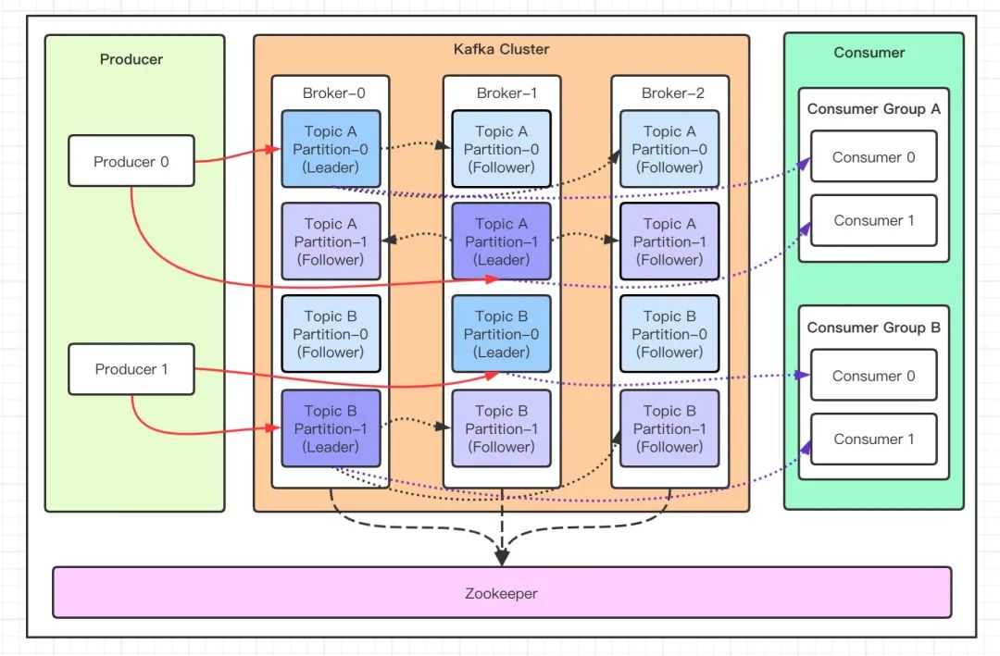

## Kafka：它到底是什么

### 定位与作用

Kafka 官方给自己的定义是"分布式事件流平台"，更通俗的理解是：**一个基于追加写日志设计的分布式消息队列**。它把消息按顺序写入磁盘、按顺序读出，牺牲了"随机删除单条消息"的能力，换来了普通消息队列难以企及的吞吐量——单机每秒几十万到上百万条消息。

三个核心用途：

- **削峰填谷**：瞬时流量先写进 Kafka，消费端按自己的节奏处理，避免下游被冲垮
- **系统解耦**：上游只管发消息，不关心谁消费。订单服务发一条"订单已支付"，库存、积分、通知系统各自订阅，互不影响
- **数据管道**：大数据体系的数据入口。Flink/Spark 从 Kafka 读数据做实时计算，日志、埋点、binlog 都经它汇聚

### 和 RabbitMQ 的区别

| 维度 | Kafka | RabbitMQ |
| --- | --- | --- |
| 消息模型 | 拉模式，消费者主动拉取 | 推模式，Broker 推给消费者 |
| 吞吐量 | 极高（单机百万级/秒），顺序写 + 零拷贝 | 中等（万级/秒），复杂路由有开销 |
| 消息保留 | 不删消息，按时间/大小保留，消费完还在 | 消费确认后即删除 |
| 回溯消费 | 按 offset 可重新消费任意历史消息 | 不支持，已消费即没了 |
| 路由能力 | 只有 topic / partition，无复杂路由 | 强项：直连、主题、扇出等多种 exchange |
| 适用场景 | 日志采集、事件流、大数据管道 | 业务消息、任务分发、延迟队列 |

一句话：**要吞吐和回放选 Kafka，要灵活路由和低延迟业务消息选 RabbitMQ**。

## 整体架构


- **Producer**：Producer 即生产者，消息的产生者，是消息的入口
- **Broker**：Broker 是 kafka 一个实例，每台kafka服务器上一般只有一个kafka的实例（避免单点故障），多个kafka服务器组成kafka cluster。
- **Topic**：消息的主题，可以理解为消息队列，kafka的数据就保存在topic。在每个 broker 上都可以创建多个 topic,例如日志topic,trace埋点topic。不过这些都是自定义topic，kafka也有内置topic，以__开头，例如__consumer_offsets保存消费者的offset, __transaction_state存事务状态。
- **Partition**：Topic的分区，每个 topic 可以有多个分区，分区的作用是做负载，提高 kafka 的吞吐量。同一个 topic 在不同的分区的数据是不重复的，partition 的表现形式就是一个一个的文件夹！   
- **Replication**：每一个分区都有多个副本，每个副本都分布在不同的broker中（副本的数量不能多于broker的数量），生产者的数据都是只写入leader（主分区）的，然后副本异步地去同步数据，如果数据没同步上，该副本就被提出ISR.leader负责维护ISR,此外，消费者读数据也默认只从leader读取（KIP-392 引入机架感知的 follower 读取后，可配置读就近的 follower 副本降低跨机房延迟）。
- **Message**：每一条发送的消息主体。
- **Consumer**：消费者，即消息的消费方，是消息的出口。
- **Consumer Group**：我们可以将多个消费组组成一个消费者组，在 kafka 的设计中同一个分区的数据只能被消费者组中的某一个消费者消费。同一个消费者组的消费者可以消费同一个topic的不同分区的数据，这也是为了提高kafka的吞吐量！
- **Zookeeper**：kafka 集群依赖 zookeeper 来保存集群的的元信息，来保证系统的可用性。zk通过分布式锁确保所有broker只有一个能够创建/controller,这是zk内部维护的一个虚拟目录树下面的一个文件，具有监听zk,感知broker下线，维护ISR,管理topic/分区等功能。当发请求创建这个controller的broker故障，锁会再次释放，监听到这个事件的其余broker再次竞争。
- **GroupCoordinator（协调器）**：Broker 内置的消费组管家，不是独立进程。每个消费组根据 group.id 的 hash 归属到某一个 Broker 上的协调器，负责成员注册、主持 Rebalance（只当主持人，分配方案由第一个进如消费组的customer计算）、监控心跳超时踢人、接收位点提交写入 __consumer_offsets。

简而言之，kafka 本质就是一个消息系统，与大多数的消息系统一样，主要的特点如下：
使用推拉模型将生产者和消费者分离.为消息传递系统中的消息数据提供持久性，以允许多个消费者,提供高可用集群服务，主从模式，同时支持横向水平扩展与 ActiveMQ、RabbitMQ、RocketMQ 不同的地方在于，它有一个分区**Partition**的概念。这个分区的意思就是说，如果你创建的topic有5个分区，当你一次性向 kafka 中推 1000 条数据时，这 1000 条数据默认会分配到 5 个分区中，其中每个分区存储 200 条数据。这样做的目的，就是方便消费者从不同的分区拉取数据，假如你启动 5 个线程同时拉取数据，每个线程拉取一个分区，消费速度会非常非常快！这是 kafka 与其他的消息系统最大的不同！

### kafka的吞吐量是如何提高的
Kafka 的高吞吐不是靠某一个单点优化，而是把「顺序 I/O + 批处理 + 并行」三件事做到了极致。

**磁盘顺序写**。每个 Partition 在磁盘上就是一个只追加不修改的日志文件，生产者写消息永远是往文件尾部追加，没有随机寻道。磁盘最怕随机 I/O，而顺序写的速度可以接近内存随机写，这是 Kafka 敢把消息直接落盘的底气。

**页缓存 + 零拷贝**。Kafka 不自己在 JVM 里维护缓存，直接复用操作系统的页缓存：消息写进页缓存就返回成功，由 OS 异步刷盘。broker接受消费者请求后则通过 sendfile 系统调用实现零拷贝，数据从页缓存直接送进网卡，省去了「内核态→用户态→内核态」的两次拷贝和上下文切换，CPU 几乎不参与数据搬运。

**分区并行**。一个 topic 切成多个 partition，分布在不同 broker 上，生产端同时向多个分区写，写入压力横向摊开——分区数就是 Kafka 并行度的基本单位。

**消费组并行消费**。同一个消费组内，一个分区只分给组内一个消费者，消费者实例数最多可以等于分区数，避免冲突，提高吞吐量，此外消费者分组一般都是按照消费的用途进行分组，例如实时计算的消费组和备份的消费组。

**批量与压缩**。生产者不会一条条发送，而是把消息在本地攒进batch整批发出去，整批消息还经过压缩传输，Broker 落盘和消费端拉取的都是压缩数据，磁盘和网络两头受益。

## 为什么 Kafka 4.x 要抛弃 ZooKeeper

1. **两套分布式系统，双倍运维成本**。ZooKeeper 本身就是一个需要单独部署、调优、监控的集群，版本还要和 Kafka 配套。出了故障得先分清是 ZK 的锅还是 Kafka 的锅，故障边界模糊，排查链路被拉长。
2. **元数据管理碎片化**。分区状态散落在 ZK 节点和各 Broker 内存里，Controller 故障切换时必须从 ZK 全量重读元数据、重建所有分区的 Leader 状态。在几十万分区规模的大集群下，这个过程能到分钟级，期间大量分区处于不可用状态。
3. **ZooKeeper 扛不住元数据规模**。ZK 的 ZNode（内部虚拟树节点） 写入需要集群内全量同步，百万级分区的场景下，元数据变更会引发 Watch 通知风暴，ZK 成为整个 Kafka 集群横向扩展的天花板。
4. **安全模型割裂**。Kafka 和 ZK 各有一套独立的认证授权体系，配置翻倍还容易漏配，给运维留坑。

解决方案就是 **KRaft（Kafka Raft）**：把元数据的管理收回 Kafka 内部，用内建的 Raft 协议自己维护一个元数据集群，彻底取代 ZooKeeper。
## 4.x 新架构：KRaft 模式

KRaft 架构里没有 ZooKeeper 了，取而代之的是一个 **Controller Quorum（仲裁团）**：

- **Controller Quorum**：由 3 或 5 个节点组成 Raft 多数派，通过 Raft 协议自己选举出主 Controller。所有集群元数据（Broker 注册信息、分区副本分配、Leader 位置、配置等）先写入主 Controller，经 Raft 多数派同步确认后才算提交——这是同步复制而非异步，也是元数据比 ZK 时代更可靠的关键——之后再复制到其余节点。生产环境下，一般这几个节点只做controller功能，区别普通broker。
- **Broker 职责更单纯**：只负责数据存储和收发，启动时和运行中从 Controller Quorum 同步元数据（根据偏移量获得快照和增量元数据写回日志），本地就有一份完整的元数据视图。旧架构里 Broker 需要抢 Controller 身份、Controller 要从 ZK 拉全量数据的复杂逻辑全部消失。
- **故障切换更快**：主Controller 挂了，Quorum 内部用 Raft 秒级选出新 Leader，新 Controller 只需读本地元数据快照加日志回放即可恢复工作，不需要像旧架构那样从 ZK 全量拉取再重建集群状态。Controller 切换从分钟级降到秒级，单集群可支撑的分区规模也提升到百万级。
- **部署运维简化**：少维护一套 ZK 集群，一套认证授权体系，元数据的问题在 Kafka 生态内闭环解决。


## 深入 Partition：队列、offset、文件与索引

### Partition 本质

分区在物理上就是磁盘上的一个文件夹（如 `topic-0/`、`topic-1/`），里面存放的是一段一段只增不改的日志文件。生产者往尾部追加，消费者从前往后顺序读，已写入的消息永远不会被原地修改——这是 Kafka 高吞吐的根基：磁盘顺序写的速度接近内存随机写，再配合零拷贝（sendfile）把数据从页缓存直接送进网卡，CPU 几乎不参与数据搬运。

新写入的消息先进入操作系统的页缓存就返回成功，由操作系统异步刷盘。Kafka 依赖的是**副本冗余而非单机刷盘**来保证可靠性，这一点和传统数据库思路不同。

### offset 偏移量：分区内唯一的消息编号

每条消息进入分区时会被分配一个单调递增的整数，即 **offset**（偏移量）。三个要点：

- offset 只保证**分区内有序**，不保证 topic 全局有序。要全局有序只能用单分区的 topic，代价是放弃并行度
- 消费位点（消费者提交到内部 topic `__consumer_offsets` 的 offset）记录"我读到哪了"，消费者挂掉重连后从上次提交的位置继续，这就是 Kafka 不需要"消费确认即删除"的底气——消息在磁盘上，位点在消费者手里
- 回溯消费就是把位点重置到更早的 offset 重新拉取，RabbitMQ 做不到的事在 Kafka 只是一条命令

### 磁盘文件与稀疏索引（了解即可）

分区文件夹下的核心文件：

```text
topic-0/
├── 00000000000000000000.log      # 消息数据，按大小滚动分段（默认 1GB 一个 segment）
├── 00000000000000000000.index    # 稀疏偏移量索引：offset → 物理文件位置
├── 00000000000000000000.timeindex # 时间戳索引：timestamp → offset
├── 00000000000000005368.log      # 下一个 segment，文件名 = 该段第一条消息的 offset
└── 00000000000000005368.index
```
**kafka如何实现磁盘空间回收**：在kafka底层一个日志又被细节=分成多个日志段，写满一个日志段后，又会新切分出来一个新的日志段，并将老的日志段封存，kafka后台定时任务定期检查老日志段能否被删除。

## 数据通过kafka的全流程

以 KRaft 架构下一张订单消息的完整旅程为例，把前文所有机制串成一条线：

**生产阶段：找路由 → 发数据**

1. **建立连接与发现元数据**：Producer 启动时只配了 `bootstrap.servers`（任意几台 Broker 的地址）。它连上任一台后发送 **Metadata 请求**，带上自己要发送的 topic 名，换取该 topic 的分区布局和所有 broker 节点的元数据——注意 KRaft 架构下这一步不需要 ZK，**每台 Broker 启动时都从 Controller Quorum 同步了完整元数据到本地**，所以任意 Broker 都能直接应答。ZK 时代这一步也是问 Broker（Broker 从 ZK 读），Producer不直连 ZK
2. **本地缓存路由表**：Producer 把"leader所在 Broker"的映射缓存在内存里，后续发送直接查表，（缓存元数据最大时间`metadata.max.age.ms`）或收到报错时才刷新
3. **选择分区**：根据消息带的key做哈希，确定这条消息应该分到哪个分区；没带 key 的由客户端轮询/粘性策略摊均分配
4. **攒批发送**：消息在客户端内存按目标分区分组攒批，凑够 batch.size（默认 16KB）或等够 linger.ms 就发往该分区主副本所在的 Broker（同一台 Broker 名下多个分区的批会合并成一个请求）
5. **Leader 追加写**：含有Leader Partition的 Broker 校验后把消息**追加到本地分区日志（页缓存）**，等待 ISR 内 Follower 拉取同步，按 acks 配置决定何时回 ack（all = ISR 全部落到各自页缓存）

**消费阶段：找协调器 → 拉数据 → 存进度**

1. **找组协调器**：消费者启动后先向任一 Broker 发请求，按 group.id hash 定位到 `__consumer_offsets` 的某个分区，那个分区 Leader 所在 Broker 就是它的组协调器
2. **入组领分区**：最先进该消费组的customer算出"组内各个消费者对应的分区"，协调器下发，每个消费者领到自己的分区
3. **按位点拉取**：消费者从上次提交的位点开始，向各分区 **Leader** 发请求拉取。Broker 端数据大概率还在页缓存里，走零拷贝直接送网卡——前文"页缓存+零拷贝"的落地点
4.  **处理与提交位点**：业务处理完这批消息后，把新位点提交给协调器，写入 `__consumer_offsets`（本身也是一次普通的写日志）——位点的存档动作决定了故障时是丢是重。

**纵向串一遍故障视角**：这条链路上任何一环挂掉都有自愈路径——Leader Broker 挂了 Controller 从 ISR 选新 Leader（生产端收到报错刷新路由表重发）；消费者挂了组内 Rebalance 接管、从 `__consumer_offsets` 续传；元数据源头（主Controller）挂了 Raft 秒级选主。

## 高可用与选举机制
### ISR：不是所有副本都算数

分区的可靠性设计围绕 **ISR（In-Sync Replicas，同步副本集合）** 展开：

- **Leader**：分区的唯一读写入口，所有生产者和消费者的请求都由它处理
- **ISR**：与 Leader 保持同步的副本集合（包含 Leader 自己）。Follower 通过持续拉取同步数据，如果落后时间超过 `replica.lag.time.max.ms`就会被踢出 ISR；追上来后自动加回
- **OSR（Out-of-Sync Replicas）**：被踢出 ISR 的落后副本。ISR + OSR = 全部副本（AR）

ISR 是动态收缩的：Leader 挂了**只在 ISR 内选举新 Leader**，保证新 Leader 拥有已提交的全部数据，这是 Kafka 不丢消息的核心承诺。代价是：如果 ISR 收缩到只剩 Leader 一个，此时它也挂了，分区就不可用——除非把 `unclean.leader.election.enable` 打开，允许 OSR 里的落后副本上位，但这会**丢消息**（用数据完整性换可用性，生产上默认关闭）。

### acks：生产者在可靠性与吞吐之间的旋钮

- `acks=0`：发出去就算成功，不等确认。最快，可能丢
- `acks=1`：Leader 写入（页缓存）即确认。Leader 确认后、Follower 同步前挂掉，消息丢失
- `acks=all`：ISR 全部副本写入才确认，配合 `min.insync.replicas`（默认 1，建议设为 2）使用。只要 ISR 里还有一个副本活着就不丢，这是生产上金融级场景的标准配置

### 两层选举，别混淆

1. **Controller 选举**（集群级，选"管家"）：ZK 时代靠抢注 ZK 临时节点（谁创建成功谁当 Controller），KRaft 时代由 Raft 协议选出。Controller 负责感知 Broker 上下线、执行分区 Leader 选举、分发元数据
2. **分区 Leader 选举**（分区级，选"主副本"）：Controller 从该分区的 ISR 列表中选出新 Leader（通常取 ISR 中第一个存活的副本），并把决定下发给所有 Broker


## 补充
### 为什么kafka一般都是主写主读
- 数据从leader写到副本需要一定时间，如果消费副本很可能数据不一致
- 哪怕开启就近副本读，只能读到已经完全同步了数据的副本，这会导致消费延迟。

### kafka如何保证消息可靠
**生产端是第一道关口**。`acks=all` 配合 `min.insync.replicas=2`，保证消息至少被 ISR 内两个副本落进页缓存才算发送成功（避免单点故障）；发送失败自动重试，再开启幂等性（`enable.idempotence=true`）后，重试既不会造成重复写入，也不会打乱分区内顺序。

**消费端由位点提交时机**。提交位点默认`enable.auto.commit=true`，也就是定时自动提交。这样做的话可能发生该消费者处理完消息，然后还没有自动提交位点就挂了，导致后续新添加的消费者再处理一遍，消费端默认没有幂等，需要业务代码自己实现。此外，如果为了吞吐量，将消息都异步丢给对应消费者的线程池处理，然后直接进行下一次的消息拉取，这样自动提交也会导致消息的丢失。所以建议`enable.auto.commit=false`,自己在业务代码里面处理完**一批消息**后手动提交新位点。

### 如何保证消息顺序
先明确一个事实：**Kafka 只保证分区内有序，不保证 topic 全局有序**。前文讲 offset 时提到过这一点，这里把「怎么让需要的消息有序」拆成生产、Broker、消费三段来看。

**生产端靠 key 路由把相关消息送进同一分区**。有序的需求本质是「同一业务实体的操作不能乱序」，比如同一笔订单的创建、支付、发货必须按序处理。生产者为消息指定同一个 key（如订单 ID），key 哈希后固定落在同一分区，分区内追加写天然有序，这个实体的所有消息就保持了顺序。

**Broker 端有个隐藏的坑：重试会打乱顺序**。生产者的消息是批量异步发送的，第一批消息网络超时重试时，第二批可能已经先写进分区了——顺序就反了。解法还是前文提过的幂等性：开启 `enable.idempotence=true` 后，Broker 用序列号校验，重试的消息必须按序写入，同时设置`max.in.flight.requests.per.connection`，只要超时重试的那批消息的序列号和最新要发送到broker的那批消息的序列号的差值不超过这个值，就能保证有序。

**消费端是更容易破坏顺序的一段**： 一个分区在同一消费组内只分配给一个消费者,即一个分区的消息是交由一个线程来处理的，保证了消息的处理顺序，一个消费者可以创建一个线程池，不同分区的消息根据哈希定位到该消费者的不同线程上并行处理，既提高吞吐量，又保证单个分区的消息有序。

**全局有序是个奢侈品**。把 topic 设成单分区，一切天然有序，但吞吐量退化成单机单文件的能力，前文讲的分区并行、消费组并行全部作废。所以实践中几乎不追求全局有序，而是**按业务实体拆分有序域**：每个订单在自己分区内有序，订单之间互不关心，有序性和吞吐量都拿到了。

### 消费者挂了怎么办
消费者挂掉的故障自愈链路是一条完整的流水线，把前文的几个机制全部串了起来：

**第一步：发现死亡**。消费者挂了不会主动通知任何人，靠的是心跳机制——消费者后台线程定期向组协调器发心跳，超过 `session.timeout.ms`（默认 45s）没收到，协调器判定它死亡。另有第二道判定：消息处理太慢被误判死亡，相关参数是`max.poll.interval.ms`

**第二步：Rebalance 接管**。协调器确认死亡后触发组内再均衡，挂掉的消费者负责的分区重新分配给幸存的成员。期间全组暂停消费，这就是为什么 Rebalance 是消费组最需要避免的高频动作。

**第三步：从位点续传**新接管的消费者从 `__consumer_offsets` 里读取该分区最后提交的位点，从那里继续拉取——消息在磁盘上一条没丢，只是换了个读它的人。这就是位点机制的意义：消费者状态外置到 Broker，任何实例都能无缝接管。

### 分区数不是越多越好
- 一个分区对应一个目录，里面也包含很多核心文件，分区过多很容易会导致文件句柄的使用到达上限。
- 增加controller的维护压力
- 分区越多，消费组rebalance时重新分配消费者-》分区的时间变长，暂停消费的时间变长。

### Rebalance 调优
- **CooperativeStickyAssignor**：增量式再均衡。默认的分配协议是 Eager 模式：Rebalance 一开始所有消费者先把手头的分区全部交回去，再按新方案重新认领，哪怕只是组里少了一个成员，全组也要经历一轮「全部撤销、全部重分」的 stop-the-world。协作式协议把这一步拆成两轮：第一轮只撤销「必须挪走」的那几个分区，其余分区照常消费不中断，挪完再补齐，同时分配算法尽量「粘住」原有分配结果，没变化的分区不换人。于是一个消费者下线的影响范围就从「全组全部分区暂停」缩小到「少数几个分区短暂停顿」。使用上只需把 `partition.assignment.strategy` 改成 CooperativeStickyAssignor，客户端自动走新协议。
- **static membership**：滚动重启不触发 Rebalance，K8s 下 Pod 频繁重建的场景几乎必配

### JVM 与机器配置
Kafka 堆内存 6GB 左右足够——数据走页缓存不走堆，剩余内存全部留给 OS 做页缓存；`vm.swappiness=1` 禁用 swap（一旦 Broker 的内存页被换出到磁盘，延迟抖动好几个数量级，消费者也会因为处理超时然后触发rebalance）；多租户场景配置限流限制疯狂的生产者/消费者。

### K8s 上跑 Kafka：Strimzi Operator
云原生环境用 Strimzi 声明式管理 Kafka：KafkaNodePool 定义 broker/controller 角色分离（正好对应 KRaft 架构），PV 扩容、滚动升级、机架感知（`broker.rack` 对齐 K8s node 反亲和）都是 CRD 配置。

### 安全基线
Kafka 默认是裸奔的：任何连上 Broker 端口的客户端都能读写任何 topic，生产上要靠三件套各堵一段。**SASL/SSL 管认证和传输**：SASL 让客户端连接时先证明身份，TLS 负责传输加密，客户端到 Broker 的数据以密文跑在网络上，防中间窃听——没有它，认证凭证本身也是明文传输的。**ACL 管授权**：认证只解决了「进来的是谁」，ACL 决定「进来后能干什么」——按用户/客户端主体授予对某 topic 的读写权限、对消费组的权限、对集群的管理权限，计费团队的消费者不该读得了订单 topic，普通业务不该能删 topic。只开 SASL 不配 ACL，等于凭票进场但进场后为所欲为。**磁盘加密管静态数据**：消息最终明文落在磁盘上，拿到物理盘或云盘快照的人可以绕过 Kafka 直接读走全部消息，磁盘加密把落盘数据变成密文。

### sendfile/mmap/read write
**页缓存是操作系统在内存里为磁盘文件做的缓存层**：内核把最近读写的文件页留在空闲内存里，应用程序的读写都先经过它。写操作只要数据进了页缓存就返回成功，由内核异步刷盘；读操作命中页缓存就直接从内存拿，不碰磁盘。Kafka 不自己在 JVM 里做缓存，全部依赖页缓存——好处是即使 Broker 重启，页缓存也还在。

**传统 read/write**。消费者来拉数据时，走 read 系统调用要把数据从页缓存拷到用户态缓冲区（第一次拷贝 + 用户态内核态切换），write/send 再从用户态拷回内核的 socket 缓冲区（第二次拷贝 + 再次切换），数据明明在内核里转了一圈却又出了内核再回来，白白多两次拷贝和上下文切换。

**sendfile零拷贝时序**：
以消费者拉取一批消息为例，完整走一遍：
- 消费者发 Fetch 请求，Broker 收到后定位到目标 segment 的页缓存；
-  网卡 DMA 启动：支持 scatter-gather 的网卡直接从页缓存分散装配数据到网络包
-  网卡 DMA 发送完成，sendfile 返回，数据从头到尾没有进过用户态。DMA 在这条链路上的分工：磁盘→页缓存由磁盘 DMA 完成，页缓存→网卡由网卡 DMA 完成。（如果没有DMA，还需要cpu将页缓存的数据拷贝到socket缓冲区，再由网卡DMA发送。）

**mmap 是另一条路：把文件映射进进程地址空间**。mmap 系统调用在进程的虚拟内存和文件之间建立映射，之后应用程序像访问普通内存数组一样直接读写这块地址，不再需要 read/write 系统调用，页错误时由内核自动把文件页加载进来。省掉了 read 的用户态拷贝，但改数据还是要主动刷回磁盘。Kafka 的索引文件（.index/.timeindex）就是用 mmap 映射的——索引体积小、需要频繁随机查找，正好适合这种访问模式。

| 维度 | read/write | mmap | sendfile |
| --- | --- | --- | --- |
| 数据拷贝次数 | 2 次（跨用户态/内核态） | 1 次（页错误时加载，之后共享物理页） |0|
| 上下文切换 | 4次 | 几乎无 | 2次 |
| 能否修改数据 | 能，完全可控 | 能，像改内存一样 | 不能，只管传输 |
| 适合的数据 | 小块、需要业务逻辑加工 | 需随机读写的本地小文件 | 大块文件的定向传输 |
| Kafka 中的用途 | 生产端日志追加写、写索引之外的普通文件 | .index/.timeindex 索引文件的随机查找 | 消费端 Fetch 响应的数据传输 |

三个机制不是互斥关系，而是各守一段：**写入靠 read/write（顺序追加），索引靠 mmap（随机查找），消费传输靠 sendfile（定向搬运）**——Kafka 按数据访问模式各选其技，这也是它高吞吐的底层细节之一。