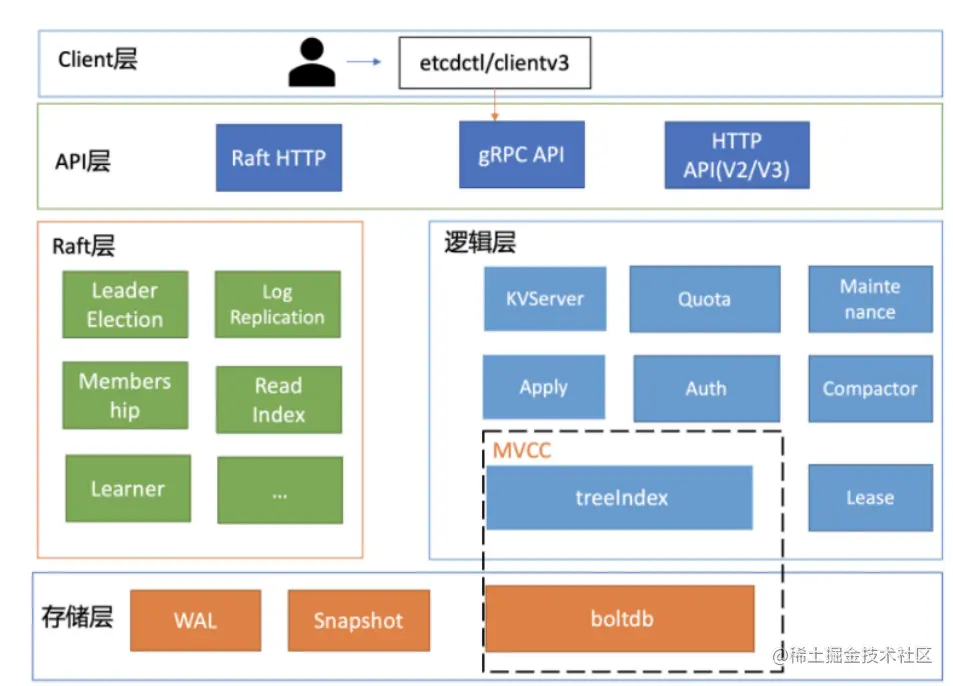
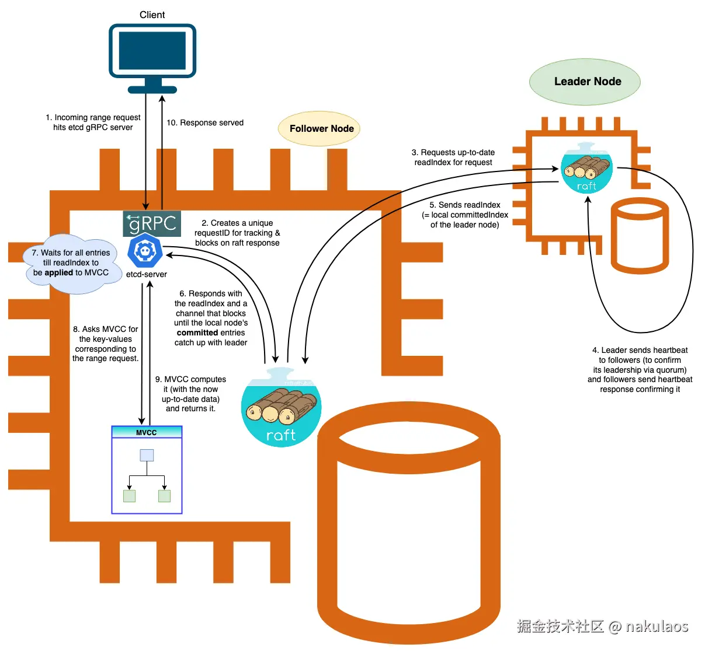
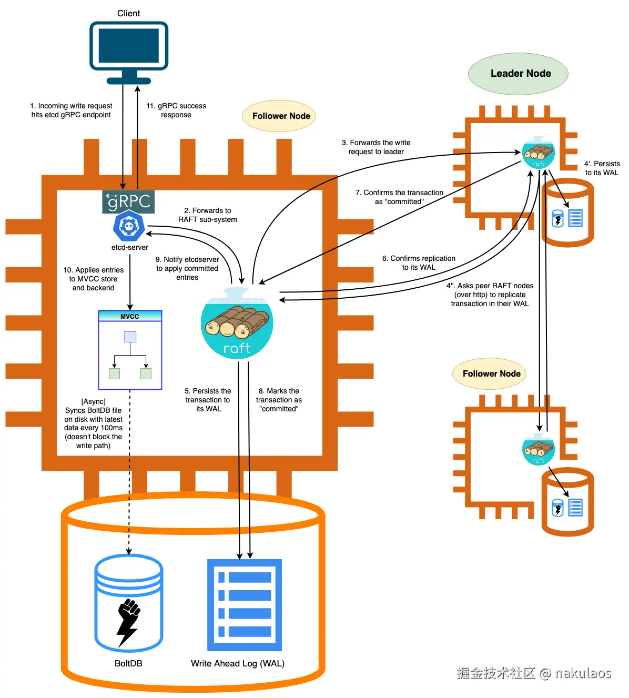

## 前置
### etcd词汇
- Raft：etcd所采用的保证分布式系统强一致性的算法。
- Node：一个Raft状态机实例，最终执行已提交日志，保存业务数据的模块，raft只保证日志一致，状态机负责把日志变成真实数据。
- Member： 一个etcd实例。它管理着一个Node，并且可以为客户端请求提供服务。
- Peer：对同一个etcd集群中另外一个Member的称呼。
- Client： 向etcd集群发送HTTP请求的客户端。
- WAL：预写式日志，etcd用于持久化存储的日志格式。
- snapshot：etcd防止WAL文件过多而设置的快照，存储etcd数据状态。
- Proxy：etcd的一种模式，为etcd集群提供反向代理服务。
- Leader：Raft算法中通过竞选而产生的处理所有数据提交的节点。
- Follower：竞选失败的节点作为Raft中的从属节点，为算法提供强一致性保证。
- Candidate：当Follower超过一定时间接收不到Leader的心跳时转变为Candidate开始竞选。
- Term：某个节点成为Leader到下一次竞选时间，称为一个Term。
- Index：数据项编号。Raft中通过Term和Index来定位数据。


## etcd的作用
所有的分布式系统，都面临的一个问题是多个节点之间的数据共享问题，这个和团队协作的道理是一样的，成员可以分头干活，但总是需要共享一些必须的信息，比如谁是 leader， 都有哪些成员，依赖任务之间的顺序协调等。所以分布式系统要么自己实现一个可靠的共享存储来同步信息（比如 Elasticsearch ），要么依赖一个可靠的共享存储服务，而 Etcd 就是这样一个服务。    
**主要的能力**
- 提供存储以及获取数据的接口，它通过协议保证 Etcd 集群中的多个节点数据的强一致性。用于存储元信息以及共享配置。
- 提供监听机制，客户端可以监听某个key或者某些key的变更（v2和v3的机制不同，参看后面文章）。用于监听和推送变更。
- 提供key的过期以及续约机制，客户端通过定时刷新来实现续约（v2和v3的实现机制也不一样）。用于集群监控以及服务注册发现。
- 提供原子的CAS（Compare-and-Swap）和 CAD（Compare-and-Delete）支持（v2通过接口参数实现，v3通过批量事务实现）。用于分布式锁以及leader选举。
**适用场景**：etcd 最重要的场景就是**作为 Kubernetes 集群的元数据存储**——集群里所有的 Pod、Service、Deployment、Secret、节点信息全部存在 etcd 里，apiserver 是它唯一的读写入口，所有控制器通过 apiserver 的 watch 感知变更。可以说 etcd 的运维重要性在今天之所以被抬到这么高，完全是因为 K8s：etcd 挂了，整个集群就是一具只能看不能动的尸体（存量 Pod 还在跑，但创建、调度、伸缩、探活恢复全部瘫痪）——前面讲的所有 quota、compaction、defrag、备份，本质上都是 K8s 运维工程师的必修课。

**业务微服务的场景则一般不选 etcd**，主流选择是 **Nacos**：注册中心+配置中心一体，自带控制台和服务健康检查，支持推送模式切换（推/拉），SDK 对国内技术栈友好——服务注册发现的量级通常是"每个实例秒级心跳 + 秒级状态推送"，这种高频心跳场景让上千个服务实例去打 etcd 的 Raft 写日志，纯属用大炮打蚊子还把炮管打坏（心跳写压垮集群，参考 lease 小节的分析），Nacos 的心跳探活走的是自己内存态的 Distro 协议，不走分布式共识存储，天生适合这个量级。一句话定位：**etcd 管"集群的命"（强一致的元数据，量小但一条都不能丢），Nacos 管"业务的调用量"（服务发现，量大但短暂不一致可容忍）**—— CAP 取向不同，不是替代关系。

**ZooKeeper 为什么被淘汰**了？它曾经是元数据存储/注册中心/配置中心的三合一事实标准（Kafka、Hadoop、Dubbo 生态都靠它），衰落有几个原因：一是**技术栈老旧**——Java 客户端重、API 面向的是"节点树 + 临时节点"这种文件系统抽象，用起来繁琐，且原生不支持多租户和完善的运维控制台；二是**CAP 与性能取向不适合新场景**——每次写都要过 ZAB 协议（类似 Raft 的多数派），而且**写吞吐受单 Leader 串行限制**，服务注册这种高频心跳场景同样会被写压砸；三是**生态迁移**——Cloud Native 时代 K8s 自带元数据存储（就是 etcd），云原生中间件原生对接 etcd 的注册发现协议，新项目没有理由再引入一个独立 ZK 集群；四是**运维复杂度**——JVM 调优、会话管理、脑裂处理都是额外成本，而 etcd 单二进制 + Nacos 控制台化运维都比它轻。Kafka 自己也意识到了这一点，从 2.8 开始去 ZK 化（KRaft 模式，用自己的 Raft 实现替代 ZK 元数据管理），这基本宣告了 ZK 在新一代基础设施里的退场。


## etcd集群部署
集群的第一次启动叫引导（bootstrap），核心问题是每个节点如何得知其他成员的存在。etcd 提供两条路径：**静态配置**是主流方案；**动态发现**借助第三方媒介在启动时动态获取成员列表，具体又有公共发现服务和 DNS SRV 记录两种实现。
### 静态配置
静态配置要求提前知道所有成员的 IP 和端口，把完整名单写进每个节点的启动参数。同样以三节点集群为例（infra0/infra1/infra2，IP 为 10.0.1.10/11/12），infra0 的启动命令如下，其余两个节点只换 `--name` 和 IP：
```bash
etcd --name infra0 \
  --initial-advertise-peer-urls http://10.0.1.10:2380 \
  --initial-cluster infra0=http://10.0.1.10:2380,infra1=http://10.0.1.11:2380,infra2=http://10.0.1.12:2380 \
  --initial-cluster-token etcd-cluster-1 \
  --initial-cluster-state new \
  --listen-peer-urls http://10.0.1.10:2380 \
  --listen-client-urls http://10.0.1.10:2379,http://127.0.0.1:2379 \
  --advertise-client-urls http://10.0.1.10:2379
```
核心是三个 initial 参数：`--initial-cluster` 罗列全部成员的名字和 peer 地址（必须与各自的 `--initial-advertise-peer-urls` 一致）；`--initial-cluster-token` 是集群令牌，防止不同集群的节点误连；`--initial-cluster-state new` 表示全新引导，节点加入已有集群时改用 `existing`。这些参数只在首次启动时生效，后续重启会被忽略。静态部署etcd集群是主流方案，因为一个etcd集群基本都只是3到5个节点，引入DNS服务器，只会增加硬件成本，运维成本，并且多了一个故障面。当我们想要给集群增加节点时，`etcdctl member add etcd-new --peer-urls=新增节点ip:端口`，然后启动这个新etcd进程，--initial-cluster带上全部成员（老+新），删除节点用 `remove` 命令。对于老节点，则什么都不用改：`member add` 的结果会作为一条成员变更日志通过 Raft 复制到每个存量成员的数据目录并立即生效。因为`--initial-cluster`只是作为集群首次启动的引导，引导集群建立好之后，成员信息也就持久化写进了本地的数据目录，此后进程重启都是读取数据目录的成员信息，启动参数里的 `--initial-cluster` 直接被忽略，真正决定"集群里有谁"的是持久化的成员表而不是命令行。所以老节点哪怕哪天重启，加载的还是当初写死的旧名单，也照样能正常运行。所以`--initial-cluster`只是作为集群首次启动的引导，引导集群建立好之后，成员信息也就写进了数据目录

扩缩容时有几个坑要注意。新节点启动必须用 `--initial-cluster-state existing`，误用 `new` 会带着这份配置自立门户建一个新集群；`member add` 执行成功的那一刻，新成员就被计入 quorum 计算，如果迟迟不启动这个节点，集群容错能力反而变差（三节点集群 add 之后再挂一台，活着的两台在"四节点"里凑不够多数派，这里只是举例，一般都是加减节点也会保持总数量在奇数的），所以 add 和启动之间不要拖太久。

**补充** k8s集群中存储集群各种元数据的etcd也是采用静态部署，`kubeadm init`会自动拼接好`--initial-cluster`参数，写入每个控制节点的etcd manifest中。至于为什么不复用集群里面自动部署的CoreDNS，那是因为apiserver,etcd,controller-manager,scheduler等组件先部署，其次才自动部署CoreDNS.

### 公共服务发现（了解即可）
集群的etcd节点请求`discovery.etcd.io`,拿到`discovery URL`，并配置在启动参数--discovery中,通过公共服务发现，每个节点就都能知道集群其他节点的地址了，不过这种方式一般只是个人实验使用，不适合生产环境，因为依赖第三方服务，不可控。
### DNS SRV 记录（了解即可）
这种方式需要一个自己可控的 DNS 服务器来承载集群记录：SRV 记录列出成员的 peer 通信端口（`_etcd-server._tcp`）和客户端端口（`_etcd-client._tcp`），TXT 记录保存集群名，A 记录把成员域名解析到实际 IP。节点启动时改用 `--discovery-srv example.com` 替代 `--initial-cluster`，etcd 自己去查询这些记录拼出成员名单，效果与静态配置完全一致——本质上只是把写死的名单搬进了 DNS，好处是后续扩容只需追加 DNS 记录、不用改存量节点配置，代价是引入了一个 DNS 组件。除了域名已由 DNS 统一管理、或成员 IP 无法提前固定的场景，一般直接用静态配置即可。
**DNS SRV是一种除了ip解析，还多解析出端口号（包括优先级）的记录，专门用来定位某域名下某个服务跑在哪个机器的哪个端口**


## etcd常见机制的原理
### lease
lease 是一个带 TTL 的"生存合同"：客户端先 Grant 申请租约，把 key 挂载到租约上，之后通过 KeepAlive 定期续约；一旦客户端故障、续约停止，TTL 到期后 etcd 自动删除这个租约及挂载其上的所有 key。它本质上是 key 的自动过期机制，解决的问题是：**临时性数据不需要任何人善后**。服务注册这类数据的生命周期本来就应该跟随进程的生死，如果没有 lease，进程宕机后它的注册信息就变成永久脏数据，必须依赖外部定时清理脚本，而脚本自身的可靠性又成了新问题；有了 lease，"进程活着，key 就在；进程死了，key 自动消失"，清理工作交给 etcd 自己完成。续约周期一般设为 TTL 的三分之一，给网络抖动留缓冲；一个租约可挂载多个 key，到期批量删除。

#### lease的应用场景
**服务注册与发现**是 lease 最经典的场景：每个服务实例启动时申请一个 TTL 租约，把自己的地址作为key写到租约下（如 `services/service_name/10.0.0.5:8080`，注意这不是文件路径，只是一个key），只要实例存活就持续续约，实例下线或崩溃后注册信息自动消失，消费方通过 watch 这个前缀就能实时感知实例的上下线。这就是"临时节点"的效果

**分布式锁的自动释放**是第二个场景：锁的持有者把锁 key 挂在租约上，持有者正常工作时持续续约，一旦崩溃，锁随租约过期自动释放，避免持有者挂掉后锁永远无法解开死锁全场。客户端会同时维护两个定时器：续约定时器和重试抢约定时器，拿到锁后继续续约，锁被别人抢走就退出。

**Kubernetes 把 lease 用到了极致**，几乎控制面所有"活性判断"都建立在它之上：

第一是 **kubelet 心跳与节点 NotReady 判定**。每个 Node 都有一个对应的 Lease 对象（kube-node-lease 命名空间），kubelet 默认每 10s 续约一次、TTL 40s，这个续约在 etcd 里就是一次真实的写请求。kubelet 挂掉或与 apiserver 失联后续约停止，node-lifecycle-controller 发现租约过期，才把节点标记为 NotReady，进而触发 Pod 驱逐等后续动作——节点故障检测的"心跳"本体就是 etcd 里的 lease 记录。这也是之前说的排查"节点莫名 NotReady"时，要看 etcd 磁盘和网络的原因：etcd 慢，续约写请求堆积，节点可能被误判 NotReady。

第二是**控制面组件的 Leader 选举**。kube-controller-manager 和 kube-scheduler 都是多副本部署但同一时刻只有一个实例在工作，高可用靠的就是 Leader 选举：候选者尝试 acquire 或 renew 一份 Lease 对象（底层是 etcd 的事务 CAS + lease 续约），拿到者持续续约，它挂掉后租约过期，其余副本竞争接替。Lease 对象的 holderIdentity 字段记录当前 Leader，renewTime 字段就是最后一次续约时间——kubectl 查看 Lease 对象时看到的这些字段，直接对应 etcd 里的租约状态。

第三是 **ServiceAccount token 的自动轮换**。1.21 之后的 bound token 机制里，token 的有效期管理也依赖 Lease，token 过期判断和续期（TokenRequest 的 expirationSeconds）底层通过 etcd 租约跟踪，避免手动管理证书/密钥的过期清理。

一句话总结：lease 在 K8s 里统一回答了一个问题——**"某个东西还活着吗"**。无论那个东西是 Node、是控制面组件的 Leader 身份、还是一条 token，答案都落在"租约是否还有效"这一个判断上，而租约的生命周期由 etcd 自动管理，不依赖任何组件"记得去清理"。


### watch机制
watch 解决的是"客户端如何第一时间感知数据变更"：客户端发起 Watch 请求（指定 key 或前缀，还可指定从哪个 revision 开始），etcd 维持一条 gRPC 长连接流，之后每条匹配的写请求在提交后，watchableStore 就把变更事件（PUT/DELETE，携带 key、value、revision）推送到这条流上。它是服务端主动推，不是客户端轮询——轮询方案的时间间隔决定了感知延迟，还浪费大量无效查询；推送方案让事件毫秒级到达，且只在有变更时占用网络。与 lease 的关系：lease 负责"数据到期自动删"，watch 负责"删除这件事被别人立刻知道"，服务发现的完整闭环正是两者协作——实例崩溃后租约过期删 key，watch 到 DELETE 事件的消费方同步摘除流量。

watch 可靠性的关键设计是**基于 revision 的事件回放**。MVCC 让每个历史版本都保留在 boltdb 里，所以客户端可以指定 `--rev` 从历史某个版本开始接收事件——即使 Watch 建立得比变更晚，也不会漏事件；断线重连时客户端带上自己处理到的 revision，从断点继续接收，实现不重不漏的增量同步。
**注意事项**：当压缩点超过了某个客户端监听的revision（可能是控制器和apisevrer之间连接断开），etcd 已经没有那段历史，只能返回 compacted 错误。此时客户端唯一的恢复手段是：丢弃本地缓存，重新 List 一次全量数据重建缓存，再从最新的 revision 开始 watch，单个客户端重建没什么，但压缩点是全局统一的：一次 compaction 执行后，有可能客户端同时收到 compacted 错误、同时重建。K8s 集群里 watch 同一资源的控制器可能成百上千，每个重放都是一次全量 List，瞬间形成打向 apiserver 和 etcd 的读洪流；apiserver 处理不过来变慢，更多 watch 超时断线，又引发更多客户端重放，恶性循环就是"压缩风暴"。    
- compaction 保留策略保守设置（如 `--auto-compaction-retention 1h`），保留时间越长，触发风暴的概率越低，绝不要为了省空间把保留时间压到几分钟；
- 补救措施则是：风暴发生时 apiserver 的请求量指标会飙升，先临时扩容 apiserver 副本或对客户端限流，让重放错峰完成，等所有 informer 同步恢复后集群自然平稳。

#### compaction、backend、quota上限
这里还要把 compaction、backend、quota 上限三者的关系说透。MVCC 机制下每次修改都留下历史版本，backend（就是那个 boltdb 数据库文件）的大小不只由"存了多少数据"决定，还由"数据被改过多少次"决定——哪怕只有一个 1KB 的 key，被每秒改一次，一天也能堆出几十 MB 历史。`--quota-backend-bytes` 就是给这个 db 文件设的硬顶（默认 2GB，生产建议调到 8GB 并告警），一旦超过，etcd 立即进入只读保护：所有写请求报 `etcdserver: mvcc: database space exceeded`，K8s 场景下 Pod 创建、节点心跳续约全部失败，而且这个状态不会自愈，必须人工介入：先 compaction 清历史，再 defrag 回收空间，最后 `etcdctl alarm disarm` 解除告警，集群才恢复可写——这是 etcd 运维最经典的 P1 故障。compaction 的角色就是给这个膨胀过程装泄压阀：定期清掉没人再需要的历史版本，让 backend 的增长只跟真实数据量挂钩而不是跟修改次数挂钩。所以 quota 告警和 auto-compaction 必须配套：前者是撞线前的最后一道警报，后者是日常泄压，缺一个都可能撞线；而 compaction 保留策略又不能太激进，否则回到上面压缩风暴的问题——保留时长就是在"quota 空间风险"和"重放风暴风险"之间找平衡，1 小时左右是常见的稳妥值。    
**补充**：`compaction`只是将boltdb里面的历史版本从“有效数据”变成“空闲页”，boltdb后续有新数据要写，会优先复用这些空白页。但是由于`compaction` 并不会立即把这些空间归还给操作系统去释放空间，而`quota`检查的对象是文件大小，只做 compaction 不做 defrag，quota 报警不会因为 compaction 而解除。所以往往后续还要`defrag `：它把有效数据搬进新文件、丢弃空洞，文件物理缩小。

#### watch机制的应用或者衍生场景
**配置中心**是最直接的应用：程序启动时 Get 全量配置并 watch 配置前缀，配置管理平台改一个 key，所有订阅的实例毫秒级收到 PUT 事件、热更新自己的配置，不需要重启进程。这里 watch 事件里带的 revision 可以用来做顺序校验——客户端只在确认这是"最新"的变更时才应用，避免乱序更新覆盖。

**Kubernetes 的 informer 机制**是 watch 最重要的衍生场景，也是 K8s 声明式 API 的基石。kubelet、controller-manager、scheduler 以及所有 Operator 想要感知资源变化，都不是直接去问 etcd（它们没有权限也没必要），而是 watch apiserver 暴露的资源接口，而 apiserver 对底层 etcd 发起的也是 watch。完整的同步流程是：informer 先 List 一次拿到全量资源作为本地缓存，然后 watch 增量事件维护缓存，断线重连时带上处理到的 resourceVersion（就是 etcd 的 revision）续传。etcd 一条 Put 进来，apiserver watch 到后推给所有 informer，控制器收到事件才触发调谐逻辑——整个集群"期望状态变化 → 控制器反应"的事件驱动链路，第一环就是 etcd 的 watch。理解了这一点，才能理解为什么 etcd 压力大会让所有控制器变"迟钝"：事件都堵在 etcd 的推送环节。

**服务发现**是另一个衍生场景，与 lease 小节呼应：消费方 watch `services/service_name/` 前缀，新实例注册收到 PUT 事件就加入负载均衡池，实例崩溃、租约过期 key 被删收到 DELETE 事件就摘除流量。相比定时轮询实例列表，watch 方案的感知延迟从"一个轮询周期"降到毫秒级，在实例频繁上下线的弹性环境里优势明显。

**分布式锁与选主的失败感知**：客户端抢锁失败后 watch 那把锁的 key，看到 DELETE 事件（锁被释放或持有者租约过期）再发起下一轮抢占，而不是固定间隔反复重试——事件驱动让锁的交接延迟从"重试间隔"降到毫秒级，还避免了多个客户端同时轮询带来的写压力。

### raft算法
篇幅过多。可以看看[raft算法](https://juejin.cn/post/7463403886280769546)。

### WAL（预写日志）
WAL（Write-Ahead Log）的核心思想一句话：**数据在真正修改之前，先把这次操作作为一条日志追加写进文件并落盘**。考虑 etcd 收到 put 请求后、还没把数据写进 boltdb 时机器突然断电的场景：内存状态没了，boltdb 里还是旧值，这次写入就凭空消失。WAL 解决的正是这个：请求先写 WAL 并 fsync 落盘，之后才应用到状态机；断电重启后，etcd 把 WAL 从头回放一遍，所有已确认的写入都能恢复出来——这就是词汇表里"WAL 可保障 etcd crash 后数据不丢失"的机制。"预写"强调的就是这个顺序约束：日志永远先于数据。这是数据库领域的通用技术，MySQL 的 redo log、PostgreSQL 的 WAL、Redis 的 AOF 都是同一个思想。

在 etcd 内部，WAL 有三个关键角色。一是 **Raft 的落地面**：Raft 要求"日志复制到多数派才算提交"，这个"日志"物理上就存在各节点自己的 WAL 文件里——Leader 复制给 Follower 时，双方各自把日志条目追加进自己的 WAL 并 fsync 后才回确认，所以 WAL 的写入速度直接决定集群写入延迟，这就是调优章节说"必须 SSD、fsync 延迟低于 10ms"的原因。二是**只追加不修改**：WAL 文件永远顺序追加，从不改写旧内容，顺序写对磁盘非常友好，这也是选它做第一道落盘的原因。三是**snapshot 是它的瘦身搭档**：WAL 一直追加会无限变大，重启时从头回放几百万条日志也太慢，所以 etcd 每处理若干条日志（`--snapshot-count` 控制）就把当前完整状态做成快照存盘，之后旧 WAL 日志就可以删了——快照是"存档点"，WAL 是"存档点之后的操作记录"，重启时先加载快照、再只回放快照之后那一段，像游戏存档一样。

崩溃恢复时 WAL 有两种用法：节点重启，用快照 + WAL 回放恢复到宕机前最后一条已提交日志；更灾难的场景（多数派磁盘全坏），拿最近备份的 snapshot 加归档的 WAL 文件 restore 重建集群——这就是运行时重配置章节说"快照必须定期备份"时 snapshot 和 WAL 被放在一起提的原因。一句话定位：**WAL 是 etcd 持久化的第一现场，所有写入先经过它落盘，Raft 复制靠它实现，崩溃恢复靠它回放；boltdb 是它身后的"正式仓库"，WAL 是"先记账的本子"**。

### boltdb
boltdb 是一个**嵌入式 KV 存储**，理解这个词要对照着"独立服务"来看：MySQL、Redis 是独立进程，你的程序通过网络连它们、它们管磁盘文件；而 boltdb 只是一个 Go 语言的库（严格说是从 C 版 LMDB 移植的 B+ 树存储库），没有端口、没有协议、没有自己的进程——etcd 代码里 import 它，调用它的 API 读写磁盘文件（就是那个 backend 文件），它跑在 etcd 进程内部，跟着 etcd 同生共死。好处是零网络开销、零部署成本、文件即数据库（拷走就能用），代价是只能单进程独占访问、没有并发多端能力——对 etcd 正合适：每个 etcd 节点独占自己的 backend 文件，集群层面的多副本一致性交给 Raft，不需要存储层操心。

**bucket（桶）是 boltdb 内部的命名空间**，类似关系库里的 table：每个 bucket 名字对应一棵独立的 B+ 树，不同 bucket 的数据完全隔离。前面讲成员表时提过的 members bucket 就是其一——etcd 在 backend 里开了多个 bucket 各司其职：key 存在 key bucket（存的是 revision → 真实 key/value），元数据在 meta bucket，每个租约在 lease bucket 占一条记录。理解 bucket 的意义在于理解 etcd 数据的组织方式：treeIndex（内存）负责 key → revision 的映射，key bucket 里按 revision 排序存放各版本数据，"treeIndex + boltdb 的多个 bucket"共同构成 MVCC 的完整实现。每棵 B+ 树按 key 有序存储，范围查询天然高效，这就是 etcd 的 key 前缀扫描（--prefix）能直接落到一次 B+ 树范围读的原因。

**事务是 boltdb 的另一个关键设计**。它只有两种事务模式：只读事务（不修改数据，可以多个并发进行）和读写事务（同一时刻全局唯一，独占写，其他读写事务都要等它结束）。写事务的提交流程分四步：①所有修改先在内存中的页副本上累积——这是写时复制（COW）的体现，boltdb 不在磁盘旧页上原地修改，而是把要改的页拷到内存改副本，原页一个字节不动；②Commit 时把这些改好的脏页写到磁盘文件的空闲位置（新页），旧页原封不动地留着——此时磁盘上同时存在旧版本和新版本两套完整数据；③释放掉的旧页记入新的空闲页列表（freelist），供以后复用；④最后一步才是拨"版本开关"：把新版本的信息写入两份元数据页（meta0/meta1）中的一份（轮流写，保证任何时刻至少一份有效），元数据页带校验和原子刷盘，读操作认的就是它。这个"最后才拨开关"的顺序保证了原子性——推演断电时点：脏页写到一半断电，元数据仍指旧版本，文件完整可读，孤立的半成品新页当空闲页回收；元数据写到一半断电，另一份元数据完好，退回上一个完整版本。任何时刻磁盘上要么是完整旧版本，要么是完整新版本，不存在写了一半的中间态，这就是 boltdb 不需要 redo log 也能保证不损坏的原因（注意区分：WAL 保护的是 etcd 层面的提交语义——Raft 日志不丢；boltdb 自身的文件原子性靠 COW + 双元数据页，两层各管各的）。这个设计的代价是每次提交写两倍量的页、旧页变成空洞需要 compaction/defrag 清理，以及 Commit 必须同步等待元数据落盘——正好呼应上一节 fdatasync 的用途。

对运维的启示是：读写事务全局串行（整个 backend 同一时刻只有一个写者），所以 etcd 的写吞吐上限被"单写者"设计锁住——不管磁盘多快，写永远是排队串行合并落盘的。这也解释了几个现象：etcd 的写吞吐通常只在每秒万级而不是十万级；批量写入（事务合并多条变更一次提交）比逐条写快得多，因为一次 fsync 摊薄了多条修改的成本；以及 etcd 只适合存小量元数据、不适合当业务数据库用的底层原因——高并发写入在它这里最终都会变成单写者队列的长度，延迟和内存占用都不可控。

**手动 defrag** 就是针对前面说的"compaction 后空洞占用文件大小"的空间回收操作：`etcdctl defrag --cluster` 对整个集群执行，或 `etcdctl --endpoints=<节点地址> defrag` 对单个节点执行。操作逻辑是把每个 bucket 的有效数据重写进一个新文件，替换旧文件，空洞随之消失，`etcdctl endpoint status` 里能直接看到 DB size 和 DB size in use 的差值来决定是否需要执行。三条红线：defrag 期间该节点的读写请求会短暂失败或阻塞，**绝不能对多个节点同时执行**（要轮流做、做完确认健康再做下一个）；defrag 不会释放 quota 告警，还需要手动 `etcdctl alarm disarm`；生产上建议把 defrag 写进低峰期例行脚本（结合 auto-compaction 的节奏），而不是等 backend 接近上限才临时抱佛脚。


## etcd 架构及流程详解


### 整体分层与核心组件
按照分层模型，etcd 可分为 Client 层、API 网络层、Raft 算法层、逻辑层和存储层。这些层的功能如下：
- Client 层：Client 层包括 client v2 和 v3 两个大版本 API 客户端库，提供了简洁易用的 API，同时支持负载均衡、节点间故障自动转移，可极大降低业务使用 etcd 复杂度，提升开发效率、服务可用性。
API 网络层：API 网络层主要包括 client 访问 server 和 server 节点之间的通信协议。一方面，client 访问 etcd server 的 API 分为 v2 和 v3 两个大版本。v2 API 使用 HTTP/1.x 协议，v3 API 使用 gRPC 协议。同时 v3 通过 etcd grpc-gateway 组件也支持 HTTP/1.x 协议，便于各种语言的服务调用。另一方面，server 之间通信协议，是指节点间通过 Raft 算法实现数据复制和 Leader 选举等功能时使用的 HTTP 协议。
- Raft 算法层：Raft 算法层实现了 Leader 选举、日志复制、ReadIndex 等核心算法特性，用于保障 etcd 多个节点间的数据一致性、提升服务可用性等，是 etcd 的基石和亮点。
- 逻辑层：etcd 核心特性实现层，如典型的 KVServer 模块、MVCC 模块、Auth 鉴权模块、Lease 租约模块、Compactor 压缩模块等，其中 MVCC 模块主要由 treeIndex 模块和 boltdb 模块组成。
- 存储层：存储层包含预写日志 (WAL) 模块、快照 (Snapshot) 模块、boltdb 模块。其中 WAL 可保障 etcd crash 后数据不丢失，boltdb 则保存了集群元数据和用户写入的数据

### 读请求
- 串行 (Serializable) 读：直接读状态机数据返回、无需通过 Raft 协议与集群进行交互，适合对数据一致性要求不高的场景。
- 线性读：需要经过 Raft 协议模块，反应的是集群共识，因此在延时和吞吐量上相比串行读略差一点，适用于对数据一致性要求高的场景。

上图展示的是一次线性读（ReadIndex）的完整流程，画的是 **Follower 处理读请求**的场景（比 Leader 处理多一步，更有讲解价值）

① Client 的get请求打到某个节点的 gRPC Server——本例是 Follower；② gRPC 层为请求创建唯一 requestID 用于追踪，然后阻塞等待 raft 回应；③ Follower 向 Leader 请求最新的 ReadIndex（即 Leader 当前已提交的日志位置 committedIndex）；④ **Leader 向所有 Follower 发心跳确认自己的 Leader 身份**——注意图右侧的自环：Leader 必须等多数派跟随者在心跳里回复确认，才能证明"我确实是多数派认可的现任 Leader"，这一步是 ReadIndex 防止已被废黜的旧 Leader 返回旧数据的关键；⑤ Leader 把 ReadIndex 返回给 Follower；⑥ Follower 的 raft 模块拿着 readindex 挂起一个等待 channel，**直到本地状态机已应用的进度追上这个 committedIndex**——Follower 的应用进度通常落后 Leader 几拍，必须追平才能保证读到"不落后于本次请求之前所有已提交写入"的数据；⑦ 等待 readIndex 之前的所有日志条目都应用到 MVCC；⑧ 向 MVCC 查询 range 请求对应的 key；⑨ MVCC 用追平后的新数据计算结果返回；⑩ 响应返回给 Client。

图里最有价值的是③④⑥三步的组合：一次线性读**既不产生写日志、也不触发选举轮次**，只靠"Leader 心跳确认多数派 + 本地追平 applied index"两个动作就拿到了线性一致性——这正是 ReadIndex 相比"把读请求也走一遍 Raft 写日志"便宜得多的原因。对照前面串行读的描述，两者的差异现在可以精确量化：串行读只走⑧⑨⑩三步（直接读本地状态机，零网络往返、无等待），线性读多了 ③⑥ 的网络与追平开销，这就是"线性读比串行读慢、但远比写快"的机制根源。etcdctl 的 `get` 默认就是线性读，加 `--consistency="s"` 才是串行读；Kubernetes apiserver 对元数据的读默认走的也是线性读，这就是 etcd fsync 变慢时整个集群的 List/Get 都跟着变慢的又一环。

- **网络**：一次线性读的链路里其实用了两套网络通道。Client → etcd 节点走的是 gRPC（HTTP/2 + protobuf，2379 端口）；节点之间传递 ReadIndex 请求、心跳确认、日志复制走的是 etcd 内部的 rafthttp 传输层（2380 端口）——也是 protobuf 序列化、HTTP 承载，但不是 gRPC 服务，而是 etcd 自定义的 raft 消息格式，ReadIndex（MsgReadIndex）、心跳（MsgHeartbeat）、日志复制（MsgApp）都是同一族消息。2379/2380 两个端口分开也是有意为之：节点间的日志复制、心跳这类关键流量不和海量客户端请求抢连接。至于流程图里的⑧⑨两步（向 MVCC 查询）和⑥的"等待追平"是进程内部行为，不涉及任何网络。所以一次 Follower 线性读的网络开销 = 1 次客户端往返（gRPC）+ 1 次 peer 往返（rafthttp）+ 心跳轮次的等待——这也解释了为什么 `--heartbeat-interval` 不只影响故障检测速度，还轻微影响线性读的延迟分布：ReadIndex 的多数派确认依附在周期性心跳上，请求如果恰好赶在上一轮心跳刚结束，就要等下一轮。
- **readindex**：ReadIndex 的本质是一个"读水位线"——Leader 当前已提交日志的位置 committedIndex。它为什么能保证线性一致？逻辑链条是：任何在客户端读请求发起之前完成的写，其日志位置必然 ≤ 这个 committedIndex；而 Follower 在返回结果前强制等待本地 applied 追平这个位置，就保证了本次读一定能看到发起前所有已提交的写入——这正是线性一致性的定义。它解决的经典问题是"已废弃的旧 Leader 读旧数据"：网络分区时旧 Leader 可能还以为自己在职，客户端连到它读到的可能是几个版本前的数据；有了 ReadIndex，任何节点返回读结果前都要经过"Leader 用多数派心跳自证"+"本地追平 committedIndex"两道关卡，旧 Leader 过不了第一关，落后节点过不了第二关。代价就是上面流程图里的网络往返与追平等待，收益是**读路径完全绕开了 Raft 写日志**——如果不用 ReadIndex，想保证线性一致只能把读请求也当成一条日志走完"WAL 落盘 → 复制 → 提交"全流程，延迟和一次写相当；ReadIndex 用一次轻量的多数派确认换掉了整个写日志流程，这就是它成为 etcd 默认线性读实现的原因（默认开启，无需配置）。




上图是写请求的完整流程，画的是 **Follower 接收写请求**的场景（客户端连到了 Follower，它自己无权处理写），按编号串一遍：

① Client 的写请求打到 etcd 的 gRPC endpoint（本例落在 Follower）；② gRPC 层转发给本节点的 RAFT 子系统；③ Follower **把写请求转发给 Leader**——写必须由 Leader 统一编号发起，这是 Raft 的基本约束，也是"客户端连到任何节点都能写"的实现方式；④ Leader 把这条写**持久化到自己的 WAL**（fsync 落盘）；④' Leader 通过 rafthttp 要求所有 peer 节点把这条事务**复制到它们各自的 WAL**——对应图中右下角的 Follower，它同样要先写 WAL 落盘；⑤ Leader 自己再把这条事务标记为已持久化；⑥ Follower 确认 WAL 复制完成；⑦ Leader 收到多数派的确认后，**把这条事务标记为 committed**——提交点就在这一刻；⑧ 通知本节点 raft 子系统事务已提交；⑨ raft 通知 etcdserver 应用已提交的日志；⑩ etcdserver 把日志条目应用到 MVCC store 和 backend——MVCC 分配 revision、更新 treeIndex、数据写入 boltdb（注意图下方的虚线：boltdb 落盘是**异步批量**的，每 100ms 同步一次最新数据，**不阻塞写路径**——写路径的持久化由 WAL 保证，boltdb 只是最终仓库）；⑪ gRPC 成功响应返回给 Client。

对照读流程，几个关键差异值得圈出来：写流程**必须走 WAL 落盘**（读流程完全碰不到 WAL），一次写的延迟主要由两串串行的 fsync 决定——Leader 自己落盘 + 等 Follower 落盘 + 网络往返，这就是磁盘 fsync 性能是写延迟天花板的流程级解释；提交点（⑦）和应用点（⑩）是分开的——多数派确认后就算提交，应用到状态机是之后的事，中间宕机靠 WAL 回放补上，这就是"WAL 可保障 crash 后数据不丢失"的流程级含义；boltdb 的 100ms 批量合并解释了为什么它自己的提交开销不直接压在每条写请求上。


## 补充
### 五个系统调用的写函数
| 函数 | 同步对象 | 是否等待 I/O 完成 | 是否同步元数据 | 说明 |
| --- | --- | --- | --- | --- |
| write / pwrite | 数据（写入页缓存） | 否 | 否 | 写数据到内存中的页缓存，不会等待磁盘写入，异步操作 |
| sync | 所有脏页 | 否 | 否 | 将所有脏页写入磁盘，但不会等待磁盘写入完成，可能数据丢失 |
| fsync | 数据和元数据 | 是（等待） | 是 | 同步指定文件的数据和所有元数据，确保数据和元数据都写入磁盘，等待所有磁盘 I/O 操作完成后返回 |
| fdatasync | 数据和必要的元数据 | 是（等待） | 部分（仅必要的元数据） | 同步指定文件的数据和必要的元数据，减少不必要的 I/O 操作，等待所有磁盘 I/O 操作完成后返回 |

这张表正好回答了前面遗留的一个问题：为什么强调 WAL "必须 fsync 落盘"。write 只写页缓存就返回，断电即丢，而 Raft 的"多数派确认才算提交"里，确认的前提是数据真的进了磁盘，所以日志落盘必须用会阻塞等待的 fsync/fdatasync——调优章节盯的 `etcd_disk_wal_fsync_duration` 指标，衡量的就是这一步的耗时，它直接构成每条写请求延迟的下限。fdatasync 和 fsync 的差别在于元数据同步的范围：fdatasync 只同步读取数据所必需的元数据（如文件大小），跳过修改时间这类无关字段，所以更快；WAL 顺序追加、每次只增长不改属性，正好适合 fdatasync 的模式，boltdb 的 backend 提交部分场景也用它来降延迟。一个运维视角的提醒：既然每条写都要等一次 fsync，那么磁盘的 fsync 性能就是集群写入能力的天花板——这就是云盘/网络盘容易拖垮 etcd、而本地 NVMe SSD 备受推荐的根本原因。

### 网关与代理：grpc-gateway 与 grpc-proxy
前面读写流程图里的 Client 都是直连某个节点——但生产中客户端和集群之间往往还隔着中间层。对照流程图理解这三个组件最清楚，它们分别作用在链路的不同位置：

**grpc-gateway 作用在最入口**：它不是独立进程，而是每个 etcd 节点自己内置的一个翻译层（挂在 gRPC Server 旁边，监听同一端口的 HTTP 路径）。读写流程图的①如果是 curl 发来的 HTTP/JSON 请求，就先被它翻译成 gRPC 再进入后续流程，翻译完的链路和图上完全一样。价值在于让不支持 gRPC 的语言（或调试用的 curl）也能访问 v3 API，代价只是多一层转换，不改任何行为。

**gRPC 代理（grpc-proxy start）作用在连接合并这一层**，这是三者中唯一真正改变请求行为的：它理解协议，最有价值的是合并能力——前面读流程里说过线性读要走 Leader 心跳确认，写流程里要走 WAL 复制，那如果 500 个客户端都 Watch 同一个配置 key、都持有同 TTL 的租约呢？没有代理就是 500 条 Watch 流 + 500 份续约写请求打向集群；挂上代理后，它在后端只维护一条 Watch 流和一次续约心跳，收到事件后分发给 500 个客户端——集群侧的 Watch 连接数和 lease 续约写请求都从 500 降到 1。写流程里每条续约都是真实走 Raft 的写请求（见 lease 小节），所以这个合并直接减轻的是集群的 WAL 落盘压力。代理实例无状态、可随意增减，这就是"可伸缩的 etcd API"——集群 quorum 不变，API 服务能力先水平扩展了。

### 运行时重配置：在线增减成员
etcd 集群的成员增减不需要停机，通过 member 命令在线完成。以生产中最常见的"替换故障节点"为例：某台机器磁盘即将报废，先用 etcdctl member list 确认成员 ID，等新机器就绪后 etcdctl member remove 移除旧成员（quorum 依然满足，集群继续服务），再 etcdctl member add newinfra --peer-urls=http://10.0.1.13:2380 预注册新成员，最后在新机器上以 --initial-cluster-state existing 启动 etcd，它会从 Leader 同步全部历史数据直到追平。扩容同理，把 3 节点扩到 5 节点可以容忍任意 2 台故障，读可用性更好；新加入的节点也可以先用 --learner 以 Learner 身份加入，只同步数据不参与投票，追平后再 promote 成正式成员，避免大量数据同步期间的日志追赶拖垮 Raft。两条红线必须遵守：一次只变更一个成员，变更后确认集群健康再做下一次；一旦多数派同时故障，member 命令救不了，只能用最近一次快照加 WAL 恢复，这就是快照必须定期备份的原因。缩容时 member remove 的目标如果恰好是 Leader，集群会先触发一次重新选举，请求短暂抖动，建议先手动迁移 Leader 或在业务低峰操作。

### 集群调优：让 etcd 处于最佳状态
调优的目标是让每条写请求在磁盘和网络上的延迟尽可能低且稳定。硬件上 etcd 对 fsync 极其敏感，必须用 SSD，官方建议 WAL fsync 延迟低于 10ms，生产环境通常把 etcd 独立部署在控制面机器上不与重负载业务混布，Kubernetes 场景下干脆用独立的静态 Pod 单独跑。参数上，--heartbeat-interval 和 --election-timeout 决定故障感知速度，默认 100ms/1000ms 适合同机房，跨机房或网络抖动大的环境要调大选举超时，避免频繁误选主；--quota-backend-bytes 默认 2GB，生产建议调到 8GB 并配合告警；--snapshot-count 控制快照频率，内存充裕时可以调大以减少快照开销。数据治理上，避免放大于 1MB 的 value（官方建议 1KB 级别），开启 --auto-compaction-mode periodic --auto-compaction-retention 1h 定期清理历史 revision，压缩后 boltdb 会留下空洞，需要在低峰期对各节点轮流执行 etcdctl defrag 回收空间（defrag 会短暂阻塞该节点的读写，绝不能同时对所有成员执行）。监控上重点盯 etcd_disk_wal_fsync_duration、etcd_disk_backend_commit_duration 和 etcd_server_proposal_duration 三个指标的 P99，任何一条持续超标都意味着集群离不可用不远。