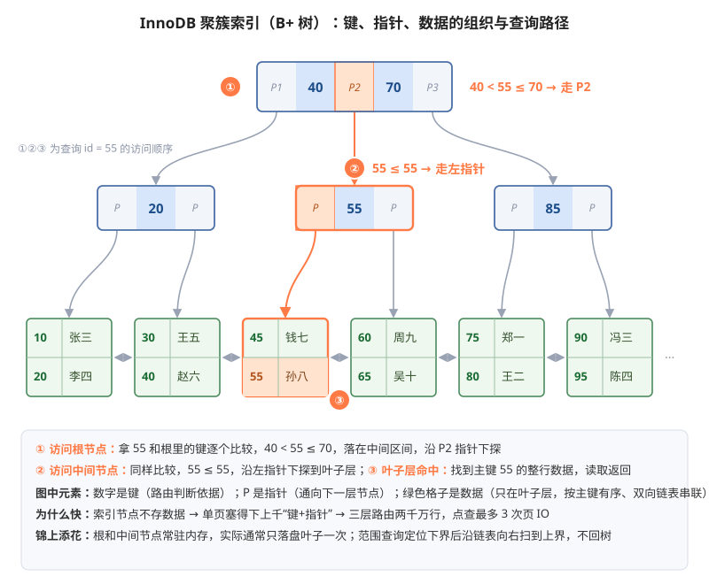
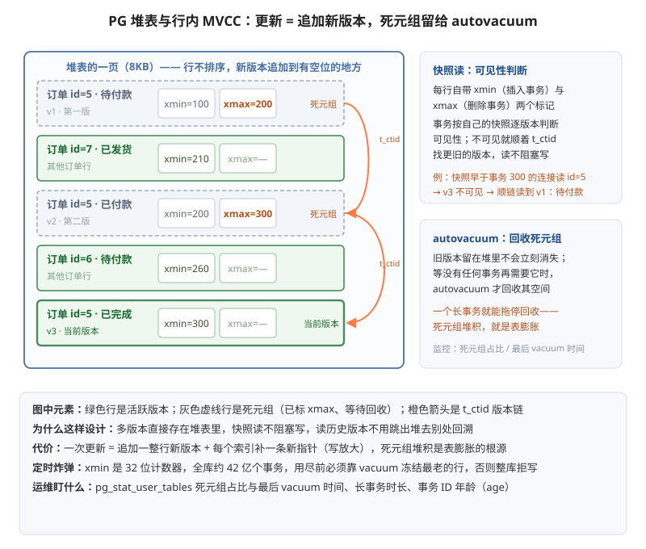
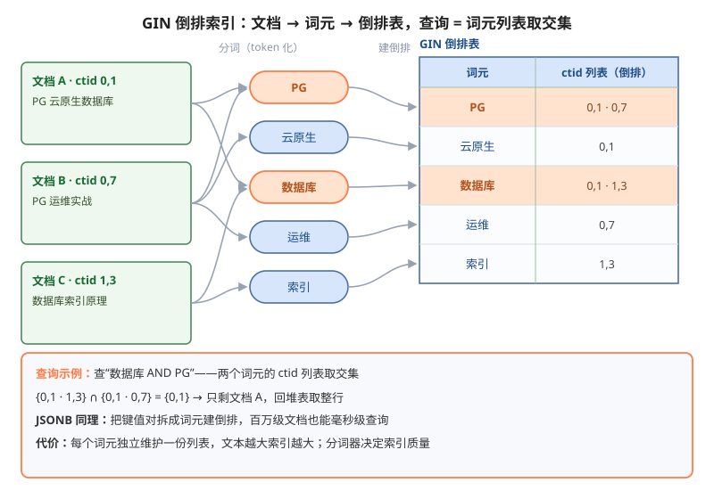
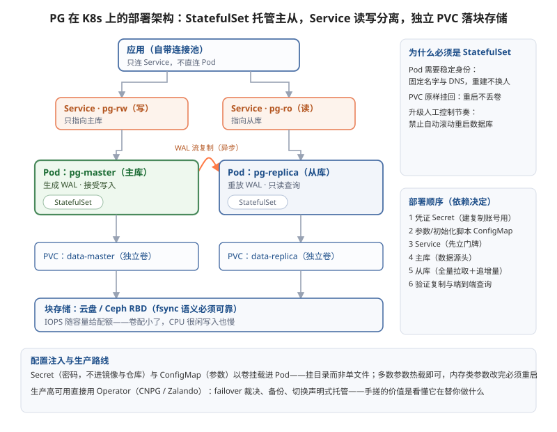
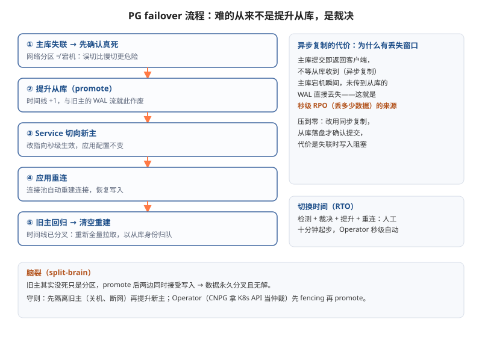

MySQL 是绝大多数业务的主存储，"会用"和"用得住"差着一整套工程能力：索引怎么设计、事务怎么隔离、锁怎么排队、死锁怎么定位、单机到顶后怎么扩。PostgreSQL 不是主角，但它是理解"另一种设计选择"最好的镜子——同一个问题，两家用完全不同的方式回答。全文以 MySQL 为主线，PG 在关键处对照。

## 选型定位 【够用】

按数据模型分三大类：

- **关系型**（MySQL / PostgreSQL）：二维表 + 外键 + SQL，核心承诺是 ACID——要么全成要么全败，断电不丢。订单、账务、用户资料的主存储。
- **NoSQL**：文档型（MongoDB，字段可变、免 DDL）、键值型（Redis，内存微秒级）、图数据库（Neo4j，多跳关系）。
- **时序库**（InfluxDB、Prometheus）：追加写 + 按时间范围扫，靠时间分区和高压缩比换吞吐。

选型的本质是拿业务的数据形状去匹配各家最擅长的部分。但也不必样样上专用库：PG 靠 JSONB、GIN 索引和扩展生态，在中小规模下能覆盖文档、全文、时序场景——这是它被称为"数据库天花板"的原因。而 MySQL 的优势在另一头：生态成熟、运维人才多、中间件和云产品最全，绝大多数团队的实际选择。

## MySQL 架构总览 【必掌握】

MySQL 分两层，这条分界线决定了后面所有机制的位置：

- **Server 层**：连接器（握手、认证、权限）、分析器（词法语法）、优化器（成本估算选索引和 join 顺序）、执行器（按计划调引擎接口）。binlog 也在这层。
- **存储引擎层**：数据的存取、索引、事务、锁全部由引擎实现。引擎可插拔、表级指定（`ENGINE=InnoDB`），但生产上基本只有 InnoDB——它是唯一同时具备事务、行锁、MVCC、crash-safe 的通用引擎。

对照 PG：执行器与存储一体化，没有引擎选择问题。MySQL 的分层带来灵活性，也带来历史包袱——比如 binlog 与 redo log 的两阶段提交，本质是两层各有一份日志要协调。

连接模型要记住一条：**MySQL 是每连接一线程**（PG 是每连接一进程）。`max_connections` 打满后新连接直接报 `too many connections`；空闲连接靠 `wait_timeout` 回收，应用侧必须用连接池。

## 数据怎么存：表空间与页 【够用】

开启 `innodb_file_per_table` 后每张表一个 `.ibd` 文件，内部按段 → 区 → 页三级组织：64 个连续的 16KB 页组成一个区，让 B+ 树相邻节点在磁盘上也尽量相邻，用顺序 IO 换掉随机 IO。

页（16KB）是整个体系的地基——磁盘管理、Buffer Pool 缓存、redo 记录、undo 记录全以页为单位。改一行数据，背后是整页的读写和日志。

## 索引：MySQL 性能的全部 【必掌握】

### B+ 树与聚簇索引



B+ 树只有两种节点：非叶子节点存"键 + 页号"负责路由，叶子节点存数据并用双向链表串联。走到目标行经过 3 个节点、最多 3 次页 IO——而根节点和中间层是所有查询的必经之路，几乎永远在内存里，真正落到磁盘的通常只有叶子那一次。一个 16KB 页能装上千个键值，三层就能覆盖千万行。所谓"单表两千万行"的临界点，本质是树要长到第四层、IO 多一次，不是硬限制。

**InnoDB 里表和聚簇索引是同一个东西**：数据行就物理存在主键 B+ 树的叶子里，按主键有序排列。这就是"索引即数据"。它带出三条工程结论：

- **主键用自增**。插入永远追加在最右侧叶子页，顺序写、页填满换新页；用 UUID 这类无序值，新行插进树中间，页满了触发页分裂，随机 IO 加空间碎片。自增主键的代价是可能存在并发插入热点，但相比随机写仍然是压倒性优势。
- **主键要短**。二级索引的叶子存的是主键值，主键越长，每个二级索引都跟着变胖。
- **不要用业务字段当主键**。业务键可能变更，而改主键等于重建整棵树。

**二级索引**是给表"额外多排几份目录"：叶子只存索引列 + 主键值。命中后要拿主键回聚簇索引再查一次整行——这就是**回表**。回表是随机 IO，这是索引设计一切取舍的源头。

### 联合索引与最左前缀

联合索引 `(a, b, c)` 按 a 排序、a 相同按 b 排、再按 c 排，所以：

- `WHERE a=?`、`WHERE a=? AND b=?`、`WHERE a=? AND b=? AND c=?` 都能用；
- `WHERE b=?`、`WHERE c=?` 用不了（无法跳过 a 直接定位）；
- `WHERE a=? AND c=?` 只有 a 生效，c 只能在索引里过滤（不能用来定位）。
- 范围条件会截断后续列：`WHERE a>? AND b=?` 中 b 无法用于定位。

联合索引的列序原则：**等值条件在前，范围条件在后，排序字段尽量跟上**。`WHERE a=? ORDER BY b` 建 `(a,b)` 后，索引本身有序，排序整段省掉。

### 覆盖索引、索引下推与前缀索引

- **覆盖索引**：查询要的列全在索引里，不用回表。`SELECT age FROM users WHERE name=?` 建 `(name, age)` 即覆盖。`EXPLAIN` 的 Extra 出现 `Using index` 就是它。
- **索引下推（ICP，5.6+）**：联合索引 `(name, age)`，查询 `WHERE name LIKE '张%' AND age=20`，5.6 之前只能按 name 回表再过滤 age；有了 ICP，`age` 的判断下推到引擎层在索引里先过滤，回表次数大幅减少。Extra 显示 `Using index condition`。
- **前缀索引**：长字符串（URL、邮箱）只索引前 N 个字符，省空间，但无法覆盖、也无法用于排序。N 的选择标准是"区分度不掉太多"——`COUNT(DISTINCT LEFT(col, N)) / COUNT(*)` 接近全列区分度即可。
- **唯一索引 vs 普通索引**：查询性能几乎无差；差异在写入——普通索引的修改可以进 Change Buffer 延迟合并，唯一索引必须读页校验唯一性，反而更慢。业务能保证唯一就用唯一索引（数据正确性优先），只为查询加速就用普通索引。

### 索引失效：优化器为什么不用你的索引

常见六类，工程上高频踩：

1. **对索引列做函数/运算**：`WHERE DATE(create_time)='2026-01-01'`、`WHERE id+1=100`。改成范围查询 `create_time >= '...' AND < '...'`。
2. **隐式类型转换**：`user_id` 是 varchar，传了数字 `WHERE user_id=123`，等于对列做 cast，索引失效。这是线上最隐蔽的一类。
3. **前导模糊**：`LIKE '%abc'` 用不了索引，`LIKE 'abc%'` 可以。
4. **不满足最左前缀**：见上一节。
5. **OR 连接的条件有一侧没索引**：整体退化为全表扫。
6. **优化器算出来不划算**：区分度太低的列（性别、状态），回表成本高于全表扫，优化器主动放弃索引。这不是"失效"，是成本判断——加索引也没用，该考虑覆盖索引或改查询。

还有一条常被忽略：**索引列参与排序时，联合索引的顺序决定能否免排序**。`WHERE a=? ORDER BY b` 建 `(a,b)` 可免 filesort，建 `(b,a)` 不行。

**索引不是越多越好**：每个索引都是独立的一份数据，写入时要同步维护，占空间、拖慢写入、干扰优化器。判断标准只有一条——**这条索引是否服务于确定的高频查询**。上线前用 `sys.schema_unused_indexes` 找从未被用过的索引，用 `sys.schema_redundant_indexes` 找冗余索引。

## 内存：Buffer Pool 与两个加速器 【必掌握】

**Buffer Pool** 以页为粒度缓存数据。读先查内存；写只改内存副本变成脏页，由后台线程按 checkpoint 节奏异步刷盘——只要 redo log 在，脏页丢了也能恢复。这是"写内存、慢刷盘"扛高并发的底气。

生产上两个必调项：

- **大小**：`innodb_buffer_pool_size` 默认 128M，必须调到实例内存的 50%~70%。命中率一跌，随机读直接穿透到磁盘，QPS 断崖。监控看 `Innodb_buffer_pool_read_requests` 与 `Innodb_buffer_pool_reads` 的比值。
- **容器边界**：K8s 里跑 MySQL，buffer pool 加上连接内存、排序缓冲必须小于容器 memory limit，否则刷脏高峰被 OOMKilled，表现是数据库莫名重启。这是云原生环境最常见的 MySQL 事故。

**淘汰算法**是改造过的 LRU：链表分 young / old 两段，新页先进 old 区，停留超过 `innodb_old_blocks_time` 后再次被访问才晋升 young。目的是防止一次全表扫描或备份任务把热点页全部冲刷出去。

两个加速器：

- **自适应哈希索引（AHI）**：引擎发现某些页被等值查询反复命中，自动建哈希索引，把树查找压成一次哈希定位。全程自动、无法人工干预，监控 `Innodb_ahi_*` 观察是否在工作。高并发等值查询场景收益明显，但也是 `innodb_buffer_pool_instances` 和并发争用的一个来源，出问题时可临时 `innodb_adaptive_hash_index=OFF` 验证。
- **Change Buffer**：普通二级索引的写入，如果目标索引页不在内存，不读磁盘、记账就返回，等页被读入或后台空闲时再 merge。**只对普通索引有效**（唯一索引要校验唯一性必须读页），这就是上一节"唯一索引写更慢"的原因。`innodb_change_buffer_max_size` 默认 25%，写多读少场景可调大。

## 日志：undo、redo、binlog 与两阶段提交 【必掌握】

### Undo Log：回滚与 MVCC 的底座

Undo 记录反向操作（"把 age 从 21 改回 20"），两个用途：事务回滚时改回去；支撑 MVCC——每行通过回滚指针串成版本链，快照读沿链找可见版本。purge 线程延迟清理不再被需要的旧版本。

**运维上最危险的是长事务**：只要事务不提交，它可能读到的旧版本就不能清理，undo 表空间无限膨胀。典型事故：报表功能在一个事务里嵌了半小时的慢查询，期间全库旧版本都无法回收，几百 GB 的盘几小时写满。处置顺序永远是先 kill 长事务止血，再谈清理。监控盯 `information_schema.innodb_trx` 的最长事务时长，不要等磁盘告警。

### Redo Log：crash-safe 的核心

Redo 是物理日志，记"某页某偏移做了什么修改"。写入路径：修改数据 → Log Buffer（MySQL 内存）→ OS page cache → redo log 文件。它顺序写，速度是随机刷数据页的几十倍——这就是"日志先落盘、数据页慢慢刷"能成立的前提。

落盘深度由 `innodb_flush_log_at_trx_commit` 决定：

| 值 | 行为 | 丢数据风险 | 适用 |
| --- | --- | --- | --- |
| 1（默认） | 每次提交都 fsync 到磁盘 | 不丢 | 生产标准 |
| 2 | 写到 OS page cache 即返回 | 宕机丢约 1 秒 | 可容忍少量丢失的批量导入 |
| 0 | 留在 Log Buffer 即返回 | 进程崩溃就丢 | 几乎不用 |

redo log 是**环形写**的固定大小文件（`innodb_log_file_size` × `innodb_log_files_in_group`），写满要推进 checkpoint 才能继续。日志文件配太小，高写入时会被迫频繁刷脏页，出现"写入抖动"——这是很多"CPU 不忙但 TPS 上不去"的根因。

### Binlog：Server 层的逻辑日志

与 redo 的物理记法相对：redo 记"某页某字节改成什么"（给自己崩溃恢复用），binlog 记"哪行数据变成了什么"（给别人用）。默认 `ROW` 格式，记录变更前后镜像；`STATEMENT` 记录 SQL 原文（有不确定性，已基本弃用）；`MIXED` 混合。

三个关键参数：

- `sync_binlog=1`：每次提交 fsync binlog，配合 `innodb_flush_log_at_trx_commit=1` 才是真正的"双 1"配置，断电不丢。
- `binlog_format=ROW`：主从一致性的基础，也是 CDC 的前提。
- `binlog_expire_logs_seconds`：binlog 保留时长，**必须大于最长的从库断线恢复时间 + 备份周期**。

两个用途：**主从复制**和 **CDC**。

```text
主库 dump 线程发出 binlog
   ↓
从库 IO 线程：原样接收，写成 relay log（不解码，只搬运）
   ↓
从库 SQL 线程：解析 relay log → 还原成行变更事件 → 执行
```

```text
MySQL 主库
  │ binlog dump（Canal 伪装成从库）
  ▼
Canal Server：二进制 binlog → 结构化行变更事件（表名、操作、前后镜像、位点）
  ▼
Kafka：变更消息进 topic
  ▼
下游：同步程序写 ES / 刷 Redis / 写其他库；Flink 做实时计算
```

### 两阶段提交：redo 与 binlog 的一致性

提交时：redo 进入 prepare → 写 binlog 并落盘 → redo 改为 commit。

崩溃恢复的裁决规则：redo 处于 prepare 且 binlog 完整 → 提交；binlog 不完整 → 回滚。如果没有两阶段提交，先写 redo 后写 binlog，崩溃时可能主库有新数据、binlog 没有，从库和备份就永远缺这一笔——主从数据分叉。

**运维推论**：`sync_binlog=0` 或 `innodb_flush_log_at_trx_commit=2` 的性能收益，换的是崩溃时的一致性风险。生产库没有理由不用双 1；如果确实要压测极限吞吐，也必须清楚自己在拿什么换。

## 事务与隔离级别 【必掌握】

### MVCC 怎么实现

InnoDB 的 MVCC 由三部分组成：

1. **隐藏字段**：每行有 `DB_TRX_ID`（最后修改它的事务 ID）、`DB_ROLL_PTR`（指向 undo 回滚段）。
2. **undo 版本链**：每次修改都把旧版本写进 undo，回滚指针串成链。
3. **ReadView**：快照读时生成，记录当前活跃事务 ID 列表（`m_ids`）、最小活跃 ID、下一个待分配 ID。沿版本链找第一个"对当前 ReadView 可见"的版本。

**RC 与 RR 的唯一区别就在 ReadView 的生成时机**：RC 每次快照读都新建 ReadView，所以能看到别人已提交的新数据（不可重复读）；RR 在事务第一次快照读时生成并复用，整个事务看到同一份快照（可重复读）。

### 隔离级别与幻读

| 级别 | 脏读 | 不可重复读 | 幻读 |
| --- | --- | --- | --- |
| 读未提交 RU | 会 | 会 | 会 |
| 读已提交 RC | 不会 | 会 | 会 |
| 可重复读 RR（默认） | 不会 | 不会 | 快照读不会，当前读靠 Next-Key Lock 解决 |
| 串行化 | 不会 | 不会 | 不会 |

MySQL 默认可重复读有其历史原因（早年 binlog 按语句复制，要求两次读一致）。如今 ROW 复制下这个绑定已解除，很多公司把默认降到 RC——**RC 没有间隙锁，锁范围小、并发高、死锁概率低**，这是互联网业务的常见选择。代价是同一事务内两次读可能不一致，必须靠业务保证。

**当前读 vs 快照读**是理解锁的前提：普通 `SELECT` 是快照读，走 MVCC 不加锁；`SELECT ... FOR UPDATE`、`UPDATE`、`DELETE`、`INSERT` 是当前读，读最新版本并加锁。

### 丢失更新：最常咬人的问题

两个事务同时读同一行、各自计算、后写覆盖先写。解法两派：

- **悲观锁**：`SELECT ... FOR UPDATE` 先把行锁住，事务结束才释放。
- **乐观锁**：加版本号 `UPDATE ... SET v=v+1, version=version+1 WHERE id=? AND version=?`，影响行数为 0 就重试。
- **原子更新**：`UPDATE ... SET balance = balance - 100 WHERE id=? AND balance >= 100`，把"读改写"压成一条语句，由数据库串行化。能原子就优先原子，最简单也最可靠。

凡是代码里"先查出来、改字段、再存回去"的写法，都该过一遍这个问题。

## 锁：行锁、间隙锁与 DDL 【必掌握】

### 全局锁、表锁、MDL

- **全局锁** `FLUSH TABLES WITH READ LOCK`（FTWRL）：整库只读，逻辑备份的旧方案，现在用 XtraBackup 不需要。
- **表锁**：`LOCK TABLES ... READ/WRITE`，MyISAM 时代的产物，InnoDB 下基本不用。
- **MDL（元数据锁）**：MySQL 5.5+ 自动加，**每个 DML 操作都会给表加 MDL 读锁，DDL 要加 MDL 写锁**。坑在这里：一个长事务没提交，它持有的 MDL 读锁就一直不放，后面的 DDL 排队等写锁，而 DDL 后面的所有查询又排在 DDL 后面——**一条 DDL 堵死整张表**。这是线上最典型的"改表导致全站卡死"。

### 行锁的三种形态

InnoDB 行锁挂在**索引**上，锁的是"通过索引找到的记录"：

- **Record Lock**：锁单条索引记录，`WHERE id=5` 走唯一索引时就是它。
- **Gap Lock**：锁索引记录之间的间隙，防止插入，只在 RR 下生效。
- **Next-Key Lock**：Record + 前面的 Gap，左开右闭区间，RR 下范围查询的默认形态。

结论：**WHERE 没走索引时，引擎只能边扫边锁，扫过多少锁多少，并发下约等于锁全表**。"UPDATE 必须走索引"不是性能洁癖，是锁粒度问题——这是生产上锁等待暴增最常见的原因。

RC 隔离级别下除唯一性检查和外键外不加 Gap Lock，所以 RC 的锁范围小得多。

### 死锁一：交叉更新（AB-BA）

最经典的一类。两个事务按相反顺序更新两行：

```text
事务 A: UPDATE accounts SET ... WHERE id=1;   -- 持有 id=1 的行锁
事务 B: UPDATE accounts SET ... WHERE id=2;   -- 持有 id=2 的行锁
事务 A: UPDATE accounts SET ... WHERE id=2;   -- 等 B
事务 B: UPDATE accounts SET ... WHERE id=1;   -- 等 A → 成环，死锁
```

InnoDB 检测到环后立刻回滚代价小的一方，报 `Deadlock found when trying to get lock`。生产上的典型场景：**批量转账/批处理任务没有约定加锁顺序**，并发跑两个批次就死锁。

解法：

- **约定全局加锁顺序**：批量操作按主键从小到大处理，从源头消灭环。这是最有效的办法。
- **拆小事务**：大事务持有锁时间长，更容易撞上。
- **应用侧重试**：死锁是正常现象，捕获错误码 1213 后重试（带随机退避），不要当成 bug 上报。
- 必要时降 RC 减少间隙锁参与。

### 死锁二：间隙锁 / 插入意向锁冲突

RR 隔离级别下，`UPDATE ... WHERE age=25`（age 无索引或非唯一索引）会锁住整个范围甚至全表间隙。两个事务各自持有一个间隙锁，然后都想插入同一个间隙：

```text
事务 A: SELECT * FROM t WHERE age BETWEEN 20 AND 30 FOR UPDATE;  -- 锁住间隙
事务 B: SELECT * FROM t WHERE age BETWEEN 20 AND 30 FOR UPDATE;  -- 也拿到间隙锁（间隙锁之间不互斥）
事务 A: INSERT INTO t(age) VALUES(25);  -- 插入意向锁，等 B 的间隙锁
事务 B: INSERT INTO t(age) VALUES(26);  -- 插入意向锁，等 A 的间隙锁 → 死锁
```

另一条高频路径是**唯一键冲突**：并发 `INSERT ... ON DUPLICATE KEY UPDATE` 或 `INSERT IGNORE` 同一批唯一键，先拿 S 锁再升级 X 锁，互相等待。还有 `REPLACE INTO` 在唯一索引冲突时的锁升级。

解法：

- **能用 RC 就用 RC**：没有间隙锁，第二类死锁基本消失。
- **避免无索引条件的大范围 UPDATE**：这是间隙锁死锁的温床。
- 唯一键冲突场景：改为"先查后插 + 捕获唯一键异常重试"，或串行化同一业务键的写入。
- 监控 `Innodb_deadlocks`，定期拉 `SHOW ENGINE INNODB STATUS` 的 `LATEST DETECTED DEADLOCK` 段分析。

### 死锁的检测与取舍

- `innodb_deadlock_detect=ON`（默认）：实时检测环，立刻回滚一方，代价是每次加锁都要做环检测，高并发下 CPU 开销可观。
- 关掉检测后靠 `innodb_lock_wait_timeout`（默认 50 秒）兜底——不推荐，等于把死锁变成慢等待。
- 超高并发热点行场景（如秒杀扣库存），关检测 + 短超时是一种极端取舍，但更该做的是把热点行拆开（库存分段）或改用 Redis 预扣。

### 排查手段

```sql
-- 当前事务与锁等待
SELECT * FROM information_schema.innodb_trx ORDER BY trx_started;
SELECT * FROM performance_schema.data_locks;      -- 8.0
SELECT * FROM performance_schema.data_waits;      -- 8.0 谁等谁
SHOW ENGINE INNODB STATUS\G                       -- 最近一次死锁现场
```

线上处置顺序：找到持锁最长的事务 → 确认是否可 kill → `KILL <thread_id>` 止血 → 再分析 SQL 和索引。

## 一个写请求的完整链路 【必掌握】

以 `UPDATE users SET age = 21 WHERE id = 5;` 串起所有机制：

1. **连接器**：从连接池复用，只做权限确认。
2. **Server 层**：分析器解析，优化器发现 id 是主键、走聚簇索引，执行器拿计划。
3. **定位页**：B+ 树上找到叶子页，在 Buffer Pool 直接用，不在则从 `.ibd` 读入。
4. **加锁**：对 id=5 的索引记录加 X 锁（当前读）。
5. **写内存**：页内 age 从 20 改为 21，页变脏；同时写 undo（反向"改回 20"）。
6. **写 redo**：记入 Log Buffer；提交时按 `innodb_flush_log_at_trx_commit` fsync 到 redo 文件。
7. **两阶段提交**：redo prepare → binlog 落盘 → redo commit，客户端收到成功。
8. **此刻磁盘**：只有 redo 和 binlog 是新的，`.ibd` 还是旧值，脏页留在内存。
9. **后台刷脏**：Page Cleaner 按 checkpoint 节奏写回 `.ibd`。
10. **分发**：dump 线程把 binlog 推给从库和 Canal。

看懂这条链，所有结论各就各位：提交快因为只顺序写两份日志；断电不丢因为 redo/binlog 已落盘；数据页敢慢刷因为 redo 兜底；长事务危险因为 undo 版本链和 MDL 都被拖住。

## 慢查询治理 【必掌握】

慢查询难防的根源：SQL 是逻辑描述，快不快取决于优化器估算出的执行路径，估算错了就慢。所以排查顺序不是"上来加索引"，而是**找出最贵的 → 看它为什么走错路 → 纠正原因**。

### 第一步：把慢 SQL 捞出来

```ini
slow_query_log = ON
long_query_time = 1                  # 超过 1 秒记录，按业务 SLA 定
log_queries_not_using_indexes = ON   # 记录未走索引的（小表也会刷屏，慎开）
log_slow_admin_statements = ON
```

大库必上 `pt-query-digest` 做聚合分析：按"总耗时 = 次数 × 单次耗时"排序，**先治总耗时最高的，而不是单次最慢的**——一条 0.5 秒执行 10 万次的 SQL，危害远大于一条 10 秒执行 1 次的。

### 第二步：看执行计划

`EXPLAIN` 关注四列：

- `type`：`const > eq_ref > ref > range > index > ALL`，出现 `ALL` 或 `index` 全扫就要警惕。
- `key`：实际用的索引，为 NULL 说明没走索引。
- `rows`：估算扫描行数，和实际差几个数量级就是统计信息问题。
- `Extra`：`Using filesort`（额外排序）、`Using temporary`（临时表）、`Using index`（覆盖索引，好）、`Using index condition`（ICP）。

MySQL 8.0.18+ 用 `EXPLAIN ANALYZE` 看**实际执行**的行数和耗时，估算与实际的偏差一目了然，比 `EXPLAIN` 准得多。

### 四类慢因与对应解法

| 慢因 | 表现 | 解法 |
| --- | --- | --- |
| 无路可走 | type=ALL，key=NULL | 建索引；检查索引失效（函数、隐式转换、前导模糊、OR） |
| 有路估错 | rows 估算与实际差几个数量级 | `ANALYZE TABLE` 刷新统计信息；检查是否索引选择性问题 |
| 内存不够 | 时快时慢，排序/临时表溢出磁盘 | 调 `sort_buffer_size`、`tmp_table_size`；优先改 SQL 去掉排序 |
| 深分页 | `LIMIT 100000, 20` 越翻越慢 | 游标翻页（记住上页最大 id）；或延迟关联 |

深分页的两种写法：

```sql
-- 差：扫 100020 行扔掉 100000 行
SELECT * FROM orders ORDER BY id LIMIT 100000, 20;

-- 好一：游标翻页，代价与页深无关
SELECT * FROM orders WHERE id > 100000 ORDER BY id LIMIT 20;

-- 好二：延迟关联，先在索引上分页再回表
SELECT o.* FROM orders o
JOIN (SELECT id FROM orders ORDER BY id LIMIT 100000, 20) t ON o.id = t.id;
```

### 统计信息与优化器

优化器靠统计信息（索引基数 `cardinality`、数据分布）估算成本。`innodb_stats_persistent=ON` 时统计信息持久化，但大表在大量增删后仍会失真，表现为"昨天还好好的 SQL 今天走了全表扫"。处置：`ANALYZE TABLE` 手动刷新，或调整 `innodb_stats_auto_recalc`。MySQL 8.0 支持直方图（`ANALYZE TABLE ... UPDATE HISTOGRAM ON col`），对数据倾斜的列（状态、城市）效果明显。

## 集群模式与高可用 【必掌握】

单机 MySQL 三个天花板：**容量**（数据/索引超过单盘）、**写入吞吐**（单主 fsync 上限）、**可用性**（主机挂了就没了）。集群解决的顺序也是这个顺序——先高可用，再容量和吞吐。

### 异步主从：一切的基础

主库把 binlog 推给从库，从库重放。三个线程：主库 dump 线程、从库 IO 线程（写 relay log）、从库 SQL 线程（重放）。

**异步复制的本质缺陷**：主库提交即返回，不等从库确认。主库宕机瞬间，未传出的 binlog 直接丢失——这是 RPO > 0 的来源。

复制延迟的来源要能背出来：

- 大事务（一次删百万行）要整段重放完才可见；
- 从库 SQL 线程单线程重放（并行复制可解，见下）；
- 从库硬件弱于主库、或从库还在跑报表；
- 无主键表的 ROW 复制，从库重放要全表扫描，一条 UPDATE 能卡几小时；
- 网络抖动、大表 DDL。

**并行复制**：5.6 按库并行，5.7 基于组提交（`slave_parallel_type=LOGICAL_CLOCK`），8.0 基于 write set（`binlog_transaction_dependency_tracking=WRITESET`）——按"事务修改的行是否冲突"并行重放，冲突的才串行，是效果最好的一档。前提是主库 `binlog_format=ROW`、表有主键。

**复制格式与参数基线**：`binlog_format=ROW`、`binlog_row_image=FULL`（CDC 需要前镜像）、`gtid_mode=ON`（切换的基础，不再依赖 binlog 文件名+位点）、`log_slave_updates=ON`（级联复制和切换必需）。

### 半同步复制：把 RPO 压到 0

`rpl_semi_sync_master_enabled` 打开后，主库提交事务要等至少一个从库确认收到 binlog 才返回。两种模式：

- `AFTER_COMMIT`（5.7 默认）：主库先提交，等确认。主库故障时客户端已收到成功的写可能丢失。
- `AFTER_SYNC`（8.0 推荐）：主库先等确认再提交，**无损复制**，RPO=0。

代价：从库全部失联时，主库在 `rpl_semi_sync_master_timeout`（默认 10 秒）后**降级为异步**继续写——可用性优先，这是半同步的隐藏妥协。严格无损要配合 `rpl_semi_sync_master_wait_for_slave_count=1` 并接受写阻塞。

### MGR：MySQL 原生组复制

MySQL 5.7.17 引入的官方高可用方案，基于 Paxos 变体（XCom）：

- 3 或 5 个节点组成组，**多数派可用**，少数派分区自动停止写入（防脑裂）。
- 事务在组内认证（certify）后广播，多数派确认即提交——**强一致**，RPO=0。
- 支持单主模式（默认，一个 PRIMARY 多个 SECONDARY）和多主模式（冲突检测，写冲突会回滚）。
- 内建故障检测与自动选主，不需要外部仲裁组件（对比 PG 的 Patroni 要 etcd/ZK）。
- InnoDB Cluster = MGR + MySQL Shell（部署管理）+ MySQL Router（读写路由）。

代价：**写放大**——每个事务要发到所有节点认证；网络延迟直接计入提交延迟，跨可用区部署时比单机慢一个量级；节点数建议 3/5，2 节点没有容错意义。

### PXC / Galera：同步多主

Percona XtraDB Cluster 基于 Galera，也是同步复制、多数派提交：

- 写可以在任意节点发起（多主），适合读多写少、需要就近写的场景。
- 认证在提交时做，冲突的事务直接失败（报 deadlock），应用必须能重试。
- 代价与 MGR 类似：写放大、对网络敏感、大事务会拖慢整个集群（流控 `flow_control` 频繁触发）。
- DDL 是"全节点同步执行"，大表改结构风险高。

### 选型对比

| 方案 | 一致性 / RPO | 自动切换 | 写性能 | 复杂度 | 适用 |
| --- | --- | --- | --- | --- | --- |
| 异步主从 | 弱，RPO>0 | 需 Orchestrator/MHA | 最高 | 低 | 大多数业务默认，能接受秒级丢失 |
| 半同步 | 强（AFTER_SYNC） | 需外部组件 | 中 | 中 | 金融、账务 |
| MGR | 强，RPO=0 | 内建 | 中低（写放大） | 中高 | 需要官方高可用、单主多从 |
| PXC | 强，RPO=0 | 内建 | 低（多主冲突回滚） | 高 | 多主写入、中小集群 |

**生产落点**：绝大多数业务用"异步主从 + Orchestrator 自动切换"就够；有 RPO=0 诉求上 MGR 或半同步；PXC 适合特定多主场景，但运维复杂度高，新项目一般优先 MGR。

### 切换与脑裂：比选型更重要的是纪律

自动切换的危险不在"提升从库"，而在两个裁决：**旧主真的死了吗**（网络分区下它可能还活着）和**什么时候切**（切早了误伤，切错了脑裂）。

脑裂后果：旧主和新主同时接受写入，数据永久分叉且无法自动合并。所以所有方案的守则都一样——**先确认旧主下线（关机/断网/fencing），再提升新主**。MGR 靠多数派投票天然防脑裂；传统主从靠 Orchestrator 的共识 + 外部 fencing。

应用侧配套：**永远只连 VIP / Service / Proxy，不写死实例地址**。切换换的是入口指向，应用无感——这一条是所有自动切换能落地的前提。

### K8s 上跑 MySQL

- **载体只能是 StatefulSet**：稳定网络标识、独立 PVC、有序启停。Deployment 的 Pod 是无名可替换的，对数据库意味着卷和身份对不上。
- **生产上高可用用 Operator**：Oracle MySQL Operator、Percona Operator for MySQL（PXC 或 PS + Orchestrator）、Vitess Operator。Operator 托管部署、备份、failover、扩缩容，手搓的价值是出事时你知道 Operator 在替你做什么。
- **存储必须块存储**（云盘 / Ceph RBD），不能 NFS——fsync 语义不可靠，断电可能丢已提交事务。
- **资源账**：buffer pool + 连接内存 < memory limit，request=limit 站进 Guaranteed 等级，避免节点压力时被驱逐。
- **升级节奏人工控制**：先重启从库、切换、最后重启旧主，绝不交给滚动更新自动编排。
- **探针宁松勿紧**：大库 crash recovery 可能几分钟，激进的 liveness 会反复杀进程导致永远起不来；readiness 只管流量。

## 分库分表 【必掌握】

### 先问：真的需要拆吗

拆分的代价是分布式事务、跨库 join、跨分片分页、扩容迁移、运维复杂度全面上升。所以顺序永远是：**索引优化 → 读写分离 → 冷热归档 → 分区表 → 才轮到分库分表**。

触发信号（按优先级）：

- 单表数据量超过几千万且持续增长，索引深度增加、DDL 无法承受；
- 单库磁盘或连接数到顶；
- 写入 QPS 超过单主 fsync 能力（通常几千 TPS 量级，视硬件和事务大小）；
- 业务天然可按用户/租户切分。

分区表（Partitioning）是中间选项：逻辑一张表、物理多个文件，适合按时间归档的场景，但跨分区查询和全局唯一索引受限，不能替代分库分表。

### 垂直拆分与水平拆分

- **垂直拆库**：按业务域拆（用户库、订单库、商品库），本质是微服务化的数据侧配套，降低单库压力、隔离故障。
- **垂直拆表**：把大字段（text、blob）、低频字段拆到扩展表，让主表行更短、单页装更多行、buffer pool 效率更高。这个收益常被低估。
- **水平拆表**：按行拆，同一张表的数据分散到多个库/表。这是通常说的"分库分表"。

水平拆分的路由方式：

| 方式 | 规则 | 优点 | 缺点 |
| --- | --- | --- | --- |
| Range | 按 id 区间或时间 | 范围查询友好、扩容简单（加新段） | 热点集中在新段 |
| Hash 取模 | `id % N` | 数据均匀 | 扩容需全量迁移（N 变化） |
| 一致性哈希 | 哈希环 | 扩容只迁移部分数据 | 实现复杂、可能不均 |
| 双倍扩容 | 2N 分片 | 迁移量可控（一半数据） | 需提前规划 |

工程上最常见的是 **hash 取模 + 成倍扩容**，或**按用户 ID 哈希 + 提前预留足够分片**（如 1024 个逻辑分片映射到少量物理库，扩容只改映射）。

### 分片键：最重要的设计决策

- **必须让高频查询带上分片键**，否则请求要广播到所有分片再聚合——这是分库分表后最大的性能陷阱。
- 订单表按 `user_id` 分片，则"用户查订单"高效，但"商家查订单"要另建一份按 `merchant_id` 分片的冗余表（异构索引表），靠 binlog 同步。
- 分片键要分布均匀，不能选状态、地区这类倾斜字段。
- 上线后修改分片键的代价接近重建，务必先想清楚。

### 分布式 ID

自增主键在分库分表下失效（各库各自自增会冲突）。方案：

- **雪花算法（Snowflake）**：时间戳 + 机器 ID + 序列号，趋势递增、本地生成、性能高。坑在**时钟回拨**，要对机器 ID 做分配管理。
- **号段模式**（美团 Leaf、滴滴 TinyID）：数据库批量发号段，应用内存分配，性能好且不依赖时钟。
- **UUID**：绝对不要用作 InnoDB 主键——无序导致页分裂，前面讲过。

### 跨分片的问题与解法

- **分页**：`LIMIT offset, n` 需要每个分片取 offset+n 条再归并，深分页不可行。解法是限制查询必须带分片键，或做"二次查询法"，或干脆禁用跨分片深分页。
- **聚合**：`COUNT/SUM/GROUP BY` 要下发到各分片再汇总，尽量在中间件层做掉，或走离线数仓。
- **join**：禁止跨库 join。解法是字段冗余（订单表冗余用户名）、异构索引表、或应用层组装。
- **分布式事务**：本地事务失效。强一致用 Seata AT/TCC（性能代价大），最终一致用**本地消息表 + 定时补偿**或 **RocketMQ 事务消息**——互联网业务的主流选择是最终一致，不是强一致。
- **全局唯一约束**：各分片的唯一索引只管自己，全局唯一要靠独立发号器或唯一性校验表。

### 中间件与落地

- **ShardingSphere-JDBC**：客户端模式，jar 包嵌入应用，无额外网络跳转，性能最好；缺点是绑定语言（Java）、升级要改应用。
- **ShardingSphere-Proxy**：独立代理，兼容 MySQL 协议，多语言可用；多一跳网络，代理层要自己做高可用。
- **Vitess**：YouTube 出品，K8s 原生，适合超大规模集群，运维复杂度高。
- **MyCat**：老一代代理，社区已不活跃，新项目不建议。

分库分表上线后，DDL 变成高危操作——要在每个分片执行、要保证一致。常用 gh-ost / pt-online-schema-change 做在线变更，配合统一的分片变更平台。

## 连接池与容量 【必掌握】

**为什么必须池化**：MySQL 每连接一线程，握手、认证、权限加载都是真实开销；连接数无节制增长会吃光内存和线程调度能力。池的本质是"少量真实连接 + 应用侧复用"。

**池不是越大越好**。总账 = 连接数 × 每连接内存，`max_connections` 打满时新连接直接报错。经验公式（PostgreSQL 社区提出、MySQL 同样适用）：

```text
连接数 ≈ CPU 核数 × 2 + 磁盘数
```

一个 8 核库配 20~30 个应用连接往往比配 200 个吞吐更高——连接多了，锁竞争和上下文切换反而拖慢。

**三个必须对齐的参数**：

- 应用池的 `maxLifetime` 要小于服务端 `wait_timeout`，否则拿到的是服务端已断开的死连接，报 `Communications link failure`。
- 池的 `minimumIdle` 不要太低，避免流量突增时大量新建连接。
- 服务端 `max_connections` 永远留余量给监控、备份和 DBA 登录——连接真打满时，你连诊断用的客户端都进不去。

**连接打满的排查**：

```sql
SHOW PROCESSLIST;
SELECT * FROM performance_schema.threads WHERE TYPE='FOREGROUND';
SELECT COUNT(*) FROM information_schema.processlist GROUP BY user, command;
```

常见原因不是"连接不够"，而是慢查询占住连接不放、应用侧连接泄漏（忘了 close）、或事务未提交。

## PostgreSQL：另一种设计选择 【够用】

PG 不是本文主角，但它的每个设计都和 MySQL 形成对照，理解差异比背结论有用。

### 堆表：数据不按主键排序

PG 的表叫堆表（heap），**数据行不按任何键排序**，插入时哪儿有空间就往哪儿放，页大小 8KB。所有索引（包括主键）都是挂在表外的独立结构，索引叶子存行号 `ctid`（页号 + 页内偏移），命中后必须回表取整行。

对照 MySQL：InnoDB 是"索引即数据"，主键树叶子就是整行；PG 是"索引只是目录"，主键和二级索引地位完全平等，回表是常态。所以 PG 里**覆盖索引（Index Only Scan）的收益比 MySQL 更大**——省掉的是每一次随机回表。

### 行内 MVCC 与表膨胀

每行自带 `xmin`（插入它的事务 ID）和 `xmax`（删除它的事务 ID）。**更新不是原地改，而是复制一份新行追加进堆表**，旧版本留在原处成为死元组：



快照读用 xmin/xmax 对事务快照做可见性判断。对照 MySQL：版本链在 undo 里（由 purge 线程清理），PG 的版本链就在表里（由 autovacuum 清理）。**写放大是 PG 的常态**——一次 UPDATE 要写一整行新版本，还要维护该表所有索引。

两个生产级后果：

- **表膨胀**：只要还有活跃事务可能读到旧版本，它就不能回收。一个长事务能拖停全库 vacuum——几百 GB 的表可能大半是死元组，查询越来越慢、磁盘越占越多。`autovacuum` 默认参数按小机器设定，生产必须显式调大；监控盯 `pg_stat_user_tables` 的死元组占比和最后一次 vacuum 时间。
- **HOT 更新**：新版本落回原页、且更新的字段不在任何索引里时，索引维护整段跳过。这是 PG "少建索引"的直接原因。

### 事务 ID 回卷：PG 的定时炸弹

`xmin` 是 32 位计数器，全库约 40 多亿个事务后回卷——旧版本会突然"变成"对新事务可见，数据直接错乱。PG 的自保是**宁可罢工**：事务 ID 年龄触到阈值就强制拒写，整库只读，等 aggressive vacuum 冻结足够老的行才能恢复。2019 年 Sentry 就因此全站停写。

监控必须盯：`SELECT datname, age(datfrozenxid) FROM pg_database;`，阈值按 `autovacuum_freeze_max_age` 的比例设，别等数据库自己罢工。

### 索引：一库多索引

PG 的索引结构是可插拔的，这是它能覆盖多种场景的根基：

- **B-link 树**（默认）：并发版 B+ 树，多一个右兄弟指针，节点分裂时查找可沿右链绕行、不用等锁，高并发下优于传统 B+ 树。
- **GIN 倒排索引**：文本切词元、建立"词元 → 行号"映射，查询时对 ctid 列表取交并集。配合 **JSONB**，把 JSON 键值拆出来建倒排索引，百万级文档毫秒级查询——这是 PG 能平替 ES、MongoDB 的原因。

  

- **GiST 通用搜索树**：多维数据（经纬度、多边形），用矩形框逐层判断相交，PostGIS 建在它之上。
- **BRIN 块范围索引**：只为每批数据页记录字段最大/最小值，极小的存储代价，适合按时间顺序写入的日志、监控数据（对应替代 InfluxDB）。

对照 MySQL：InnoDB 只有 B+ 树一种索引结构，全文索引能力弱，JSON 只支持函数索引。需要全文/地理/时序时，MySQL 体系通常要引入 ES、PostGIS 不可用就得换库；PG 一套解决。

### WAL：一份日志管写路径和复制

PG 只有一份 WAL（物理日志），顺序写、先写日志再刷数据页。提交时由 `synchronous_commit` 决定落盘深度：`on` 强制 fsync（默认），`off` 写到 OS cache 就返回。

WAL 同时是复制源头，主从和 CDC 都从它分流：

```text
主库 WAL 生成（提交即 fsync）
   ↓
wal sender：原样发送 WAL 流
   ├─→ 从库 wal receiver：写本地 → 重放，主从物理一致（流复制）
   └─→ 逻辑解码：WAL → 逻辑变更事件（表名、操作、前后镜像）→ CDC
```

对照 MySQL：MySQL 有两份日志（redo 给崩溃恢复、binlog 给复制和 CDC），所以必须两阶段提交；PG 一份 WAL 两用，没有这个问题，但**逻辑解码必须等事务提交后才能输出**，且流复制要求主从大版本一致。

运维坑：**`pg_wal` 目录持续增长**——WAL 要等所有复制槽确认进度后才能删，下游消费者占着槽不推进，WAL 永远不删直到磁盘写满。下游允许的中断时长不能超过剩余空间能撑的时间，这要进容量规划。

### 内存与连接：每连接一进程

- `shared_buffers`：默认 128M，通常调到实例内存的 25% 左右（另一半留给 OS cache）。
- `work_mem`：**每个排序/哈希操作**独立分配，不是每个连接——一条 SQL 三个排序点就是三份。高并发下 `连接数 × work_mem` 极易顶爆内存，容器里莫名 OOMKilled 多半是它。
- **每个连接一个独立进程**，比线程重得多，连接数一高内存先崩，所以 PgBouncer 几乎是生产标配。PgBouncer 的 `transaction` 模式事务结束即回收连接，能用少量连接扛几千客户端，代价是会话状态（临时表、prepared statement、SET 变量）失效——用前确认框架适配。

对照 MySQL：线程模型更轻，但连接数同样要池化；MySQL 的相关内存参数是 `sort_buffer_size`、`join_buffer_size` 这类**每连接**分配的参数。

### 扩展：天花板的由来

`CREATE EXTENSION` 一句话装扩展：PostGIS（地理）、TimescaleDB（时序）、pg_trgm（模糊搜索）、pgvector（向量）等几千个扩展独立演进，还能 hook 进优化器、自定义数据类型和访问方法。

结论：PG 的优势不是单点性能最强，而是**一套库覆盖关系型、文档、全文、地理、时序**，中小团队可以少维护一套技术栈；代价是索引独立维护、存储成本高、超大规模仍要拆专业库。

### PG 在 K8s 上的运维要点



和 MySQL 同构的部分（StatefulSet、块存储、Operator、人工控制升级节奏）不再重复，只讲 PG 特有的：

- **关机姿势**：PG 收到 SIGTERM 是 smart shutdown——拒绝新连接、等存量连接全部退出。长连接退不完，宽限期一到 SIGKILL，下次启动就是一次 crash recovery。宽限期按业务最长连接时间调大。
- **探针**：大库重启要做 crash recovery，重放时长与 checkpoint 间隔成正比。恢复期间进程未就绪，激进的 liveness 会反复杀进程、库永远起不来。liveness 宁松勿紧，readiness 只管流量。
- **failover 裁决**：难点不在提升从库，而在确认旧主真死。旧主只是分区没死的话，新主提升后两边同时写，数据永久分叉——所以流程永远是先隔离旧主（关机/断网）再提升。生产上交给 Operator（CNPG 用 K8s API 当仲裁，不额外部署 etcd）。



### PG 的写请求链路

`UPDATE orders SET status=2 WHERE id=5`：

1. 连接池复用连接，独立 backend 进程接手，优化器走主键 B-link 树。
2. 树里查到 ctid，回堆表找到旧版本行。
3. **复制一份新行**写进堆表（xmin=当前事务 ID），旧行 xmax 标上当前事务，成为死元组。
4. 表上有几个索引就补几条指向新 ctid 的记录，与更新哪个字段无关。
5. 变更写 WAL，提交时 fsync，这一步完成才算提交成功。
6. WAL 流给从库重放，逻辑解码推给 CDC。
7. checkpoint 刷脏页，autovacuum 回收死元组。

对照 MySQL 的写链路：MySQL 原地改页 + undo 版本链，PG 追加新版本 + 全索引维护；MySQL 两份日志两阶段提交，PG 一份 WAL；MySQL 靠 purge 清 undo，PG 靠 autovacuum 清死元组。**理解了这两条链路的差异，两家的所有运维坑都能自己推出来。**

## MySQL 与 PG 对比总结 【必掌握】

| 维度 | MySQL（InnoDB） | PostgreSQL |
| --- | --- | --- |
| 数据组织 | 聚簇索引，表即主键 B+ 树 | 堆表无序，索引全是独立目录 |
| 回表 | 二级索引 → 主键 → 聚簇索引 | 所有索引 → 堆表，地位平等 |
| 版本链位置 | undo 表空间，purge 清理 | 行内（表里），autovacuum 清理 |
| 写放大 | 小：原地改页 + 写 undo/redo | 大：整行新版本 + 全索引维护 |
| 日志 | redo（恢复）+ binlog（复制/CDC），需两阶段提交 | 一份 WAL 两用 |
| 复制 | binlog，ROW 格式，逻辑复制 | 物理流复制 / 逻辑解码 |
| 连接模型 | 每连接一线程 | 每连接一进程 |
| 索引能力 | B+ 树、全文（弱）、函数索引 | B-tree、GIN、GiST、BRIN、可扩展 |
| DDL | 部分在线，大表变更仍需工具 | 事务性 DDL，加列秒级 |
| 默认隔离 | RR（有间隙锁） | RC |
| 特有风险 | 长事务撑爆 undo、MDL 堵表、间隙锁死锁 | 表膨胀、事务 ID 回卷、pg_wal 爆盘 |
| 生态强项 | 运维人才、中间件、云产品、分库分表方案成熟 | 功能完整度、扩展生态、复杂查询 |

选型结论：**高并发简单查询、团队以业务研发为主、需要成熟的分库分表和高可用方案——选 MySQL；复杂查询、地理/全文/JSON、需要一套库覆盖多场景——选 PG。** 两者都是正确选择，真正的风险是选了却不按它的性格运维。

## 主从延迟与读写分离 【必掌握】

**为什么会有延迟**：两家的复制都是异步推送——主库提交成功就返回客户端，不等于从库已经收完并重放完。延迟来源是重放追不上写入：大事务、从库串行重放、网络抖动、从库硬件弱。

**读写分离把延迟暴露给业务**：写完立刻读从库，可能读到旧值——"刚改完头像刷新还是旧的"这类工单多半是它。处理按场景分层：

- 能容忍旧值的（排行榜、列表页、历史查询）走从库；
- 不能容忍的（写后立刻读、支付结果、库存）强制走主库；
- 要彻底消除窗口用半同步（RPO=0），代价是写延迟上升。

工程实现上，**强制走主库**通常用注解或上下文标记（如 ShardingSphere 的 Hint），不要靠"延迟小于 X 秒就读从库"这类猜测——延迟是波动的，猜不准。

**一条边界必须记住**：复制不是备份。误删的数据会被原样同步到所有从库，恢复只能靠备份 + 日志回放。

## 备份与恢复 【必掌握】

### Velero 能当数据库备份吗

结论：**能兜底，不能当主方案。**

Velero 解决的是"K8s 集群里有什么、能不能整体搬回来"——备份 API 对象，对持久卷靠 CSI 快照或 restic/kopia 做文件级拷贝。放到数据库上有两个硬伤：

- **不保证事务一致性**：按文件抓取时数据库还在写，拿到的是"半个事务加半个脏页"。文件级备份必须冻结写入才安全，大库不可接受。
- **没有 PITR**：数据库备份的核心不是"恢复到昨天"，而是"恢复到昨天 14:03:07 那条误删之前"。这需要"基础备份 + 连续日志归档"，Velero 只做前者。

正确定位是**兜底层**：命名空间被误删、集群重建、清单全丢这类灾难，Velero 把数据库连同部署和卷一起捞回来。数据库自身的备份仍要交给数据库自己的工具。

### 四层备份，各管各的

| 层 | 手段 | 能恢复什么 | 代价 |
| --- | --- | --- | --- |
| 逻辑备份 | `mysqldump` / `pg_dump` / `pg_dumpall` | 单表、单库；可跨版本、可改结构 | 慢，大库小时级；恢复即重放 SQL |
| 物理备份 + 日志归档 | XtraBackup + binlog 归档 / `pg_basebackup` + WAL 归档（pgBackRest、Barman） | **任意时间点（PITR）**、整实例 | 需持续归档，占对象存储 |
| 卷快照 | CSI VolumeSnapshot / 云盘快照 | 整卷，秒级，对业务影响小 | 一致性靠冻结，跨区受限 |
| K8s 资源 | Velero | 命名空间、工作负载、PVC、Secret | 不保证数据库内部一致性 |

分层用法：**日常误删靠 PITR，跨版本迁移用逻辑备份，卷级快速回滚用快照，集群灾难用 Velero**。四层不重叠，缺一层就有一种事故无解。

MySQL 侧的实操要点：

- `mysqldump --single-transaction` 用一致性快照，不锁表，但只对 InnoDB 有效；大库恢复是"重放 SQL"，慢到不可接受。
- **XtraBackup 是生产标准**：物理热备、不锁库、增量备份、支持流式传到对象存储。备份完要 `--prepare` 才能恢复。
- **PITR = 全量备份 + binlog 归档**：恢复到"误删前一秒"，靠 `mysqlbinlog --stop-datetime` 回放。binlog 保留时长必须覆盖备份周期。
- 从库备份可以减少主库压力，但要注意从库延迟导致的数据滞后。

### 几条不能省的纪律

- **备份必须演练**。没恢复过的备份等于没有备份——凭证过期、归档断档、备份文件是空壳，只有真恢复一次才暴露。至少季度一次，恢复到隔离环境验数据。
- **备份与数据分离**。不同盘、不同可用区、不同账号——集群级事故常常把存储一起带走。
- **复制不是备份**。一条 `DROP TABLE` 一秒内同步到所有从库。
- **必须答得出两个数**：RPO（最多丢多久数据，由归档频率决定）、RTO（恢复要多久，由备份方式和演练决定）。答不上，等于没有方案。

## 监控落地 【必掌握】

两家都走 exporter + Prometheus：

| | MySQL | PostgreSQL |
| --- | --- | --- |
| exporter | `mysqld_exporter`（9104） | `postgres_exporter`（9187） |
| 采集方式 | `SHOW GLOBAL STATUS` / `VARIABLES` | `pg_stat_*` 视图 |
| 账号 | 只读监控账号 | `pg_monitor` 角色 |

MySQL 核心指标（每个都对应前文一种故障）：

```text
# 连接数水位：打满报 too many connections
mysql_global_status_threads_connected / mysql_global_variables_max_connections

# Buffer Pool 命中率：跌破 99% 说明随机读开始穿透磁盘
1 - mysql_global_status_innodb_buffer_pool_reads
  / mysql_global_status_innodb_buffer_pool_read_requests

# 主从延迟（版本不同前缀可能是 mysql_slave_status_ / mysql_replica_status_）
mysql_slave_status_seconds_behind_master

# 锁等待与死锁：突增说明有热点行或长事务
mysql_global_status_innodb_row_lock_waits
rate(mysql_global_status_innodb_deadlocks[5m])

# 长事务：undo 膨胀和 MDL 堵塞的源头，查 information_schema.innodb_trx
# 慢查询数：结合 slow_query_log 定位
```

PG 侧对应：

```text
# 连接数
pg_stat_activity_count{datname="app"} / pg_settings_max_connections

# 复制延迟（字节）：槽位不推进，pg_wal 迟早写满盘
pg_replication_slots_pg_wal_lsn_diff

# 表膨胀：死元组占比
pg_stat_user_tables_n_dead_tup / (pg_stat_user_tables_n_live_tup + pg_stat_user_tables_n_dead_tup)

# 最长事务：一切膨胀的源头
pg_stat_activity_max_tx_duration
```

事务 ID 年龄没有现成指标，用自定义查询暴露：

```sql
SELECT datname, age(datfrozenxid) AS xid_age FROM pg_database;
```

告警排序按爆炸半径：**先接会让库停写的三条**——连接数打满、事务 ID 年龄（PG）、磁盘剩余天数；**再接会让业务变慢的四条**——主从延迟、死元组占比（PG）、最长事务、慢查询数。阈值按自己的容量基线定，别抄网上的绝对值。

采集侧两个坑：exporter 自己也占一条连接，监控账号别配成超级用户；`pg_stat_*` 视图很轻，但 `information_schema` 的全表统计在大库上很贵，采集间隔别设太密。

## 一页纸总结 【必掌握】

- **架构**：Server 层 + InnoDB；数据在聚簇索引叶子里，二级索引要回表。
- **索引**：联合索引等值在前范围在后；覆盖索引免回表；函数/隐式转换/前导模糊会让索引失效；索引不是越多越好。
- **内存**：Buffer Pool 调到内存 50%~70% 且小于容器 limit；Change Buffer 只对普通索引有效。
- **日志**：undo 撑 MVCC 和回滚（长事务是噩梦）；redo 保 crash-safe（双 1 配置）；binlog 供复制和 CDC；两阶段提交保主从一致。
- **事务**：MVCC = 隐藏字段 + undo 版本链 + ReadView；RC 每次新建快照，RR 复用快照；RC 无间隙锁，并发更高。
- **锁**：行锁挂在索引上，没走索引约等于锁全表；MDL 会让 DDL 堵死全表。
- **死锁**：AB-BA 交叉更新靠固定加锁顺序；间隙锁/唯一键冲突靠 RC + 索引 + 重试；死锁是常态，应用必须有重试。
- **慢查询**：先按总耗时排序，再看执行计划，最后按四类慢因下药；`EXPLAIN ANALYZE` 看真实执行。
- **集群**：异步主从保可用、半同步保 RPO=0、MGR/PXC 强一致但有写放大；切换的核心是"先确认旧主死"，应用只连 VIP/Service。
- **分库分表**：先优化再拆；分片键决定一切；分布式 ID 用雪花/号段；跨分片 join 和分页要提前设计；最终一致靠消息表，不强求 2PC。
- **运维**：备份必演练、复制不是备份、监控按爆炸半径排序、K8s 上 StatefulSet + Operator + 块存储 + 资源账算平。
