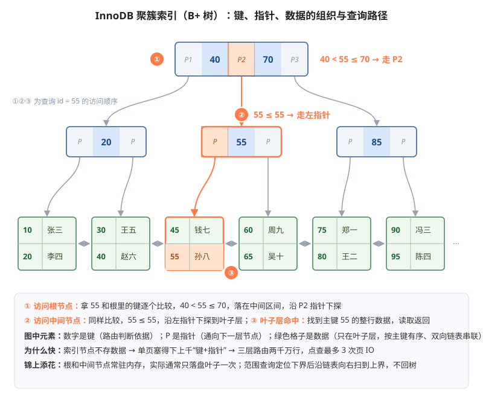
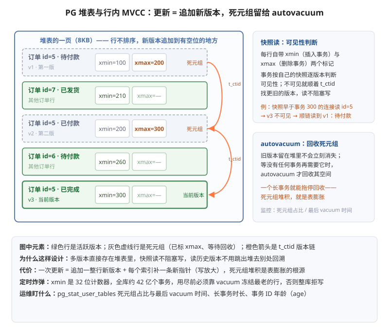
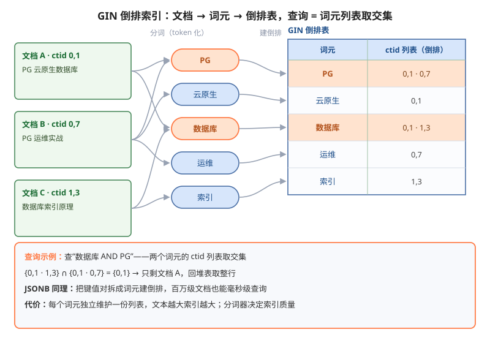
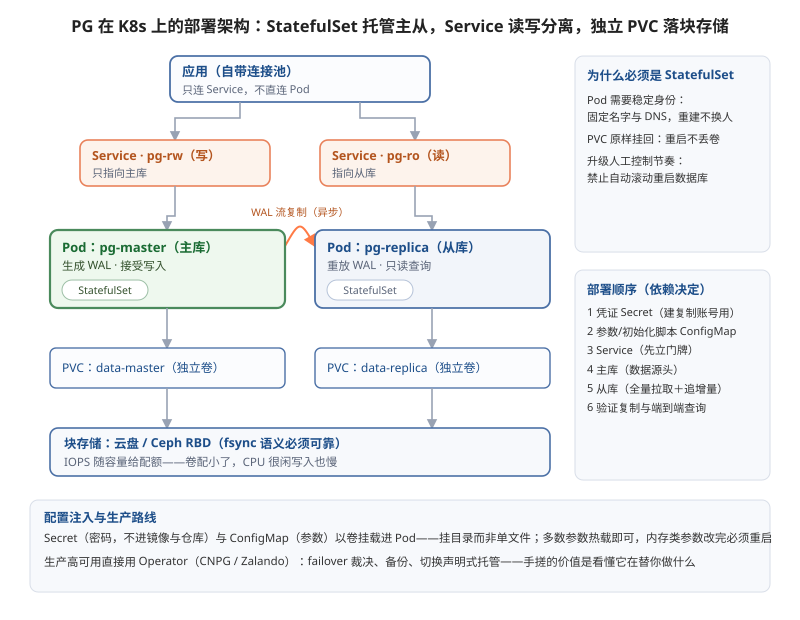
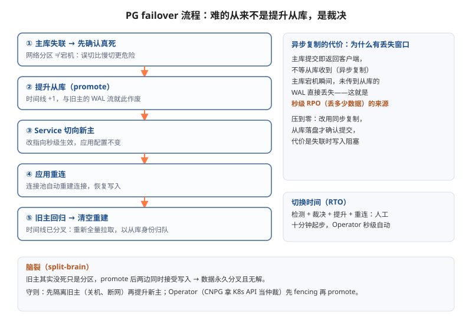

## 架构
### mysql

#### 磁盘：数据到底怎么存

InnoDB 用表空间文件管理数据，开启 innodb_file_per_table 后每张表一个独立的 .ibd 文件。文件内部按段、区、页三级组织：64 个连续的 16KB 页组成一个区，区再组成段，让 B+ 树相邻节点在磁盘上也尽量相邻，用顺序 IO 代替随机 IO。页是整个体系的地基——磁盘管理、内存缓存、日志记录全都以页为单位。

#### B+ 树：数据怎么被找到

先看图，认识 B+ 树里的两种节点：



全程访问 3 个节点、最多 3 次页 IO，而且根节点和中间节点是所有查询的必经之路，几乎永远留在内存里，真正穿透到磁盘的通常只有叶子那一次。

索引节点不存数据，一个 16KB 页塞得下上千个“键+指针”（扇出上千），三层就能路由到两千万行，树矮所以 IO 少；数据在叶子层按主键有序、叶子间有链表，所以范围查询只需先定位到下界，再顺着链表向右扫到上界，全程不用回到树上。至于单表千万行的“临界点”，本质是树要长到第四层、IO 多一次，不是硬性限制。

主键设计是最相关的推论：自增 ID 的插入永远追加在最右侧叶子页，写满换新页，顺序且紧凑；用 UUID 这类无序值当主键，新行会插到树中间的某页，页满了还得分裂，随机 IO 加碎片，写入性能和空间都吃亏。“尽量用自增主键”的底层原因就在这。

InnoDB 里“表”和“聚簇索引”是同一个东西，数据行就物理存在这棵树的叶子里，按主键大小排列。这就是“索引即数据”。聚簇索引决定了表“按谁排”，二级索引（）是给表“额外多排几份”——每多一份，就多一种查询条件能走树，也多一份维护成本。
#### 内存：Buffer Pool 与两个加速器

Buffer Pool 以页为粒度缓存数据。读请求先查内存；写请求只改内存副本成为脏页，由后台线程按 checkpoint 节奏异步刷盘——只要 redo log 在，脏页丢了也能恢复，这就是“写内存、慢刷盘”能扛高并发的底气。Buffer Pool 偏小是生产环境最常见的性能问题之一：命中率一跌，大量随机读直接穿透到磁盘。云原生环境还有一层：容器里跑的 MySQL，innodb_buffer_pool_size 默认只有 128M，必须显式调到实例内存的 50%~70%，且要小于容器的 memory limit——否则刷脏高峰内存越过 limit 直接被 OOMKilled，表现就是数据库莫名重启。

淘汰算法是改造过的 LRU（最近最少使用）：链表分 young/old 两段，新页先进 old 区，停留足够时间（innodb_old_blocks_time）后再次被访问才晋升 young 区，目的是防止一次全表扫描或备份任务把真正的热点数据全部冲刷出去。

两个加速器：

- 自适应哈希索引：引擎监控到某些页被等值查询反复命中，自动为热点页建哈希索引，把树查找压缩成一次哈希定位。全程自动、无法人工干预，只能通过监控观察 hash search 占比来感知它是否在工作。
- Change Buffer：普通索引的写入，如果目标索引页不在内存里， 不用读磁盘，记个账就返回 ——插入速度不受影响。等到那个页以后被读到，或者后台空闲时，再把账补上。

#### 日志：三大日志撑起 crash-safe 与复制

- Undo Log 是“向后”的日志，记录反向操作，用途两个：回滚时把数据改回去；支撑 MVCC——每行通过回滚指针串成版本链，快照读靠它实现，读不阻塞写。purge 线程延迟清理不再被需要的旧版本。运维上最相关的坑：长事务会拖住版本链不释放，undo 表空间膨胀、磁盘暴涨。典型场景：业务上线一个报表功能，事务里嵌了慢查询跑半小时，期间所有旧版本都无法清理，几百 GB 的盘几小时内写满。处理顺序永远是先 kill 长事务止血，再谈清理；监控要盯 innodb_trx 的最长事务时长，而不是等磁盘告警。

- Redo Log 是“向前”的物理日志，记录某页某处做了什么修改。事务执行中修改数据-》Log Buffer（内存）-》OS page cache（操作系统的内存）-》redo log 文件（磁盘）。利用redo log可以使得断电不丢内存中的脏页数据，至于有人会说那redo log不是也是要从内存再进入磁盘吗，不也可能断电丢数据吗。首先，redo log文件是顺序写，将内存中的数据刷回磁盘的速度是数据页刷到磁盘的速度的几十倍。其次也并不是完全不丢数据，这取决于`innodb_flush_log_at_trx_commit`等于多少，等于1就是强制强制 fsync 到磁盘文件。等于2则写到OS page cache 就算完,等于0则留在 Log Buffer（mysql自己的内存）就算完。

- Binlog 是 Server 层的逻辑日志，与 redo 的物理记法相对：redo 记“某页某字节改成了什么”（给 MySQL 自己崩溃恢复用），binlog 记“哪行数据变成了什么”（给别人用）。一般默认采用ROW策略，记录变更事件，如update,和数据变更前后的镜像。Binlog常用于主从复制和CDC流式推送，他们都是异步推送的。
```text
主库 dump 线程发出二进制 binlog
   ↓
从库 IO 线程：原样接收，写成 relay log（这一步不解码，只是搬运）
   ↓
从库 SQL 线程：解析 relay log → 还原成行变更事件 → 执行
```
```text
阶段① 接入          MySQL 主库
                    │ binlog dump（Canal 伪装成从库连接）
                    ▼
阶段② 解析          Canal Server
                    │ 二进制 binlog → 结构化行变更事件
                    │ （表名、操作类型、前镜像、后镜像、binlog 位点）
                    ▼
阶段③ 投递          Kafka（消息队列）
                    │ Canal 把变更消息推到 topic
                    ▼
阶段④ 消费          下游消费者（可以同时有多个）
                    ├─ 同步程序 → 写 ES / 刷 Redis / 写其他库
                    └─ Flink → 实时计算
```

最后是把一切缝合起来的两阶段提交：提交时先写 redo 进入 prepare，再写 binlog，最后把 redo 改为 commit。崩溃恢复以两者的完整性为准绳：redo 处于 prepare 但 binlog 完整则提交，binlog 不完整则回滚——否则主从库会出现数据分叉。

#### 存储引擎：可插拔的“数据管家”

MySQL 架构最独特的设计是存储引擎可插拔：数据怎么存、索引怎么组织、事务怎么实现，全部封装在引擎这一个组件里，Server 层只通过统一接口调用，不关心底下是谁。而且引擎是表级属性，建表时 ENGINE= 指定——但可选项如今只是名义上的，实际生产几乎只有 InnoDB。其他用的极少。

InnoDB 是唯一同时具备事务、行级锁、MVCC、crash-safe 的通用引擎，四者缺一不可：事务保证一组 SQL 要么全成、要么全败；行级锁让并发写入同一表但不同行时互不阻塞；MVCC 让读不阻塞写；crash-safe 保证断电重启后数据不丢不坏。Web 业务的核心诉求是并发读写和数据安全，InnoDB 正面回答了这两点，所以今天说“用 MySQL”基本等于“用 InnoDB”——下文讲的 B+ 树、Buffer Pool、三大日志全部以它为背景展开。顺带一提，PG 没有引擎选择问题，执行器与存储是一体化设计，这是 MySQL 分层带来的灵活性，也是它的历史包袱。

#### InnoDB：前面讲的机制都住在引擎里

B+ 树、Buffer Pool、Change Buffer、三大日志，全部是 InnoDB 一个引擎的内部实现。它自身分三块：

内存结构有两块：Buffer Pool 缓存数据页，读写都先走这里；Log Buffer 缓冲尚未落盘的 redo log，攒一批再写，减少磁盘 IO 次数。

后台线程负责所有落盘工作：Master Thread 主导 checkpoint 和脏页刷盘，Page Cleaner 把刷脏任务独立出来避免抖动，IO Thread 处理异步读写，Purge Thread 清理 undo 里的旧版本。用户线程只改内存、写日志，脏页交给后台线程慢慢刷——前文“写内存、慢刷盘”的底气就是这套线程体系。

磁盘结构对应三类文件：表空间（.ibd，B+ 树住在这里）、redo log 文件、undo 表空间，再加上 Server 层的 binlog。

对上层，InnoDB 只暴露一套统一的引擎接口：执行器发出“读主键 55 的行”“插入一行”“提交事务”这类请求，InnoDB 负责翻译成页读写、日志写入、加锁解锁。数据怎么存、事务怎么保证，Server 层一概不关心——可插拔架构下，InnoDB 靠事务、行锁、MVCC、crash-safe 四件套成了事实上的唯一选项。

#### Server 层：一条 SQL 的旅程

- 连接器负责握手、认证和权限加载，权限在建立连接时读入，所以改了权限要重连才生效；运维最常撞上的是连接数问题：每个连接在 Server 层是一个线程，max_connections 打满后新连接直接报 too many connections；应用每次请求都新建连接的话，开销全耗在握手认证上，所以应用侧必须用连接池长连接复用，配合 wait_timeout 回收空闲连接。
- 分析器做词法语法分析；
- 优化器基于统计信息做成本估算，决定用哪个索引、join 顺序。
- 执行器校验表权限后，按执行计划循环调用引擎接口取数，返回结果集。完整链路：连接器 → 分析器 → 优化器 → 执行器 → 存储引擎。

#### 一个写请求的链路

以 `UPDATE users SET age = 21 WHERE id = 5;` 为例，把前文所有组件串起来走一遍：

1. **连接器**：连接从连接池里复用（早握手、早认证过），只做权限确认；
2. **Server 层**：分析器解析语句，优化器发现 id 是主键、决定走聚簇索引，执行器拿到执行计划；
3. **引擎定位页**：InnoDB 收到“更新 id=5 的行”，在 B+ 树上定位叶子页——在 Buffer Pool 里直接用，不在则从 .ibd 读入；
4. **写内存**：页里 age 从 20 改成 21，该页变成脏页；同时写 undo log（反向操作“改回 20”）；
5. **写 redo**：先记入 Log Buffer（内存）；事务提交时 fsync 到 redo log 文件（顺序写，这一步完成才算提交成功）；
6. **两阶段提交**：redo 进入 prepare → 写 binlog 并落盘 → redo 改为 commit，客户端收到“执行成功”；
7. **此刻的磁盘**：只有两份东西是新的——redo log 和 binlog；.ibd 数据页还是旧的 age=20，脏页留在内存；
8. **后台刷脏**：Page Cleaner 按 checkpoint 节奏把脏页写回 .ibd——什么时候刷不影响正确性，redo 随时能恢复；
9. **binlog 分发**：dump 线程把变更推给从库（IO/SQL 线程重放）和 Canal（解析后推进 Kafka）。

看懂这个链路，所有机制就各就各位：提交快，因为只顺序写两份日志；断电不丢，因为 redo/binlog 已落盘；数据页敢慢慢刷，因为 redo 兑底；主从/CDC 能同步，因为 binlog 对外发布；长事务危险，因为 undo 版本链被拖住。


### postgresql

PG 的底层设计自成一体：数据行不按主键排序、多版本直接存在行里、写路径只有一份物理日志、每个连接一个独立进程、索引结构天生可插拔。同样从下往上拆。

#### 磁盘：堆表与行内 MVCC

PG 的表叫堆表（heap）：数据行不按任何键排序，插入时哪儿有空间就往哪儿放，页大小 8KB。所有索引（包括主键索引）都是挂在表外的独立结构，索引节点存的是行号 ctid（哪个页、页内第几条），命中索引后还要回表取整行。主键和二级索引地位平等，回表是常态，覆盖索引（Index Only Scan）能省掉回表，收益格外明显。

每行数据自带 xmin/xmax 两个事务 ID：xmin 记录这行由哪个事务插入，xmax 记录被哪个事务删除。PG 的更新不是原地改，而是复制一份新行追加进堆表，一行数据的生命周期就是一条靠 ctid 串起来的版本链：



快照读就是用 xmin/xmax 对事务快照做可见性判断，读堆里的历史版本，读不阻塞写。代价是旧版本尸体留在表里，由 autovacuum 后台进程清理。运维最经典的坑是表膨胀：只要还有活跃事务，它可能读到的旧版本就不能回收，一个长事务就能拖停全局 vacuum——报表功能嵌个慢查询跑半天，几百 GB 的表可能大半是死元组，查询越来越慢、磁盘越占越多。autovacuum 默认参数按小机器设定，生产环境必须显式调大；监控盯 pg_stat_user_tables 的死元组占比和最后一次 vacuum 时间，比等磁盘告警有用得多。

行内 MVCC 还埋着一个定时炸弹：xmin 是 32 位计数器，全库最多 40 多亿个事务，用完就回卷——旧版本会突然“变成”对新事务可见的版本，数据直接错乱。PG 的自保手段是宁可罢工：事务 ID 年龄触到阈值就强制拒写，整个库只读，等一次 aggressive vacuum 把足够老的行冻结标记后才能恢复，2019 年 Sentry 就是这么全站停写的。监控要盯事务 ID 年龄（age），别等数据库自己罢工。

#### 索引：一库多索引，各管一类查询

PG 原生多种索引结构，这是它能覆盖多种专业场景的根基：

- B-link 树（默认索引类型）：传统 B+ 树的小幅改进版，按主键把数据页组织成多层级树，解决等值和范围查询。节点分裂时上层要串行加锁，B-link 树给每层加了右兄弟指针，分裂期间的查找可以顺着右链绕过去不用等锁，因此并发处理能力更强。
- GIN 通用倒排索引：把文本切成词元（token），建立词元到行 ID 的映射，搜索时匹配词元再做交集并集：

  

  配合 JSONB 二进制 JSON 格式，把 JSON 里的键值对拆出来生成哈希构建倒排索引，百万级文档也能毫秒级查询——全文搜索和文档型数据一套 PG 直接扛，很多场景可以平替 Elasticsearch、MongoDB。
- GiST 通用搜索树：经纬度是二维数据，用矩形表示范围，非叶子节点对应矩形范围、叶子节点对应具体坐标点，查询从顶层向下逐层判断矩形是否相交。GiST 把这套多维空间搜索抽象成统一框架，只要定义清楚节点的相交和分裂规则就能接入自定义索引，所以 PG 能处理地理信息系统级别的二维、三维乃至更高维数据（PostGIS 就构建在它上面）。
- BRIN 块范围索引：对按时间顺序插入的海量数据，相邻数据页的字段值天然相近，BRIN 不为每一行建索引，只为每批数据页记录某字段的最大最小值作范围摘要，查询时先扫摘要跳过无关页、直接定位目标页范围。用极小的存储代价换来可观的查询性能，适合日志、监控打点这类时序数据，对应替代 InfluxDB。

B-link 树负责精确查找，GIN 负责文本和 JSON，GiST 负责地理和多维数据，BRIN 负责时序数据，再叠加插件机制，PG 成了数据库领域的小米式全能选手。代价是各索引独立维护、存储成本上升；好处是不用同时维护 MySQL、ES、MongoDB、InfluxDB 一整套技术栈（超大规模业务还是单独上专业库）。

#### 内存与连接：shared_buffers、work_mem 与每连接一进程

shared_buffers 以页为粒度缓存数据页，默认 128M 是按老机器定的，通常调到实例内存的 25% 左右。更危险的另一个是 work_mem：排序、哈希、聚合每个操作单独分配这么多内存——注意是“每个操作”而不是“每个连接”，一条 SQL 里有三个排序点就是三份。高并发下连接数 × work_mem 很容易把内存顶爆，容器里莫名 OOMKilled 十有八九和它有关。另外 PG 每个连接是一个独立进程，进程比线程重、握手开销更大，连接数一高内存先扛不住，所以连接池（PgBouncer）几乎是生产标配。

#### WAL：一份日志管写路径和复制

PG 的写路径只有一份 WAL（Write-Ahead Log）：物理日志，记“哪个页哪个字节改成了什么”，顺序写、先写日志再刷数据页。事务提交时按 synchronous_commit 决定落盘深度：on 强制 fsync 到磁盘（默认），off 写到操作系统缓存就算完——断电不丢，靠的就是提交前那次 fsync。崩溃恢复靠重放 WAL，checkpoint 按节奏把脏页刷回堆表文件。

WAL 同时是复制的源头，主从和 CDC 都从它分流：

```text
主库 WAL 生成（顺序写，提交即 fsync）
   ↓
wal sender 进程：原样发送 WAL 流
   ├─→ 从库 wal receiver：写回本地 → 重放，主从物理一致（流复制，不解码只搬运）
   └─→ 逻辑解码（logical decoding）：把 WAL 翻译成逻辑变更事件
         （表名、操作类型、前后镜像）→ 推给下游消费者（CDC）
```

流复制传的是物理 WAL，主从数据逐字节一致，所以主从大版本必须相同；对外做异构同步走逻辑解码，把物理变更翻译成逻辑事件再推给下游。运维坑：pg_wal 目录持续增长——WAL 要等所有复制槽（replication slot）确认进度后才能删，下游消费者占着槽不推进，WAL 就永不删除直到磁盘写满。下游允许的中断时长绝不能超过 pg_wal 剩余空间能撑的时间，这个要放进容量规划。

#### 扩展：插件机制才是“天花板”的由来

前面四种索引、全文检索、地理类型，都是通过 PG 的扩展机制装进来的：CREATE EXTENSION 一句话，PostGIS（地理）、TimescaleDB（时序）、pg_trgm（模糊搜索）等几千个扩展各自独立演进，扩展甚至能 hook 进优化器、自定义数据类型和访问方法——索引结构和数据类型全部开放给生态。所以 PG 被称为数据库天花板，不是单点性能最强，而是一套数据库靠索引组合和插件生态覆盖关系型、文档、全文、地理、时序，中小团队一套 PG 打天下；代价是每个索引独立维护、存储成本上升，超大业务仍要拆出专业的 MongoDB、ES、InfluxDB。

#### 一个写请求的链路

以 `UPDATE orders SET status = 2 WHERE id = 5;` 为例，把前文所有组件串起来走一遍：

1. **连接**：从连接池复用，独立的 backend 进程接手，优化器决定走主键 B-link 树；
2. **定位**：树里查到 id=5 的 ctid，回堆表找到旧版本行（status=1）；
3. **追加新版本**：复制一份新行写进堆表（status=2，xmin=当前事务 ID），旧行 xmax 标上当前事务，成为死元组；
4. **维护索引**：这张表上有几个索引，就给每个索引补一条指向新 ctid 的记录，跟更新哪个字段无关；
5. **写 WAL**：变更记入 WAL，提交时 fsync 落盘，这一步完成才算提交成功；
6. **分发**：WAL 流传给从库重放，逻辑解码翻译成变更事件推给下游；
7. **后台收尾**：checkpoint 按节奏把脏页刷回堆表文件，autovacuum 等没有事务需要旧版本时回收死元组。

看懂这个链路，PG 的性格就各就各位：提交快，因为只顺序写一份 WAL；写放大是常态，一次 UPDATE 撬动全部索引加一整行新版本；优化手段是 HOT 更新——新版本落回原页、且更新的字段不在任何索引里时，索引维护整段跳过，这也是 PG 建表强调少建索引的原因。表膨胀的种子在链路第 3 步就埋下了，autovacuum 跟不上就是磁盘和性能的双重账单。顺带一个隐藏福利：DDL 是事务性的，ALTER TABLE 可以包在事务里随业务语句一起回滚，变更出错整体撤回。


## 部署运维（postgresql）

#### 部署骨架：状态决定了载体

先看图，K8s 里一套读写分离的 PG 长这样：



为什么只能是 StatefulSet 而不是 Deployment：PG 是有状态的——数据要落 PVC、实例要有稳定的网络身份、重启顺序有讲究。Deployment 的 Pod 是“随时可换的无名工人”，对 Web 服务无所谓，对数据库意味着数据卷和身份对不上；StatefulSet 给每个 Pod 固定名字和 DNS，Pod 重建后 PVC 原样挂回，正好回答这三件事。应用永远只连 Service——主从切换换的是 Service 的指向，不是应用配置，这一条是后面 failover 的地基。部署顺序由依赖决定：凭证最先（初始化要用密码建复制账号），参数与脚本其次，然后 Service、主库、从库、验证——主库先于从库，因为从库首次启动要从主库全量拉取数据。最后一条定位：生产高可用直接上 Operator，failover 的裁决与执行、备份、切换全部声明式托管；手搓的价值是出事时你知道 Operator 在替你做什么。

#### 存储：fsync 语义决定了能选什么盘

为什么先谈盘：架构篇讲过，PG 提交时强制 fsync WAL，断电不丢靠的就是这一下——所以存放数据的文件系统必须诚实履行 fsync。NFS 这类共享文件系统的 fsync 语义不可靠，断电可能丢掉已提交事务甚至写坏数据页，数据目录只能放块存储（云盘、Ceph RBD）。落盘语义还带出一笔性能账：每次提交都在等 fsync 返回，云盘的时延和 IOPS 直接决定写入吞吐；而云盘的 IOPS 通常随容量给配额——卷配小了，就是“CPU 很闲但写入就是慢”的经典根因。容量方向上 PVC 只能扩不能缩，按增长预期一次留够；local PV 性能最好但绑死节点，节点没了数据就没了，只适合有副本兜底的场景。

#### 生命周期：关机姿势、探针与驱逐

默认值为什么出事：K8s 删 Pod 先发 SIGTERM 并给一个宽限期，PG 收到 SIGTERM 的姿势是 smart shutdown——拒绝新连接、等存量连接全部退出；长连接几秒退不完，宽限期一到 SIGKILL，下次启动就是一次 crash recovery，所以宽限期按业务最长连接预期调大。探针要按 PG 的脾气配：大库重启要做 crash recovery，重放时长与两次 checkpoint 的间隔成正比——WAL 攒得越多恢复越久；恢复期间进程未就绪，激进的存活探针会反复杀进程、库永远起不来，所以启动阶段要给足探测时间，存活探针宁松勿紧（误杀主库就是生产事故），就绪探针只管流量去留。内存另有一本账：节点吃紧时 K8s 按资源承诺等级挑驱逐对象，数据库要把内存申请与上限设为相等、站进最高等级；配合架构篇“shared_buffers 只占实例内存四分之一、其余留给 OS cache”的结论，limit 里再给连接和工作内存留出份额，账才算得平。最后一条纪律：升级镜像永远人工控制节奏——先重建从库、切换换主、最后重建旧主，绝不交给自动滚动。

#### 高可用：failover 难在裁决，不在提升



为什么 failover 危险：提升从库只是一条命令，难的是两件裁决——“旧主真的死了吗”（网络分区下它可能还活着）和“什么时候切”（切早了误伤，切错了脑裂）。脑裂的场景：旧主只是分区没死，新主提升后两边同时接受写入，数据永久分叉且无解——所以守则只有一条：先确认旧主彻底下线（关机、断网），宁可慢不可错。另一层必须接受的代价来自异步复制：主库提交即返回客户端、不等从库收到，宕机瞬间未传出的 WAL 直接丢失——这是秒级数据丢失窗口的来源；把 RPO 压到零用同步复制，代价是同步从库失联时写入全部阻塞，金融类场景才值得。生产上这些判断交给 Operator：CNPG 直接拿 K8s API 当仲裁、不额外部署 etcd，先隔离旧主再提升新主。

#### 停机风险：计划内看节奏，计划外看两个数

计划内停机（发布、迁移、节点维护）是节奏问题：先从库后主库是铁律，节点排水要保证主从绝不同时下线；轮到主库走标准窗口——摘流量、等连接排空、优雅关闭、维护、起回来。计划外停机量化成两个数：RPO（丢多少数据）由复制模式和备份决定，RTO（停多久）由自动化程度决定——人工 promote 十分钟起步，Operator 秒级切换，中间还藏着一段常被忽略的 crash recovery 时间。最终兜底是备份：基础备份加 WAL 持续归档到对象存储，两者合起来才有“恢复到任意一秒”的能力；备份必须定期演练——凭证失效、归档断档，只有真恢复一次才会暴露，没演练过的备份等于没备份。

#### 监控：每个指标对应前文一种故障

监控不是抄模板，是把架构篇埋的坑逐个指标化：死元组占比与最后一次 vacuum 时间（表膨胀）、事务 ID 年龄（wraparound 全库罢工）、复制槽是否推进（pg_wal 爆盘）、连接数逼近上限（每连接一进程的内存账）、最长事务时长（一切膨胀的源头）、副本延迟（读写分离的脏读窗口）。告警阈值按各自的爆炸半径定，而不是等磁盘告警再动手。


## 补充
### 索引
把某几列的值单独复制一份，组织成有序的查找结构（最常见是 B+ 树），每个条目再附上指向真实数据行的地址——这就是索引。没有索引，`WHERE user_id = 5` 只能全表扫描，几十万行挨个读一遍；有了索引，沿着有序结构走两三层就定位到目标，用空间换时间。但天下没有免费的午餐：索引是独立于表数据的第二份数据，每次写入除了改表还要同步维护所有相关索引——所以索引不是越多越好，MySQL 和 PG 在这一点上完全一致。

两家数据库的差异不在“要不要索引”，而在“数据住在哪”：

MySQL（InnoDB）选择“数据住进主键树”：主键 B+ 树的叶子节点存的就是整行数据，表即树、树即表，这叫聚簇索引；二级索引的叶子只存主键值，命中后要拿着主键回主键树再查一次，这就是回表。前文的两条经验都从这里推出来：主键用自增（插入永远追加在最右侧叶子页，顺序写不分裂），二级索引查询要尽量少回表或建覆盖索引。

PG 选择“数据住在堆表里”：所有索引——包括主键——都是挂在表外的独立结构，叶子节点只存行号 ctid，查谁都要回堆表一趟，主键和二级索引地位完全平等。好处是索引轻、结构自由，才有了 B-link/GIN/GiST/BRIN 一库多索引的生态；代价是回表成为常态，把高频查询要取的列捎进联合索引（覆盖索引，PG 里叫 Index Only Scan），能省掉这趟可能随机 IO 的回表，收益比在 MySQL 上更明显。例如：
```SQL
-- 情况一：索引没覆盖，要回表
SELECT status FROM orders WHERE user_id = 5;
-- user_id 索引条目只有 (5, ctid)。拿到 ctid 还得去堆表读出整行，才知道 status 是多少。
-- 命中 1 万行就回表 1 万次，每次可能是随机 IO。

-- 情况二：建联合索引 (user_id, status)，索引覆盖了
SELECT status FROM orders WHERE user_id = 5;
-- 索引条目现在是 (5, status值, ctid)，status 就在条目里，直接返回。
-- 全程只读索引一个结构，PG 里这叫 Index Only Scan。
```
一句话收束：索引的本质是“列值的有序副本 + 行地址”，MySQL 和 PG 都靠它把随机查找变成树路由；区别只在数据行物理上住在哪儿——MySQL 住在主键树的叶子里，PG 住在无序的堆表里，索引永远只是目录。

### 慢查询

为什么慢查询难防：SQL 写出来是逻辑描述，跑得快不快取决于优化器选的路径，而路径是估算出来的——估算错了，慢就发生了。所以排查的思路不是上来加索引，而是“找出最贵的 → 看它为什么走错路 → 纠正原因”。

慢的根源就四类。一是无路可走：条件列没索引，或索引被废掉——对索引列套函数、隐式类型转换，优化器只剩全表扫描。二是有路但估错：统计信息过期，估算行数和实际差几个数量级，join 顺序、索引选择跟着全错——这是优化器选错路的头号原因，刷新统计信息常常直接治好。三是内存不够：排序、哈希的内存配额不足时宁可溢出到磁盘也不超，表现是同一句 SQL 时快时慢。四是深分页：OFFSET 十万是老老实实扫过十万行再扔掉，代价随页深线性涨。

定位分两步：先全局找“谁最贵”——MySQL 的慢日志、PG 的语句统计插件都会按累计开销把 SQL 排序，top 榜单直接到手；再单条验证——用真实执行的执行计划看每个节点的实际行数，重点看估算与实际的偏差、有没有溢出到磁盘的排序。

解决按因下药：无路修路，高频查询建覆盖索引（见前文索引小节）；估错先刷新统计再复查计划；溢出优先改 SQL——带 ORDER BY 的查询若能按索引读，天然有序、排序整段省掉；深分页改记住边界值的翻页方式——下一页从上页最大 id 接着取，代价与页深无关。

### 锁与等待

为什么读不阻塞写了还会卡：MVCC 只解决了“读”和“写”互不阻塞，写与写之间仍然要排队，改表结构的 DDL 也要排队——各家故障模式不同，根源是排队规则不同。

MySQL 的排队规则：行锁挂在索引上。为什么——InnoDB 的行锁实现就是给索引记录上锁，锁的是“通过索引找到的那些记录”；WHERE 没走索引时引擎只能边扫边锁，扫过多少锁多少，并发场景下约等于锁全表——“UPDATE 必须走索引”不是性能洁癖，是锁粒度问题。排查思路是查清谁持有、谁在等，再让业务收敛对热点行的更新。大表改结构是另一类：长时间持锁或重建表会挡住业务，在线做法是影子表——建新表、追增量、原子改名切换，代价是多一倍存储和一段回放延迟。

PG 的排队规则：DDL 锁队列公平排队。为什么一条改表能堵死全站——PG 的 DDL 要拿表级排他锁，而队列是公平的：它前面只要压着一个没提交的事务，它就等着；它后面的所有查询（包括 SELECT）都排在它后面。不是锁本身多猛，是队列规则把一整列人全堵住。所以纪律只有一条：给 DDL 设拿锁超时，拿不到就失败退出、择机重试，绝不让它无限排队。另外加列在 PG 是秒级元数据操作（和前文 DDL 事务性同源），改列类型才是全表重写的停机级操作。

死锁为什么发生：两个事务按相反顺序要锁，互相等对方手里那把，形成环；数据库检测到环就牺牲一个回滚。应用侧两件事：对回滚带重试；全库约定批量操作的加锁顺序（按 id 从小到大），从源头消灭环。

### 事务与隔离级别

为什么需要隔离级别：并发事务混跑会产生三类脏结果——读到别人未提交的数据、同一事务两次读结果不一致、前后行数对不上。隔离级别就是“愿意花多少并发代价，换哪几类问题不发生”。

两家默认不同，各有历史原因：MySQL 默认可重复读——早年主从复制按语句重放，要求同一事务里两次读到一样的结果才能重放一致，后来复制改成按行重放、绑定解除，默认值留到今天；PG 默认读已提交——快照读天然来自堆里的版本链，多数业务够用，要更强直接上可串行化，实现思路是检测到危险冲突就报错让应用重试，代价转移到应用的重试逻辑。

实战里最常咬人的是丢失更新：两个事务同时读同一个值、各自加一、后写的覆盖前写的。为什么发生——“读、改、写”三步之间事务还没提交，另一个事务插了进来。解法两派：悲观派读之前先锁住这行、事务结束才放；乐观派把三步合成一条原子更新（x = x + 1 由数据库串行化）。凡是代码里“先查出来、改字段、再存回去”的套路，写之前都该过一遍这个问题。

### 连接池的正确姿势

为什么必须池化：前文讲过 PG 每个连接是一个独立进程——创建、内存、调度都是真金白银的开销，连接数一高内存先扛不住；MySQL 是线程模型，开销小些但握手认证同样要钱。生产的标准姿势永远是少量真实连接加应用侧复用，池就是干这个的。

池不是越大越好：总账 = 连接数 × 每连接内存，把上限当万能旋钮只会把内存顶爆。PG 的池还多一层模式选择，坑全在这：session 模式整段会话占住一条连接，连接数压不下来；transaction 模式事务一结束就回收连接给下一个人——十个后端进程扛几千客户端，代价是“会话状态”失效：上一条语句设置的变量、准备好的语句，下一条来的时候连接可能已经换人了，应用踩进去都是诡异报错——用前确认框架适配，或把依赖会话状态的业务隔离到单独的 session 池。MySQL 侧相对简单：应用侧池管生命周期，服务端按超时回收空闲连接。最后一条经验：连接上限永远留余量给监控和管理工具——连接真打满时，你连诊断用的客户端都登不进去。

### 主从与读写分离

为什么主从会有延迟：架构篇讲过，两家的复制都是异步推送——主库提交成功就返回客户端，不等于从库已经收到并重放完。延迟的来源是重放速度追不上写入速度：大事务要整段重放完、从库重放是单点串行、网络抖动，任何一个都能把差距拉大。

读写分离把这层延迟暴露给业务：写完立刻读从库，可能读到旧值——“刚改完头像刷新还是旧的”这类工单，多半是它。处理按场景分层：能容忍旧值的（排行榜、列表页）放从库；不能容忍的读走主库，尤其“写后立刻读”这一小段；要彻底消除丢失窗口用同步复制（代价见部署篇）。运维侧监控复制延迟，延迟突增往往预示从库故障或大事务出现。最后记住一条边界：复制不是备份——误删的数据会被原样同步到所有从库，恢复只能靠备份加日志回放。