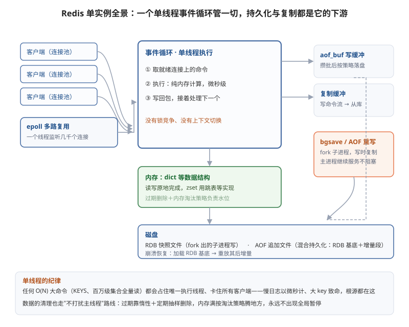

## 架构
### redis

#### 为什么快：内存、单线程与 IO 多路复用

先看图，一条命令在 Redis 内部会经过的所有站点：



Redis 的性能答案是三个词的组合。数据全在内存，读写天然避开磁盘 IO；命令执行是单线程——没有锁竞争、没有上下文切换，每条命令的耗时就是纯计算，这也是"不要在 Redis 里跑 O(N) 大命令"的根本原因（KEYS、大集合的 SMEMBERS 会卡住所有请求）；单线程不等于只有一个线程——网络 IO 交给 epoll 多路复用，一个线程监听几千个连接，谁就绪处理谁，6.0 又把协议解析和回包拆给 IO 线程，命令执行依然是单线程。对应的运维常识：Redis 慢日志的阈值是微秒级，一旦出现毫秒级慢查询，先查大 key 和 O(N) 命令，而不是怀疑资源不够。

#### 数据结构：命令背后的实现

Redis 不是简单的 KV，每个 value 是一个带类型的对象。string 底层是 SDS（简单动态字符串，长度直接记录、O(1) 取长、二进制安全）；hash/list/set/zset 各有多层编码，数据小用紧凑结构（listpack、intset），超阈值自动换标准结构，在内存和性能之间动态平衡。两个最有代表性的实现：

dict（字典）的渐进式 rehash：扩容时新旧两张哈希表并存，每次操作顺手搬一个桶、定时任务再搬一批，把一次 O(N) 的 rehash 摊到无数次操作里——单线程架构下，一次性 rehash 就是全局卡顿。

skiplist（跳表）是 zset 的底层之一：多层链表，上层是下层的快速通道，查找自顶向下，平均 O(logN)。不选红黑树的原因很工程化：实现简单、范围查询顺着底层链表走、还能按排名定位。

应用层最值钱的就是 zset：排行榜的天然结构——ZADD 更新分数、ZRANGE 取 top N、ZREVRANK 查自己的名次，全是 O(logN)，游戏战力榜、电商销量榜一个结构全解决。

#### 持久化：RDB 与 AOF

内存数据库断电即失，持久化是命门。RDB 是某一时刻的全量快照：bgsave 触发时主进程 fork 子进程去写盘——fork 复用了操作系统的写时复制，子进程看到的是 fork 瞬间的数据视图，主进程继续服务，写盘全程不阻塞；代价是两次快照之间的数据会丢。AOF 是追加的命令日志：写命令先进 aof_buf，按 appendfsync 策略落盘——always 每条 fsync（最安全最慢）、everysec 每秒一次（默认，最多丢一秒）、no 交给操作系统。AOF 文件会膨胀，AOF 重写用同样的 fork + 写时复制，把当前内存状态重写成等价的最小命令集。

4.0 起支持混合持久化、5.0 起默认开启：重写后的 RDB 做基底、之后的增量记 AOF，恢复快（RDB 加载快）丢得少（增量段最多一秒）。生产选择：纯缓存可以关持久化，当数据库用就混合模式 + everysec。

#### 内存管理：过期删除与淘汰策略

过期删除回答"到期的 key 怎么清"：惰性删除（访问时发现过期才删）加定期删除（后台随机抽样清理）组合——不给每个 key 配定时器，几百万 key 的定时器本身就是灾难。内存淘汰回答"内存满了怎么办"：maxmemory 触顶后按 maxmemory-policy 执行——noeviction（默认，写直接报错）、allkeys-lru（全键范围）、volatile-lru（只在设了过期的键里挑）、以及 4.0 起的 LFU 系列（按访问频率，比 LRU 更抗偶发的批量扫描）。Redis 的 LRU 是近似实现——抽样若干 key 淘汰最久未用的，不维护全局链表，省内存省 CPU。运维要点：缓存实例选 allkeys-lru，同时监控内存水位和 evicted_keys 增速——淘汰开始意味着命中率要跌，这是容量预警的第一信号。

#### 主从、哨兵与集群

主从复制的套路与 MySQL 殊途同归：从库首次连接做全量同步——主库 bgsave 生成 RDB 发过去，期间的增量写入进缓冲区随后补发；之后主库把写命令流持续推给从库。repl_backlog 是一个环形缓冲区，从库断线重连时位点还在缓冲区内就走增量，被冲掉了退回全量——buffer 太小加从库断线太久等于频繁全量同步，这是常见的主库 IO 事故。

哨兵（Sentinel）解决"主挂了谁说了算"：三个以上哨兵独立部署在别的机器上，主观下线（单个哨兵 ping 不通）→ 询问其他哨兵、过半同意 → 客观下线 → 哨兵之间选 leader 执行故障转移——提升从库、通知客户端改路由。本质是给 Redis 补上仲裁层，角色相当于 PG 的 Patroni。

Cluster 是官方分片方案：16384 个 slot 分配给各主节点，key 按 CRC16(key) mod 16384 落槽，每个主节点带从节点，节点间用 gossip 协议交换状态，主挂了从库自动顶上。客户端连任意节点，key 不在本节点返回 MOVED 重定向（智能客户端会缓存槽位表）。运维代价要心里有数：多 key 命令、事务、Lua 脚本要求所有 key 在同一槽（用 hash tag 强制），slot 迁移是逐 key 搬运，大 key 迁移会卡——大 key 治理在集群模式下更致命。

#### 大 key 治理：为什么发现比解决更难

为什么大 key 致命：单线程架构下，读一个大 key 就是一条长命令——执行期间所有客户端排队；删除更隐蔽，DEL 一个百万元素的集合同样是长命令，生产上"删一个 key 引发全局卡顿"的事故不少见；再叠加网络传输放大和集群模式下的逐 key 迁移，大 key 在每一种拓扑里都是雷。

大 key 怎么来的：几乎全是业务无意识堆积——list 当队列用却不清理，消费完不删；hash 存用户资料，字段越加越多；set 存全量名单，只进不出。写代码时没人觉得"这个 key 会有一千万元素"。

为什么发现比解决难：危险扫描命令（KEYS、全量 SMEMBERS）不能在生产跑，而渐进遍历（SCAN 一批一批走）只能摸清 key 的分布，value 的大小还要逐个采样统计——所以大 key 往往是出了事才知道。实践上两条路并行走：开发期约定 key 的容量预算（队列必设长度上限、集合必设清理机制），线上靠慢日志和网络流量突变做哨兵，监控大 key 的专用分析工具定期在从库跑。

解决按形态下药：拆——大 hash 按字段拆成多个 key，把一次 O(N) 变成多次 O(1)；限——list 只保留尾部、集合加过期；缩——大 value 先压缩再存；删——不用 DEL，用异步删除（主线程只把 key 从字典里摘掉，真正的内存回收交给后台线程，长命令的代价从主线程转移走了）。

#### 缓存三大问题与实战模式

缓存永远是系统里最先被流量打死的一层，三大经典故障各有打法：穿透——查询根本不存在的数据，缓存永远 miss 全部砸向数据库，解法是空值也缓存（短 TTL）或布隆过滤器前置拦截；击穿——热点 key 过期瞬间海量请求同时穿透，解法是互斥锁重建（只放一个请求去查库回填）或热点 key 逻辑过期；雪崩——大量 key 同时过期或实例整体宕机，解法是 TTL 加随机抖动、多级缓存、集群高可用。

缓存一致性是模式问题：旁路缓存（Cache Aside）是主流——读先查缓存，miss 查库回填；写先更新数据库再删缓存。为什么是删不是改：并发写时后到的更新可能覆盖先到的，删掉让下一次读做 lazy 回填，天然收敛。为什么先库后缓存：顺序反了，删完缓存的空窗里读请求会把旧值回填进去。极小概率的不一致窗口始终存在——要强一致就别用缓存。

分布式锁是高频误用区：加锁用 SET key value NX EX 10 一条命令原子完成（value 放唯一标识），释放用 Lua 脚本校验 value 再删——防止误删别人的锁。但要清醒：业务执行超过锁 TTL 锁就会被别人拿走；主从切换瞬间锁记录可能还没同步到从库——所以 Redis 锁是"效率锁"不是"正确性锁"，扣款这类强互斥请交给数据库事务或 ZooKeeper/etcd。

#### 一条命令的旅程

以 `SET order:5 paid EX 300;`（写订单状态并设 5 分钟过期）为例，把前文所有组件串起来走一遍：

1. **接入**：客户端经连接池把命令发向 Redis，连接由 epoll 统一监听——谁的数据就绪处理谁，几千个连接共享一个线程；
2. **执行**：事件循环取出命令，单线程解析后在 dict 里定位 key、写入 value——纯内存操作，微秒级完成；
3. **记账**：写成功后顺带两件事——这条写命令追加进 aof_buf（按落盘策略攒批写 AOF），同时进复制缓冲推给从库；主线程只管扔进缓冲，落盘和传输都是异步的；
4. **过期**：key 连同 300 秒进过期字典，之后惰性删除和定期抽样盯着它，到期即清；
5. **返回**：内存够就直接回客户端 OK；不够则先按淘汰策略腾地方——淘汰开始就是容量告警的第一信号；
6. **后台**：周期性的 bgsave fork 子进程做 RDB 快照（写时复制保证快照一致性），AOF 攒到阈值就重写瘦身。

看懂这个链路，Redis 的性格就各就各位：快，因为全程内存加单线程无锁；不阻塞，因为持久化、复制、清理全部异步化或后台化；怕大命令，因为唯一执行线程被占住就是全局卡顿。

#### 应用场景：结构与场景一一对应

Redis 的实战价值在于"选对结构，问题自动解决一半"：

- string：缓存（查库结果回填）、计数器（原子自增，限流、秒杀库存预扣）、分布式锁（前文讲过姿势与边界）；
- hash：对象缓存——玩家资料一个 key、字段级读写省流量，比整串 JSON 反序列化轻得多；
- list：简单队列与最新列表（公告推送、动态流），注意配合长度上限防堆积成大 key；
- set：去重与关系（抽奖名单防重复、共同好友取交集）；
- zset：排行榜（战力榜、销量榜），更新分数、取 top N、查名次一个结构全包；
- 三个低频但惊艳的：bitmap 用一位表示一天的签到，千万用户签到只要几 MB；HyperLogLog 用 KB 级内存估算上亿 UV（要接受误差）；GEO 底层是 zset，"附近的人"一行命令。

选型口诀对照 MongoDB 篇的结论：Redis 管实时状态，MongoDB 管持久文档，MySQL/PG 管强事务账务——拿 Redis 存丢了会疼的数据，是选型里最常见的错位。

### mongodb

#### 文档模型：Document、Collection 与 BSON

MongoDB 的最小单元是文档（Document）——一个 JSON 风格的键值对象；同类文档装进集合（Collection）；集合再组成数据库。与关系型的映射：文档约等于行、集合约等于表，但没有固定 schema——同一集合里文档可以字段不同，加字段不用改表结构、不用数据迁移。

底层编码是 BSON（Binary JSON）：JSON 的二进制版，补齐了 JSON 缺失的类型——Date、ObjectId、Decimal128、二进制数据；二进制遍历不再解析文本，字段带长度前缀，跳过任意字段是 O(1)。单个文档上限 16MB，大附件、长文本要拆出去或走 GridFS。

这个模型为什么吃游戏场景：玩家档案一个文档全装下——等级、货币、任务进度、背包 items 数组、装备强化记录；版本更新加了新系统，文档直接多一个字段，老玩家的旧文档没有这个字段照样正常读写——没有 ALTER TABLE、没有停服迁移窗口。MMO 每周更新版本，schema-free 是真能救命的能力。

#### 磁盘：WiredTiger 与 .wt 文件

单机 MongoDB 的数据住在 WiredTiger 引擎的文件里：每个集合一个 .wt 文件、每个索引一个 .wt 文件（数据目录下 collection-xxx.wt、index-xxx.wt 加元数据），变更日志在 journal 目录。文件内部按 BTree 组织，页是基本单位——internal page 只存键做路由，leaf page 存实际的 key 和文档本体，页大小可变（internal 约 4KB、leaf 上限 32KB，按数据自适应），压缩开箱即用（Snappy 默认，索引走前缀压缩）。


单机 MongoDB 的架构和 MySQL 惊人地相似：Server 层负责解析、优化、执行，存储引擎层负责数据怎么存——引擎还是可插拔的（WiredTiger 之前是 MMAPv1，4.2 后移除）。差异在引擎内部的组织方式：InnoDB 是"索引即数据"，二级索引的叶子存主键、回表去聚簇索引；WiredTiger 的集合文件本身就是一棵按 _id 有序的 BTree，效果上同样是"按 _id 聚簇存储"，而每个二级索引是独立的 .wt 文件、叶子存文档的 _id，命中后同样要回主树取文档——回表这件事 MongoDB 和 PG/MySQL 一家都没躲掉。

#### 索引：变种 B+ 树

WT 的索引是 B+ 树的变种：同族结构——internal page 路由、leaf page 存数据；差异点在叶子节点之间没有链表，范围扫描靠树遍历而不是顺链右扫，这是 WT 与经典 B+ 树的主要区别。更新不走原地改页（见下文写时复制），删除是打标记，空间由后台回收。

索引类型比 MySQL 宽一圈：复合索引、稀疏/部分索引、TTL 索引（到点自动删文档，日志类集合的标配）、多键索引（直接给数组字段建索引——背包里每个物品的 itemId 都可查）、全文索引和 2dsphere 地理索引。用法上和关系型一样：_id 主键索引自带，业务查询字段建复合索引，explain("executionStats") 里看 COLLSCAN（全集合扫描）还是 IXSCAN——COLLSCAN 打在大集合上就是慢查询，和 MySQL 的 type=ALL 一个意思。

#### 内存：Cache 与 LRU 淘汰

WiredTiger 自带一层 cache：读页进 cache，写也不原地改——改的是 cache 里页的副本。默认大小约为物理内存的一半减 1GB，且感知容器的 memory limit——K8s 里仍要显式配 cacheSizeGB 对齐资源预算，给 OS page cache 留出空间（.wt 文件还会被 OS cache 再缓一层，实际内存占用 = WT cache + 连接开销 + OS cache，limit 算不满账就是 OOMKilled 老故事）。淘汰是 LRU 变体：优先赶干净页；脏页占比到 20% 时，应用线程会被拖去协助驱逐，表现就是写入毛刺——监控 eviction 相关指标，写入抖动先看脏页水位。

#### 并发控制：写时复制 MVCC

WT 的 MVCC 走"写时复制"：更新一个文档不原地改页里数据，而是把新版本追加到该文档的 update chain（同一 key 的版本链），每个版本带全局事务时间戳。读拿快照时间戳，沿版本链找到"对当前事务可见"的版本——读不阻塞写、写不阻塞读，目标与 InnoDB/PG 的 MVCC 一致，实现路线不同：InnoDB 版本挂在 undo 链，PG 版本存在行内，WT 版本挂在 key 的 update chain 上。旧版本由 eviction 和 checkpoint 顺手回收，没有独立的 purge/vacuum 进程——但长事务同样拖住版本回收，磁盘和 cache 的膨胀逻辑与前两家同源。

#### 持久化：Journal 与 Checkpoint

crash-safe 靠两件套：journal 是 WAL 写前日志——文档变更先追加进 journal 缓冲，默认每 100ms fsync 落盘（writeConcern 带 j:1 可强制提交即 fsync）；checkpoint 默认每 60 秒一次——把内存脏页整理成一致快照写回 .wt 文件并落标记。崩溃恢复 = 加载最近 checkpoint + 重放其后的 journal，与 MySQL"redo 重放"完全同构。运维认知：默认配置下单机丢失窗口约 100ms，更高保障用 writeConcern 的 majority + j:1，代价是提交延迟上升。

#### 副本集：Replica Set

journal 管单机数据安全，高可用靠副本集：一主（Primary）多从（Secondary），写只能进主库，主库把变更写进 oplog——一个固定大小的环形集合，记录逻辑操作日志，角色就是 MongoDB 的 binlog（ROW 模式），从库拉 oplog 异步重放；CDC 生态（Debezium、Kafka Connector）同样以 oplog/change stream 为源头。主挂了触发选举：类 Raft 协议，多数派投票选出新主，选举期间集群只读。

副本集的读写语义两层可调：writeConcern——w:1 主库确认即返回（主挂了可能丢）、w:majority 多数派确认（防回滚的关键，代价是延迟）；readPreference——primary 强制读主、secondaryPreferred 读分流。oplog 是环形集合，从库断线太久、oplog 被 rolling over 就要全量重同步——监控 oplog 窗口时长，和 MySQL 监控 relay log 落后是同一件事。

#### 分片集群：真正的分布式 MongoDB

副本集解决高可用，写吞吐和单机容量到顶要分片。分布式 MongoDB 由三种角色拼成：

```text
应用 ──→ mongos（无状态路由，可部署多个）
            │ 按 shard key 路由请求、聚合结果
            ▼
Config Server（副本集：存 chunk 分布、路由表等元数据）
            │
   ┌────────┼────────┐
Shard A     Shard B     Shard C
(副本集)    (副本集)    (副本集)
```

- Shard：数据分片本体，每个 shard 是一个副本集——分片与高可用是叠加关系；
- Config Server：元数据副本集，记录"哪段数据在哪个 shard"；
- mongos：无状态路由进程，应用只连它，不带 shard key 的请求会广播到所有 shard。

数据切分逻辑：集合按 shard key 切成 chunk（键范围段或哈希段），chunk 是迁移与平衡的粒度——balancer 后台检测各 shard 数据量不均，自动搬运 chunk。shard key 是分布式 MongoDB 最重要的设计决策：选自增类字段，写入热点全压一个 shard；选哈希，写入打散但范围查询变全扇出；键选错了，4.2 之前改 shard key 等于重刷数据。这是 MongoDB 把"分库分表"内置化：MySQL 生态要 ShardingSphere 在业务层做的事，MongoDB 在数据库层原生给了，代价是 shard key 的设计复杂度转嫁给 DBA——上线前想清楚，它是这个架构里最不可逆的决定。

#### 游戏场景实战

把 MongoDB 的特性和游戏需求逐一对上：玩家档案、背包、任务进度——文档模型加 schema-free，一个玩家一个文档，版本更新加字段零迁移；战斗日志、埋点、聊天记录——写多读少的 append-only 流，TTL 索引到点自动清理，按月分集合，统计查询走从库；全服活动状态、公会数据——文档嵌套天然表达"公会 → 成员列表 → 贡献值"的层级，关系型要三张表 join，文档一次取出；热更新不停服——schema-free 加在线扩容（副本集加节点、分片加 shard）支撑五年生命周期运营。

一句话定位：Redis 管实时状态（排行榜、会话、计数、锁），MongoDB 管持久文档（玩家档案、日志、活动数据），MySQL/PG 管强事务账务——游戏后端最常见的三件套分工，各干各的强项。


## 部署运维（redis和mongodb）

### redis

#### 先分身份：缓存与存储的部署要求完全不同

为什么先谈身份：Redis 当缓存用和当数据库用，是两套部署哲学。缓存身份——真数据在 MySQL/PG 里，Redis 丢了可以重建：持久化可以关、淘汰策略开成全键 LRU、内存触顶是正常工作状态而不是故障；存储身份——丢了就是事故：混合持久化必须开、淘汰必须关（宁可拒绝写入也不能静默丢数据）、内存触顶前就要告警扩容。身份定下来，后面所有配置才有对错的判断依据——缓存实例出事故最常见的原因，就是按"存储"的谨慎配置了一个"缓存"的角色，或者反过来。

#### 内存账本：limit 和数据量之间必须留距离

为什么 Redis 在容器里特别容易 OOM：进程内存不止数据本身——复制缓冲随从库数量和写入强度膨胀；反复增删后碎片让实际占用比数据大得多；最隐蔽的是 fork 写时复制——bgsave 或重写瞬间子进程不复制全部数据，但主进程在快照期间写入的每一页都要复制一份，写入高峰撞上持久化，内存可能瞬间多出一大块。limit 贴着数据量配，就是 OOMKilled 老故事的 Redis 版，表现是深夜快照撞上写入高峰时突然重启。部署原则：内存上限给数据量留出成倍余量；且数据量越大 fork 越重（页表复制量随数据线性涨），单实例多大才合适要过 fork 停顿这一关——这也是"先哨兵后集群"的另一个推论：集群化顺带把单实例数据量切小了。

#### 拓扑选型：为什么多数场景哨兵就够了

为什么 Cluster 不是默认答案：Cluster 解决的是"单机装不下、写不进"，代价是多 key 操作受限（hash tag 是权宜不是解法）、slot 迁移运维复杂、客户端必须支持集群协议。数据量单机装得下（多数业务几十 GB 以内），主从加哨兵就能拿到高可用，且多 key、Lua、事务全部无限制。所以选型顺序是先哨兵后 Cluster，真装不下再分。K8s 里主从加哨兵各用各的载体：数据 Pod 有状态走 StatefulSet，哨兵是无状态小进程走 Deployment，生产托管选 Operator——与 PG 篇"生产高可用交 Operator"是同一个结论。

### mongodb

#### cacheSizeGB 是第一笔账

为什么 MongoDB 在容器里特别容易 OOM：架构篇说过 mongod 的内存构成——WT cache、连接开销、OS cache（.wt 文件会被操作系统再缓一层）、journal 缓冲，四项相加；默认值按物理内存的比例算，放进容器后感知的是 limit，但四项的账加起来仍然可能越线。部署第一件事就是显式算账：cache 对齐内存预算的大头，limit 里给 OS cache 和连接留足份额——cache 偏小只影响性能（命中下跌、驱逐频繁），总账越线是 OOMKilled 直接重启，后者才是生产事故。宁可 cache 小一点，也不能让总账满打满算。

#### Operator、存储与升级节奏

为什么推荐 Operator：副本集的选举、failover、成员变更是一套状态机，手搓 StatefulSet 要自己维护副本集配置和每一步变更的顺序，Operator（Percona、官方）把这些声明式托管——和 PG 部署篇的结论同源：生产高可用交 Operator，手搓的价值是出事时看懂它在做什么。存储要求也和 PG 同源：journal 定期 fsync 落盘，需要 fsync 语义诚实的块存储，NFS 进黑名单，云盘 IOPS 随容量给配额的规律照旧。升级与 PG 多一条约束：MongoDB 版本跨度大时涉及存储格式与引擎行为变化，跨版本要逐级走官方升级路径，永远人工控制节奏、先从库后主库验证，绝不交给自动滚动。
