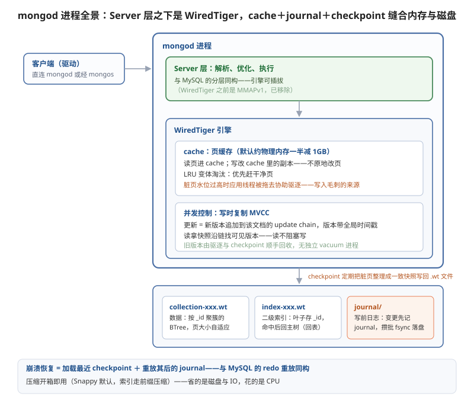

## redis
### 为什么需要redis

MySQL 并不缺内存缓存——InnoDB 的 buffer pool 就是干这个的：热数据整页缓在内存里，调得好的实例命中率 99% 以上。那大流量下到底差在哪？buffer pool 缓存的是"数据页"，业务每次付的却是"整条 SQL 链路"的钱：连接处理、SQL 解析、优化器选计划、执行器逐行取数，这条固定开销每条查询都要付一遍，内存命中省掉的只有磁盘 IO；二级索引点查还要回表、沿 MVCC 版本链找可见版本。第二个瓶颈是连接模型：每个连接占一个线程，上万并发就是上万线程的调度与上下文切换，连接池和线程池只是缓解。生产里最直观的对照是秒杀库存：热点商品就一行记录，buffer pool 必然命中，数据明明全在内存里，但每条 UPDATE 都要排队过行锁、走完整 SQL 链路、等事务提交的 redo fsync，单行热点几百上千 QPS 就开始堆积连接。  

以电商平台为例。为了跳过这些繁琐的步骤，我们很容易可以想到申请一个字典，在 python 里叫 dict，在 java 里叫 map。key 是商品 ID，value 是商品数据。通过商品 ID, 就能查到商品数据。像这样，放在服务内部的缓存，就是所谓的本地缓存。但是为了保证系统高可用，商品服务经常不止一个实例，如果每个实例都重复缓存一份本地内存，那就有些浪费内存条了。所以更好的解决方案是将这部分字典内存抽出来，单独做成一个服务。它就是所谓的远程缓存服务（也就是redis）。但这就引入另外一个问题，多个商品服务通过网络去读写同一份远程缓存，会存在并发问题。怎么办呢？    
很简单！对外不管有多少有个网络连接，收到读写命令后，都统一塞到一个线程上，在一个线程上对字典进行读写，什么并发问题和线程切换开销，完全不存在！   
现在缓存服务里，只有一个字典类型。key 和 value 都是字符串。但我们平时写代码的时候，还会用到很多其他内存里的数据结构，是不是也可以在缓存服务里提供类似的数据结构？    
于是我们对字段的 value 进行扩展，除了 字符串, 还支持先进先出的队列 List 和用于去重的 Set 类型，再加入可以做排行榜的 ZSet，现在缓存服务就更强了。   
缓存服务支持的数据结构变多了之后，塞到内存里的数据就越来越多了，内存又小又贵，迟早扛不住。   
怎么办呢？我们可以给缓存里的数据加个过期时间，一旦数据过期，就从内存里删掉，可以很大程度缓解掉内存增长速度。   
但问题又又来了，我怎么知道哪些数据该设置多长过期时间呢？    
完全没办法，只能交给调用方去做判断，让用户通过 expire 命令的形式来指定哪些数据多久过期。   


## mongodb

### 文档模型：Document、Collection 与 BSON

MongoDB 的最小单元是文档（Document）——一个 JSON 风格的键值对象；同类文档装进集合（Collection）；集合再组成数据库。与关系型的映射：文档约等于行、集合约等于表，但没有固定 schema——同一集合里文档可以字段不同，加字段不用改表结构、不用数据迁移。

底层编码是 BSON（Binary JSON）：JSON 的二进制版，补齐了 JSON 缺失的类型——Date、ObjectId、Decimal128、二进制数据；二进制遍历不再解析文本，字段带长度前缀，跳过任意字段是 O(1)。单个文档上限 16MB，大附件、长文本要拆出去或走 GridFS。

这个模型为什么吃游戏场景：玩家档案一个文档全装下——等级、货币、任务进度、背包 items 数组、装备强化记录；版本更新加了新系统，文档直接多一个字段，老玩家的旧文档没有这个字段照样正常读写——没有 ALTER TABLE、没有停服迁移窗口。MMO 每周更新版本，schema-free 是真能救命的能力。

### 磁盘：WiredTiger 与 .wt 文件

单机 MongoDB 的数据住在 WiredTiger 引擎的文件里：每个集合一个 .wt 文件、每个索引一个 .wt 文件（数据目录下 collection-xxx.wt、index-xxx.wt 加元数据），变更日志在 journal 目录。文件内部按 BTree 组织，页是基本单位——internal page 只存键做路由，leaf page 存实际的 key 和文档本体，页大小可变（internal 约 4KB、leaf 上限 32KB，按数据自适应），压缩开箱即用（Snappy 默认，索引走前缀压缩）。



单机 MongoDB 的架构和 MySQL 惊人地相似：Server 层负责解析、优化、执行，存储引擎层负责数据怎么存——引擎还是可插拔的（WiredTiger 之前是 MMAPv1，4.2 后移除）。差异在引擎内部的组织方式：InnoDB 是"索引即数据"，二级索引的叶子存主键、回表去聚簇索引；WiredTiger 的集合文件本身就是一棵按 _id 有序的 BTree，效果上同样是"按 _id 聚簇存储"，而每个二级索引是独立的 .wt 文件、叶子存文档的 _id，命中后同样要回主树取文档——回表这件事 MongoDB 和 PG/MySQL 一家都没躲掉。

### 索引：变种 B+ 树

WT 的索引是 B+ 树的变种：同族结构——internal page 路由、leaf page 存数据；差异点在叶子节点之间没有链表，范围扫描靠树遍历而不是顺链右扫，这是 WT 与经典 B+ 树的主要区别。更新不走原地改页（见下文写时复制），删除是打标记，空间由后台回收。

索引类型比 MySQL 宽一圈：复合索引、稀疏/部分索引、TTL 索引（到点自动删文档，日志类集合的标配）、多键索引（直接给数组字段建索引——背包里每个物品的 itemId 都可查）、全文索引和 2dsphere 地理索引。用法上和关系型一样：_id 主键索引自带，业务查询字段建复合索引，explain("executionStats") 里看 COLLSCAN（全集合扫描）还是 IXSCAN——COLLSCAN 打在大集合上就是慢查询，和 MySQL 的 type=ALL 一个意思。

### 内存：Cache 与 LRU 淘汰

WiredTiger 自带一层 cache：读页进 cache，写也不原地改——改的是 cache 里页的副本。默认大小约为物理内存的一半减 1GB，且感知容器的 memory limit——K8s 里仍要显式配 cacheSizeGB 对齐资源预算，给 OS page cache 留出空间（.wt 文件还会被 OS cache 再缓一层，实际内存占用 = WT cache + 连接开销 + OS cache，limit 算不满账就是 OOMKilled 老故事）。淘汰是 LRU 变体：优先赶干净页；脏页占比到 20% 时，应用线程会被拖去协助驱逐，表现就是写入毛刺——监控 eviction 相关指标，写入抖动先看脏页水位。

### 并发控制：写时复制 MVCC

WT 的 MVCC 走"写时复制"：更新一个文档不原地改页里数据，而是把新版本追加到该文档的 update chain（同一 key 的版本链），每个版本带全局事务时间戳。读拿快照时间戳，沿版本链找到"对当前事务可见"的版本——读不阻塞写、写不阻塞读，目标与 InnoDB/PG 的 MVCC 一致，实现路线不同：InnoDB 版本挂在 undo 链，PG 版本存在行内，WT 版本挂在 key 的 update chain 上。旧版本由 eviction 和 checkpoint 顺手回收，没有独立的 purge/vacuum 进程——但长事务同样拖住版本回收，磁盘和 cache 的膨胀逻辑与前两家同源。

### 持久化：Journal 与 Checkpoint

crash-safe 靠两件套：journal 是 WAL 写前日志——文档变更先追加进 journal 缓冲，默认每 100ms fsync 落盘（writeConcern 带 j:1 可强制提交即 fsync）；checkpoint 默认每 60 秒一次——把内存脏页整理成一致快照写回 .wt 文件并落标记。崩溃恢复 = 加载最近 checkpoint + 重放其后的 journal，与 MySQL"redo 重放"完全同构。运维认知：默认配置下单机丢失窗口约 100ms，更高保障用 writeConcern 的 majority + j:1，代价是提交延迟上升。

### 副本集：Replica Set

journal 管单机数据安全，高可用靠副本集：一主（Primary）多从（Secondary），写只能进主库，主库把变更写进 oplog——一个固定大小的环形集合，记录逻辑操作日志，角色就是 MongoDB 的 binlog（ROW 模式），从库拉 oplog 异步重放；CDC 生态（Debezium、Kafka Connector）同样以 oplog/change stream 为源头。主挂了触发选举：类 Raft 协议，多数派投票选出新主，选举期间集群只读。

副本集的读写语义两层可调：writeConcern——w:1 主库确认即返回（主挂了可能丢）、w:majority 多数派确认（防回滚的关键，代价是延迟）；readPreference——primary 强制读主、secondaryPreferred 读分流。oplog 是环形集合，从库断线太久、oplog 被 rolling over 就要全量重同步——监控 oplog 窗口时长，和 MySQL 监控 relay log 落后是同一件事。

### 分片集群：真正的分布式 MongoDB

副本集解决高可用，写吞吐和单机容量到顶要分片。分布式 MongoDB 由三种角色拼成：

```text
应用 ──→ mongos（无状态路由，可部署多个）
            │ 按 shard key 路由请求、聚合结果
            ▼
Config Server（副本集：存 chunk 分布、路由表等元数据）
            │
   ┌────────┼────────┐
Shard A     Shard B     Shard C
(副本集)    (副本集)    (副本集)
```

- Shard：数据分片本体，每个 shard 是一个副本集——分片与高可用是叠加关系；
- Config Server：元数据副本集，记录"哪段数据在哪个 shard"；
- mongos：无状态路由进程，应用只连它，不带 shard key 的请求会广播到所有 shard。

数据切分逻辑：集合按 shard key 切成 chunk（键范围段或哈希段），chunk 是迁移与平衡的粒度——balancer 后台检测各 shard 数据量不均，自动搬运 chunk。shard key 是分布式 MongoDB 最重要的设计决策：选自增类字段，写入热点全压一个 shard；选哈希，写入打散但范围查询变全扇出；键选错了，4.2 之前改 shard key 等于重刷数据。这是 MongoDB 把"分库分表"内置化：MySQL 生态要 ShardingSphere 在业务层做的事，MongoDB 在数据库层原生给了，代价是 shard key 的设计复杂度转嫁给 DBA——上线前想清楚，它是这个架构里最不可逆的决定。

### 游戏场景实战

把 MongoDB 的特性和游戏需求逐一对上：玩家档案、背包、任务进度——文档模型加 schema-free，一个玩家一个文档，版本更新加字段零迁移；战斗日志、埋点、聊天记录——写多读少的 append-only 流，TTL 索引到点自动清理，按月分集合，统计查询走从库；全服活动状态、公会数据——文档嵌套天然表达"公会 → 成员列表 → 贡献值"的层级，关系型要三张表 join，文档一次取出；热更新不停服——schema-free 加在线扩容（副本集加节点、分片加 shard）支撑五年生命周期运营。

一句话定位：Redis 管实时状态（排行榜、会话、计数、锁），MongoDB 管持久文档（玩家档案、日志、活动数据），MySQL/PG 管强事务账务——游戏后端最常见的三件套分工，各干各的强项。


## 部署运维（redis和mongodb）

### redis

#### 先分身份：缓存与存储的部署要求完全不同

为什么先谈身份：Redis 当缓存用和当数据库用，是两套部署哲学。缓存身份——真数据在 MySQL/PG 里，Redis 丢了可以重建：持久化可以关、淘汰策略开成全键 LRU、内存触顶是正常工作状态而不是故障；存储身份——丢了就是事故：混合持久化必须开、淘汰必须关（宁可拒绝写入也不能静默丢数据）、内存触顶前就要告警扩容。身份定下来，后面所有配置才有对错的判断依据——缓存实例出事故最常见的原因，就是按"存储"的谨慎配置了一个"缓存"的角色，或者反过来。

#### 内存账本：limit 和数据量之间必须留距离

为什么 Redis 在容器里特别容易 OOM：进程内存不止数据本身——复制缓冲随从库数量和写入强度膨胀；反复增删后碎片让实际占用比数据大得多；最隐蔽的是 fork 写时复制——bgsave 或重写瞬间子进程不复制全部数据，但主进程在快照期间写入的每一页都要复制一份，写入高峰撞上持久化，内存可能瞬间多出一大块。limit 贴着数据量配，就是 OOMKilled 老故事的 Redis 版，表现是深夜快照撞上写入高峰时突然重启。部署原则：内存上限给数据量留出成倍余量；且数据量越大 fork 越重（页表复制量随数据线性涨），单实例多大才合适要过 fork 停顿这一关——这也是"先哨兵后集群"的另一个推论：集群化顺带把单实例数据量切小了。

#### 拓扑选型：为什么多数场景哨兵就够了

为什么 Cluster 不是默认答案：Cluster 解决的是"单机装不下、写不进"，代价是多 key 操作受限（hash tag 是权宜不是解法）、slot 迁移运维复杂、客户端必须支持集群协议。数据量单机装得下（多数业务几十 GB 以内），主从加哨兵就能拿到高可用，且多 key、Lua、事务全部无限制。所以选型顺序是先哨兵后 Cluster，真装不下再分。K8s 里主从加哨兵各用各的载体：数据 Pod 有状态走 StatefulSet，哨兵是无状态小进程走 Deployment，生产托管选 Operator——与 PG 篇"生产高可用交 Operator"是同一个结论。

### mongodb

#### cacheSizeGB 是第一笔账

为什么 MongoDB 在容器里特别容易 OOM：架构篇说过 mongod 的内存构成——WT cache、连接开销、OS cache（.wt 文件会被操作系统再缓一层）、journal 缓冲，四项相加；默认值按物理内存的比例算，放进容器后感知的是 limit，但四项的账加起来仍然可能越线。部署第一件事就是显式算账：cache 对齐内存预算的大头，limit 里给 OS cache 和连接留足份额——cache 偏小只影响性能（命中下跌、驱逐频繁），总账越线是 OOMKilled 直接重启，后者才是生产事故。宁可 cache 小一点，也不能让总账满打满算。

#### Operator、存储与升级节奏

为什么推荐 Operator：副本集的选举、failover、成员变更是一套状态机，手搓 StatefulSet 要自己维护副本集配置和每一步变更的顺序，Operator（Percona、官方）把这些声明式托管——和 PG 部署篇的结论同源：生产高可用交 Operator，手搓的价值是出事时看懂它在做什么。存储要求也和 PG 同源：journal 定期 fsync 落盘，需要 fsync 语义诚实的块存储，NFS 进黑名单，云盘 IOPS 随容量给配额的规律照旧。升级与 PG 多一条约束：MongoDB 版本跨度大时涉及存储格式与引擎行为变化，跨版本要逐级走官方升级路径，永远人工控制节奏、先从库后主库验证，绝不交给自动滚动。
