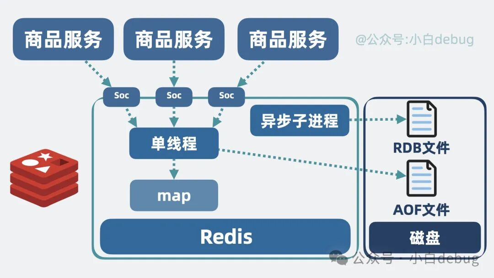
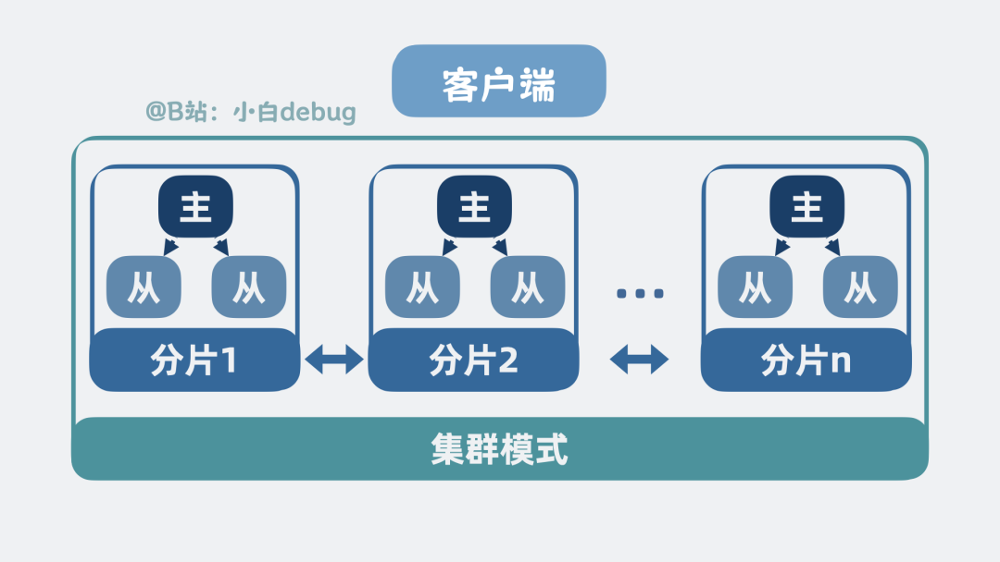

## redis
### redis简介

MySQL 并不缺内存缓存——InnoDB 的 buffer pool 就是干这个的，热数据整页缓在内存里，调得好的实例命中率 99% 以上。大流量下差的不是内存，而是每条查询都要付一遍的"整条 SQL 链路"固定开销：连接处理、解析、优化、执行逐行取数；再加上每连接一线程的连接模型，上万并发就是上万线程的调度与上下文切换，连接池只能缓解。生产里最直观的对照是秒杀库存：热点商品就一行记录，数据明明全在内存里，但每条 UPDATE 都要排队过行锁、走完整 SQL 链路、等事务提交的 redo fsync，单行热点几百上千 QPS 就开始堆积连接。

以电商平台为例。为了跳过这些繁琐的步骤，很容易想到申请一个字典——Python 里叫 dict，Java 里叫 map：key 是商品 ID，value 是商品数据，通过商品 ID 就能查到商品数据。像这样放在服务内部的缓存，就是所谓的**本地缓存**。但为了保证系统高可用，商品服务往往不止一个实例，每个实例都重复缓存一份本地内存，就有些浪费内存条了。更好的解决方案是把这部分字典内存抽出来，单独做成一个服务——它就是所谓的**远程缓存服务**（也就是 Redis）。

但这引入了新问题：多个商品服务通过网络读写同一份远程缓存，会存在并发问题。怎么办？很简单——用操作系统的 I/O 多路复用（epoll）让一个线程同时监听几千个连接，收到读写命令后统一在这一个线程里对字典进行读写：没有锁竞争、没有上下文切换，并发问题不存在了，这就是 Redis 单线程模型的由来。代价是执行必须快——任何 O(N) 大命令（KEYS 扫全库、读一个百万成员的超大 key）都会占住唯一线程、卡住所有客户端，生产上的慢查询治理和大 key 治理，根源都在这条纪律上。

现在缓存服务里只有一个字典类型，key 和 value 都是字符串。但平时写代码还会用到很多其他内存数据结构，是不是也可以在缓存服务里提供类似的东西？于是对字典的 value 进行扩展：除了字符串（String），还支持先进先出的队列（List）、用于去重的 Set、可以做排行榜的 ZSet——缓存服务就更强了。

数据结构变多之后，塞进内存的数据越来越多，内存又小又贵，迟早扛不住。第一层缓解是给数据加**过期时间**（EXPIRE），一旦过期就从内存里删掉，很大程度上缓解内存增长。但该给哪些数据设多长的过期时间，Redis 自己判断不了，只能交给调用方——而你不能指望每个调用方都是老实人，全都不设过期时间，内存还是得炸。第二层兜底是**内存淘汰**：内存接近上限时按策略删数据，比如删掉最近最少使用的，也就是所谓的 LRU——既解决了内存过大的问题，又让 Redis 里留下的全是热点数据，一箭双雕。

内存问题解决了，还有一层风险：MySQL 之所以过得舒服，是因为前面有缓存挡住了大部分流量。一旦缓存服务重启，内存数据全丢，流量会全部打到 MySQL 身上，把它打垮。所以还需要给 Redis 加上最大程度的**持久化**保证，确保重启后不至于什么数据都没有。

第一种思路是加个异步线程，定期把全量内存数据快照到磁盘文件——这就是 **RDB**（Redis Database Backup）。它每隔几分钟记录一次全量数据，类似游戏的"存档"：进程挂了，重启时加载快照文件就能复原大部分数据。之所以说"大部分"，是因为毕竟是定期快照。想保留更多数据，就可以每次写入数据时顺手把命令记录到文件缓冲，并每秒刷入磁盘——这种机制叫 **AOF**（Append Only File），服务启动时把文件重放一遍就能还原几乎全部数据。AOF 文件会不会很大？定期重写压缩就行——比如SET a 1，SET a 2，只保留SET a 2。   
二者混合使用就是：每次 AOF 重写时，先把当前全量内存数据以 RDB 格式写进 AOF 文件的头部，之后的新写入继续以命令形式追加在尾部。这样重启恢复数据时，可以先快速把 RDB 快照恢复成内存数据，再重放一小段 AOF 即可——不仅恢复速度快，数据也最多丢一秒。



那远程缓存服务对外提供读写，走的是 HTTP 接口吗？当然不是。HTTP 基于 TCP 实现了很多笨重的特性，既然当初就是为了性能才上的缓存服务，索性彻底点：直接基于 TCP 做传输，协议也设计得极简——传入 `SET key value` 完成写入，传入 `GET key` 拿到对应的 value。协议解析也不用自己写：Redis 官方提供了命令行工具 **redis-cli**，可以直接读写服务器里的各种数据；不想用命令行，各路开发者也已经用各种语言把 redis-cli 支持的命令封装了一遍，完全不需要手写协议。

Redis 是架构里的万金油——放在 MySQL 面前挡一道查询只是最基础的用法。官方扩展模块还能把各种中间件塞进内存：RedisJSON（内存版 MongoDB）、RediSearch（内存版 ES）、RedisTimeSeries（内存版 InfluxDB）……不过这些属于开发侧的玩法，运维视角知道有这回事即可。

### 部署运维

#### 主从复制：备胎解决可用性，解决不了容量

Redis 本质是单机服务，进程一崩服务就不可用——某款上线中的游戏，Redis 单机挂了，会话、排行、锁全没了，运维半夜登上服务器手动拉起进程，恢复全程十几分钟。最直觉的补救是加从节点：从节点 `replicaof` 主节点，先全量同步一份完整数据，之后主节点的每笔写入沿 TCP 长连接持续传过去，主挂了从顶上。但切换靠人——半夜得有人手动把从节点提升为主、再改客户端配置，故障恢复时间取决于人醒不醒得来。更麻烦的是，从节点存的是全量数据，加再多也只是读分流和容灾备份，容量上限和写吞吐始终卡在主节点那一台机器上。
#### 哨兵模式：把"人肉切换"自动化

哨兵（Sentinel）解决的是"切换靠人"的问题：一组独立于数据节点的小进程，不存数据，专职监控和故障转移。生产标准部署是 3 台机器各跑一个哨兵进程，quorum 配 2——一个哨兵 ping 不通主库只标记主观下线，它自己网络抖了也会误报；它去问其余哨兵，凑够 2 票才算客观下线，这时哨兵们先用类 Raft 协议选出一个 leader 哨兵，由它执行转移。

把一次真实的故障转移按时间线摊开：T0 主库宕机；T0+5s（down-after-milliseconds 配置值）三个哨兵先后 ping 超时，各自标记主观下线；哨兵间互相确认凑够 2 票转客观下线，同时选出 leader 哨兵；leader 从从节点里挑新主——挑选有优先级：replica-priority 高的优先、复制偏移量最大的优先（数据最新）、runid 最小的兜底；选中后对它发 `replicaof no one` 升主，再让其余从节点改挂到新主下，最后把新主地址写进自己的元数据。全程 10 秒到 30 秒。

客户端这一侧的配套容易被忽略：应用不能在配置里写死主库地址，而是先连哨兵问"主库是谁"（get-master-addr-by-name），再连主库读写；主库切换后，客户端订阅哨兵的 +switch-master 频道收新地址推送——Jedis、go-redis 这些主流 SDK 都内置了这套逻辑，配置好哨兵地址列表就行。

哨兵也有自己的事故形态——脑裂。网络分区把老主和哨兵们隔开：哨兵侧看到主库失联，正常选举出新主；老主那边其实活着，还继续接收客户端写入。分区恢复后老主被哨兵降级为从、全量同步新主，它分区期间收到的写入全部作废。防线是两个参数：min-replicas-to-write 1 加 min-replicas-max-lag 10——主库发现 10 秒内没有任何从库连着自己，就拒绝写入。这是拿可用性换一致性的典型取舍：分区期间老主拒绝服务，换来分区恢复后数据不丢，会话和锁这类丢不起的场景值得开，纯缓存场景可以不开。

应用场景：数据量单机装得下（多数业务几十 GB 以内）、写吞吐单机扛得住，只需要高可用——这就是多数业务的默认形态。哨兵架构下多 key 操作、Lua 脚本、事务全部无限制，运维心智最接近单机。

#### 集群模式：哈希槽切分数据

容量或写吞吐到顶，就得把数据切开。最朴素的思路是对节点总数求余：`CRC16(key) mod N`——问题出在扩容：N 从 3 变 4，几乎所有 key 的归属都变，等于全量迁移，线上服务担不起这个风险。解法是"没有中间层就加一层"：在 key 和节点之间放一个固定长度 16384 的槽数组，`slot = CRC16(key) mod 16384`，每个节点负责一段槽——公式与节点数彻底解耦，扩容只是把部分槽连同数据搬给新节点。



读写路由值得拆开一步步走：客户端启动连任意节点，第一次请求 user:1001，节点算出 CRC16("user:1001") mod 16384 = 8213，发现这槽归节点 B 管，回一条 `MOVED 8213 10.0.0.2:6379`——客户端拿到正确地址后把 slot→节点的映射记进本地路由表，之后的请求直达对应节点不再绕路，只有路由表过期（扩缩容、节点故障）时才会再吃一次 MOVED。槽迁移中的细节：源节点先给槽打 MIGRATING 标记、目标节点打 IMPORTING，槽里的 key 逐个用 MIGRATE 原子搬运，期间的请求源节点查得到 key 就直接处理、查不到就回 ASK 重定向到目标节点，客户端带上 ASKING 标志再请求一次——ASK 是"暂时借道"，和 MOVED 的"永久搬家"语义不同。

16384 这个数字不是拍脑袋：集群节点间靠 gossip 协议互传心跳，心跳包里携带自己负责的槽位图，16384 个槽用 bitmap 表示是 2KB；如果槽开到 65536，光槽位图就 8KB，节点间频繁的 gossip 交换会把带宽吃掉。集群官方设计上限就是 1000 个主节点，16384 够用且不浪费。

分片的代价直接砸在业务代码上。举例：主从形态下代码里有一句 `MGET user:1001:profile user:1001:session`——一次拿同一个玩家的档案和会话，没问题。上了集群，这两个 key 经哈希计算落到了不同的节点上，而 MGET 必须在同一个节点上执行，于是命令直接报错拒绝。怎么办？让这两个 key 永远算出同一个槽位——**hash tag**：Redis 规定 key 里大括号内的部分才参与哈希计算，把玩家 ID 套进大括号，`{user:1001}:profile` 和 `{user:1001}:session` 参与计算的都是 "user:1001" 这个字符串，算出的槽位必然相同，必然落在同一个节点上，MGET 就能正常执行了。这个规定的本质：开发者可以用大括号手动指定"这几个 key 必须待在一起"。但它是双刃剑：把整个公会的 key 都套上同一个 tag（如 `{guild:888}:member:1`、`{guild:888}:member:2`……），公会数据确实聚合了，但这个公会的所有读写就全压在一个节点上，游戏里大战公会就是热点打爆单节点。Lua 脚本和事务同理：要求涉及的 key 落在同一节点，跨玩家的原子操作要么重新设计 key 结构，要么放弃原子性。另外集群只有 db0，SELECT 没了；KEYS、FLUSHDB 这类全库命令变成要逐节点执行。

高可用是内建的：每个主节点挂从节点异步复制，主挂了其余主节点多数派投票让从节点上位——哨兵的活集群自己干了，不需要再部署哨兵。

#### 选型：先哨兵后集群

判断不用背结论，拿三个指标对着生产环境量就行。第一个是内存水位：INFO memory 里 used_memory_human 除以机器内存，长期超过 60% 就该警惕——fork 子进程做 RDB 时写时复制可能让内存瞬时接近翻倍，再算上复制缓冲区和碎片，70% 就是危险线。第二个是写入 QPS：Redis 单线程处理命令，普通 8C 机器实测写入上限大约 8~10 万 QPS，压测逼近这个量级或增长曲线眼看够到，就规划分片。第三个是业务语义盘点：代码里有多少多 key 事务、跨 key 的 Lua 脚本、MGET 批量读——改造点越多，上集群的成本越高，这部分往往比运维成本更痛。

两种形态的成本清单摆在一起看更直观。哨兵形态：3 个哨兵进程（可以和数据节点混布，零新增机器）、客户端 SDK 配哨兵地址、脑裂参数按业务取舍，到此为止。集群形态：客户端必须支持集群协议（自研客户端要自己维护路由表和重定向逻辑）、hash tag 改造存量代码、reshard 是线上高危动作（MIGRATE 大 key 会阻塞两边节点，迁移前先做大 key 治理）、监控体系要覆盖每个分片——心智明显上一档。

游戏后端的常见落点：会话、排行榜、分布式锁这类几十 GB 以内的热度数据，哨兵形态到顶；全服在线会话上亿、实时计数写入打满单机，才轮到集群出场。中间还经常存在一个被忽略的选项：按业务域拆多个独立 Redis——排行榜一个、会话一个、锁一个，各自主从加哨兵，等于在应用层做了分片，绕开集群协议的全部代价，很多中型项目拆完域之后根本走不到上集群那一步。

#### 生产运维清单：SRE 侧的必修功课

架构选型是"为什么"，运维清单是"出事了看哪个指标、动哪个参数"。前者一次想清楚，后者天天要用。

监控与告警先行，核心指标就这几组：内存水位 used_memory 对 maxmemory 的占比（超 80% 告警，接近 maxmemory 触发淘汰策略，noeviction 下直接报错）；缓存命中率 keyspace_hits / (hits+misses)（低于 90% 说明缓存设计有问题，流量正在穿透到 MySQL）；fork 耗时 latest_fork_usec（微秒数，超过几十毫秒就要警惕内存过大或机器老旧）；主从延迟 master_repl_offset 与 slave_repl_offset 的差值；阻塞客户端数 blocked_clients（持续大于 0 就是有命令卡住了）。

OS 层三个配置陷阱，踩中任何一个都是性能悬崖：**THP 必须关**——透明大页把内存页从 4KB 放大到 2MB，fork 后写时复制的粒度跟着放大，内存占用和延迟双双失控（启动日志里 Redis 会自己警告，但没人看日志）；**vm.overcommit_memory=1**——否则 bgsave 的 fork 可能因内存申请策略直接失败，全量同步跟着失败；**盯 swap**——Redis 是纯内存服务，一旦被换出到磁盘，延迟从微秒级跌到毫秒级，监控上就是周期性的延迟毛刺。

大 key 与热 key 的日常处置：定期 `redis-cli --bigkeys` 扫描（或对可疑 key 用 MEMORY USAGE 精确测量），线上删大 key 一律用 UNLINK 而不是 DEL——DEL 同步释放内存会卡住整个线程，UNLINK 丢给后台线程异步回收；热 key 用 `--hotkeys` 或在代理层抓，压到本地缓存挡一层。大 key 的隐藏杀伤链要记住：大 key 导致 bgsave 变慢 → 主从同步超时 → 触发全量同步 → 写时复制内存翻倍 → OOM，很多"莫名其妙"的实例重启都是这条链。

容量规划的经验值：maxmemory 设机器内存的 60%~70%，剩下的留给 fork 写时复制、复制缓冲区、碎片；repl-backlog-size 按写入速率 × 期望容忍断线时长估算（每秒 10MB 写入、容忍 60 秒断线，就配 640MB）；单实例规格宁小勿大，10GB 以内的实例 fork 快、恢复快、RDB 加载快，64GB 塞满的实例故障恢复就是灾难。

最后一条纪律：备份必须演练。RDB + AOF 混用时的加载规则是 AOF 优先（数据更全），定期把备份文件拉到测试实例 restore 一遍——不可恢复的备份等于没有备份，这条在真实事故里验证过的人都不会忘。

### redis不止做缓存
最常见的误区是把 Redis 等同于"MySQL 前面的缓存"。判断标准其实只有一条：**Redis 里的数据是副本还是权威**。商品详情这类缓存，value 只是 MySQL 的拷贝，丢了没关系——下一个请求 MISS，回源查一遍再写回来，数据自动自愈。但游戏后端有一批数据 MySQL 里根本没有，Redis 自己就是唯一存放地：

- **分布式锁**：`SET lock:boss:100 NX EX 30`——这个锁只在 Redis 里存在，脑裂或误删导致两把锁同时生效，就是重复发奖、重复扣款的真实事故；
- **会话**：玩家登录态、在线状态只写 Redis，丢了就是全服玩家被踢下线；
- **排行榜**：ZSet 实时排序，通常没有对应的 MySQL 表；
- **计数器与限流**：INCR 统计在线人数、API 限流计数，权威数据只此一份。

两类数据混在同一个实例时，运维策略跟着最贵的那份走：脑裂防线 `min-replicas-to-write` 为锁和会话必须开——丢几条缓存无所谓，丢一把锁就是事故。这也是为什么前文反复强调 Redis 的持久化和高可用不是可选项：对缓存而言它们是锦上添花，对权威数据而言它们是命根子。


## mongodb

### 文档模型：Document、Collection 与 BSON

MongoDB 的最小单元是文档（Document）——一个 JSON 风格的键值对象；同类文档装进集合（Collection）；集合再组成数据库。与关系型的映射：文档约等于行、集合约等于表，但没有固定 schema——同一集合里文档可以字段不同，加字段不用改表结构、不用数据迁移。

底层编码是 BSON（Binary JSON）：JSON 的二进制版，补齐了 JSON 缺失的类型——Date、ObjectId、Decimal128、二进制数据；二进制遍历不再解析文本，字段带长度前缀，跳过任意字段是 O(1)。单个文档上限 16MB，大附件、长文本要拆出去或走 GridFS。

这个模型为什么吃游戏场景：玩家档案一个文档全装下——等级、货币、任务进度、背包 items 数组、装备强化记录；版本更新加了新系统，文档直接多一个字段，老玩家的旧文档没有这个字段照样正常读写——没有停服迁移窗口。MMO 每周更新版本，schema-free 是真能救命的能力。

### 磁盘：WiredTiger 与 .wt 文件

单机 MongoDB 的数据住在 WiredTiger 引擎的文件里：每个集合一个 .wt 文件、每个索引一个 .wt 文件（数据目录下 collection-xxx.wt、index-xxx.wt 加元数据），变更日志在 journal 目录。文件内部按 BTree 组织，页是基本单位——internal page 只存键做路由，leaf page 存实际的 key 和文档本体，页大小可变（internal 约 4KB、leaf 上限 32KB，按数据自适应），压缩开箱即用（Snappy 默认，索引走前缀压缩）。


单机 MongoDB 的架构和 MySQL 惊人地相似：Server 层负责解析、优化、执行，存储引擎层负责数据怎么存——引擎还是可插拔的。差异在引擎内部的组织方式：InnoDB 是"索引即数据"，二级索引的叶子存主键、回表去聚簇索引；WiredTiger 的集合文件本身就是一棵按 _id 有序的 BTree，效果上同样是"按 _id 聚簇存储"，而每个二级索引是独立的 .wt 文件、叶子存文档的 _id，命中后同样要回主树取文档——回表这件事 MongoDB 和 PG/MySQL 一家都没躲掉。

这层组织方式还埋着一个关键代价：WT 的更新是**文档级重写**——改一个字段，整个文档的新版本追加写进页里（与下文写时复制 MVCC 一脉相承），文档越大重写成本越高。玩家档案里塞一个几千元素的背包数组，每改一件装备就重写整个大文档，journal、cache、磁盘全跟着买单——"大数组拆独立集合、热点小字段单独存"这条生产优化守则，根源就在这里。

### 索引：变种 B+ 树

WT 的索引是 B+ 树的变种：internal page 路由、leaf page 存数据，主要区别是叶子节点之间没有链表，范围扫描靠树遍历；删除是打标记，空间由后台回收。索引类型比 MySQL 宽一圈：复合索引、稀疏/部分索引、TTL 索引（到点自动删文档，日志类集合的标配）、多键索引（直接给数组字段建索引——背包里每个物品的 itemId 都可查）、全文和 2dsphere 地理索引。复合索引的字段顺序按 **ESR 法则**排：等值字段最前、排序居中、范围最后——比如"公会 X 内等级大于 60 按战力倒序"，索引就该是 {guild_id: 1, power: -1, level: 1}。慢查询排查用 explain 看执行计划：走的是索引扫描还是全集合扫描——全集合扫描打在大集合上就是慢查询，和 MySQL 的 type=ALL 一个意思。

### 内存：Cache 与 LRU 淘汰

WiredTiger 自带一层 cache：读页进 cache，写也不原地改——改的是 cache 里页的副本。默认大小约为物理内存的一半减 1GB，且感知容器的 memory limit——K8s 里仍要显式配 cacheSizeGB 对齐资源预算，给 OS page cache 留出空间（.wt 文件还会被 OS cache 再缓一层，实际内存占用 = WT cache + 连接开销 + OS cache，limit 算不满账就是 OOMKilled 老故事）。淘汰是 LRU 变体：优先赶干净页；脏页占比到 20% 时，应用线程会被拖去协助驱逐，表现就是写入毛刺——监控 eviction 相关指标，写入抖动先看脏页水位。

### 并发控制：写时复制 MVCC

WT 的 MVCC 走"写时复制"：更新一个文档不原地改页里数据，而是把新版本追加到该文档的 update chain（同一 key 的版本链），每个版本带全局事务时间戳。读拿快照时间戳，沿版本链找到"对当前事务可见"的版本——读不阻塞写、写不阻塞读，目标与 InnoDB/PG 的 MVCC 一致，实现路线不同：InnoDB 版本挂在 undo 链，PG 版本存在行内，WT 版本挂在 key 的 update chain 上。旧版本由 eviction 和 checkpoint 顺手回收，没有独立的 purge/vacuum 进程——但长事务同样拖住版本回收，磁盘和 cache 的膨胀逻辑与前两家同源。

### 持久化：Journal 与 Checkpoint

crash-safe 靠两件套：journal 是 WAL 写前日志——文档变更先追加进 journal 缓冲，默认每 100ms fsync 落盘（writeConcern 带 j:1 可强制提交即 fsync）；checkpoint 默认每 60 秒一次——把内存脏页整理成一致快照写回 .wt 文件并落标记。崩溃恢复 = 加载最近 checkpoint + 重放其后的 journal，与 MySQL"redo 重放"完全同构。运维认知：默认配置下单机丢失窗口约 100ms，更高保障用 writeConcern 的 majority + j:1，代价是提交延迟上升。

### 副本集：Replica Set

journal 管单机数据安全，高可用靠副本集：一主（Primary）多从（Secondary），写只能进主库，主库把变更写进一个固定大小的环形集合oplog，记录逻辑操作日志，角色就是 MongoDB 的 binlog（ROW 模式），从库拉 oplog 异步重放；CDC 生态（Debezium、Kafka Connector）同样以 oplog/change stream 为源头。主挂了触发选举：类 Raft 协议，多数派投票选出新主，选举期间集群只读。

主从复制是异步的，这引出一个业务必须回答的问题：**写进主库的数据，要多稳才算数？** MongoDB 把答案做成两档可调——writeConcern：`w:1` 是主库自己落盘就返回成功，最快，但如果主库没来得及同步给从库就宕机，新主上没有这条数据，等于丢了；`w:majority` 是多数派从库都收到才返回，慢一点，但换来主库宕机后这条数据一定还在。充值、消耗货币这类丢不起的写入用 majority，日志埋点用 w:1 就行。读的方向上也有对应开关 readPreference：`primary` 强制读主库（数据最新），`secondaryPreferred` 从从库读（分流，但可能读到几秒前的旧数据）。

oplog 是环形集合——固定大小、写满就从最旧的开始覆盖。这带来一个运维红线：从库断线太久，等它重连时它需要的日志段已经被覆盖（rolling over），唯一出路是全量重同步——数据量大时恢复以小时计。所以要监控 oplog 窗口时长（现有日志够从库落后多久），和 MySQL 监控 relay log 落后是同一件事。

生产还会配一个 **hidden 节点**：它也是从库，但设置里声明 hidden 后，不参与选举、客户端的路由表里也看不到它，读分流永远轮不到它——等于一个"隐身"的复制副本，专职给备份 dump 和 BI 统计用。重查询打在它身上，主库和正常从库毫无感知。

### 分片集群：真正的分布式 MongoDB

副本集解决高可用，写吞吐和单机容量到顶要分片。分布式 MongoDB 由三种角色拼成：

```text
应用 ──→ mongos（无状态路由，可部署多个）
            │ 按 shard key 路由请求、聚合结果
            ▼
Config Server（副本集：存 chunk 分布、路由表等元数据）
            │
   ┌────────┼────────┐
Shard A     Shard B     Shard C
(副本集)    (副本集)    (副本集)
```

- Shard：数据分片本体，每个 shard 是一个副本集——分片与高可用是叠加关系；
- Config Server：元数据副本集，记录"哪段数据在哪个 shard"；
- mongos：无状态路由进程，应用只连它，不带 shard key 的请求会广播到所有 shard。

数据切分逻辑：集合按 shard key 切成 chunk（键范围段或哈希段），chunk 是迁移与平衡的粒度——balancer 后台检测各 shard 数据量不均，自动搬运 chunk。shard key 是分布式 MongoDB 最重要的设计决策，不同场景选法不同：**按玩家操作的数据**（档案、背包、日志）——用 `player_id 的哈希`，单玩家请求永远直达一个 shard，写入还均匀散开；**公会数据**——用 `{guild_id: 1, member_id: 1}` 复合键，公会维度的查询精确路由，成员维度又留了段内连续性；**按时间递增写入的数据**（战斗日志、埋点，带时间戳）——千万不能拿时间或自增 ID 直接当 shard key，所有写入永远落到最后一个 shard 上，其他全部闲置，要么对这类字段做哈希，要么拼进别的字段；**需要按范围查的数据**（比如按等级段拉玩家名单）——哈希会把范围查询打散成广播到所有 shard，宁可选手段式 shard key、接受写入不均。一句话：查询模式决定 shard key——查询总是带 player_id 就哈希 player_id，总按公会查就 guild_id 打头，两边都想要就用复合键按优先级排列。shard key 上线后改起来代价巨大，务必先想清楚再建集合。

分片运维最常见的一个坑是 **jumbo chunk**：某个 shard key 的值异常集中（比如哈希碰巧、或一个超大会长涉及几十万成员），它的 chunk 超过阈值后 balancer 搬不动——默认迁移以 chunk 为单位，搬不动的 chunk 永远堵在那里，数据分布越来越歪。处置靠 chunk 太大先手动 split、实在拆不动标记 jumbo 等窗口手工迁——监控 balancer 状态和 chunk 分布不均，是分片集群的日常功课。

这是 MongoDB 把"分库分表"内置化：MySQL 生态要 ShardingSphere 在业务层做的事，MongoDB 在数据库层原生给了，代价是 shard key 的设计复杂度转嫁给 DBA——上线前想清楚，它是这个架构里最不可逆的决定。

### 游戏场景实战

把 MongoDB 的特性和游戏需求逐一对上：玩家档案、背包、任务进度——文档模型加 schema-free，一个玩家一个文档，版本更新加字段零迁移；战斗日志、埋点、聊天记录——写多读少的 append-only 流，TTL 索引到点自动清理，按月分集合，统计查询走 hidden 从库；全服活动状态、公会数据——文档嵌套天然表达"公会 → 成员列表 → 贡献值"的层级，关系型要三张表 join，文档一次取出；运营侧的统计排行——公会活跃度、玩法参与率、全服等级分布这类分析查询，用 aggregation pipeline 在库内分阶段算完（match 过滤 → group 聚合 → sort 排序）只回传结果，不用把几十万文档拉到应用层循环算；热更新不停服——schema-free 加在线扩容（副本集加节点、分片加 shard）支撑五年生命周期运营。

一句话定位：Redis 管实时状态（排行榜、会话、计数、锁），MongoDB 管持久文档（玩家档案、日志、活动数据），MySQL/PG 管强事务账务——游戏后端最常见的三件套分工，各干各的强项。
