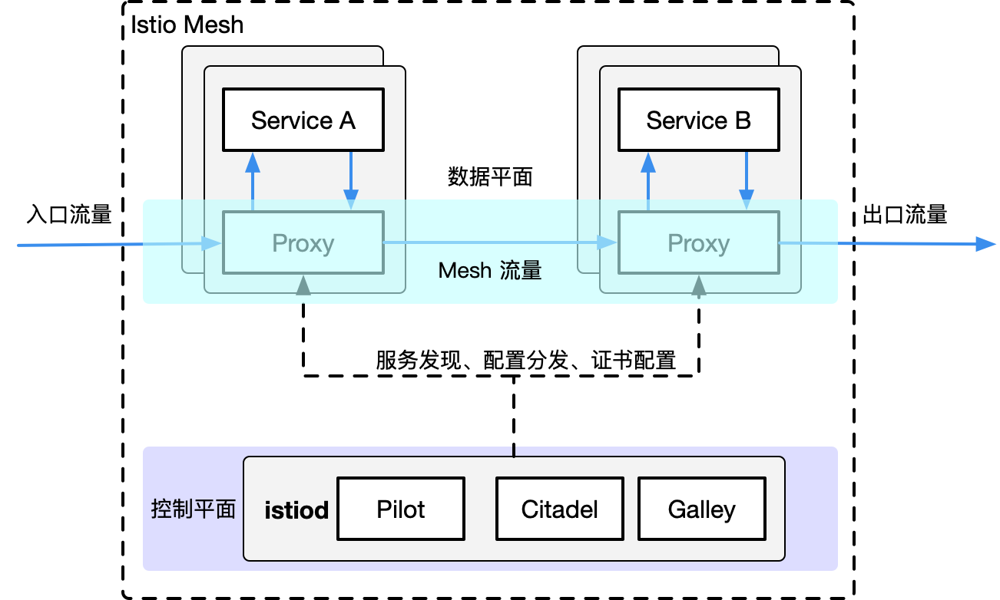

## 服务网格简介

### 服务网格是什么

**服务网格（Service Mesh）是把"服务间网络通信"这件事从业务代码里抽出来，下沉到一个独立的基础设施层**。Istio 是这个领域的事实标准实现，其架构只有两个角色：

- **数据平面（Data Plane）**：每个 Pod 里注入一个 **Sidecar 代理（Envoy）**，应用的所有进出流量都被它劫持转发——所有服务间的连接交织起来，形似一张"网"，这就是"网格"名字的由来。
- **控制平面（Control Plane）**：**istiod**，负责把用户写的流量规则（VirtualService 等 CR）下发到所有 Sidecar，并维护服务发现、证书签发。控制平面只下策略不碰流量，数据流量永远不经过 istiod。

```text
传统模式：app-a 的代码 ──(SDK 处理重试/熔断/TLS)──→ app-b 的代码

网格模式：app-a 的代码 ──→ 本 Pod 的 Envoy Sidecar ──(mTLS)──→ app-b 的 Envoy Sidecar ──→ app-b 的代码
                              ↑                        ↑
                              └──── istiod 统一下发规则 ─┘
```

关键认知：**业务代码感知不到 Sidecar 的存在**——应用以为自己在直连对方，实际上流量被透明劫持。这个"透明"正是服务网格最大的卖点，也解释了它的收益和代价（后文展开）。

### mTLS是什么

mTLS（双向 TLS）是普通 TLS 的加强版，区别只在握手阶段：

| | 普通 TLS（浏览器访问网站） | mTLS（服务网格内） |
| ---- | ---- | ---- |
| 客户端验服务端 | ✅ 服务端出示证书 | ✅ 服务端出示证书 |
| 服务端验客户端 | ❌ 任意客户端都能连 | ✅ **客户端也必须出示证书** |
| 防什么 | 防窃听、防冒充服务端 | 额外防"不明身份的服务混进来" |

普通 TLS 是"单向验证"——任何人都可以连上 HTTPS 网站；mTLS 要求**通信双方都出示证书**，互相确认身份后才建立连接。

**Istio 中如何落地**：Citadel（istiod 内的证书模块，见下文）给每个 Pod 签发一张 X.509 证书，证书里绑定的身份是该 Pod 的 serviceaccount（遵循 SPIFFE 标准，形如 `spiffe://cluster/ns/prod/sa/default`）。两个 Pod 通信时，双方 Sidecar 各自出示证书验证对方身份——**身份来自 K8s 的 serviceaccount，而不是 IP**，Pod 漂移换 IP 身份不变，这正是零信任网络的基础。

**应用场景**：

1. **服务间加密**：内网明文通信的时代结束了——一台 Pod 被入侵后抓包即可看到所有敏感数据，mTLS 让链路上全是密文。
2. **服务身份认证**：连接方必须证明"我是支付服务"，无证书的陌生 Pod 根本握不上手，横向渗透被阻断在握手阶段。
3. **细粒度授权的依据**：身份确认后，`AuthorizationPolicy` 才能写出"只允许 serviceaccount 为 checkout 的服务调用支付接口"这类规则——**先有身份，才谈得上授权**。

### 服务网格可以解决哪些问题

微服务把一个进程拆成几十个服务后，"调一次接口"从函数调用变成了跨越网络的远程调用，原来根本不存在的问题全冒出来了。逐个看，每个问题对应网格的一个能力：

| 微服务引入的问题 | 没有网格时的解法 | 网格的解法 |
| ---- | ---- | ---- |
| 服务间明文通信，内网被攻破即裸奔 | 业务代码里集成 mTLS SDK，每个服务改一遍 | Sidecar 间自动 mTLS，**业务代码零改动** |
| 重试、超时、熔断、限流每个服务自己写 | 沉淀公共 SDK，但多语言团队版本各自漂移 | istiod 下发策略，Envoy 统一执行 |
| 灰度发布只能靠 K8s 的随机负载均衡 | 入口网关写复杂的权重路由脚本 | VirtualService 按 90/10 权重精确切流 |
| 排障时不知道请求在服务间怎么走的 | 每个服务自己埋 OTel SDK（post30 做过） | Sidecar 自动生成调用链指标/日志 |

三个高频场景展开：

**安全：零改造的全链路 mTLS**（机制见前文 mTLS 小节）。生产事故的真实剧本：内网一台 Pod 被入侵后，直接向同 namespace 的 Redis/支付服务发包——K8s 网络策略默认放行所有 Pod 间流量。网格的 mTLS + `AuthorizationPolicy` 组合让服务间自带零信任网络，业务团队一行代码不用写。

**灰度：流量切分的精确手术刀**。K8s Service 只能做无差别负载均衡——新旧版本各占一半 Pod 就各接一半流量，想让"新版本先承接 5% 流量观察"做不到。Istio 用 VirtualService 声明权重（95/5 之类的一个数字），观察错误率/延迟无异常再逐步调大，出问题秒级回滚——金丝雀发布从"改脚本"变成"改一个数字"，完整 YAML 见后文流量治理与 Bookinfo 实战。

**可观测：白得三支柱数据**。Sidecar 转发流量时顺带记录每次调用的延迟、状态码、上下游服务名，自动产出指标和调用链——**不写一行埋点代码，Grafana/Tempo 里就有全网格的 L7 视图**。这对没有精力做 OTel 埋点的遗留服务尤其值钱。

一句话总结收益边界：**网格统一收编了"跨横切面的流量治理"（安全/路由/观测），代价是每个 Pod 多一个 Envoy、多一跳代理的资源和延迟**。小规模微服务（几个服务、单一团队）上 SDK + K8s 原生能力就够；服务数量上规模、多语言、多团队共用平台时，网格的边际收益才盖过成本——先想清楚自己的规模再决定是否引入。


## Istio架构

前文从"能解决什么问题"的视角看了服务网格，现在进入 Istio 内部，看它靠什么实现这些能力。



对照上图，两条铁律贯穿 Istio 的所有设计：

- **控制平面（istiod）只下配置、不碰流量**：用户写流量规则 → istiod 翻译 → 下发给所有代理，数据流量永远不经过 istiod。
- **数据平面靠 Envoy 劫持流量做决策**：没有网格时，网络无法理解流量、也无法按流量类型/来源/目的地做决策；Envoy 负责补上这一层。

Istio 支持两种数据平面模式：

- **Sidecar 模式**：与集群中启动的每个 Pod 一起部署一个 Envoy 代理，或者与在虚拟机上运行的服务一同运行。
- **Ambient 模式**：使用每个节点的四层代理，并且可选地使用每个命名空间的 Envoy 代理来实现七层功能。

### 控制平面istiod内部组成

Istio 1.5 之前，Pilot、Citadel、Galley 是三个独立部署的控制平面组件，后来合并进了一个二进制——**istiod**。所以今天在集群里只有一个 istiod Deployment，但内部仍保留这三个逻辑模块（老架构图仍按它们分开画）：

| 模块 | 职责 | 关键词 |
| ---- | ---- | ---- |
| **Pilot** | Watch 所有流量 CR（VirtualService/DestinationRule/ServiceEntry），翻译成 xDS 配置下发给 Envoy；同时维护服务发现（对接 K8s API Server） | 配置翻译 + 流量下发，istiod 的**大脑** |
| **Citadel** | 签发和管理 SPIFFE 身份证书：给每个 Pod/工作负载发 X.509 证书，支撑自动 mTLS 的双向认证 | 身份与证书，mTLS 的**信任根** |
| **Galley** | 配置的校验与转发层：校验用户提交的 CR 合法性（写错字段直接拒绝），再分发给 Pilot | 配置的**质检员** |

三者各管一段：**Galley 收配置 → Pilot 翻译成 xDS 推给数据面；Citadel 另一条线发证书给数据面**。合并成 istiod 的动机就是简化部署——三个组件拆开时版本对齐、互相调用都是运维负担。

排查问题时的对应关系：路由不生效查 Pilot 的翻译结果（`istioctl proxy-config`，见下文）；mTLS 握手失败查 Citadel 发的证书（`istioctl proxy-config secret`）；CR 提交被拒、无效果但没报错，先看 Galley 的校验日志。

### Sidecar和Ambient模式

**Sidecar 模式**：每个 Pod 注入一个 Envoy，功能全、链路长。**Ambient 模式**：Istio 1.24 起正式 GA 的新架构，把"代理"从 Pod 里搬了出来，分两层：

- **ztunnel（必选，L4）**：每个**节点**一个 Rust 写的代理，DaemonSet 部署。负责 mTLS 加密和 L4 遥测，节点上所有 Pod 的流量都汇聚到它，**Pod 里不再注入任何东西**。
- **waypoint（可选，L7）**：按需部署的 Envoy 代理（通常每个 namespace 或每个 Service 一个）。只有需要 L7 能力（HTTP 路由、金丝雀切流、AuthorizationPolicy 按 header 授权）的流量才显式指向它，不需要的服务就停在 ztunnel 的 L4 层。

| 维度 | Sidecar 模式 | Ambient 模式 |
| ---- | ---- | ---- |
| 代理位置 | 每个 Pod 一个 Envoy | 节点级 ztunnel + 按需 waypoint |
| 资源开销 | 每个 Pod 常驻一份代理（CPU/内存随 Pod 数线性增长） | 大幅降低，ztunnel 全节点共享 |
| 升级/发布 | 代理与应用**耦合**：Envoy 升级要滚动重启全部业务 Pod | **解耦**：ztunnel/waypoint 升级与业务无关 |
| 接入方式 | 注入（namespace 加 label 或手动 inject） | namespace 加 `istio.io/dataplane-mode=ambient` label |
| L7 功能 | 全量，开箱即得 | 默认只有 L4，L7 需显式加 waypoint |
| 成熟度 | 多年生产验证，生态/排障资料最全 | GA 时间不长，生产案例仍在积累 |

**为什么大部分场景仍选 Sidecar**：Ambient 的核心优势是省资源、升级解耦，但这两点只在**大规模集群**（数千 Pod、Sidecar 资源开销真的成为瓶颈）下才值回票价；而它的代价——L7 功能要按需补 waypoint、故障排查链路多了一层（Pod→ztunnel→waypoint）、GA 后生产沉淀时间短——对中小规模场景是净亏损。Sidecar 模式功能完整、问题定位路径简单（流量就多一跳 sidecar），加上几乎所有官方示例和社区方案都基于它，**当前生产默认选 Sidecar，是更稳的决定**；Ambient 适合作为新集群或有明确资源诉求时的评估选项。


## 流量治理资源

Istio 的流量治理全靠几类 CR，按"流量从哪进、到哪去"理解它们的分工：

| 资源 | 管什么 | 一句话定位 |
| ---- | ---- | ---- |
| **Gateway** | 南北向流量（集群外→集群内） | 声明网格的"大门"：监听哪些端口/协议、管哪些证书 |
| **VirtualService** | 流量路由 | 按 host/路径/header 等条件，把请求转发到谁 |
| **DestinationRule** | 到达目标后的策略 | 定义目标服务的 subset（版本分组）、负载均衡策略、TLS 模式 |
| **ServiceEntry** | 出向流量（集群内→集群外） | 把外部服务（如三方 API）注册进网格，使其可被治理 |

逐个拆开讲，每个资源都回答清楚"hosts 填什么、路由怎么生效"。

### Gateway：声明网格的大门

Gateway 本身**不转发任何流量**，它只是一份"大门规格书"——声明监听哪个端口、什么协议、接受哪些域名的请求。真正监听端口的是 `selector` 选中的那批 **istio-ingressgateway** Pod（独立的 Envoy Deployment）：

```yaml
apiVersion: networking.istio.io/v1
kind: Gateway
metadata:
  name: bookinfo-gateway
spec:
  selector:
    istio: ingressgateway        # 选中 istio-ingressgateway 的 Pod，由它们执行这份"规格书"
  servers:
  - port: { number: 80, name: http, protocol: HTTP }
    hosts: ["bookinfo.example.com"]   # 大门只放行请求这个域名的流量，其他域名直接拒之门外
```

**`hosts` 字段的含义**：只有 Host 头为 `bookinfo.example.com` 的请求能进门。一个 ingressgateway 上可以声明多个 Gateway，分别对应不同域名（`api.example.com`、`admin.example.com`），实现"一个入口按域名分流给多套业务"。

### VirtualService：定义路由规则

VirtualService 是路由的核心，**它管理的是"host"这个维度上的所有请求**，按匹配条件转发。它的 `hosts` 字段填两类值，含义完全不同：

- **对外域名**（如 `bookinfo.example.com`）：配合 `gateways` 字段绑定 Gateway，处理南北向流量——外部用户进门后的第一站路由；
- **内部服务名**（如 `reviews`）：处理网格内东西向流量——其他服务调用 reviews 时的路由。

```yaml
apiVersion: networking.istio.io/v1
kind: VirtualService
metadata:
  name: bookinfo
spec:
  hosts: ["bookinfo.example.com"]      # 对外域名，处理外部请求
  gateways: ["bookinfo-gateway"]       # 必须绑定 Gateway 才对外生效；不写则只作用于网格内部
  http:
  - match:                             # 规则从上到下依次匹配，命中即停
    - uri: { prefix: /static }
    route:
    - destination: { host: productpage, port: { number: 9080 } }
  - route:                             # 没有任何 match 的规则是兜底路由
    - destination: { host: productpage, port: { number: 9080 } }
---
apiVersion: networking.istio.io/v1
kind: VirtualService
metadata:
  name: reviews
spec:
  hosts: ["reviews"]                   # 内部服务名，处理网格内的调用
  http:
  - route:
    - destination: { host: reviews, subset: v1 }
      weight: 95
    - destination: { host: reviews, subset: v2 }
      weight: 5
```

**路由的匹配维度**：`uri`（路径前缀/精确匹配）、`headers`（请求头正则）、`query`（查询参数）、`port`——组合起来可以做"header 带 `user=admin` 的请求全走 v2"这类精细控制；`destination.subset` 指向的版本分组由 DestinationRule 定义，两者是配套的（不定义 subset 直接引用会报 404 类路由错误）。

### DestinationRule：定义目的地

VirtualService 说"把 5% 流量给 reviews 的 v2"，但**v2 是哪些 Pod、按什么策略负载均衡，由 DestinationRule 回答**。它按 Pod label 把一个服务切分成命名的 subset：

```yaml
apiVersion: networking.istio.io/v1
kind: DestinationRule
metadata:
  name: reviews
spec:
  host: reviews                        # 针对哪个服务，K8s 内填 Service 名即可
  subsets:
  - name: v1
    labels: { version: v1 }            # 选中带 version=v1 label 的 Pod
  - name: v2
    labels: { version: v2 }            # 选中带 version=v2 label 的 Pod
  trafficPolicy:
    loadBalancer:
      simple: LEAST_REQUEST            # 负载均衡策略：最少请求数优先（还有 ROUND_ROBIN/RANDOM）
    # connectionPool:                  # 还可配置连接池（熔断的基础）
    # outlierDetection:                # 异常实例剔除：连续错误N次后摘除该Pod一段时间
```

`trafficPolicy` 是生产排障的高频区：`outlierDetection` 就是 Envoy 实现的熔断——某 Pod 连续返回 5xx 被摘出负载均衡池，流量自动导给健康实例，**业务代码一行熔断逻辑都不用写**。

### ServiceEntry：把外部世界纳入网格

网格默认只认识集群内的 Service。想治理"访问外部 API"的流量（统一出口、mTLS、限流），先用 ServiceEntry 把外部目标注册成一个"逻辑服务"：

```yaml
apiVersion: networking.istio.io/v1
kind: ServiceEntry
metadata:
  name: external-api
spec:
  hosts: ["api.thirdparty.com"]        # 外部服务的域名，网格内从此可以用它做路由
  ports:
  - number: 443
    name: https
    protocol: HTTPS
  location: MESH_EXTERNAL              # 声明这是网格外的目标
```

注册之后，这个外部域名和其他内部服务一视同仁——可以给它写 VirtualService 做路由、配 DestinationRule 做超时重试，再配合 AuthorizationPolicy 限定"哪些服务允许访问它"。

### CR与Envoy：逻辑规则与真实执行者

前面所有 YAML 都是**逻辑声明**，集群里没有一个"叫 VirtualService 的进程"在转发流量。真正干活的是 **Envoy**——CNCF 出品的高性能 C++ 代理，L3 到 L7 全能（HTTP/gRPC/TCP 都能解析），是 Istio 整个数据平面的引擎。它的工作方式只有一个：**接受 xDS 协议下发的配置，然后照着配置转发流量**。

理解 Envoy 是什么，四个资源的关系就一目了然：

```text
你写的 CR（逻辑规则，不存在于流量路径上）
    Gateway / VirtualService / DestinationRule / ServiceEntry
        ↓ istiod（Pilot）Watch 并翻译
        ↓ 组装成 Envoy 的原生配置对象
        ↓ 通过 xDS 协议下发
真实执行者（Envoy 实例）
    ├─ Sidecar：注入在业务 Pod 里，管东西向流量
    └─ istio-ingressgateway / egressgateway：独立 Deployment，管南北向流量
```

三个直观的推论：

- **CR 是说明书，Envoy 是工人**：改 CR 只是改了说明书，工人们（所有 Envoy）拿到新版说明书才真正改变行为——所以配置下发有秒级延迟，不是改完立即生效。
- **排查必须看 Envoy 侧的最终配置**：CR 写了但没生效，说明翻译环节断了（典型：VirtualService 忘了绑 `gateways`）。用 `istioctl proxy-config` 系列命令 dump 某个 Envoy 实际收到的 Listener/Route/Cluster 配置，一翻便知规则有没有送达。
- **Sidecar 和 Gateway 是同一个引擎的两种摆位**：Pod 里那个是 Sidecar 摆法，ingressgateway 是独立 Deployment 摆法，跑的都是 Envoy 镜像——**差别只是站的位置**。

### istio-ingressgateway与istio-egressgateway

Gateway CR 定义了网格的"大门"（见前文），本节看真正执行这扇门的两个常驻 Deployment——它们是网格的**进出口关卡**，各管一个方向：

```text
外部用户 ──→ istio-ingressgateway ──→ 网格内服务      （入口：南北向流入）
网格内服务 ──→ istio-egressgateway ──→ 外部 API/DB    （出口：南北向流出）
```

**istio-ingressgateway**：入口网关，即 Gateway CR 的 `selector: istio: ingressgateway` 选中的那批 Pod。生产上它前面通常再挂一个 LoadBalancer Service 把入口暴露出去。

**istio-egressgateway**：出口网关。没有它时，Pod 访问外部 API 的流量会被 Sidecar 直接放出去——**出站策略分散在每个 Sidecar 上，外部审计看不到统一的出口 IP**。加了 egressgateway 后，"访问外部"的流量统一流经这个关卡，三个典型用途：

1. **统一出口 IP**：三方系统（银行、政府接口）通常要白名单对端 IP，几十个业务 Pod 的出口 IP 漂移没法维护；全部走 egressgateway 后给对方一个 IP 就行。
2. **出口审计与管控**：哪些服务能访问外网、访问哪些域名，在出口集中执行（配合 ServiceEntry + AuthorizationPolicy），而不是相信每个 Sidecar 的配置都配对了。
3. **安全合规要求**：内网与外部之间必须有可审计的单一通道，egressgateway 就是这个"DMZ"。

一句话对比：**ingressgateway 管"别人怎么进来"，egressgateway 管"自己怎么出去"**——两者都是独立的 Envoy Deployment，默认安装里 egressgateway 可能未启用，`istioctl install --set components.egressGateways[0].enabled=true` 补开。

**出口资源配置**：入口就是前文 Gateway CR（`selector: istio: ingressgateway` + VirtualService 绑定），不再重复；**出口**需要几个资源配合，让"productpage 访问外部 API"的流量强制流经 egressgateway：

```yaml
# ① ServiceEntry：把外部域名注册进网格（前提条件，见前文）
apiVersion: networking.istio.io/v1
kind: ServiceEntry
metadata:
  name: external-api
spec:
  hosts: ["api.thirdparty.com"]
  ports:
  - number: 443
    name: https
    protocol: HTTPS
  location: MESH_EXTERNAL
---
# ② Gateway：在 egressgateway 上开一道通往该域名的小门
apiVersion: networking.istio.io/v1
kind: Gateway
metadata:
  name: egress-api-gateway
spec:
  selector:
    istio: egressgateway          # 关键：selector 换成 egressgateway 的 Pod
  servers:
  - port: { number: 443, name: https, protocol: HTTPS }
    hosts: ["api.thirdparty.com"]
---
# ③ VirtualService：把网格内访问该域名的流量"改道"到 egressgateway
apiVersion: networking.istio.io/v1
kind: VirtualService
metadata:
  name: route-via-egress
spec:
  hosts: ["api.thirdparty.com"]
  gateways:
  - mesh                          # 特殊值：匹配所有网格内部的调用（Sidecar 发出的）
  - egress-api-gateway            # 匹配从 egressgateway 进来的（转发给最终目标）
  http:
  - match:
    - gateways: ["mesh"]
      port: 443
    route:
    - destination:
        host: istio-egressgateway.istio-system.svc.cluster.local
        subset: external-api
        port: { number: 443 }
  - match:
    - gateways: ["egress-api-gateway"]
      port: 443
    route:
    - destination: { host: api.thirdparty.com }
      # egressgateway 收到流量后，转发给真正的外部域名
---
# 配套：给 egressgateway 定义上面的 subset（无 labels 的命名分组，供 VirtualService 引用）
apiVersion: networking.istio.io/v1
kind: DestinationRule
metadata:
  name: egress-external-api
spec:
  host: istio-egressgateway.istio-system.svc.cluster.local
  subsets:
  - name: external-api
---
# ④（可选）AuthorizationPolicy：只允许 productpage 借道出口
apiVersion: security.istio.io/v1
kind: AuthorizationPolicy
metadata:
  name: egress-allow-productpage
  namespace: istio-system         # 作用于 egressgateway 所在 namespace
spec:
  selector:
    matchLabels:
      app: istio-egressgateway
  action: ALLOW
  rules:
  - from:
    - source:
        principals: ["cluster.local/ns/default/sa/productpage"]   # 按服务身份放行
    to:
    - operation:
        hosts: ["api.thirdparty.com"]
```

三步的逻辑：ServiceEntry 让网格"认识"外部域名 → VirtualService 里 `gateways: ["mesh"]` 把所有出向流量第一跳改道到 egressgateway → 第二跳（egressgateway 收到后）按 `gateways: ["egress-api-gateway"]` 匹配，转发给真实目标。验证：`curl http://api.thirdparty.com` 从 productpage 发出后，egressgateway 的访问日志（`kubectl logs`）里应能看到这条请求——出口审计从此有据可查。


## 入口方案选型

网格自身的流量资源讲完了，回过头看"集群入口"这个特殊场景：K8s 原生还有 Gateway API 和 Ingress 两套方案，它们与 Istio 的关系值得单独讲清楚。

### 与 K8s Gateway API 的关系

K8s 官方的 **Gateway API**（`GatewayClass` / `Gateway` / `HTTPRoute`）与 Istio 自家的 Gateway CRD 是两套并存的入口体系：

- **`GatewayClass` 是集群级资源，回答"谁来实现 Gateway"**：它的 `spec.controllerName` 指向一个控制器实现，如 Istio 的 `istio.io/gateway-controller`。Gateway API 的设计哲学是"标准 API + 可插拔实现"——用户写标准的 Gateway/HTTPRoute，底层由 Istio、Envoy Gateway 等任意实现方驱动。
- **血缘关系**：Istio 的 Gateway CRD 比 Gateway API 诞生得早，Gateway API 大量吸收了 Istio 的实践；Istio 现在同时支持两套，且官方新文档更推荐用 Gateway API 作为入口配置。
- **能力边界**：`HTTPRoute` 能覆盖 VirtualService 的南北向路由（权重/路径/header 匹配），但 VirtualService 还管网格内东西向流量，且与 DestinationRule 的 subset 配套——所以**Gateway API 替代的是 Gateway+部分 VS，不是整个 Istio 流量 CR 体系**。

### Ingress可以被完全替代

Istio 完全覆盖了 K8s Ingress 的功能，并且远超它：

| 能力 | K8s Ingress | Istio Gateway / Gateway API |
| ---- | ---- | ---- |
| L7 路由（路径/host） | 支持，但注解（annotation）各家实现五花八门 | 原生声明式 |
| 权重灰度、header 路由 | 做不到（要靠各实现的 annotation 魔法） | 原生支持 |
| mTLS 终结、证书管理 | 部分支持 | 原生支持 |
| 故障注入、重试、超时、熔断 | 无 | 原生支持 |
| 东西向流量治理 | 与入口无关，完全管不到 | 全网格覆盖 |
| 语义可移植性 | annotation 不跨实现 | Gateway API 是标准，实现可替换 |

结论：**在已经部署 Istio 的集群里，Ingress 没有存在价值**——上表前四行说明 Istio Gateway 是 Ingress 的严格超集，后两行更是 Ingress 永远补不齐的能力。保留 Ingress 等于维护两套入口逻辑，应该下线；唯一需要 Ingress 的场景是集群没上网格、又不值得为入口引入整个网格——那时 Ingress 才作为轻量替代出场。


## 流量管理的最佳实践：以Bookinfo为例

用 Istio 官方的经典示例应用 **Bookinfo** 把所有资源串一遍。它模拟一个书店，四个服务组成一条真实调用链：

```text
productpage（产品页，入口服务）
  ├── details（书籍详情）
  ├── reviews（书评，有 v1/v2/v3 三个版本，本文关注 v1/v2）
  │     └── ratings（评分）
```

目标：外部用户通过 `bookinfo.example.com` 访问 productpage；reviews 做金丝雀发布（v1 承接 95%、v2 灰度 5%）。三个资源依次上场：

**① Gateway 开大门**（`bookinfo.example.com` 进得来）：

```yaml
apiVersion: networking.istio.io/v1
kind: Gateway
metadata:
  name: bookinfo-gateway
spec:
  selector:
    istio: ingressgateway
  servers:
  - port: { number: 80, name: http, protocol: HTTP }
    hosts: ["bookinfo.example.com"]
```

**② VirtualService 接住入口流量**（进了门去哪）：

```yaml
apiVersion: networking.istio.io/v1
kind: VirtualService
metadata:
  name: bookinfo
spec:
  hosts: ["bookinfo.example.com"]
  gateways: ["bookinfo-gateway"]       # 绑定大门，不写则只对网格内部生效
  http:
  - match:
    - uri: { exact: /details }         # 路径路由：详情接口直接给 details 服务
    route:
    - destination: { host: details, port: { number: 9080 } }
  - match:
    - uri: { exact: /ratings }
    route:
    - destination: { host: ratings, port: { number: 9080 } }
  - route:                             # 兜底：其余路径全部给产品页
    - destination: { host: productpage, port: { number: 9080 } }
```

productpage 内部再调用 reviews 时，走的是网格内（东西向）流量，命中下面这条 VS。

**③ VirtualService + DestinationRule 配套做金丝雀**（reviews 的 95/5 切流）：

```yaml
apiVersion: networking.istio.io/v1
kind: VirtualService
metadata:
  name: reviews
spec:
  hosts: ["reviews"]                   # 内部服务名，只作用于网格内调用
  http:
  - route:
    - destination: { host: reviews, subset: v1 }
      weight: 95
    - destination: { host: reviews, subset: v2 }
      weight: 5
---
apiVersion: networking.istio.io/v1
kind: DestinationRule
metadata:
  name: reviews
spec:
  host: reviews
  subsets:
  - name: v1
    labels: { version: v1 }            # 按 Pod label 划分版本分组
  - name: v2
    labels: { version: v2 }
```

**验证闭环**：域名解析到 ingressgateway 的 LB IP 后（本地测试可加 hosts 或 `curl --resolve`），`curl http://bookinfo.example.com/productpage` 应正常返回页面；反复刷新页面（或 `for i in {1..100}; do curl -s http://bookinfo.example.com/productpage | grep -c "star"; done`），能观察到约 5% 的请求展示 v2 的星星评分——权重切流生效。灰度期间盯着 Grafana 里 reviews 的错误率和 P95，异常就把 weight 改回 `100/0`，一条 `kubectl apply` 完成回滚。

这套"**Gateway 定大门 → VirtualService 定路由 → DestinationRule 定目的地**"的三板斧，覆盖了南北向入口、路径路由、金丝雀发布三个最高频的生产需求，也是所有 Istio 流量管理任务的标准起手式。
