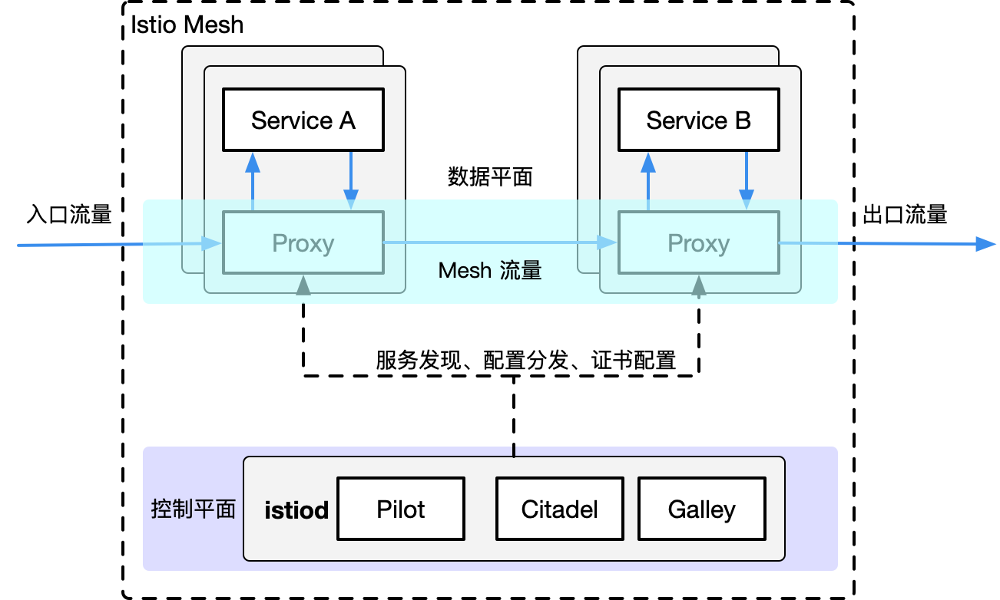
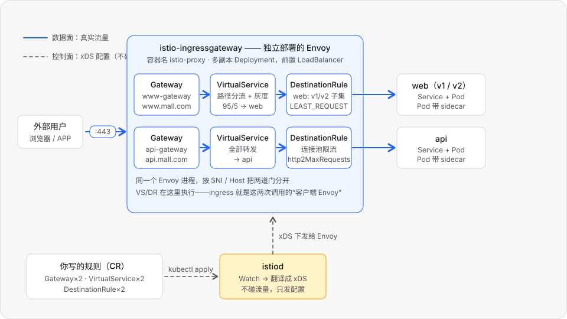

## 服务网格简介

### 服务网格是什么

**服务网格（Service Mesh）是把"服务间网络通信"这件事从业务代码里抽出来，下沉到一个独立的基础设施层**。Istio 是这个领域的事实标准实现。

先解释一个文中反复出现的词——**Sidecar（边车）**，一句话：就是"**同一个 Pod 里的第二个容器**"。Pod 是 K8s 的最小调度单位，一个 Pod 里可以放多个容器，它们：

- **共享网络命名空间**：同一个 IP、同一个 localhost，容器之间用 `127.0.0.1:端口` 直接互访；
- **共享存储卷**：可以挂同一个 emptyDir、ConfigMap；
- **同生共死**：一起调度到同一节点，一起创建、一起销毁。

"边车"是这种用法的俗名：**主容器干活，副容器在旁边辅助**。它的价值是把通用能力从业务代码里剥离——业务镜像只专注自己的事，辅助能力塞进旁边的容器，业务代码一行不用改。

拿 Kafka 的 JMX 举个真实例子，开了 `metrics.jmx.enabled` 之后，Pod 里就是两个容器：

```text
Pod: kafka-0
├── kafka           主容器：9092 业务端口、9093 controller 端口
└── jmx-exporter    边车  ：9404 指标端口
        └─ 用 localhost 读同 Pod 内 kafka JVM 的 JMX MBean
            翻译成 Prometheus 文本，暴露在 :9404/metrics
```

Service 的 selector 选中这个 Pod、`targetPort: metrics` 指向边车的端口——Prometheus 抓的是 Pod 里的边车，不是单独的工作负载；exporter 不需要独立部署，它"寄生"在 kafka Pod 里。

**为什么 JMX 用 sidecar、lag exporter 却是独立 Deployment？** JMX 的 MBean 是 JVM 本地管理接口，提供broker的一些重要指标，JMX 默认监听 `127.0.0.1:9999` → 只能本机访问，外部 Pod 连不上，所以做成sidecar。而消费组 lag 走 Kafka 协议、连 9092 跨网络去读 `__consumer_offsets`，数据哪都能拿，做成独立deployment pod可以一个进程监听多个broker，而不是作为sidecar与broker1:1.

生产上最常见的 sidecar 就三类：**指标采集**（上面的 JMX exporter）、**日志采集**（Fluent Bit / Filebeat）、**代理**（Envoy）——共同点都是"必须贴着主容器干活"。Istio 属于第三类，也是这个模式最著名的一个用户。

**两个容易混的点。** 一是"注入"这个词：Kafka 的 jmx-exporter 是**静态声明**——chart 写死在 StatefulSet 模板里，看 manifest 就能看到；而 Istio 的 istio-proxy 是**动态注入**——通过 MutatingWebhook 在 Pod 创建时才塞进去，你写 Deployment 时根本看不到这个容器。两者都叫 sidecar，一静一动，后文讲的都是后者。二是**代价**：边车的资源要算进同一个 Pod 的 requests/limits，生命周期绑定（改边车配置的 ConfigMap 会滚动重启整个 Pod），边车挂了还可能拖垮 Pod 的 readiness——sidecar 用耦合换便利，不是免费的。

Istio 的架构只有两个角色：

- **数据平面（Data Plane）**：每个 Pod 里注入一个 **Sidecar 代理（Envoy）**，应用的所有进出流量都被它劫持转发——所有服务间的连接交织起来，形似一张"网"，这就是"网格"名字的由来。
- **控制平面（Control Plane）**：**istiod**，负责把用户写的流量规则（VirtualService 等 CR）翻译成 Envoy 配置、下发给所有 Sidecar，并维护服务发现、证书签发。

```text
传统模式：app-a 的代码 ──(SDK 处理重试/熔断/TLS)──→ app-b 的代码

网格模式：app-a 的代码 ──→ 本 Pod 的 Envoy Sidecar ──(mTLS)──→ app-b 的 Envoy Sidecar ──→ app-b 的代码
                              ↑                        ↑
                              └──── istiod 统一下发规则 ─┘
```

关键认知：**业务代码感知不到 Sidecar 的存在**——应用以为自己在直连对方，实际上流量被透明劫持。这个"透明"正是服务网格最大的卖点，也解释了它的收益和代价（后文展开）。

### Envoy 与 istio-proxy

前文的"Sidecar 代理"、以及后文所有的网关，跑的都是同一个引擎——**Envoy**：CNCF 毕业的高性能 L7 代理（C++ 编写，HTTP/gRPC/TCP 都能解析），是 Istio 整个数据平面的本体。它自己不做任何业务决策，工作方式只有一条：**接收 xDS 协议下发的配置，照着配置转发流量**——没有配置，它就是个空转发器。

**istio-proxy：Istio 打包定制后的 Envoy**——加上 Istio 配套插件（遥测、安全、策略执行）和与 istiod 对接 xDS 的逻辑，**镜像/容器名就叫 `istio-proxy`**。所以 `kubectl get pod` 看到的 Sidecar 容器不是什么新东西，它就是 Envoy。

全文从此只有两族角色反复出场：**一群 Envoy（执行者）+ 一个 istiod（把规则翻译成 Envoy 配置下发）**——"谁执行、谁描述"的完整关系见后文「CR与Envoy」一节。

### mTLS是什么

mTLS（双向 TLS）是普通 TLS 的加强版，区别只在握手阶段：

| | 普通 TLS（浏览器访问网站） | mTLS（服务网格内） |
| ---- | ---- | ---- |
| 客户端验服务端 | ✅ 服务端出示证书 | ✅ 服务端出示证书 |
| 服务端验客户端 | ❌ 任意客户端都能连 | ✅ **客户端也必须出示证书** |
| 防什么 | 防窃听、防冒充服务端 | 额外防"不明身份的服务混进来" |

**Istio 中如何落地**：Citadel（istiod 内的证书模块，见下文）用根证书的私钥给每个 Pod 签发一张 X.509 证书，证书里绑定的身份是该 Pod 的 serviceaccount。两个 Pod 通信时，双方 Sidecar 各自出示证书验证对方身份——**身份来自 K8s 的 serviceaccount，而不是 IP**，Pod 漂移换 IP 身份不变，这正是零信任网络的基础。

**应用场景**：

1. **服务间加密**：内网明文通信的时代结束了——一台 Pod 被入侵后抓包即可看到所有敏感数据，mTLS 让链路上全是密文。
2. **服务身份认证**：连接方必须证明"我是支付服务"，无证书的陌生 Pod 根本握不上手，横向渗透被阻断在握手阶段。
3. **细粒度授权的依据**：支付服务只想让结账服务调它。开了 mTLS 后写一条 AuthorizationPolicy 限定调用方身份为 `sa/checkout`；此时黑客拿下了内网另一台 Pod，它没有（也伪造不了）checkout 的证书。

```yaml
rules:
- from:
  - source:
      principals: ["cluster.local/ns/prod/sa/checkout"]   # 只认 serviceaccount 为 checkout 的调用方
  to:
  - operation:
      paths: ["/api/pay"]                                  # 只许调支付接口
```

### 节点内部通信都是 mTLS 吗

先给结论：**只要通信两端都是被注入了 Sidecar 的 Pod，那么不管它们在不在同一台机器上，中间那一段都是 mTLS 的；反过来，只要有一端没进网格，或者流量压根没经过 Envoy，就是明文。** 加密发生在"两个 Envoy 之间"，与物理位置无关——同节点不构成例外。

**为什么同节点也得走两次代理。** 很多人下意识认为同节点两个 Pod 走 loopback 直连、绕过了 Sidecar，这是错的。同节点 Pod 之间依然是 veth pair + 网桥转发，出方向被 Pod 网络命名空间里的 iptables 规则重定向到本 Pod Envoy 的 **15001**，对端入方向被重定向到对端 Envoy 的 **15006**：

```text
同节点 PodA → PodB（两端都注入）

PodA 应用 :8080 访问 PodB:8080
   │  出站被 iptables 拦下
   ▼
PodA Envoy :15001 ══mTLS 加密══► PodB Envoy :15006 ──明文──► PodB 应用 :8080
        ▲                                  ▲
        └──────── 同节点内的一段 veth/网桥 ────┘
```

同节点省掉的只是一次物理网卡往返，**没有省掉两个代理，也没有省掉 TLS 握手**。所以它不会让 mTLS 失效，也不会让延迟变成"本地调用"——同节点依然比 Pod 内进程间调用多出两跳代理，只是延迟差通常在亚毫秒级（长连接下 TLS 会话复用，开销可忽略）。

**mTLS 只保护中间那一段。** 这是最容易被误解的地方：加密的是 `Envoy ↔ Envoy`，**不包含两端的 `应用 ↔ 本 Pod Envoy`**——那两段走 Pod 内的 loopback，永远是明文。

```text
   明文            密文                     明文
应用 ⇄ 本Pod Envoy ══════════ 对端 Envoy ⇄ 对端应用
   ↑ loopback      ↑ 跨节点 / 同节点网络          ↑ loopback
```

推论很硬：**拥有节点 root 权限的进程（特权 Pod、节点上的 agent、debug 容器）tcpdump 一下 lo，就能看到完整明文**。在节点上 `tcpdump -i any port 8080` 看到的 HTTP 内容依然清清楚楚。

所以 mTLS 的信任边界是**主机边界**，不是"整个集群边界"。它防网络上的窃听和冒充，防不住同主机同内核的窥探——那一层要靠节点加固、禁止特权容器、Pod Security Admission 来兜。

### 收紧 mTLS：PeerAuthentication

mTLS 怎么工作、保护到哪讲完了，这里补上"开关在哪"。Istio 装完默认就是 **auto mTLS**：两端都进网格时自动加密，对端没进网格就降级成明文——能通，但不设防。**PeerAuthentication** 就是管这个策略的 CR，按 namespace/Pod 粒度生效：

```yaml
apiVersion: security.istio.io/v1
kind: PeerAuthentication
metadata:
  name: default
  namespace: bookinfo
spec:
  mtls:
    mode: STRICT          # 本 namespace 的 Pod 只接受 mTLS 流量
```

| 模式 | 行为 | 用途 |
| ---- | ---- | ---- |
| **UNSET**（缺省） | 继承上级：Pod → namespace → mesh 根策略 | 不表态，跟着全局走 |
| **PERMISSIVE** | 同时接受明文和 mTLS | 迁移过渡期（auto mTLS 的底层默认） |
| **STRICT** | 只接受 mTLS，明文直接拒 | 正式收紧，零信任的落点 |
| **DISABLE** | 强制明文 | 纯排障用，生产禁用 |

**生产收紧路径**（顺序错了会直接把业务打挂）：

1. **先验证 auto mTLS 正常**：`istioctl proxy-config listener <pod> -n <ns>` 确认 inbound/outbound 已带 mTLS 上下文，两端互访确实走了密文；
2. **先接网格、再开 STRICT**：STRICT 生效后，**没注入 Sidecar 的调用方**（裸 Job、未接管的 Pod、集群外组件）会被握手直接拒掉——这些流量源必须先接入网格，或明确接受它们不通；
3. **按 namespace 分批上 STRICT**：先给非核心 namespace 打 STRICT → 重建 Pod → 验证调用正常再推下一个，出问题摘标签回滚（与前文注入标签同一套分批思路）；
4. **策略各管一层**：PeerAuthentication 管"**怎么连**"（必须 mTLS），"**谁可以连**"由 AuthorizationPolicy 管（见前文 `principals` 示例）——两者配合才是完整的服务间零信任。

一句话：**auto mTLS 让"有网格就加密"，STRICT 让"不加密就别进来"**——前者是默认收益，后者才是安全基线。

### 服务网格可以解决哪些问题

微服务把一个进程拆成几十个服务后，"调一次接口"从函数调用变成了跨越网络的远程调用，原来根本不存在的问题全冒出来了。逐个看，每个问题对应网格的一个能力：

| 微服务引入的问题 | 没有网格时的解法 | 网格的解法 |
| ---- | ---- | ---- |
| 服务间明文通信，内网被攻破即裸奔 | 业务代码里集成 mTLS SDK，每个服务改一遍 | Sidecar 间自动 mTLS，**业务代码零改动** |
| 重试、超时、熔断、限流每个服务自己写 | 沉淀公共 SDK，但多语言团队版本各自漂移 | istiod 下发策略，Envoy 统一执行 |
| 灰度发布只能靠 K8s 的随机负载均衡 | 入口网关写复杂的权重路由脚本 | VirtualService 按 90/10 权重精确切流 |
| 排障时不知道请求在服务间怎么走的 | 每个服务自己埋 OTel SDK（post30 做过） | Sidecar 转发流量时自动记录每次调用的延迟、状态码、上下游服务名，自动产出指标和调用链 |

一句话总结收益边界：**网格统一收编了"跨横切面的流量治理"（安全/路由/观测），代价是每个 Pod 多一个 Envoy、多一跳代理的资源和延迟**。小规模微服务（几个服务、单一团队）上 SDK + K8s 原生能力就够；服务数量上规模、多语言、多团队共用平台时，网格的边际收益才盖过成本——先想清楚自己的规模再决定是否引入。


## Istio架构

前文从"能解决什么问题"的视角看了服务网格，现在进入 Istio 内部，看它靠什么实现这些能力。



对照上图，两条铁律贯穿 Istio 的所有设计：

- **控制平面（istiod）只下配置、不碰流量**：用户写流量规则 → istiod 翻译 → 下发给所有代理，数据流量永远不经过 istiod。
- **数据平面靠 Envoy 劫持流量做决策**：没有网格时，网络无法理解流量、也无法按流量类型/来源/目的地做决策；Envoy 负责补上这一层。

### 控制平面istiod内部组成

之前，Pilot、Citadel、Galley 是三个独立部署的控制平面组件，后来合并进了一个二进制——**istiod**。所以今天在集群里只有一个 istiod Deployment，但内部仍保留这三个逻辑模块（老架构图仍按它们分开画）：

注意这里的"控制平面"是 Istio 自己的逻辑概念（对应数据平面），与 K8s 的 master 节点无关——istiod 就是 `istio-system` 里一个普通 Deployment，被调度到哪台工作节点都行（一般不建议调度到master节点），会漂移、可多副本。

| 模块 | 职责 | 关键词 |
| ---- | ---- | ---- |
| **Pilot** | Watch 所有流量 CR（VirtualService/DestinationRule/ServiceEntry），翻译成 xDS 配置下发给 Envoy；同时维护服务发现（对接 K8s API Server） | 配置翻译 + 流量下发，istiod 的**大脑** |
| **Citadel** | 签发和管理 SPIFFE 身份证书：给每个 Pod/工作负载发 X.509 证书，支撑自动 mTLS 的双向认证 | 身份与证书，mTLS 的**信任根** |
| **Galley** | 配置校验的逻辑模块：校验用户提交的 CR 合法性（写错字段直接拒绝）。实际由 istiod 暴露的 ValidatingWebhook 承接校验，写错的 CR 在 `kubectl apply` 阶段就被打回 | 配置的**质检员** |

三者各管一段：**Galley 收配置 → Pilot 翻译成 xDS 推给数据面；Citadel 另一条线发证书给数据面**。合并成 istiod 的动机就是简化部署——三个组件拆开时版本对齐、互相调用都是运维负担。

（本文只讲单集群：多集群下 istiod 还会通过 remote secret 读取远端集群的服务发现、共用同一套根证书签发跨集群身份——拓扑另文展开，不是本文重点。）

排查问题时的对应关系：路由不生效查 Pilot 的翻译结果（`istioctl proxy-config`，见下文）；mTLS 握手失败查 Citadel 发的证书（`istioctl proxy-config secret`）；CR 提交被直接拒绝是 ValidatingWebhook 拦下的（`kubectl` 侧就有报错信息），提交成功但没效果再查 istiod 日志与下发结果。

### Sidecar和Ambient模式

**Sidecar 模式**：每个 Pod 注入一个 Envoy，功能全、链路长。**Ambient 模式**：Istio 1.24 起正式 GA 的新架构，把"代理"从 Pod 里搬了出来，分两层：

- **ztunnel（必选，L4）**：每个**节点**一个 Rust 写的代理，DaemonSet 部署。负责 mTLS 加密和 L4 遥测，节点上所有 Pod 的流量都汇聚到它，**Pod 里不再注入任何东西**。
- **waypoint（可选，L7）**：按需部署的 Envoy 代理（通常每个 namespace 或每个 Service 一个）。只有需要 L7 能力（HTTP 路由、金丝雀切流、AuthorizationPolicy 按 header 授权）的流量才显式指向它，不需要的服务就停在 ztunnel 的 L4 层。

| 维度 | Sidecar 模式 | Ambient 模式 |
| ---- | ---- | ---- |
| 代理位置 | 每个 Pod 一个 Envoy | 节点级 ztunnel + 按需 waypoint |
| 资源开销 | 每个 Pod 常驻一份代理（CPU/内存随 Pod 数线性增长） | 大幅降低，ztunnel 全节点共享 |
| 升级/发布 | 代理与应用**耦合**：Envoy 升级要滚动重启全部业务 Pod | **解耦**：ztunnel/waypoint 升级与业务无关 |
| 接入方式 | 注入（namespace 加 label 或手动 inject） | namespace 加 `istio.io/dataplane-mode=ambient` label |
| L7 功能 | 全量，开箱即得 | 默认只有 L4，L7 需显式加 waypoint |
| 成熟度 | 多年生产验证，生态/排障资料最全 | GA 时间不长，生产案例仍在积累 |

### 实际选型：Sidecar还是Ambient

选型回答三个问题即可：

1. **L7 需求占多少？** Ambient 省钱的前提是流量停在 L4。如果几乎每个服务都要 HTTP 路由、header 授权，那就全得再挂 waypoint——代理没省下来还多一跳，不如直接用 Sidecar。
2. **规模有多大？** 3000 Pod 的集群（约百节点），Sidecar 约 **600 核**纯代理开销（0.2C/Pod 线性增长），Ambient 每节点一个 ztunnel 合计只要约 **6 核**——规模越大 Ambient 收益越明显，几十个 Pod 的小集群差距不大。
3. **能否接受新技术风险？** Sidecar 的坑社区踩了七八年，排障资料全；Ambient 出问题要分层查 ztunnel/waypoint，团队没积累时排障明显变慢。

| 你的情况 | 建议 |
| ---- | ---- |
| 首次上网格 / 几百 Pod 以内 | **Sidecar**（资料全、有人陪踩坑） |
| 大规模、多数服务只需 mTLS + 遥测 | **Ambient**（资源省一个数量级） |
| L7 治理需求遍布全网格 | **Sidecar** |
| 业务不能随代理升级滚动重启 | **Ambient**（数据面与业务解耦） |

关键认知：**不必一刀切**——两种模式可按 namespace 共存于同一网格（mTLS 自动协商互通）。生产常见路径是渐进式迁移：非核心业务先上 Ambient 试点，L7 重度链路（网关、交易核心）留在 Sidecar。

## 安装与接入

在写任何流量规则之前，先解决两个前置问题：控制平面怎么装、业务 Pod 怎么接入网格。

**安装**：一条命令装好控制平面和数据面网关：

```bash
istioctl install --set profile=demo -y   # demo 配置：含 istiod + ingress/egressgateway（default 配置不含 egressgateway）
kubectl get pod -n istio-system          # istiod + ingress/egressgateway 就位
```
**网关的层级**：
```text
istio-system namespace（Istio 自己的组件住这）
├── Deployment: istiod                    ← 控制平面
├── Deployment: istio-ingressgateway      ← 普通 Pod，容器里跑 Envoy，无业务容器
└── Deployment: istio-egressgateway       ← 同上

业务 namespace（bookinfo 等）
└── 业务 Pod：[业务容器 + istio-proxy 容器]  ← Sidecar 住这里，跟业务 Pod 同生共死
```

这两个网关 Deployment 是**全集群共享**的：全集群的南北向流量都汇聚到这一两个 Pod，业务 Pod 有几千个、网关副本通常只有 1~2 个——是共享的进出口关卡，不是每 Pod 一份的东西。

**接入业务 Pod**：Sidecar 注入靠 namespace 标签触发——istiod 里的 sidecar injector webhook 监听所有 Pod 创建请求，发现 Pod 所在 namespace 带了这个标签，就自动把 **istio-proxy**（常驻容器，Envoy 进程住在这里）塞进 Pod，并让所有进出业务容器的流量先经过 Envoy。

**iptables 规则谁来配**：主流版本默认启用 **istio-cni**——由节点上的 CNI 插件在 Pod 创建时配好重定向规则，所以注入完成的 Pod 里**没有 istio-init 容器**，只有"业务容器 + istio-proxy"；老版本才是注入 istio-init（init 容器，业务容器启动前跑一次 iptables 后即退出）。对应命令：

```bash
# Sidecar 模式：namespace 打标签，之后新建的 Pod 自动注入
kubectl label namespace bookinfo istio-injection=enabled

# Ambient 模式：换一个标签（原理完全不同：Pod 不注入，流量由节点级 ztunnel 接管）
kubectl label namespace bookinfo istio.io/dataplane-mode=ambient
```

1. 两种注入标签：
   - `istio-injection=enabled`：交给**无 revision（默认版）istiod**注入
   - `istio.io/rev=canary`：交给**revision=canary 命名版 istiod**注入
2. 用途：istiod 自身灰度升级，多版本 istiod 并存
3. 切换方式：改 namespace 标签，Pod 重建后由对应版本 istiod 注入 sidecar；改标签即可快速回滚
4. 要点：标签需要手动打，安装 istiod 不会自动打；注入完成的 Pod 会带上对应的`istio.io/rev`标签，标识归属哪个 istiod。

两个必须知道的细节：

- **标签只对打标签之后新建的 Pod 生效**。已运行的 Pod 要重启才会被注入：`kubectl rollout restart deployment -n bookinfo`；
- **验证注入成功**：Pod 容器数从 1/1 变成 2/2（业务容器 + istio-proxy）。`kubectl get pod -n bookinfo` 一眼可辨。

一句话总结接入模型：**网关天生有 Envoy（安装即带），业务 Pod 靠标签注入（webhook 自动塞）**——两批 Pod 的 Envoy 到位后，istiod 才有"工人"可下发配置，后面的流量治理资源才有执行者。

## 流量治理资源

Istio 的流量治理全靠几类 CR，按"流量从哪进、到哪去"理解它们的分工：

| 资源 | 管什么 | 一句话定位 |
| ---- | ---- | ---- |
| **Gateway** | 南北向流量（集群外→集群内） | 声明网格的"大门"：监听哪些端口/协议、管哪些证书 |
| **VirtualService** | 流量路由 | 按 host/路径/header 等条件，把请求转发到谁 |
| **DestinationRule** | 到达目标后的策略 | 定义目标服务的 subset（版本分组）、负载均衡策略、TLS 模式 |
| **ServiceEntry** | 出向流量（集群内→集群外） | 把外部服务（如三方 API）注册进网格，使其可被治理 |

先建立一个总括认知——这些 CR 与真正干活的 Envoy 是什么关系，再逐个拆解，每个资源都回答清楚"hosts 填什么、路由怎么生效"。

### CR与Envoy：逻辑规则与真实执行者

上表四类资源都是**逻辑声明**，集群里没有一个"叫 VirtualService 的进程"在转发流量——执行者 Envoy 是什么、`istio-proxy` 和它什么关系，前文「Envoy 与 istio-proxy」一节已说清。四类规则与执行者的关系只有一条链：

```text
你写的 CR（逻辑规则，不存在于流量路径上）
    Gateway / VirtualService / DestinationRule / ServiceEntry
        ↓ istiod（Pilot）Watch 并翻译
        ↓ 组装成 Envoy 的原生配置对象
        ↓ 通过 xDS 协议下发
真实执行者：Envoy 实例（跑在对应容器里的进程）
    ├─ Sidecar：注入在业务 Pod 里，管东西向流量
    └─ istio-ingressgateway / egressgateway：独立的 Envoy Deployment，管南北向流量
```

三个直观的推论：

- **CR 是说明书，Envoy 是工人**：改 CR 只是改了说明书，工人们（所有 Envoy）拿到新版说明书才真正改变行为——所以配置下发有秒级延迟，不是改完立即生效。
- **排查必须看 Envoy 侧的最终配置**：CR 写了但没生效，说明翻译环节断了（典型：VirtualService 忘了绑 `gateways`）。用 `istioctl proxy-config` 系列命令 dump 某个 Envoy 实际收到的 Listener/Route/Cluster 配置，一翻便知规则有没有送达。
- **Sidecar 和 Gateway 是同一个引擎的两种摆位**：Pod 里那个是 Sidecar 摆法，ingressgateway 是独立 Deployment 摆法，跑的都是 Envoy 镜像

### Gateway：声明网格的大门

Gateway 本身**不转发任何流量**，它只是一份"大门规格书"——声明监听哪个端口、什么协议、接受哪些域名的请求。真正监听端口的是 `selector` 选中的那批 **istio-ingressgateway** Pod（独立的 Envoy Deployment）：

```yaml
apiVersion: networking.istio.io/v1
kind: Gateway
metadata:
  name: bookinfo-gateway
spec:
  selector:
    istio: ingressgateway        # 选中 istio-ingressgateway 的 Pod，由它们执行这份"规格书"
  servers:
  - port: { number: 80, name: http, protocol: HTTP }
    hosts: ["bookinfo.example.com"]   # 大门只放行请求这个域名的流量，其他域名直接拒之门外
```
**`hosts` 字段的含义**：只有 Host 头为 `bookinfo.example.com` 的请求能进门。一个 ingressgateway 上可以声明多个 Gateway，分别对应不同域名（`api.example.com`、`admin.example.com`），实现"一个入口按域名分流给多套业务"——生产完整实例见后文「南北向入口实战」一节。

**`selector` 选中的 Pod 从哪来**：Gateway 不是进程，真正监听 80 的是 `selector` 匹配的那批网关 Pod——`istioctl install` 时自动生成的 **istio-ingressgateway Deployment**（骨架，只保留与 selector 相关的部分）：

```yaml
apiVersion: apps/v1
kind: Deployment
metadata:
  name: istio-ingressgateway
  namespace: istio-system
spec:
  selector:
    matchLabels:
      istio: ingressgateway      # ← 与上面 Gateway 的 selector 一一对应
  template:
    metadata:
      labels:
        istio: ingressgateway    # label 对上了，这份"规格书"才会下发到这些 Pod
    spec:
      containers:
      - name: istio-proxy        # 无业务容器，这一个容器跑的就是 Envoy
        image: auto              # 占位符，安装时按 istiod 版本解析为 proxyv2 镜像
        ports: [{ containerPort: 80 }, { containerPort: 443 }]
```

### VirtualService：定义路由规则

VirtualService 是路由的核心，**它管理的是"host"这个维度上的所有请求**，按匹配条件转发。它的 `hosts` 字段填两类值，含义完全不同：

- **对外域名**（如 `bookinfo.example.com`）：配合 `gateways` 字段绑定 Gateway，处理南北向流量——外部用户进门后的第一站路由；
- **内部服务名**（如 `reviews`）：处理网格内东西向流量——其他服务调用 reviews 时的路由。

```yaml
apiVersion: networking.istio.io/v1
kind: VirtualService
metadata:
  name: bookinfo
spec:
  hosts: ["bookinfo.example.com"]      # 对外域名，处理外部请求
  gateways: ["bookinfo-gateway"]       # 必须绑定 Gateway 才对外生效；不写则只作用于网格内部
  http:
  - match:                             # 规则从上到下依次匹配，命中即停
    - uri: { prefix: /static }
    route:
    - destination: { host: productpage, port: { number: 9080 } }  # productpage 是 Service 名，全名 <service>.<namespace>.svc.cluster.local
  - route:                             # 没有任何 match 的规则是兜底路由
    - destination: { host: productpage, port: { number: 9080 } }
---
apiVersion: networking.istio.io/v1
kind: VirtualService
metadata:
  name: reviews
spec:
  hosts: ["reviews"]                   # 内部服务名，即 K8s Service 名，处理网格内的调用
  http:
  - route:
    - destination: { host: reviews, subset: v1 }
      weight: 95
    - destination: { host: reviews, subset: v2 }
      weight: 5
```

**路由的匹配维度**：`uri`（路径前缀/精确匹配）、`headers`（请求头正则）、`query`（查询参数）、`port`——组合起来可以做"header 带 `user=admin` 的请求全走 v2"这类精细控制；`destination.subset` 指向的版本分组由 DestinationRule 定义，两者是配套的（引用未定义的 subset 会直接导致请求失败，典型的 503 no healthy upstream）。

### VirtualService 的重定向与重写

VirtualService 除了"路由到哪"，还能对请求本身做两类变形——redirect（重定向）与 rewrite（重写），语义完全不同：

**redirect：告诉客户端"换地址再来"**（HTTP 301/302）：

```yaml
http:
- match:
  - uri: { exact: /v1/products }
  redirect:
    uri: /v2/products              # 302 到新路径，浏览器地址栏会变
    # authority: www.new-domain.com  # 还可整域跳转
    # scheme: https                  # 还可强制跳 https
  # 注意：redirect 规则里不写 route——响应 302/301 给客户端，由客户端重新发起请求
  # httpCode: 301   302是临时重定向，301是永久重定向（浏览器会缓存新地址）
 
```

请求根本不会被转发到后端，网关直接回一个"302 请去新地址"，客户端自己再发一次。**典型场景**：① HTTP 强跳 HTTPS（`http://` 请求 302/301 到 `https://`，安全基线操作）；② 域名迁移（`old.example.com` 全量 301 到新域名，配 `httpCode: 301` 把搜索引擎权重带走）；③ 接口路径升级后兼容旧路径。

**rewrite：客户端无感地改"转发目标"**：

```yaml
http:
- match:
  - uri: { prefix: /bookinfo }
  rewrite:
    uri: /                # 前缀剥掉：/bookinfo/productpage 转发成 /productpage
  route:
  - destination: { host: productpage, port: { number: 9080 } }
```

浏览器地址栏**不变**，改写只发生在网关/Sidecar 内部转发时。**典型场景**：① 对外统一域名、内部各服务认自己的路径——多个业务共用一个入口靠前缀区分（`/bookinfo/*` 剥前缀给 productpage、`/shop/*` 剥给 shop 服务），后端代码完全不用改；② 把对外路径映射成后端真实路径，隐藏内部实现。

一句话对比：**redirect = "客户端自己去新地址"（地址栏变、两次请求）；rewrite = "我帮你改好了再转发"（地址栏不变、一次完成）**。生产高频坑：redirect 不能与 route 共存（同一规则里写了会校验报错）；rewrite 必须与 route 配套出现——先改写再路由，两步在一条规则里完成。

### 超时与重试：控制失败的传播速度

熔断是"下游不行了把它摘掉"，超时与重试是更前置的一对：**超时决定一次调用最多等多久，重试决定失败后再给几次机会**。两者都写在 VirtualService 的路由规则里，由**调用方一侧的 Envoy** 执行——重试不是业务代码或客户端 SDK 干的，是 Sidecar 替你干的。

```yaml
apiVersion: networking.istio.io/v1
kind: VirtualService
metadata:
  name: reviews
spec:
  hosts: [reviews]
  http:
  - route:
    - destination: { host: reviews, port: { number: 9080 } }
    timeout: 2s                     # 整个调用（含所有重试）的总预算，超时 Envoy 直接回 504
    retries:
      attempts: 3                   # 最多重试 3 次（加上首发共 4 次尝试）
      perTryTimeout: 500ms          # 单次尝试的超时
      retryOn: connect-failure,refused-stream,unavailable,cancelled
```

三个必须想清楚的点：

- **timeout 是总预算，不是单次超时**：预算耗尽的瞬间整个调用终止，重试不会突破 `timeout`。所以 `attempts × perTryTimeout` 必须装得进 `timeout`（3 × 500ms = 1.5s < 2s），否则后面的重试轮次永远轮不到，`attempts` 形同虚设。
- **重试会放大故障**：下游处理能力跟不上时，每次超时重试都等于向它多砸一轮流量，形成"越慢越重试、越重试越慢"的正反馈（与前文熔断一节的队列雪崩同源）。所以 attempts 要克制（1~3 次），并配 DestinationRule 的 `connectionPool` 限制重试排队——重试风暴的最后防线。
- **retryOn 决定"什么样的失败值得再试"**：`connect-failure`（连接没建立）、`refused-stream`、`unavailable` 这类**没打到后端业务逻辑**的错误可以放心重试；默认**不含 5xx**——业务返回 500 说明请求已被处理过，POST 下单这类非幂等接口跟着重试就是重复扣款，确要重试需显式加 `retriable-status-codes` + `retriableStatusCodes` 并确认接口幂等。

生产默认建议：**超时必须显式设**——不设就没有全链路的时间约束，慢下游会长期占住调用方的连接与并发；重试 attempts ≤ 3、perTryTimeout 明确给出。配完用后文的故障注入实测一遍：延迟注入到 5s，确认调用方在 2s 干净超时、按预期重试、没有拖垮整条链路。

### DestinationRule：定义目的地

VirtualService 说"把 5% 流量给 reviews 的 v2"，但**v2 是哪些 Pod、按什么策略负载均衡，由 DestinationRule 回答**。它按 Pod label 把一个服务切分成命名的 subset；`trafficPolicy` 可以写在 `spec` 下（全局，对所有 subset 生效），也可以写在某个 subset 里（局部，仅该 subset 生效），**subset 级覆盖全局**：

```yaml
apiVersion: networking.istio.io/v1
kind: DestinationRule
metadata:
  name: reviews
spec:
  host: reviews                        # 针对哪个服务，K8s 内填 Service 名即可
  trafficPolicy:                       # 全局策略：没有自己 trafficPolicy 的 subset 都用它
    loadBalancer:
      simple: RANDOM                   # v2 用的就是它
    # connectionPool:                  # 还可配置连接池（熔断的基础）
    # outlierDetection:                # 异常实例剔除：连续错误N次后摘除该Pod一段时间
  subsets:
  - name: v1
    labels: { version: v1 }            # 选中带 version=v1 label 的 Pod
    trafficPolicy:                     # subset 级策略：优先级高于全局
      loadBalancer:
        simple: LEAST_REQUEST          # v1 覆盖为最小请求优先
  - name: v2
    labels: { version: v2 }            # 选中带 version=v2 label 的 Pod
```
**负载均衡算法怎么选**：
| 算法 | 行为 | 生产建议 |
| ---- | ---- | ---- |
| ROUND_ROBIN 轮询 | 依次轮流分配 | **不推荐**：请求耗时不均时，顺序分配会稳定踩中慢实例 |
| **LEAST_REQUEST 最小请求** | 随机挑两个实例，比活跃请求数，发给少的那个 | **无脑选它**：应对快慢实例混合最稳 |
| PASSTHROUGH 直通 | 不负载均衡，直连调用方请求的原始 IP | 特殊场景才用，了解即可 |
| UNSPECIFIED | 留空，让 Istio 挑默认值 | 建议**显式指定**，别把行为交给版本升级 |

验证：`istioctl proxy-config cluster <pod> | grep reviews` 能看到每个 subset 的 cluster 用的负载均衡策略；Kiali 的 Istio Config 页面直接可视化 DR 配置。生产建议：**没有特殊诉求就保持 LEAST_REQUEST 不动**——它对"有的实例慢、有的请求重"的普遍现实最有韧性，其余算法只在确有理由时才改。

**Istio 七层和 kube-proxy 四层的负载均衡**

同一个集群里其实有两套负载均衡在同时工作：**kube-proxy 的四层**负责"把连接送到 Service 背后"，**Istio 的七层**负责"把每个请求分给哪个实例"。

四层的本质是"把连接均分给后端"，它看不懂内容，也感知不到后端"质量"；七层是"看懂每个请求再决定发给谁"，还能按真实健康状况调整——**能力差距是维度性的**。

**什么时候才需要 ipvs**：ipvs 的价值是大规模普通应用的连接分摊——几万个后端、百万级连接时，iptables 每包遍历规则链扛不住，ipvs 的哈希表才有意义。所以策略很简单：

- **没有接入服务网格的普通应用**：流量只能靠 kube-proxy 执行四层调度，连接多、后端多的集群才把 iptables 换成 ipvs；
- **已接入网格的流量**：客户端 Envoy 通过 EDS 直接拿到后端 Pod IP 并**直连**，根本不走 Service 的 ClusterIP，ipvs 的会话表对这段流量完全不参与——此时**不需要再为它启用 ipvs 调度策略**，负载均衡决策全部交给 Istio 七层。

换句话说，网格内 kube-proxy 退化成"只会把非网格流量送进 Service VIP"的基础设施，**分活的大权在客户端 Envoy 手里**。

七层负载均衡的灵活性正是网格的核心卖点，全部由一条 DestinationRule 声明（见下文）：

- **按服务换算法**：不同服务用不同策略，同一个服务的不同子集还能各用各的（subset 覆盖全局）；
- **按内容分流**：灰度看 header/URL 权重切流（配合 VirtualService 见前文），四层永远做不到"带 canary 头的请求只进 v2"；
- **按真实表现调度**：LEAST_REQUEST + outlierDetection 让"慢实例"自然少接活，而不是干等 Pod 被杀；
- **声明式、可回滚**：改 DR 就是改 YAML，istiod 秒级下发到全网格，比改 ipvs 规则、重启 kube-proxy 干净得多。

#### 熔断与过载保护

**熔断解决的是"下游不行了，别把它拖死"**。微服务链路里最怕的雪崩剧本：C 服务变慢 → B 的调用线程全堵在等 C → B 也变慢 → A 堵在等 B……故障像多米诺一样逐级向上传播。熔断的思路是给这条链路装"保险丝"：**某实例连续出错/变慢就把它摘出负载均衡池，过一会儿再试探恢复**——把故障隔离在局部，而不是让全链路陪葬。

Istio 的熔断由 DestinationRule 的 `trafficPolicy` 承载，两个字段各管一摊：

```yaml
apiVersion: networking.istio.io/v1
kind: DestinationRule
metadata:
  name: reviews
spec:
  host: reviews
  trafficPolicy:
    connectionPool:                    # 过载保护：限制流量强度
      http:
        http1MaxPendingRequests: 100   # 最多 100 个请求排队，超出的直接拒绝（fast fail）
        maxRequestsPerConnection: 10   # 每个连接最多 10 个请求后重建，防连接老化
        http2MaxRequests: 1000         # 对该上游的最大并发请求数
    outlierDetection:                  # 熔断：摘除不健康实例
      consecutive5xxErrors: 5          # 连续 5 次 5xx → 摘除该 Pod
      interval: 10s                    # 每 10 秒检测一轮
      baseEjectionTime: 30s            # 摘除至少 30s，之后按比例试探性放回
      maxEjectionPercent: 50           # 最多摘除 50% 的实例，防止全摘导致服务整体不可用
```

**为什么要限制请求队列长度。** 队列只能吸收突发，吸收不了持续过载：一旦下游处理速度跟不上到达速度，队列每秒都在净堆积，排队延迟无上界——请求还在队里排着，调用方早就超时重试了，重试的请求又排进队列，形成"越慢越重试、越重试越慢"的雪崩正反馈，最后队列被永远不会被消费的僵尸请求塞满，所有请求一起超时。有界队列 + fast fail 换来的是：**已进入的请求正常完成，超出的立刻拿到错误**，调用方瞬间降级/切兜底，而不是整条链路陪葬。

**连接老化是什么。** HTTP/1.1 长连接会被 Envoy 一直复用，一条连接处理得越久，问题越多：对端实例可能已经变慢甚至被摘除，但连接仍"钉"在它上面（扩容、缩容、摘除对这条连接都不生效，新实例分不到它的流量）；连接上的缓冲区、状态也随使用时间不断累积。`maxRequestsPerConnection: 10` 就是**强制连接到点就换新**——既重新做一次负载均衡分发，也把老连接上的陈旧状态一并丢掉。

**摘除不健康实例的好处。** 没有 outlierDetection 时，Pod 没死就一直接流量，哪怕它已经连续 5xx：健康实例要替它背锅，上游还在把重试往它身上砸。摘除后：**故障被隔离在一个实例**，其余实例继续正常服务；上游的重试落到健康实例上、成功率恢复；到 `baseEjectionTime` 结束再试探性放回——恢复了就回归，没恢复就再摘，形成自愈闭环。`maxEjectionPercent: 50` 是最后的保险：极端情况下最多只摘一半，避免"全摘光 = 服务直接 0 可用"。

关键认知：**业务代码一行熔断逻辑都不用写**。对比传统做法（Hystrix/Resilience4j 要每个调用点写注解、SDK 版本还要各语言对齐），Istio 把熔断下沉到了 Sidecar——配置在 DR 上，对业务完全透明。验证：`istioctl proxy-config cluster <pod>` 看 cluster 配置里的 outlierDetection 段，或故意 kill 掉一个副本观察 `istioctl proxy-config endpoint` 里它被摘出的过程。

### 故障注入：主动制造故障测韧性

前面所有能力都在"防故障"，故障注入反过来——**主动往链路里塞故障，测试系统扛不扛得住**。它的目的不是破坏，是**提前暴露**：A 调 B、B 调 C，如果 C 突然变慢或挂掉，上游会怎样？与其等生产半夜炸了才知道，不如在可控条件下主动演练一遍——这也是混沌工程的入门实践。

**两种故障类型**：

| 类型 | 行为 | 模拟什么 | 暴露什么问题 |
| ---- | ---- | ---- | ---- |
| **delay 注入延迟** | 请求卡住 N 秒再放行 | 网络抖动、下游变慢、DB 慢查询 | 上游超时设置合理吗？会不会被拖死？重试风暴吗？ |
| **abort 注入中断** | 直接返回指定错误码（如 503） | 服务完全不可用 | 上游降级逻辑有没有？错误处理会不会雪崩？ |

**配置位置**：故障注入写在**被调用服务的 VirtualService** 里（注意和熔断相反——熔断配在调用方视角的 DR 上，故障注入配在被调方的 VS 上，因为故障模拟的就是这个服务自身的表现）。但有一个排障时容易懵的细节：**配置在被调方的 VS 上，实际注入却发生在调用方的 Sidecar 上**——所有调用 details 的 Sidecar 评估这条路由时会各自执行 fault，而不是 details 自己的 Pod"变慢"。所以注入后去 details 的日志里找不到那 5 秒延迟，去调用方 Sidecar 的日志才能对上：

```yaml
apiVersion: networking.istio.io/v1
kind: VirtualService
metadata:
  name: details-fault
spec:
  hosts: [details]
  http:
  - fault:                              # 与 route 平级：先注入故障（delay 后仍按 route 转发；abort 直接返回错误）
      delay:
        percentage: { value: 100 }      # 100% 的请求注入（50 就是一半请求）
        fixedDelay: 5s                  # 延迟 5 秒
    route:                              # 兜底路由仍在：注入延迟后正常转发
    - destination: { host: details, port: { number: 9080 } }
```

**实操验证一条龙**（延续 Bookinfo 环境）：

```bash
# 1. 建一个测试 Pod 模拟调用方
kubectl create deploy -n bookinfo debug-tools \
  --image=registry.cn-beijing.aliyuncs.com/dotbalo/debug-tools -- sleep 36000

# 2. 注入前测基线：响应约 0.02s
kubectl exec -ti deploy/debug-tools -n bookinfo -- curl -o /dev/null -s -w 'total: %{time_total}s\n' details:9080

# 3. 应用上面的延迟故障 VS 后再测：约 5.19s —— 注入生效
kubectl exec -ti deploy/debug-tools -n bookinfo -- curl -o /dev/null -s -w 'total: %{time_total}s\n' details:9080

# 4. 测完删掉故障配置，恢复正常
kubectl delete vs details-fault -n bookinfo
```

**延迟注入的实战推演**：如果 productpage 调 details 的超时设的是 2s，而 details 被注入了 5s 延迟——productpage 必然超时报错，页面缺一块或整体变慢。这一刻你就**提前看到了生产事故的形状**：超时设短了导致连锁失败？还是根本没配超时导致线程堆积？修完再演练，直到链路在 5s 延迟下依然优雅降级。

**中断注入的示例**（换 fault 类型即可）：

```yaml
  - fault:
      abort:
        percentage: { value: 50 }       # 50% 的请求直接失败
        httpStatus: 503                 # 返回 503，模拟服务不可用
    route:
    - destination: { host: details, port: { number: 9080 } }
```

三个生产要点：

- **percentage 必须配**：上例写 100 只是为了测试环境里效果直观；生产演练永远别写 100——按 10%/20% 起步，只影响一小部分流量，可控观察；
- **故障注入对"谁能触发"没身份区分**：配了就对所有命中该 VS 的流量生效，所以**只在测试环境玩**，或配合 header 匹配限定特定测试用户；
- **测完即删**：故障配置残留是最经典的"生产灵异事件"来源——明明什么都没坏却偶发变慢/报错，查半天发现是半年前演练忘删的 VS。把故障配置纳入和应用代码相同的 CR 审批/清理流程。

### ServiceEntry：把外部世界纳入网格

网格默认只认识集群内的 Service。想治理"访问外部 API"的流量（统一出口、mTLS、限流），先用 ServiceEntry 把外部目标注册成一个"逻辑服务"：

```yaml
apiVersion: networking.istio.io/v1
kind: ServiceEntry
metadata:
  name: external-api
spec:
  hosts: ["api.thirdparty.com"]        # 外部服务的域名，网格内从此可以用它做路由
  ports:
  - number: 80                         # 示例统一用 80/HTTP，与后文 egressgateway 全链路保持一致
    name: http
    protocol: HTTP
  location: MESH_EXTERNAL              # 声明这是网格外的目标
```

> 真实的三方 API 基本都是 HTTPS：此时 SE 填 `443/HTTPS`，并要给出口配 **TLS origination**（DestinationRule 里 `tls: { mode: SIMPLE }`），否则 Envoy 发往外部的仍是明文 HTTP——端口、协议、网关、VS 路由必须整条链对齐，改一处要全改。

注册之后，这个外部域名和其他内部服务一视同仁——可以给它写 VirtualService 做路由、配 DestinationRule 做超时重试，再配合 AuthorizationPolicy 限定"哪些服务允许访问它"。

### Egressgateway：出向流量的门（与 ingress 对照）

ServiceEntry 解决的是"网格认不认识外部服务"；如果还要**把出站流量强制收口到统一出口**（审计、固定出口 IP、出口限流），就部署 istio-egressgateway——它和 istio-ingressgateway 是同构的东西（无业务容器的 Envoy Deployment，label `istio: egressgateway`），只是站位在出口方向：

| | istio-ingressgateway | istio-egressgateway |
| ---- | ---- | ---- |
| 站位 | 集群边缘，接住外面进来的流量 | 集群边缘，把集群内的流量送出去 |
| 方向 | 外 → 内 | 内 → 外 |
| 大门 CR 的 selector | `istio: ingressgateway` | `istio: egressgateway` |

egressgateway **默认不部署**（default profile 不含，demo profile 自带，见前文「安装与接入」），也可以用 IstioOperator 显式开启——开启后生成的 Deployment/Service 与 ingressgateway 完全同构：

```yaml
apiVersion: install.istio.io/v1alpha1
kind: IstioOperator
spec:
  components:
    egressGateways:
    - name: istio-egressgateway
      enabled: true
```

**① 出向大门 Gateway**（CR 写法与 ingress 的 bookinfo-gateway 完全一致，只换 selector）：

```yaml
apiVersion: networking.istio.io/v1
kind: Gateway
metadata:
  name: egress-gateway
spec:
  selector:
    istio: egressgateway           # 换成出向网关 Pod；ingress 那边是 istio: ingressgateway
  servers:
  - port: { number: 80, name: http, protocol: HTTP }
    hosts: ["api.thirdparty.com"]  # 只放行这个外部域名的出站流量过网关
```

**② VirtualService：两跳接力**（`gateways: [mesh, egress-gateway]` 同时绑定两侧，两条 match 各管一跳）：

```yaml
apiVersion: networking.istio.io/v1
kind: VirtualService
metadata:
  name: api-egress
spec:
  hosts: ["api.thirdparty.com"]        # 目标 = 上面 ServiceEntry 注册的外部域名
  gateways: [mesh, egress-gateway]     # mesh：绑业务 Sidecar；egress-gateway：绑出向网关
  http:
  - match:
    - gateways: [mesh]                 # 第一跳：业务 Sidecar → 先送进 egressgateway
      port: 80
    route:
    - destination:
        host: istio-egressgateway.istio-system.svc.cluster.local
        port: { number: 80 }
  - match:
    - gateways: [egress-gateway]       # 第二跳：egressgateway → 真正发往外部
    route:
    - destination: { host: api.thirdparty.com, port: { number: 80 } }
```

完整流量路径：`Pod Sidecar → istio-egressgateway（Envoy）→ api.thirdparty.com`。验证：

```bash
istioctl proxy-config route deploy/istio-egressgateway -n istio-system   # 第二跳（→ 外部）已下发
istioctl proxy-config route deploy/<业务Pod> -n <业务ns>                  # 第一跳（→ 网关）已下发
```

一句话对照：**ingress 回答"外面的流量怎么进来"，egress 回答"里面的流量怎么出去"**——Gateway/VS 的写法、istiod 翻译下发的机制完全相同，差别只在 selector 指向哪批网关 Pod 和流量方向。

## 南北向入口实战：一个 ingress 挂两个 Gateway

先把入口四件套的本质钉死——**谁是进程、谁是规则**：

- **istio-ingressgateway：独立部署的 Envoy**。普通 Deployment、无业务容器，跑的和 Sidecar 同一个定制版 Envoy（`istio-proxy`，前文一节），只是站位在网格边缘接管南北向流量，生产上前面通常再挂一个 LoadBalancer Service 对外暴露。
- **Gateway / VirtualService / DestinationRule：规则描述，不是进程**。Gateway 定"监听哪些域名/端口"，VS 定"进门后转发到哪"，DR 定"到达后按什么策略连"——三者都是 CR，由 istiod 翻译成 xDS 配置、下发给 Envoy 执行：Gateway/VS 的规则落到 ingressgateway 这个 Envoy 上；DR 在**发起调用一侧**的 Envoy 生效（此刻就是 ingressgateway，服务间互调时则是双方 Sidecar）。流量永远不经过 istiod。

下面用一个完整例子把四件套串起来，并故意做成**多个 Gateway 挂在同一个 ingress 上**——这是生产最常见的摆法。

### 完整例子：两个域名、两道门、一个网关

一个电商入口：`www.mall.com`（官网，带 5% 灰度）与 `api.mall.com`（开放接口），共用同一个 istio-ingressgateway：



**⓪ istio-ingressgateway：先把站岗的进程摆出来**（①②③都是规则，规则要下发到这批 Pod 上才有意义）：

```yaml
apiVersion: apps/v1
kind: Deployment
metadata:
  name: istio-ingressgateway
  namespace: istio-system
spec:
  replicas: 2
  selector:
    matchLabels:
      istio: ingressgateway       # ← ①里两个 Gateway 的 selector 都按这个 label 选中本组 Pod
  template:
    metadata:
      labels:
        istio: ingressgateway     # label 对上，两道门的 listener 才会下发到这里
    spec:
      containers:
      - name: istio-proxy         # 无业务容器，跑的就是 Envoy
        image: auto               # 占位符，安装时按 istiod 版本解析为 proxyv2 镜像
        ports:
        - { containerPort: 80 }
        - { containerPort: 443 }  # ①里两道门都监听 443，就落在这
---
# 对外暴露：LB Service
apiVersion: v1
kind: Service
metadata:
  name: istio-ingressgateway
  namespace: istio-system
spec:
  type: LoadBalancer
  selector:
    istio: ingressgateway
  ports:
  - { name: http, port: 80, targetPort: 80 }
  - { name: https, port: 443, targetPort: 443 }
```

> 生产里这份 Deployment/Service 由 `istioctl install` 自动生成（见前文「安装与接入」），贴出来是为了对齐三件事：**Gateway 的 selector ↔ Deployment 模板 label**、**证书 Secret 要和网关同 namespace（istio-system）**、**对外暴露的 LB IP 从哪来**。

**① Gateway ×2：同一网关池上的两道门**（selector 都指向同一批 ingress Pod，靠域名区分）：

```yaml
apiVersion: networking.istio.io/v1
kind: Gateway
metadata:
  name: www-gateway
spec:
  selector:
    istio: ingressgateway        # 和 api-gateway 选中同一批网关 Pod
  servers:
  - port: { number: 443, name: https, protocol: HTTPS }
    hosts: ["www.mall.com"]      # 第一道门：只放行 www.mall.com
    tls:
      mode: SIMPLE
      credentialName: mall-www-cert  # 该域名证书（存为 ingressgateway 同 namespace 的 Secret）
---
apiVersion: networking.istio.io/v1
kind: Gateway
metadata:
  name: api-gateway
spec:
  selector:
    istio: ingressgateway        # 同一批 Pod，第二道门
  servers:
  - port: { number: 443, name: https, protocol: HTTPS }
    hosts: ["api.mall.com"]
    tls:
      mode: SIMPLE
      credentialName: mall-api-cert
```

**② VirtualService ×2：进门之后的路线**（各自绑定各自的门）：

```yaml
apiVersion: networking.istio.io/v1
kind: VirtualService
metadata:
  name: www
spec:
  hosts: ["www.mall.com"]
  gateways: ["www-gateway"]      # 只挂 www 的门；漏写这行 = 规则送不到网关，表现为 404
  http:
  - match:
    - uri: { prefix: /api }      # 官网页面里的接口请求转给 api 服务
    route:
    - destination: { host: api, port: { number: 8080 } }
  - route:                       # 兜底：官网流量按 95/5 灰度到 web 的两个版本
    - destination: { host: web, subset: v1, port: { number: 8080 } }
      weight: 95
    - destination: { host: web, subset: v2, port: { number: 8080 } }
      weight: 5
---
apiVersion: networking.istio.io/v1
kind: VirtualService
metadata:
  name: api
spec:
  hosts: ["api.mall.com"]
  gateways: ["api-gateway"]
  http:
  - route:
    - destination: { host: api, port: { number: 8080 } }
```

**③ DestinationRule ×2：到达目的地之后的策略**（在发起调用的 ingress Envoy 上生效）：

```yaml
apiVersion: networking.istio.io/v1
kind: DestinationRule
metadata:
  name: web
spec:
  host: web                       # 上面 VS 的 subset: v1/v2 必须在此有定义，否则 503
  subsets:
  - name: v1
    labels: { version: v1 }
  - name: v2
    labels: { version: v2 }
  trafficPolicy:
    loadBalancer: { simple: LEAST_REQUEST }
---
apiVersion: networking.istio.io/v1
kind: DestinationRule
metadata:
  name: api
spec:
  host: api
  trafficPolicy:                  # 没有版本分组也要写 DR：限住并发，过载快速失败
    loadBalancer: { simple: LEAST_REQUEST }
    connectionPool:
      http: { http2MaxRequests: 1000 }
```

**职责一表收口**：

| 环节 | 配置 | 本质 | 回答的问题 |
| ---- | ---- | ---- | ---- |
| 站岗的 | istio-ingressgateway | **进程**：独立部署的 Envoy（`istio-proxy`） | 谁在监听 443？ |
| 大门 | Gateway ×2 | 规则 → 下发给这个 Envoy 的 listener | 哪些域名进得来？ |
| 门内路线 | VirtualService ×2 | 规则 → 下发给这个 Envoy 的路由表 | 进门后转发给谁？ |
| 目的地策略 | DestinationRule ×2 | 规则 → 下发给**发起调用一侧**的 Envoy | 到了目标怎么连（版本子集 / 负载均衡 / 熔断）？ |
| 翻译工头 | istiod | 控制平面 | Watch CR → 翻译成 xDS → 下发，不碰流量 |

## 中大厂使用istio的策略

大厂落地 Istio 的共性可以概括成一句话：**能力按需开、范围按批扩、配置当代码管**——网格从来不是"一刀切全量上"的工程，而是分阶段、可回滚的基础设施演进。拆开是六条实战策略：

**① 渐进接入，不搞一刀切**：按 namespace 打标签分批注入（见前文「安装与接入」），新服务/非核心业务先行，核心交易链路最后进；接入动作统一为"打标签 → 重建 Pod → 验证容器 2/2"，回滚就是摘标签重启，业务代码零改动。Sidecar/Ambient 的取舍同样保守：L7 重度链路（网关、交易核心）留 Sidecar，Ambient 只在非核心服务试点（见前文选型一节）。

**② 入口：逻辑拆、物理合**：常态是一个集群只养 1~2 个 ingressgateway Deployment（多副本 + HPA），上面挂几十个 Gateway CR——**按域名/业务域拆 Gateway，不按团队拆 Deployment**。道理很实在：Envoy 靠 SNI/Host 天然分流多域名，拆逻辑规则零成本、秒级生效；拆部署则是每个团队各养副本、各自的 LB/证书/HPA，网关碎片化、资源闲置、升级标准分裂。多团队协作靠 RBAC 按资源隔离：平台团队持有网关 Deployment（升级、HPA、PDB 归它管），业务团队只维护自己的 Gateway/VS。补一句：不少大厂最外层根本不走 istio-ingressgateway，而是 APISIX/自研网关打头阵、Istio 退到内层做网格入口——但"逻辑拆、物理合"的原则同样适用。

**③ 网格范围收敛**：不是所有 workload 都进网格——边角服务、批处理任务不注入；用 Sidecar CR 限定每个 namespace 只接收自己需要的配置，控制 istiod 的下发量与内存。网格越大越要主动"圈边界"，否则控制平面被无关配置灌满。

**④ 配置当代码管**：VirtualService / DestinationRule / AuthorizationPolicy 全走 GitOps——PR 评审 → 合并 → istiod 秒级下发，YAML 是唯一事实来源，出问题 `git revert` 就是回滚；故障注入这类危险配置纳入同一套审批与清理流程（测完即删，见前文故障注入一节）。

**⑤ 先可观测、后治理**：上网格前先把 Prometheus / Grafana / Kiali / 链路追踪铺好——灰度比例、熔断阈值全靠指标说话，否则"5% 灰度到底打没打到 v2"都没法验证；出了问题没有指标，网格反而成了排障黑盒。

**⑥ 升级走 revision 灰度**：控制面用 `istio.io/rev` 让新旧版本 istiod 并存，按 namespace 切标签分批迁移（见前文注入标签一节），数据面随 Pod 滚动更新——避免全集群一次性升级赌运气，出问题摘标签即回退。

一句话收口：**大厂用 Istio 用的是"收敛的网格"——入口合、范围收、配置进 Git、升级分批**；功能上反而克制（默认 mTLS + LEAST_REQUEST 不折腾），把复杂度花在灰度、可观测这些真能保命省钱的地方。