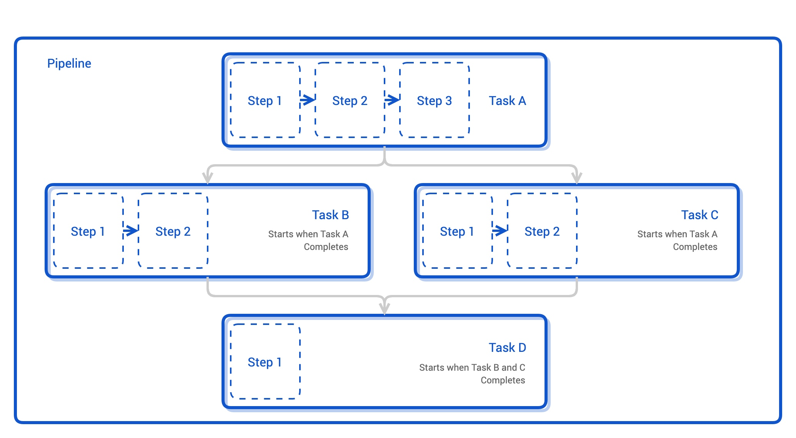

## Tekton介绍

### Tekton是什么

**Tekton 是 Kubernetes 原生的 CI/CD 框架**——它没有自己发明一套流水线引擎，而是把"构建、测试、发布"这件事完全建模成 K8s CRD：流水线的每个环节是一个 Pod，整套 CI/CD 就是一堆 CR 的声明式组合。这带来两个根本性优势：

- **无自有架构**：Jenkins 要维护 Master/Agent、GitLab CI 要维护 Runner，Tekton 的执行载体就是 K8s 本身——Task 一跑起来就是个 Pod，调度、弹性、日志、资源限制全部复用 K8s 现有能力，CI 系统本身零额外运维；
- **声明式可迁移**：流水线是 YAML 资源，跟 Deployment 一样走 Git 仓库、走 `kubectl apply`——CI 配置和业务配置用同一套范式管理，跨集群迁移就是导出资源再 apply。

代价也要认清：Tekton 只提供"执行框架"，PaaS 化程度低——没有 Jenkins 那种开箱界面和插件生态，Webhook 触发、可视化都要靠附加组件拼装。**它适合已经深度使用 K8s、想把 CI 也纳入声明式管理的团队；小团队要"上传即用"的 CI，Jenkins/GitLab CI 更省事**。

### 核心资源总览

Tekton 的资源分层非常清晰，按"从最小单元到完整流水线"理解它们的分工：

| 资源 | 管什么 | 一句话定位 |
| ---- | ---- | ---- |
| **StepAction** | 最小可复用步骤 | 可复用的"动作片段"，被 Task 引用 |
| **Task** | 一次具体工作 | 有序的步骤集合，如"构建"、"扫描"、"推镜像" |
| **Pipeline** | 完整流水线 | 多个 Task 按依赖编排，定义流程框架 |
| **TaskRun / PipelineRun** | 实际执行 | 定义不会跑，Run 才会跑——一次 Run 对应真实的 Pod |
| **Triggers** | 事件触发（扩展组件） | 接收 Webhook 等外部事件，自动创建 Run |

先建立一个贯穿全文的总括认知——**定义与执行分离**：

```text
资源定义（静态的"说明书"，不会自动执行）
    StepAction / Task / Pipeline
        ↓ 需要一个"Run"来实例化
实际执行（真正跑起来的 Pod）
    TaskRun（执行一个 Task） / PipelineRun（执行整条 Pipeline）
```

这类似 Jenkins 里 **Job 定义与"立即构建"的关系**：写好 Job 不代表构建发生，点一次"立即构建"才产生一次执行。Tekton 把这次"点击"也建模成了资源——TaskRun/PipelineRun，于是"哪次构建、传了什么参数、跑到什么状态"全部是集群里可查的 CR，历史记录天然持久化。

### StepAction：最小工作单元

StepAction 是 Tekton 中**最小的可执行单元**（较新版本中从 Task 的 Step 拆分而来的独立 CRD），定位是**可复用的动作片段**：把一段具体操作（如 `mvn clean install`、SonarQube 扫描）封装成独立资源，供多个 Task 引用。

```yaml
apiVersion: tekton.dev/v1
kind: StepAction
metadata:
  name: sonar-scan                        # 下面 Task 示例引用的就是这个 StepAction
spec:
  params:
  - name: app-name                        # StepAction 也可以声明参数接口
  image: sonarsource/sonar-scanner-cli:11 # 步骤运行所在的容器镜像
  command: ["sonar-scanner"]
  args: ["-Dsonar.projectKey=$(params.app-name)"]
```

但生产实践中有一句大实话：**StepAction 的复用收益常被高估**。它通常被 Task 调用，可多数团队发现直接在 Task 里写命令更省事——为每个小操作都抽一个 StepAction，会让资源数量膨胀、跳转链路变长，管理复杂度反而上升。建议只对**真正跨项目共享**的操作（如公司统一的代码扫描动作）抽 StepAction，其余直接写在 Task 里。

### Task：一次具体工作

Task 由多个有序的 Step 组成，Step 按**定义顺序串行执行**（本质是一个 Pod 里的多个容器，共享工作空间）。Step 有两种写法——直接写命令，或引用 StepAction：

```yaml
apiVersion: tekton.dev/v1
kind: Task
metadata:
  name: build-node-app
spec:
  params:
  - name: app-name
  workspaces:
  - name: source                          # 挂载代码的工作空间
  steps:
  - name: install                         # 写法一：直接写命令（生产主流写法）
    image: node:22
    workingDir: $(workspaces.source.path)
    script: npm ci && npm run build
  - name: scan                            # 写法二：引用上文的 sonar-scan StepAction（仅真正共享的动作）
    ref:
      name: sonar-scan
    params:                               # 引用 StepAction 时显式传参，和 Pipeline 传参给 Task 同一个套路
    - name: app-name
      value: $(params.app-name)
```

**实际开发的建议**：通常直接在 Task 里配置具体命令（写法一），避免过度拆分为 StepAction。Task 的划分粒度按"执行边界"切，串行和并行两种情况区别对待：

- **严格串行的步骤 → 合在一个 Task**：同一 Task 里的 Step 跑在同一个 Pod 内、共享文件系统，中间产物天然传递，不用为跨 Pod 传产物折腾 workspace——如"初始化 → 编译 → 制镜像"这类共享同一份源码的步骤；
- **需要并行或跨流水线复用的环节 → 拆成独立 Task**：每个 Task 独立成 Pod，状态、日志、重试、资源配额都按 Task 粒度可见，还能被多条流水线引用——如"构建""代码扫描""镜像推送"各一个 Task，Pipeline 层再编排它们的并行与依赖。

### Pipeline：流水线框架

Pipeline 是 CI/CD 的核心模块，**把多个 Task 按依赖关系编排成流程**：支持顺序执行（代码下载 → 构建 → 镜像制作 → 推送 → 部署），也支持并行编排（无依赖关系的 Task 自动同时跑）。



```yaml
apiVersion: tekton.dev/v1
kind: Pipeline
metadata:
  name: build-deploy-pipeline
spec:
  params:
  - name: repo-url                        # 参数接口：Pipeline 只定义"要什么"，不管"是什么"
  - name: image-repo
  - name: build-command                   # 构建命令也参数化：Go/Java/Node 服务传不同的值
  workspaces:
  - name: shared-workspace
  tasks:
  - name: fetch-source                    # ① 拉代码，所有后续 Task 的上游
    taskRef:
      name: git-clone
    workspaces:
    - name: output
      workspace: shared-workspace
    params:
    - name: url
      value: $(params.repo-url)
  - name: unit-test                       # ②③ 无依赖关系的 Task 自动并行
    taskRef: { name: run-tests }
    runAfter: [fetch-source]
    workspaces:
    - name: source
      workspace: shared-workspace
  - name: code-scan
    taskRef: { name: sonarqube-scan }     # 引用已定义的 Task（Task 内部可复用上文的 StepAction）
    runAfter: [fetch-source]
    workspaces:
    - name: source
      workspace: shared-workspace
  - name: build-image                     # ④ 等 ②③ 都完成才执行
    taskRef: { name: build-and-push }
    runAfter: [unit-test, code-scan]
    params:
    - name: image
      value: $(params.image-repo)
    - name: build-command                 # 框架不管构建命令是什么，透传给 Task 执行
      value: $(params.build-command)
    workspaces:
    - name: source
      workspace: shared-workspace
```

对照上图和上面的示例，Tekton 的编排语义可以浓缩成四条规则：

**① 按执行边界拆分，而非"一步一 Task"**。Task 的划分标准是执行边界，不是步骤数量：**需要并行执行、跨流水线复用、或独立排障定位的环节，拆成独立 Task**——每个 Task 独立成 Pod，**状态、日志、重试、资源配额都按 Task 粒度可见**，构建挂了能精确定位到是哪个环节，而不是翻一段几百行的混合日志（如上图的 unit-test 和 code-scan 要并行，就必须各自成 Task）；反之**严格串行、共享同一份源码和文件系统的步骤，合在一个 Task 里更简单**，同一 Pod 内中间产物天然传递，不必为跨 Pod 传产物折腾 workspace（前文 build-node-app 把 install 和 scan 写进一个 Task 只是为了演示两种 Step 写法；后文 go-build-push 四步合一个 Task 则是本原则的正面落地）。

**② 无依赖即并行**。没有声明依赖关系的 Task（如上图的 Task B 和 Task C）**自动并行执行**——示例里 unit-test 和 code-scan 都只依赖 fetch-source，二者同时跑能显著压缩流水线总时长。Tekton 不需要你写任何 parallel 关键字，"默认并行、显式声明串行"是它的编排哲学。

生产实例——某支付团队的发布流水线，fetch-source 之后三路并行：unit-test（约 8 分钟）、SonarQube 质量扫描（约 6 分钟）、Trivy 镜像层依赖安全扫描（约 12 分钟）。串行执行需 26 分钟，并行后总时长被压到最慢一路的 12 分钟，发布窗口内的流水线吞吐直接翻倍。这类"互不写同一份文件、只读共享源码"的校验类 Task 是并行的天然候选；反过来，build 和 deploy 这类有严格产出依赖的环节就老实用 runAfter 串行。另有一个并行场景的实打实的坑：并行 Task 若绑定**同一个 RWO PVC**，所有 Pod 必须落在同一节点（卷单节点挂载），节点故障时整条流水线的并行分支一起排队——要么给并行分支各绑独立 PVC，要么用支持 RWX 的存储。

**③ runAfter 显式控制顺序**。需要串行的 Task 用 `runAfter` 字段声明依赖（如示例的 build-image 等待 unit-test、code-scan 完成后才启动）。注意 runAfter 语义是"等它们**成功**"，这就引出第四条隐含规则——

**④ 失败沿依赖图截断**。任一 Task 失败，其下游全部终止：fetch-source 失败则测试/扫描都不会执行；unit-test 或 code-scan 任一失败则 build-image 不执行。这个语义与直觉一致——上游构建都没产出，跑下游测试毫无意义。失败位置之前的并行分支不受牵连，这让排障时一眼就能从 PipelineRun 状态里看出故障边界。

注意 Pipeline 的层级分工：**Task 里写"具体怎么做"，Pipeline 里写"按什么顺序做、参数怎么传"**——命令实现下沉在 Task，Pipeline 保持纯框架。

### Workspace：跨Step/Task的文件通道

同一个 Task 内的 Step 共享 Pod 文件系统，但**跨 Task 传文件必须走 workspace**——它是 Tekton 里跨 Step、跨 Task 共享文件的唯一正规通道。其设计精髓同样是"模板与实现分离"：Task/Pipeline 只声明"我需要一个叫 source 的工作空间"，**具体落到什么存储，由 Run 层绑定决定**。五种绑定载体，生命周期完全不同：

| 绑定载体 | 装什么 | 生命周期 | 典型用途 |
| ---- | ---- | ---- | ---- |
| `emptyDir` | 源码、编译产物 | 跟随 Pod，**跑完即删** | 每次构建从干净状态开始，无脏代码残留 |
| PVC | 缓存 | **跨 Run 复用** | 依赖/编译缓存，二次构建快数倍 |
| `volumeClaimTemplate` | 任意数据 | **每次 Run 自动新建一块独立 PVC** | 需要 Run 间隔离的持久存储（产物归档），避免互写污染；代价是要自行清理旧 PVC |
| secret | 凭证 | 常驻，只读挂载 | Git/镜像仓库凭证 |
| configmap | 构建配置 | 常驻，只读挂载 | 代理地址等易变配置，改配置不改模板 |

两条生产铁律：**凭证类 workspace 一律只读**（`readOnly: true`，防止脚本误写）；**RWO 的 PVC 要求所有挂载它的 Pod 落在同一节点**（在 Run 层用 nodeSelector 固定构建 Pod，后文实践会用到）。

### TaskRun与PipelineRun：让定义真正跑起来

Task/Pipeline 都只是资源定义，**不会自动触发任何执行**。要真正跑起来，必须创建对应的 Run 资源来实例化——TaskRun 执行一个 Task，PipelineRun 执行整条 Pipeline：

```yaml
apiVersion: tekton.dev/v1
kind: PipelineRun
metadata:
  name: order-service-run-42
spec:
  pipelineRef:
    name: build-deploy-pipeline           # 指向哪条流水线框架
  params:
  - name: repo-url
    value: https://git.example.com/order-service.git    # 注入运行时参数：这次跑的是谁
  - name: image-repo
    value: registry.example.com/order-service:v1.4.2
  - name: build-command
    value: go build ./...                 # 注入构建命令：Go 服务传这个，Java 服务传 mvn clean package
  workspaces:
  - name: shared-workspace
    volumeClaimTemplate:
      spec:
        accessModes: [ReadWriteOnce]
        resources: { requests: { storage: 5Gi } }
```

每个 TaskRun 对应一个真实 Pod，执行状态直接用 K8s 的方式查：

```bash
kubectl get pipelinerun order-service-run-42
kubectl get taskrun -l tekton.dev/pipeline=build-deploy-pipeline   # 看流水线下每个 Task 的执行状态
kubectl get pods | grep order-service-run-42          # 先拿到真实 Pod 名（末尾带随机后缀）
kubectl logs -f order-service-run-42-build-image-xxxxx   # 某个步骤的构建日志
```

### Triggers：事件驱动的扩展组件

到目前为止流水线还要手动创建 PipelineRun 才会跑。**Tekton Triggers** 补上事件驱动这一环：接收外部系统事件（最典型的是 Git 仓库的 Webhook——push、tag、PR），解析后自动创建 PipelineRun，实现"提交代码即触发构建"。它需要单独安装，由三个核心资源协作：

| 资源 | 职责 |
| ---- | ---- |
| **EventListener** | 部署一个接收 Webhook 的服务入口（对应一个 Pod + Service） |
| **TriggerBinding** | 从事件里抽取字段（如仓库名、分支、commit SHA） |
| **TriggerTemplate** | 拿抽取的字段渲染出 PipelineRun 模板并创建 |

```text
Git push ──Webhook──→ EventListener（收到事件）
                        ↓ TriggerBinding 抽取 repo/branch/commit
                        ↓ TriggerTemplate 渲染参数
                     自动创建 PipelineRun ──→ 流水线开跑
```

### CLI与Dashboard

**tkn** 是 Tekton 官方 CLI，覆盖创建/管理 Task、触发 Pipeline、跟踪日志、与集群内 Tekton 交互等日常操作。但生产建议是：**优先用 kubectl 管理 Tekton 资源**——因为 Task/Pipeline 本质就是 CRD，统一走 kubectl 意味着资源配置管理、跨环境迁移、声明式维护与业务资源同一套范式；tkn 的价值在交互式场景（`tkn pipelinerun logs -f` 跟日志确实比 kubectl 顺手），两者不冲突。

**Tekton Dashboard** 提供图形化界面：可视化查看 Task/Pipeline 配置、实时监控构建状态。对刚接触 Tekton 的团队，Dashboard 能显著降低学习曲线——排障时在页面上点开每个 Task 的状态和日志，比命令行翻 CR 直观得多；但它同样是可选组件，不影响核心链路。

## Tekton工作模式

资源分工和编排语义都清楚了，这一节看 Tekton 最值得记住的设计哲学——**为什么它是"模板 + 参数注入"而不是"每个项目一条流水线"**。

### 模板+参数注入：一套流水线服务所有项目

核心在于：**Pipeline 只定义流程框架**（build/test/package 等阶段），不包含任何具体命令实现——构建什么语言、用什么命令，全部通过预留的参数接口（`params`）在执行时注入。

以一个多语言微服务团队为例：Go、Java、Node.js 三种服务的构建命令天差地别，但**流程完全同构**（拉代码 → 构建 → 制镜像 → 推送 → 部署）。做法是：

```text
一条通用 Pipeline（框架，定义阶段顺序和参数接口）
    ├── PipelineRun#1：传 go build ./...       → Go 服务跑一遍
    ├── PipelineRun#2：传 mvn clean package    → Java 服务跑一遍
    └── PipelineRun#3：传 npm run build        → Node 服务跑一遍
```

**维护优势立现**：不为每个微服务维护独立 Pipeline，流程变更（比如加一道安全扫描）只改一处框架，所有服务下次执行自动生效；各服务的差异全部收敛在 PipelineRun 的参数里。这就是"分离 Pipeline 定义与 Runtime 参数"的精髓——**定义稳定复用，参数各跑各的**。

### 工作流程总结

把 Tekton 的标准用法串成一条线：

```text
① 创建 Task（按执行边界划分：串行共享的步骤合在一个 Task，需并行/复用的环节拆开）
        ↓
② 组合 Task 构建 Pipeline（流程框架：顺序/并行/参数接口）
        ↓
③ 创建 PipelineRun 实例化执行（注入运行时参数，触发真实 Pod）
        ↓ （可选）
④ 配置 Triggers，Webhook 事件自动创建 PipelineRun
```

设计哲学一句话：**"模板 + 参数注入"实现流程复用**——Pipeline 是稳定的模板，PipelineRun 是一次性的注入。这个模式正是为多语言、多版本的 CI/CD 场景而生：流程收敛为一处维护，差异全部参数化，规模越大复用收益越明显。


## 自动化构建go服务

### kaniko：容器里做镜像的构建工具
传统构建镜像（例如Jenkins）的方式是找一台装了 Docker 的机器跑 `docker build`：依赖常驻的 docker daemon（守护进程），且 build 时要挂载节点的 `docker.sock`——**等于把宿主机的 root 权限交给构建过程**，这在多租户的 K8s 集群里是不可接受的安全模型。

**kaniko 是 Google 开源的镜像构建工具，专门解决"没有 docker daemon 怎么构建镜像"**：它在普通容器内运行，直接解包基础镜像的文件层，按 Dockerfile 指令逐层追加文件，最后把新镜像推送到任意 registry（Harbor/Docker Hub 等）——**全程不碰 docker daemon、不需要特权容器、不需要挂 docker.sock**。这意味着"构建镜像"可以直接变成一个 Pod 里的一步，天然融入 Tekton 的"每步一个容器"模型。

使用直觉：把 kaniko 的官方镜像（`gcr.io/kaniko-project/executor`）当作 step 的 `image`，`args` 里给上 Dockerfile 路径、构建上下文和目标镜像地址，它就开始干活——下文 Task 里的 ④ kaniko 步骤就是原样照此使用。它还自带 `--cache` 选项，把镜像层缓存推回 registry 复用，代码没大改时构建能快到秒级。

### 流程总览

一条 Task 四步串行，代码从 GitLab 进、镜像从 Harbor 出：

```text
GitLab（私有代码仓库）                     Harbor（私有镜像仓库）
        │                                         ▲
        ▼ git clone                               │ docker push
┌──────────────────────────────────────────────────────┐
│ Task: go-build-push（一个 Pod 内四步串行）              │
│   ① git-clone  拉取源码（凭证来自 git-auth secret）     │
│   ② init       初始化构建环境（GOPROXY 来自 configmap） │
│   ③ build      go build（缓存落在共享 PVC）             │
│   ④ kaniko     依据 Dockerfile 制镜像并推送（凭证来自    │
│                 dockerconfig secret，无 docker daemon）│
└──────────────────────────────────────────────────────┘
```

四步合进一个 Task，正是前文 Task 粒度取舍的落地：四步共享同一份源码和构建环境，中间产物（编译好的二进制）在一个 Pod 内天然传递，无需并行、也无需跨流水线复用。

### workspace绑定：易失的源码，复用的缓存

概念层面 workspace 的五种载体见前文。这条流水线的五个插槽照此选型：**source** 用 `emptyDir` 装易失的源码和编译产物（跑完即删，无脏代码残留）；**cache** 用共享 PVC 装 GOMODCACHE / GOCACHE（跨 Run 复用，二次构建快数倍）；**git-auth / dockerconfig**（secret）和 **build-config**（configmap）只读挂载。先建凭证和配置：

```bash
# GitLab SSH 凭证：deploy key（只读权限）+ known_hosts（预置指纹，防交互式确认卡死）
# 本地生成 deploy key 加入 GitLab 仓库后，用 keyscan 生成 known_hosts，一并打进 secret
ssh-keyscan gitlab.example.com > known_hosts
kubectl create secret generic gitlab-auth -n ci \
  --from-file=ssh-key=id_ed25519 \
  --from-file=known_hosts=known_hosts

# Harbor 凭证：镜像仓库没有 SSH 一说——Registry API 走 HTTPS，认证就用 dockerconfigjson
# （docker-registry 是 secret 的子类型，kaniko 默认读取 /kaniko/.docker/）
kubectl create secret docker-registry harbor-auth -n ci \
  --docker-server=harbor.example.com \
  --docker-username=ci-bot \
  --docker-password=<harbor-robot-token>

# 构建配置：代理地址易变，放 configmap 而不是写死在 Task 里
kubectl create configmap build-config -n ci \
  --from-literal=goproxy=https://goproxy.cn,direct

# 缓存 PVC：Go 依赖 + 编译缓存的家
kubectl create -n ci -f - <<'EOF'
apiVersion: v1
kind: PersistentVolumeClaim
metadata:
  name: go-cache-pvc
spec:
  accessModes: [ReadWriteOnce]
  resources: { requests: { storage: 20Gi } }
EOF
```

### Task定义：四步串行

```yaml
apiVersion: tekton.dev/v1
kind: Task
metadata:
  name: go-build-push
spec:
  params:
  - name: git-repo          # 如 gitlab.example.com/team/go-demo.git
  - name: git-ref
    default: main
  - name: image-name        # 如 harbor.example.com/dev/go-demo
  - name: image-tag
  results:                  # 对外输出：镜像 digest（不可变），下游部署 Task 消费它而非 tag
  - name: image-digest
  workspaces:
  - name: source
  - name: cache
  - name: git-auth
    mountPath: /git-auth                      # SSH 凭证挂载点：deploy key + known_hosts
  - name: dockerconfig
    mountPath: /kaniko/.docker                # kaniko 默认凭证目录，挂上即可推送私有仓库
  - name: build-config
    mountPath: /build-config
  steps:
  - name: git-clone                           # ① 拉代码
    image: alpine/git:2.45
    resources:                                # 每个 step 都设资源限额，防止吃满 CI 节点
      requests: { cpu: 200m, memory: 128Mi }
      limits: { cpu: 500m, memory: 256Mi }
    script: |
      #!/bin/sh
      set -e
      # SSH 方式：deploy key + known_hosts 从 secret 落到 ~/.ssh，clone 走 git@ 协议
      mkdir -p $HOME/.ssh
      cp /git-auth/ssh-key $HOME/.ssh/id_ed25519
      cp /git-auth/known_hosts $HOME/.ssh/known_hosts
      chmod 600 $HOME/.ssh/id_ed25519        # 私钥权限必须是 600，ssh 会拒绝宽松权限
      git clone --depth 1 --branch $(params.git-ref) \
        git@$(params.git-repo) \
        $(workspaces.source.path)/src

  - name: init                                # ② 初始化
    image: golang:1.22
    workingDir: $(workspaces.source.path)/src
    resources:
      requests: { cpu: 200m, memory: 256Mi }
      limits: { cpu: "1", memory: 512Mi }
    script: |
      #!/bin/sh
      set -e
      go env -w GOPROXY=$(cat /build-config/goproxy)   # 配置来自 configmap，换代理只改 CM
      go env GOPROXY

  - name: build                               # ③ 构建（资源大户，限额要给足）
    image: golang:1.22
    workingDir: $(workspaces.source.path)/src
    resources:
      requests: { cpu: "1", memory: 1Gi }
      limits: { cpu: "2", memory: 2Gi }
    env:
    - name: GOMODCACHE
      value: $(workspaces.cache.path)/gomod   # 依赖缓存落共享 PVC
    - name: GOCACHE
      value: $(workspaces.cache.path)/gocache # 编译缓存同理，二次构建提速数倍
    script: |
      #!/bin/sh
      set -e
      go mod download                          # 首次慢（写缓存），此后秒级（命中缓存）
      go build -o $(workspaces.source.path)/artifacts/app ./...

  - name: kaniko                              # ④ 制镜像并推送
    image: gcr.io/kaniko-project/executor:v1.23.2
    resources:
      requests: { cpu: 500m, memory: 512Mi }
      limits: { cpu: "2", memory: 2Gi }
    command: ["/kaniko/executor"]
    args:
    - --dockerfile=$(workspaces.source.path)/src/Dockerfile
    - --context=$(workspaces.source.path)     # context 用 source 根目录，Dockerfile 直接 COPY artifacts/app
    - --destination=$(params.image-name):$(params.image-tag)
    - --digest-file=$(results.image-digest.path)   # 把不可变的 digest 写进 results，供下游引用
    - --cache=true                            # 镜像层缓存推回 Harbor，代码没大改时秒级出镜像
```

配套的 Dockerfile 极简（放在仓库根目录）：

```dockerfile
FROM alpine:3.20
COPY artifacts/app /app/app
ENTRYPOINT ["/app/app"]
```

**关键认知：编译为什么放在 Dockerfile 外面做？** 多阶段构建也能编译，但那时代码在 kaniko 的容器里跑，GOMODCACHE 无法指向我们的 cache workspace——**缓存红利全部丢失**。先在 build 步编译、产物经 workspace 传给 kaniko 只做 COPY，缓存才能落到 PVC。这是 Tekton 构建与 Dockerfile 多阶段构建的本质取舍。

下游 Task（扫描/部署）在 Pipeline 里编排为 `runAfter: [go-build-push]`，引用镜像时传 **digest 而非 tag**（`$(params.image-name)@$(tasks.go-build-push.results.image-digest)`）——tag 可被覆盖，digest 不可变，确保扫的严格就是刚构建的那个镜像。Pipeline 本体就是前文的透传套路，不再重复。

### PipelineRun：workspace绑定与节点固定

**模板与存储的解耦发生在 PipelineRun 的 workspace 绑定层**：

```yaml
apiVersion: tekton.dev/v1
kind: PipelineRun
metadata:
  generateName: go-demo-dev-          # generateName 自动生成唯一后缀，适合批量触发
spec:
  pipelineRef: { name: go-build-pipeline }   # 引用 Task 组成的 Pipeline（写法同前文，不再重复）
  params:
  - name: git-repo
    value: gitlab.example.com/team/go-demo.git
  - name: git-ref
    value: main
  - name: image-name
    value: harbor.example.com/dev/go-demo
  - name: image-tag
    value: a1b2c3d                      # git commit SHA（Trigger 从 webhook 注入），禁用 latest——tag 可被覆盖，digest 才不可变
  workspaces:
  - name: source
    emptyDir: {}                      # 源码+产物：Pod 一死即删
  - name: cache
    persistentVolumeClaim:
      claimName: go-cache-pvc         # 缓存：跨 Run 复用
  - name: git-auth
    secret: { secretName: gitlab-auth }
    readOnly: true                    # SSH 凭证（deploy key + known_hosts）一律只读，防止脚本误写
  - name: dockerconfig
    secret: { secretName: harbor-auth }
    readOnly: true
  - name: build-config
    configMap: { name: build-config }
    readOnly: true
  taskRunTemplate:
    podTemplate:
      nodeSelector:
        tekton-ci: "builder"          # 所有构建 Pod 固定到同一节点——RWO PVC 的前提，见下文
```

### 环境解耦：同一模板，dev/test两套注入

现在兑现前文"模板 + 参数注入"的承诺。Pipeline 和 Task 一行不改，**换环境只是 PipelineRun 换三个注入点**：

| 注入点 | dev 环境 | test 环境 |
| ---- | ---- | ---- |
| `image-name` | `harbor.example.com/dev/go-demo` | `harbor.example.com/test/go-demo` |
| `git-ref` | main / feature 分支 | release tag（如 v1.4.2） |
| `cache` PVC | `go-cache-pvc`（可按环境拆 PVC，防缓存互相污染） | `go-cache-pvc-test` |
| 触发方式 | push 到 main 自动触发（Triggers） | 手动 `kubectl apply` 或 merge 事件 |

```yaml
# test 环境的 PipelineRun，与 dev 版仅以下差异：
#   params.image-name → harbor.example.com/test/go-demo
#   params.git-ref    → v1.4.2
#   workspaces.cache  → persistentVolumeClaim: { claimName: go-cache-pvc-test }
```

这就是 workspace 作为"抽象插槽"的价值：**模板只声明"我需要一个缓存空间、一份凭证、一份配置"，绑定决定它们落在哪块 PVC、哪个 secret**。开发环境和测试环境用不同的存储后端、不同的凭证边界，模板零改动——存储和凭证的编排被完整地从流水线逻辑里剥离出来了。

## 补充

### Trivy：镜像安全扫描

**Trivy 是 Aqua 开源的漏洞与配置扫描器**——一个二进制搞定四类扫描：OS 包漏洞、语言依赖漏洞（go.sum/package-lock.json）、镜像内误植入的 secret、IaC 配置错误。Go 单二进制、无外部依赖，直接当 step 的 `image` 用，是 K8s CI 里事实上的扫描标准。

**什么时候用**：制镜像之后、部署之前做**门禁**——高危漏洞的镜像不允许进 Harbor 的生产项目。配合前文的 digest（sha256…，唯一标识镜像内容）传递链：build-push 出 digest → scan Task 扫 `image@digest` → 通过才轮到 deploy，保证"扫的就是要部署的那个镜像"。存量扫描是第二用途：用 CronJob 定期扫 Harbor 里已存的镜像（新 CVE 每天都在出），存量中招后只更新制品库版本即可复扫。

**怎么用**（作为扫描 Task 的核心 step）：

```yaml
- name: image-scan
  image: aquasec/trivy:0.55.0
  # 门禁参数说明：--exit-code 1 有命中即失败 → 下游 deploy 被截断；
  # 只对 CRITICAL/HIGH 拦截，LOW/MED 只报告；--ignore-unfixed 跳过无修复版本的漏洞，门禁才可长期执行
  script: |
    trivy image \
      --exit-code 1 \
      --severity CRITICAL,HIGH \
      --cache-dir $(workspaces.cache.path)/trivy \
      --ignore-unfixed \
      $(params.image-name)@$(params.image-digest)
```

### RWO与节点亲和：为什么所有Task要落到同一节点

前文铁律的展开。**RWO（ReadWriteOnce）的准确语义是"同一时刻只能被一个节点挂载"**——不是"一个 Pod"，是"一个节点"。因此当多个 TaskRun 的 Pod 共享同一块 RWO PVC（缓存 workspace）时，这些 Pod 必须全部落在同一节点，否则第二个跨节点的 Pod 会卡在 `ContainerCreating`（卷挂载失败），流水线假死等超时。

解法是 PipelineRun 层用 `taskRunTemplate.podTemplate` 把调度指令注入**所有** TaskRun 的 Pod：

```text
PipelineRun（taskRunTemplate.podTemplate.nodeSelector: tekton-ci=builder）
      ├── TaskRun#1 Pod ──┐
      ├── TaskRun#2 Pod ──┼── 全部落到 builder 节点 ──→ 共享 RWO cache PVC 正常挂载
      └── TaskRun#N Pod ──┘
```

这正好顺带解决了另一个问题：**Go 编译缓存命中靠的是 CPU 本地盘和文件时间戳，跨节点调度等于缓存全废**——固定节点让 PVC 缓存真正"值得复用"。

生产细节有三条。**其一**，`nodeSelector` 是硬约束的粗粒度写法；要"优先固定、装不下再散"用 `nodeAffinity` 的 `preferredDuringScheduling`——但缓存场景建议保持硬约束，散到无 PVC 的节点缓存就失效了。**其二**，固定节点是单点：builder 节点 NotReady 时所有流水线 PodPending。对策是给 CI 节点组打 taint 专用隔离 + 监控告警，故障时改 PipelineRun 的 nodeSelector 指向备用节点。**其三**，规模化后单节点扛不住并发构建时，按"节点 = 缓存池"扩容：N 个 builder 节点各配独立 PVC，PipelineRun 按 hash 分桶绑定（节点 A 配 cache-a），或换 RWX 存储类（CephFS/NFS）彻底解耦——代价是 RWX 性能和运维复杂度，中小规模不值得。

### 其他生产细节

- **失败重试**：在 Pipeline 的 task 条目上配 `retries: 3`，只值得配在"网络抖动型"步骤（git clone、推镜像、下载依赖）——确定性失败（编译错误、测试断言）配重试只是拖延反馈，纯浪费资源。
- **超时兜底**：PipelineRun `spec.timeout: 30m` 必配。没有它，卡死的流水线会一直占着节点资源（Pod Running 但无进展），CI 越跑越慢。
- **finally 收尾**：Pipeline 的 `finally` 段定义的 Task 无论成败都执行——发 IM 通知、上报 metrics、清理临时资源都放这里，避免在业务 Task 里写"失败了怎么办"。
- **Run 历史清理**：每次 Run 都是 etcd 里的 CR，量大后 List/Patch 变慢。生产惯例是用 CronJob 定期执行 `tkn pipelinerun delete --keep 50 --force`（或按 label 批量删 TaskRun），只保留近期历史。