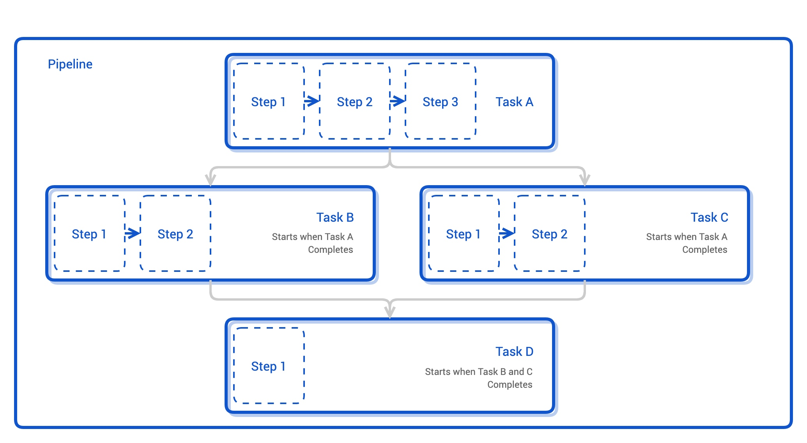

## Tekton介绍

### Tekton是什么

**Tekton 是 Kubernetes 原生的 CI/CD 框架**——它没有自己发明一套流水线引擎，而是把"构建、测试、发布"这件事完全建模成 K8s CRD：流水线的每个环节是一个 Pod，整套 CI/CD 就是一堆 CR 的声明式组合。这带来两个根本性优势：

- **无自有架构**：Jenkins 要维护 Master/Agent、GitLab CI 要维护 Runner，Tekton 的执行载体就是 K8s 本身——Task 一跑起来就是个 Pod，调度、弹性、日志、资源限制全部复用 K8s 现有能力，CI 系统本身零额外运维；
- **声明式可迁移**：流水线是 YAML 资源，跟 Deployment 一样走 Git 仓库、走 `kubectl apply`——CI 配置和业务配置用同一套范式管理，跨集群迁移就是导出资源再 apply。

代价也要认清：Tekton 只提供"执行框架"，PaaS 化程度低——没有 Jenkins 那种开箱界面和插件生态，Webhook 触发、可视化都要靠附加组件拼装。**它适合已经深度使用 K8s、想把 CI 也纳入声明式管理的团队；小团队要"上传即用"的 CI，Jenkins/GitLab CI 更省事**。

### 核心资源总览

Tekton 的资源分层非常清晰，按"从最小单元到完整流水线"理解它们的分工：

| 资源 | 管什么 | 一句话定位 |
| ---- | ---- | ---- |
| **StepAction** | 最小可复用步骤 | 可复用的"动作片段"，被 Task 引用 |
| **Task** | 一次具体工作 | 有序的步骤集合，如"构建"、"扫描"、"推镜像" |
| **Pipeline** | 完整流水线 | 多个 Task 按依赖编排，定义流程框架 |
| **TaskRun / PipelineRun** | 实际执行 | 定义不会跑，Run 才会跑——一次 Run 对应真实的 Pod |
| **Triggers** | 事件触发（扩展组件） | 接收 Webhook 等外部事件，自动创建 Run |

先建立一个贯穿全文的总括认知——**定义与执行分离**：

```text
资源定义（静态的"说明书"，不会自动执行）
    StepAction / Task / Pipeline
        ↓ 需要一个"Run"来实例化
实际执行（真正跑起来的 Pod）
    TaskRun（执行一个 Task） / PipelineRun（执行整条 Pipeline）
```

这类似 Jenkins 里 **Job 定义与"立即构建"的关系**：写好 Job 不代表构建发生，点一次"立即构建"才产生一次执行。Tekton 把这次"点击"也建模成了资源——TaskRun/PipelineRun，于是"哪次构建、传了什么参数、跑到什么状态"全部是集群里可查的 CR，历史记录天然持久化。

### StepAction：最小工作单元

StepAction 是 Tekton 中**最小的可执行单元**（较新版本中从 Task 的 Step 拆分而来的独立 CRD），定位是**可复用的动作片段**：把一段具体操作（如 `mvn clean install`、SonarQube 扫描）封装成独立资源，供多个 Task 引用。

```yaml
apiVersion: tekton.dev/v1
kind: StepAction
metadata:
  name: sonar-scan                        # 下面 Task 示例引用的就是这个 StepAction
spec:
  params:
  - name: app-name                        # StepAction 也可以声明参数接口
  image: sonarsource/sonar-scanner-cli:11 # 步骤运行所在的容器镜像
  command: ["sonar-scanner"]
  args: ["-Dsonar.projectKey=$(params.app-name)"]
```

但生产实践中有一句大实话：**StepAction 的复用收益常被高估**。它通常被 Task 调用，可多数团队发现直接在 Task 里写命令更省事——为每个小操作都抽一个 StepAction，会让资源数量膨胀、跳转链路变长，管理复杂度反而上升。建议只对**真正跨项目共享**的操作（如公司统一的代码扫描动作）抽 StepAction，其余直接写在 Task 里。

### Task：一次具体工作

Task 由多个有序的 Step 组成，Step 按**定义顺序串行执行**（运行模型见下一节）。Step 有两种写法——直接写命令，或引用 StepAction：

```yaml
apiVersion: tekton.dev/v1
kind: Task
metadata:
  name: build-node-app
spec:
  params:
  - name: app-name
  workspaces:
  - name: source                          # 挂载代码的工作空间
  steps:
  - name: install                         # 写法一：直接写命令（生产主流写法）
    image: node:22
    workingDir: $(workspaces.source.path)
    script: npm ci && npm run build
  - name: scan                            # 写法二：引用上文的 sonar-scan StepAction（仅真正共享的动作）
    ref:
      name: sonar-scan
    params:                               # 引用 StepAction 时显式传参，和 Pipeline 传参给 Task 同一个套路
    - name: app-name
      value: $(params.app-name)
```

**实际开发的建议**：通常直接在 Task 里配置具体命令（写法一），避免过度拆分为 StepAction。Task 的划分粒度按"执行边界"切，串行和并行两种情况区别对待：

- **严格串行的步骤 → 合在一个 Task**：同一 Task 里的 Step 跑在同一个 Pod 内、共享文件系统，中间产物天然传递，不用为跨 Pod 传产物折腾 workspace——如"初始化 → 编译 → 制镜像"这类共享同一份源码的步骤；
- **需要并行或跨流水线复用的环节 → 拆成独立 Task**：每个 Task 独立成 Pod，状态、日志、重试、资源配额都按 Task 粒度可见，还能被多条流水线引用——如"构建""代码扫描""镜像推送"各一个 Task，Pipeline 层再编排它们的并行与依赖。

### 执行模型：Step、容器与 Pod 的关系

上面反复说"一个 Task 就是一个 Pod"，这里把它拆开讲透——这是理解"Step 间为什么能直接传文件"和"Pod 挂了为什么还能看日志"的地基。Tekton 里一个 Task 的每一个 step，都对应 Pod 内部的**一个独立容器**，临时、串行执行，整个 Pod 的生命周期和 TaskRun 绑定。

核心机制四条：

1. **1 个 TaskRun = 1 个 Pod**：Tekton 不会为每个 step 单独创建 Pod，所有 step 都运行在同一个 Pod 内。
2. **1 个 step = 1 个容器**：Pod 中会为每个 step 生成一个名为 `step-<step名称>` 的容器（如 `step-git-clone`），按 Task 定义的顺序**串行执行**——上一个 step 容器执行完毕并退出后，下一个 step 容器才会启动，而非同时运行。所以 `kubectl logs <pod> -c step-build` 能单独拿到某一步的输出。
3. **临时性**：每个 step 容器只在自身执行阶段存活，命令执行完成就立刻退出。整个 Task 跑完后 Pod 标记为 Completed——注意 **Tekton 默认保留这个 Pod**，就是为了让你事后翻最后失败那步的日志（下文 kubectl logs 的排障用法正依赖这一点）；清理是显式动作：删 TaskRun 时靠 ownerReference 级联删 Pod。
4. **资源共享**：所有 step 容器共享同一个 Pod 的网络命名空间、IPC，以及通过 workspace 挂载的存储卷——前一个 step 写进卷的文件，后一个 step 从同一路径直接读取。

这四条直接解释了两个高频疑问：为什么"串行共享的步骤要合在一个 Task"（第 1、4 条：同 Pod 共享卷，中间产物免传递），以及为什么 Pod 是排障的最小单位（第 2、3 条：日志按容器切分、Pod Completed 后仍可回看）。

### Pipeline：流水线框架

Pipeline 是 CI/CD 的核心模块，**把多个 Task 按依赖关系编排成流程**：支持顺序执行（代码下载 → 构建 → 镜像制作 → 推送 → 部署），也支持并行编排（无依赖关系的 Task 自动同时跑）。



```yaml
apiVersion: tekton.dev/v1
kind: Pipeline
metadata:
  name: build-deploy-pipeline
spec:
  params:
  - name: repo-url                        # 参数接口：Pipeline 只定义"要什么"，不管"是什么"
  - name: image-repo
  - name: build-command                   # 构建命令也参数化：Go/Java/Node 服务传不同的值
  workspaces:
  - name: shared-workspace
  tasks:
  - name: fetch-source                    # ① 拉代码，所有后续 Task 的上游
    taskRef:
      name: git-clone
    workspaces:
    - name: output
      workspace: shared-workspace
    params:
    - name: url
      value: $(params.repo-url)
  - name: unit-test                       # ②③ 无依赖关系的 Task 自动并行
    taskRef: { name: run-tests }
    runAfter: [fetch-source]
    workspaces:
    - name: source
      workspace: shared-workspace
  - name: code-scan
    taskRef: { name: sonarqube-scan }     # 引用已定义的 Task（Task 内部可复用上文的 StepAction）
    runAfter: [fetch-source]
    workspaces:
    - name: source
      workspace: shared-workspace
  - name: build-image                     # ④ 等 ②③ 都完成才执行
    taskRef: { name: build-and-push }
    runAfter: [unit-test, code-scan]
    params:
    - name: image
      value: $(params.image-repo)
    - name: build-command                 # 框架不管构建命令是什么，透传给 Task 执行
      value: $(params.build-command)
    workspaces:
    - name: source
      workspace: shared-workspace
```

对照上图和上面的示例，Tekton 的编排语义可以浓缩成四条规则：

**① 按执行边界拆分，而非"一步一 Task"**。Task 的划分标准是执行边界，不是步骤数量：**需要并行执行、跨流水线复用、或独立排障定位的环节，拆成独立 Task**——每个 Task 独立成 Pod，**状态、日志、重试、资源配额都按 Task 粒度可见**，构建挂了能精确定位到是哪个环节，而不是翻一段几百行的混合日志（如上图的 unit-test 和 code-scan 要并行，就必须各自成 Task）；反之**严格串行、共享同一份源码和文件系统的步骤，合在一个 Task 里更简单**，同一 Pod 内中间产物天然传递，不必为跨 Pod 传产物折腾 workspace（前文 build-node-app 把 install 和 scan 写进一个 Task 只是为了演示两种 Step 写法；后文 go-build-push 四步合一个 Task 则是本原则的正面落地）。

**② 无依赖即并行**。没有声明依赖关系的 Task（如上图的 Task B 和 Task C）**自动并行执行**——示例里 unit-test 和 code-scan 都只依赖 fetch-source，二者同时跑能显著压缩流水线总时长。Tekton 不需要你写任何 parallel 关键字，"默认并行、显式声明串行"是它的编排哲学。

生产实例——某支付团队的发布流水线，fetch-source 之后三路并行：unit-test（约 8 分钟）、SonarQube 质量扫描（约 6 分钟）、Trivy 镜像层依赖安全扫描（约 12 分钟）。串行执行需 26 分钟，并行后总时长被压到最慢一路的 12 分钟，发布窗口内的流水线吞吐直接翻倍。这类"互不写同一份文件、只读共享源码"的校验类 Task 是并行的天然候选；反过来，build 和 deploy 这类有严格产出依赖的环节就老实用 runAfter 串行。另有一个并行场景的实打实的坑：并行 Task 若绑定**同一个 RWO PVC**，所有 Pod 必须落在同一节点（卷单节点挂载），节点故障时整条流水线的并行分支一起排队——要么给并行分支各绑独立 PVC，要么用支持 RWX 的存储。

**③ runAfter 显式控制顺序**。需要串行的 Task 用 `runAfter` 字段声明依赖（如示例的 build-image 等待 unit-test、code-scan 完成后才启动）。注意 runAfter 语义是"等它们**成功**"，这就引出第四条隐含规则——

**④ 失败沿依赖图截断**。任一 Task 失败，其下游全部终止：fetch-source 失败则测试/扫描都不会执行；unit-test 或 code-scan 任一失败则 build-image 不执行。这个语义与直觉一致——上游构建都没产出，跑下游测试毫无意义。失败位置之前的并行分支不受牵连，这让排障时一眼就能从 PipelineRun 状态里看出故障边界。

注意 Pipeline 的层级分工：**Task 里写"具体怎么做"，Pipeline 里写"按什么顺序做、参数怎么传"**——命令实现下沉在 Task，Pipeline 保持纯框架。

### Workspace：跨Step/Task的文件通道

同一个 Task 内的 Step 共享 Pod 文件系统，但**跨 Task 传文件必须走 workspace**——它是 Tekton 里跨 Step、跨 Task 共享文件的唯一正规通道。

**workspace 到底是什么**：它本质上是**对 K8s Volume 的声明式抽象**，整个生命周期分三层落地：

```text
① 声明（Task/Pipeline 层）：只写"我需要一个叫 source 的工作空间"，不指定任何存储
      ↓ ② 绑定（Run 层）：把插槽落实成一个具体的 K8s Volume（emptyDir/PVC/secret/configmap…）
      ↓ ③ 挂载（Tekton 执行层）：卷被挂进本次 Run 的 Pod，Step 内用 $(workspaces.source.path) 这个路径读写
```

由此得到"传文件"的全部机制：**跨 Task 传文件 = 多个 Task 引用同一个 workspace、最终挂到同一块卷上**——fetch Task 写进卷，build Task 从同一个路径读出，所谓"通道"没有更多魔法。注意 emptyDir 是例外：它跟着 Pod 走，**每个 TaskRun 的 Pod 各拿一份、不跨 Task**（官方因此建议 Pipeline 级共享用 PVC）。

其设计精髓同样是"模板与实现分离"：Task/Pipeline 只声明"我需要一个叫 source 的工作空间"，**具体落到什么存储，由 Run 层绑定决定**。五种绑定载体，生命周期完全不同：

| 绑定载体 | 装什么 | 生命周期 | 典型用途 |
| ---- | ---- | ---- | ---- |
| `emptyDir` | 源码、编译产物 | 跟随 Pod，**跑完即删** | 每次构建从干净状态开始，无脏代码残留 |
| PVC | 缓存 | **跨 Run 复用** | 依赖/编译缓存，二次构建快数倍 |
| `volumeClaimTemplate` | 任意数据 | **每次 Run 自动新建一块独立 PVC** | 需要 Run 间隔离的持久存储（产物归档），避免互写污染；代价是要自行清理旧 PVC |
| secret | 凭证 | 常驻，只读挂载 | Git/镜像仓库凭证 |
| configmap | 构建配置 | 常驻，只读挂载 | 代理地址等易变配置，改配置不改模板 |

两条生产铁律：**凭证类 workspace 一律只读**（`readOnly: true`，防止脚本误写）；**RWO 的 PVC 要求所有挂载它的 Pod 落在同一节点**（在 Run 层用 nodeSelector 固定构建 Pod，后文实践会用到）。

**tmpfs 加速：把易失工作区搬进内存**。emptyDir 默认落在节点磁盘，绑定时加一行就能换成内存盘——K8s 的 emptyDir 原生支持 `medium: Memory`（即 tmpfs），Tekton 的 emptyDir 绑定直接透传这个字段：

```yaml
workspaces:
- name: source
  emptyDir:
    medium: Memory          # 底层换成 tmpfs（内存），读写不再经过磁盘
    sizeLimit: 1Gi          # 必须给上限：tmpfs 占用计入 Pod 内存配额，不设限可能把节点内存打满
```

**适用场景**（共同点：数据易失、但 I/O 是瓶颈）：

- **小文件密集的热工作区**：Go 的 GOCACHE、node_modules、ccache 这类上万个小文件的编译缓存，瓶颈常在磁盘随机 I/O 而不是 CPU，搬进内存后编译/测试提速明显；
- **不想留痕的敏感临时数据**：tmpfs 只存在于内存，Pod 一死什么都不剩——处理临时凭证、密钥材料比落盘干净，节点磁盘上也不会有残留。

**代价与边界**：① tmpfs 用的是**节点内存**，占用计入所在容器的 memory limits，给工作区设了 1Gi 的 sizeLimit，就要同步把 step 的 memory limit 留出余量，否则直接 OOMKill；② 它和普通 emptyDir 一样**跟 Pod 走、跑完即删**，跨 Run 复用的依赖缓存依然只能靠 PVC——tmpfs 管"单次 Run 内的热数据"，别拿它装跨 Run 缓存；③ 附带的好处：tmpfs 不是 PVC，**没有 RWO 同节点约束**（见后文 RWO 一节），并行 Task 各自绑独立 tmpfs 即可自由跨节点调度。

### TaskRun与PipelineRun：让定义真正跑起来

Task/Pipeline 都只是资源定义，**不会自动触发任何执行**。要真正跑起来，必须创建对应的 Run 资源来实例化——TaskRun 执行一个 Task，PipelineRun 执行整条 Pipeline：

```yaml
apiVersion: tekton.dev/v1
kind: PipelineRun
metadata:
  name: order-service-run-42
spec:
  pipelineRef:
    name: build-deploy-pipeline           # 指向哪条流水线框架
  params:
  - name: repo-url
    value: https://git.example.com/order-service.git    # 注入运行时参数：这次跑的是谁
  - name: image-repo
    value: registry.example.com/order-service:v1.4.2
  - name: build-command
    value: go build ./...                 # 注入构建命令：Go 服务传这个，Java 服务传 mvn clean package
  workspaces:
  - name: shared-workspace
    volumeClaimTemplate:
      spec:
        accessModes: [ReadWriteOnce]
        resources: { requests: { storage: 5Gi } }
```

**一次 TaskRun 的底层全过程**：把 `kubectl create taskrun` 之后、看到 Pod Running 之前发生的事拆开，全链路是这样的：

```text
① kubectl ──HTTP──> apiserver
                      ├─ 准入校验：CRD schema 合法吗、参数/必需 workspace 给了吗
                      └─ 写入 etcd（Run 的唯一持久化，此后一切状态都从这里长出来）

② TaskRun controller（watch/informer，常驻 Pod：tekton-pipelines-controller）
                      ├─ 监听到新 TaskRun → 读它引用的 Task 定义
                      ├─ reconcile：注入 params、解析 StepAction 引用
                      └─ 绑定 workspace：volumeClaimTemplate 先经 apiserver 建出 PVC
                                            ↓ 再请求 apiserver
③                    创建 1 个 Pod（step 容器按 Task 定义生成）
                                            ↓
④ scheduler          评估资源/亲和 → 绑定节点（写回 apiserver）
                                            ↓
⑤ kubelet（选中节点） watch 到 Pod → 拉镜像 → CRI/containerd 起容器
                      init 容器 → step-X 容器①②③…串行执行
                                            ↓ 容器状态实时
⑥                    kubelet ──status 子资源──> apiserver ──> controller 观察到
                      controller 把结果 patch 回 TaskRun.status（conditions、results）
                                            ↓ 若是 PipelineRun 发起的
⑦                    PipelineRun controller watch 到该 TaskRun Completed
                      → 按依赖图启动下一个 TaskRun（回到②）
``` 

### Triggers：事件驱动的扩展组件

到目前为止流水线还要手动创建 PipelineRun 才会跑。**Tekton Triggers** 补上事件驱动这一环：接收外部系统事件（最典型的是 Git 仓库的 Webhook——push、tag、PR），解析后自动创建 PipelineRun，实现"提交代码即触发构建"。它需要单独安装，由三个核心资源协作：

| 资源 | 职责 |
| ---- | ---- |
| **EventListener** | 部署一个接收 Webhook 的服务入口（对应一个 Pod + Service） |
| **TriggerBinding** | 从事件里抽取字段（如仓库名、分支、commit SHA） |
| **TriggerTemplate** | 拿抽取的字段渲染出 PipelineRun 模板并创建 |

```text
Git push ──Webhook──→ EventListener（收到事件）
                        ↓ TriggerBinding 抽取 repo/branch/commit
                        ↓ TriggerTemplate 渲染参数
                     自动创建 PipelineRun ──→ 流水线开跑
```

### CLI与Dashboard

**tkn** 是 Tekton 官方 CLI，覆盖创建/管理 Task、触发 Pipeline、跟踪日志、与集群内 Tekton 交互等日常操作。但生产建议是：**优先用 kubectl 管理 Tekton 资源**——因为 Task/Pipeline 本质就是 CRD，统一走 kubectl 意味着资源配置管理、跨环境迁移、声明式维护与业务资源同一套范式；tkn 的价值在交互式场景（`tkn pipelinerun logs -f` 跟日志确实比 kubectl 顺手），两者不冲突。

**Tekton Dashboard** 提供图形化界面：可视化查看 Task/Pipeline 配置、实时监控构建状态。对刚接触 Tekton 的团队，Dashboard 能显著降低学习曲线——排障时在页面上点开每个 Task 的状态和日志，比命令行翻 CR 直观得多；但它同样是可选组件，不影响核心链路。

## Tekton工作模式

资源分工和编排语义都清楚了，这一节看 Tekton 最值得记住的设计哲学——**为什么它是"模板 + 参数注入"而不是"每个项目一条流水线"**。

### 模板+参数注入：一套流水线服务所有项目

核心在于：**Pipeline 只定义流程框架**（build/test/package 等阶段），不包含任何具体命令实现——构建什么语言、用什么命令，全部通过预留的参数接口（`params`）在执行时注入。

以一个多语言微服务团队为例：Go、Java、Node.js 三种服务的构建命令天差地别，但**流程完全同构**（拉代码 → 构建 → 制镜像 → 推送 → 部署）。做法是：

```text
一条通用 Pipeline（框架，定义阶段顺序和参数接口）
    ├── PipelineRun#1：传 go build ./...       → Go 服务跑一遍
    ├── PipelineRun#2：传 mvn clean package    → Java 服务跑一遍
    └── PipelineRun#3：传 npm run build        → Node 服务跑一遍
```

**维护优势立现**：不为每个微服务维护独立 Pipeline，流程变更（比如加一道安全扫描）只改一处框架，所有服务下次执行自动生效；各服务的差异全部收敛在 PipelineRun 的参数里。这就是"分离 Pipeline 定义与 Runtime 参数"的精髓——**定义稳定复用，参数各跑各的**。

### 工作流程总结

把 Tekton 的标准用法串成一条线：

```text
① 创建 Task（按执行边界划分：串行共享的步骤合在一个 Task，需并行/复用的环节拆开）
        ↓
② 组合 Task 构建 Pipeline（流程框架：顺序/并行/参数接口）
        ↓
③ 创建 PipelineRun 实例化执行（注入运行时参数，触发真实 Pod）
        ↓ （可选）
④ 配置 Triggers，Webhook 事件自动创建 PipelineRun
```

设计哲学一句话：**"模板 + 参数注入"实现流程复用**——Pipeline 是稳定的模板，PipelineRun 是一次性的注入。这个模式正是为多语言、多版本的 CI/CD 场景而生：流程收敛为一处维护，差异全部参数化，规模越大复用收益越明显。

## 补充

### Trivy：镜像安全扫描

**Trivy 是 Aqua 开源的漏洞与配置扫描器**——一个二进制搞定四类扫描：OS 包漏洞、语言依赖漏洞（go.sum/package-lock.json）、镜像内误植入的 secret、IaC 配置错误。Go 单二进制、无外部依赖，直接当 step 的 `image` 用，是 K8s CI 里事实上的扫描标准。

**什么时候用**：制镜像之后、部署之前做**门禁**——高危漏洞的镜像不允许进 Harbor 的生产项目。配合前文的 digest（sha256…，唯一标识镜像内容）传递链：build-push 出 digest → scan Task 扫 `image@digest` → 通过才轮到 deploy，保证"扫的就是要部署的那个镜像"。存量扫描是第二用途：用 CronJob 定期扫 Harbor 里已存的镜像（新 CVE 每天都在出），存量中招后只更新制品库版本即可复扫。

**怎么用**（作为扫描 Task 的核心 step）：

```yaml
- name: image-scan
  image: aquasec/trivy:0.55.0
  # 门禁参数说明：--exit-code 1 有命中即失败 → 下游 deploy 被截断；
  # 只对 CRITICAL/HIGH 拦截，LOW/MED 只报告；--ignore-unfixed 跳过无修复版本的漏洞，门禁才可长期执行
  script: |
    trivy image \
      --exit-code 1 \
      --severity CRITICAL,HIGH \
      --cache-dir $(workspaces.cache.path)/trivy \
      --ignore-unfixed \
      $(params.image-name)@$(params.image-digest)
```

### RWO与节点亲和：为什么所有Task要落到同一节点

前文铁律的展开。**RWO（ReadWriteOnce）的准确语义是"同一时刻只能被一个节点挂载"**——不是"一个 Pod"，是"一个节点"。因此当多个 TaskRun 的 Pod 共享同一块 RWO PVC（缓存 workspace）时，这些 Pod 必须全部落在同一节点，否则第二个跨节点的 Pod 会卡在 `ContainerCreating`（卷挂载失败），流水线假死等超时。

解法是 PipelineRun 层用 `taskRunTemplate.podTemplate` 把调度指令注入**所有** TaskRun 的 Pod：

```text
PipelineRun（taskRunTemplate.podTemplate.nodeSelector: tekton-ci=builder）
      ├── TaskRun#1 Pod ──┐
      ├── TaskRun#2 Pod ──┼── 全部落到 builder 节点 ──→ 共享 RWO cache PVC 正常挂载
      └── TaskRun#N Pod ──┘
```

这正好顺带解决了另一个问题：**Go 编译缓存命中靠的是 CPU 本地盘和文件时间戳，跨节点调度等于缓存全废**——固定节点让 PVC 缓存真正"值得复用"。

生产细节有三条。**其一**，`nodeSelector` 是硬约束的粗粒度写法；要"优先固定、装不下再散"用 `nodeAffinity` 的 `preferredDuringScheduling`——但缓存场景建议保持硬约束，散到无 PVC 的节点缓存就失效了。**其二**，固定节点是单点：builder 节点 NotReady 时所有流水线 PodPending。对策是给 CI 节点组打 taint 专用隔离 + 监控告警，故障时改 PipelineRun 的 nodeSelector 指向备用节点。**其三**，规模化后单节点扛不住并发构建时，按"节点 = 缓存池"扩容：N 个 builder 节点各配独立 PVC，PipelineRun 按 hash 分桶绑定（节点 A 配 cache-a），或换 RWX 存储类（CephFS/NFS）彻底解耦——代价是 RWX 性能和运维复杂度，中小规模不值得。

### 其他生产细节

- **失败重试**：在 Pipeline 的 task 条目上配 `retries: 3`，只值得配在"网络抖动型"步骤（git clone、推镜像、下载依赖）——确定性失败（编译错误、测试断言）配重试只是拖延反馈，纯浪费资源。
- **超时兜底**：PipelineRun `spec.timeout: 30m` 必配。没有它，卡死的流水线会一直占着节点资源（Pod Running 但无进展），CI 越跑越慢。
- **finally 收尾**：Pipeline 的 `finally` 段定义的 Task 无论成败都执行——发 IM 通知、上报 metrics、清理临时资源都放这里，避免在业务 Task 里写"失败了怎么办"。
- **Run 历史清理**：每次 Run 都是 etcd 里的 CR，量大后 List/Patch 变慢。生产惯例是用 CronJob 定期执行 `tkn pipelinerun delete --keep 50 --force`（或按 label 批量删 TaskRun），只保留近期历史。