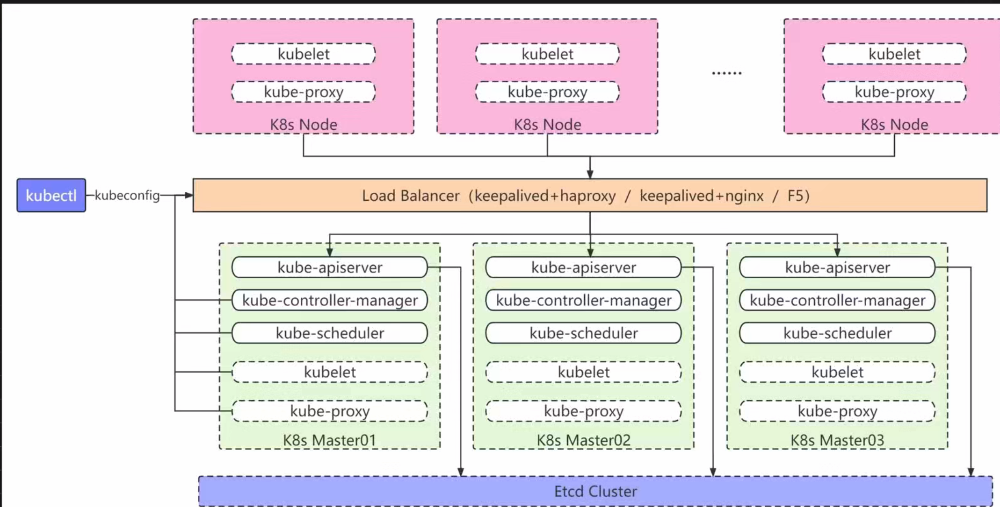

## 整体架构：高可用到底解决什么问题

先看一张典型的企业级 k8s 高可用架构图：



整个架构从上到下分四层，每一层解决的问题都不一样：

| 层 | 组件 | 解决的问题 |
| ---- | ---- | ---- |
| 接入层 | keepalived + nginx（VIP） | apiserver 有 3 个副本，客户端到底连谁？ |
| 控制层 | 3 × Master（apiserver / controller-manager / scheduler） | 控制平面单点故障 |
| 数据层 | Etcd 集群（3 或 5 节点） | 集群"状态"的持久化，丢了 etcd 等于丢了整个集群 |
| 工作层 | N × Node（kubelet / kube-proxy） | 真正跑业务的地方，坏了不影响集群控制面 |

**高可用的核心矛盾在接入层**：apiserver 可以多副本，controller-manager 和 scheduler 自身有选主机制（多副本只有Leader在干活），etcd 靠 Raft 保证一致性——但客户端（kubectl、kubelet、controller）需要一个**永远不变的入口地址**。总不能在每台 kubelet 的配置里写"连 192.168.0.11 失败了就换 192.168.0.12"。

解法就是架构图中间那条橙色横条：**Load Balancer (keepalived + nginx)**。在生产上最常用的组合是：

- **keepalived**：负责一个虚拟 IP（VIP）在三台机器之间漂移，VIP 永远指向活着的机器；
- **nginx**：监听 VIP 上的 6443 端口，把流量反向代理到三台 apiserver。

两个组件都**直接部署在 3 台 master 上**，不额外加机器。kubeconfig 里写的 server 地址永远是 `https://192.168.0.100:6443`（假设这是 VIP），后面哪台 master 挂了都无感。

顺带说下 F5：金融、运营商这类传统企业确实有，一台几十万，稳是稳，但互联网公司基本用软件方案——keepalived + nginx/haproxy 零成本达到同等效果，为什么不用。

### 重点：keepalived 的原理（VRRP）

keepalived 本质是 **VRRP 协议（Virtual Router Redundancy Protocol，RFC 2338）的用户态实现**，加上一套自己的健康检查框架。

#### 组播
VRRP 通告的默认投递方式是组播，讲 keepalived 之前先把组播本身说清。网络通信按「一个发送方对应几个接收方」分三类：

| 方式 | 地址形态 | 一份数据的投递 | 典型例子 |
| ---- | ---- | ---- | ---- |
| 单播 Unicast | 普通单播 IP/MAC | 有几个接收方就复制几份，逐个发送 | 访问网站、SSH |
| 广播 Broadcast | MAC `FF:FF:FF:FF:FF:FF` | 一定范围内所有人都收 | ARP 请求、DHCP 发现 |
| 组播 Multicast | IP `224.0.0.0~239.255.255.255`（D 类）/ MAC `01:00:5E` 开头 | **只发一份**，仅「订阅过」的主机收 | VRRP 通告、OSPF、IPTV |

组播的定位夹在两者中间：**单播**给 100 台机器发同一份数据要发 100 份，带宽和发送方 CPU 都浪费；**广播**虽然只发一份，但同广播域里不关心的主机也被迫收下并打断 CPU 处理，且路由器不转发、范围只能限一个网段。**组播两者兼顾**——发送方只发一份，交换机/路由器顺着「订阅关系」把数据送到且只送到订阅者的端口，没订阅的主机网卡在硬件层就丢帧，几乎零打扰。

**工作原理**是一条「订阅-分发」链路：

`1`**接收方入组**：应用向内核声明加入某个组播组（如 keepalived 加入 224.0.0.18），内核把对应组播 MAC 写进网卡过滤表，同时（对非 224.0.0.x 的普通组播）发 IGMP report 告知交换机「我这个端口要收这个组」。

`2`**交换机维护订阅表**：开着 IGMP snooping 的交换机监听这些 report，在 MAC 地址表之外维护一张「组播组 → 成员端口」的表，转发时只往成员端口发。

`3`**发送方只发一份**：源把数据发往组播地址，网络里每条链路最多出现一次这份数据，由组播路由协议（PIM 等）在跨网段时复制分发。

IPv4 组播地址段有明确的用途划分，VRRP 用到的 `224.0.0.x` 是其中的特殊块：

| 地址段 | 用途 | 是否跨网段 |
| ---- | ---- | ---- |
| `224.0.0.0/24` | 本地网络控制块：OSPF 224.0.0.5、VRRP 224.0.0.18 等 | 否，TTL=1，不入组播路由 |
| `224.0.1.0/24` | 网间控制块（如 NTP 224.0.1.1） | 可跨网段 |
| `232.0.0.0/8` | SSM 指定源组播 | 可跨网段 |
| `239.0.0.0/8` | 私有组播段（相当于组播界的 RFC 1918） | 企业内部自用 |

对 keepalived 而言，组播的价值一句话概括：**Master 只发一份通告，所有 Backup 自动收到，新增 Backup 零配置入组**——这就是后文「组播成组靠同听一个频道」的根基。代价是依赖二层环境支持组播泛洪/IGMP，一旦交换机策略禁了它，就要退到单播模式（见后文生产选型）。

#### VRRP 要解决的问题

VRRP 解决的是比 k8s 更古老的问题：**默认网关是单点**。内网里所有机器的网关都是 192.168.0.1，这台路由器挂了全网断网。VRRP 的思路是把"路由"抽象成一个虚拟的东西：

```text
物理拓扑：
  R1（优先级 100）──┐
  R2（优先级 90） ──┼── 虚拟路由器 VRID=1 → VIP: 192.168.0.1
  R3（优先级 80） ──┘
  局域网内所有机器的网关都指向 VIP，感知不到后面是谁在实际干活
```

多台物理设备组成一个**虚拟路由器**（用 VRID 标识），对外暴露一个 **VIP（虚拟 IP）+ 虚拟 MAC 地址（00:00:5E:00:01:VRID）**。同一时刻只有一台设备实际持有 VIP 并转发流量，它叫 **Master**，其余是 **Backup**。

**优先级**：取值 1~255，决定两个事——谁平时当 Master、Master 挂了谁先接管。数值越大越优先（配置里的 `priority 100/90/80` 就是三台机器的座次）。两个特殊值：**0** 不是最低而是信号——Master 主动放弃时发优先级 0 的通告，Backup 秒级接管；**255** 是最高，若某台机器的接口 IP 恰好就是 VIP（IP Owner），自动持有 255，恒为 Master。生产中不用 255，就是为了让 VIP 的归属由配置控制（优先级 + 健康检查权重），而不是被拓扑绑死。

#### 选举机制：靠组播通告"我还活着"

VRRP 的运行机制简单到可以用三句话说清：

1. **Master 周期性向组播地址 `224.0.0.18` 发 VRRP 通告**（Advertisement），报文里带着自己的优先级，默认每 1 秒一次；
2. **Backup 一直在监听224.0.0.18**，只要通告还在来，就知道 Master 活着，自己继续待命；
3. **通告停了**（超过 `Master_Down_Interval`），Backup 们认为 Master 挂了，**优先级最高者**接管 VIP，通过 ARP 广播宣告"VIP 在我这"，开始接流量。

#### 二层网络通信流程

VRRP 通告从 Master 的 keepalived 进程发出，到 Backup 的 keepalived 进程收到，中间经过网卡、交换机、内核协议栈三层。先讲默认的**组播模式**，完整链路如下：

```text
【第 0 步：启动时登记——为什么后面能命中】
keepalived 启动，setsockopt(IP_ADD_MEMBERSHIP) 加入组播组 224.0.0.18
  ↓ 内核在该接口登记组成员，并按映射规则生成链路层地址 01:00:5e:00:00:12
  ↓ 内核调驱动的 set_rx_mode，把这个组播 MAC 写进网卡硬件的组播过滤表

Master (192.168.0.11)                              Backup (192.168.0.12/13)
keepalived 构造 VRRP 报文（IP 协议号 112，不是 TCP/UDP）
  ↓ 网络层：IP 目的地址 = 224.0.0.18
  ↓ 由组播 IP 推导出目标 MAC = 01:00:5e:00:00:12（映射规则：01:00:5e + IP 低 23 位）
  ↓ 数据链路层封装以太网帧，从网卡发出
交换机（VLAN 内泛洪——注意 224.0.0.x 不走 IGMP snooping，见细节 2）
  ↓
Backup 网卡收帧：目标 MAC 01:00:5e:00:00:12 命中第 0 步写入的组播过滤表 → 放行到内核
  （网卡只做哈希粗筛，一个 MAC 对应 32 个组播 IP；内核收到后还会按已加入的组播组精筛一次）
  ↓ 内核：驱动收到 → 网络层解析 IP 头 → Protocol = 112（VRRP）
  ↓ 内核把报文投递给注册了「监听协议号 112」的 raw socket
  ↓
keepalived 用户态进程收到通告，更新 VRRP 状态机
```

验证登记是否成功：`ip maddr show dev ens192` 应看到 `224.0.0.18`；`tcpdump -i ens192 vrrp` 能抓到通告，就是网卡放行生效的实证。

三个关键细节：

`1`**组播 MAC 的推导规则**：IPv4 组播地址映射到 MAC `01:00:5E` 开头的地址段，取组播 IP 的低 23 位填入。`224.0.0.18` → `01:00:5e:00:00:12`。注意别和前文虚拟路由器的 MAC（`00:00:5E:00:01:VRID`）搞混——**`01:00:5e:00:00:12` 只承载 VRRP 通告**，而客户端访问 VIP 的业务流量走的是虚拟 MAC。

`2`**网卡为什么收组播帧 / 交换机为什么不用配**：以太网网卡默认只收「目标 MAC 是自己」的单播帧和广播帧。keepalived 启动时内核把 `01:00:5e:00:00:12` 写进**网卡的组播过滤列表**（`ip maddr show dev ens192` 可查看），列表里没有这个 MAC 的网卡会在硬件层直接丢帧。交换机侧则是另一回事：`224.0.0.0/24` 属于**本地网络控制块**（OSPF 的 224.0.0.5、VRRP 的 224.0.0.18 都在此列），协议规定主机加入这个范围的组**不发 IGMP report**，所以交换机的 IGMP snooping 对它学不到端口——按 RFC 4541，开着 snooping 也在 VLAN 内泛洪。这就是 VRRP 在默认配置的交换机上开箱即用的原因；同理，这也解释了「交换机禁组播/IGMP 会脑裂」的真正机制：多数情况下不是通告被 snooping 拦掉，而是 ACL/策略直接丢弃了组播报文或限制了泛洪范围。

`3`**内核怎么知道交给 keepalived**：VRRP 没有端口号的概念，keepalived 启动时打开一个 `IPPROTO_VRRP(112)` 的 raw socket，内核收到 Protocol=112 的 IP 报文就投递给这个 socket。所以抓包时看到的通告是「IP 直载」，不涉及任何端口。

**单播模式**的链路只在第一环节不同。配置 `unicast_src_ip` + `unicast_peer` 后：

```text
通告的 IP 目的地址 = 对端真实 IP（如 192.168.0.12）
目标 MAC = 对端真实 MAC（走普通 ARP 解析，和任意两台机器通信一样）
```

对端网卡按普通单播帧接收（MAC 匹配本机即可，不需要组播过滤列表），之后的内核路径与组播完全一致：协议号 112 → raw socket → keepalived。交换机全程只做普通二层转发，对组播/IGMP 零感知。

**生产选型**：

| 维度 | 组播 | 单播 |
| ---- | ---- | ---- |
| 配置成本 | 零配置，装完即用 | 每个节点都要维护完整 peer 列表，加/删节点需改全部配置 |
| 交换机要求 | 需放行组播和 IGMP | 无任何特殊要求 |
| 故障模式 | 交换机禁组播 → 互相收不到通告 → 双 VIP 脑裂（坑二） | peer 配漏/写错 → 单节点误判 Master 挂了 |
| 云环境 | 公有云 VPC 基本都禁组播和 gratuitous ARP | 可用（部分云连 VRRP 都不支持，只能用云 LB） |

选型结论：**自有机房、交换机自己管 → 组播**（零配置，天然支持任意数量 Backup）；**交换机策略禁组播、或公有云环境 → 单播**。无论哪种，上线前必须实抓一遍：`tcpdump -i ens192 vrrp -nn`——组播模式应看到目的 `224.0.0.18`、单播模式应看到对端真实 IP；**抓不到对端通告的集群，运行起来就是定时脑裂**。排查双 VIP 问题时，这一条抓包命令也是第一现场证据。

#### keepalived 在 VRRP 之上补的两块拼图

原版 VRRP 有个致命盲区：**它只检测"机器"是否存活，不检测"服务"是否存活**。机器活着，但网关进程挂了，VRRP 照样不切换——VIP 纹丝不动，流量继续打向一台"僵尸网关"。

keepalived 就是冲着这个盲区来的，它加了两块东西：

**1. 健康检查（track script）**。keepalived 可以跟踪任意脚本，脚本失败就把本机优先级降为 0 或直接让出 VIP。k8s 场景下经典配置就是**跟踪 nginx 进程**：

```bash
# /etc/keepalived/check_nginx.sh
#!/bin/bash
# nginx 6443 端口不通就返回非 0，触发 VIP 漂移
if ! curl -sk https://127.0.0.1:6443/healthz >/dev/null 2>&1; then
    systemctl kill keepalived   # 或降低权重
    exit 1
fi
exit 0
```

```text
! /etc/keepalived/keepalived.conf 核心片段
vrrp_script check_nginx {
    script "/etc/keepalived/check_nginx.sh"
    interval 2          # 每 2 秒执行一次
    weight -30          # 失败则优先级 -30
}
vrrp_instance VI_1 {
    state MASTER        # 节点A为MASTER，B/C为BACKUP
    interface ens192
    virtual_router_id 51        # 三台必须一致
    priority 100                # 节点A=100，B=90，C=80
    advert_int 1
    virtual_ipaddress {
        192.168.0.100/24        # 这就是 kubeconfig 里写的 VIP
    }
    track_script {
        check_nginx
    }
}
```

**2. 故障切换时的 ARP 处理**。接管方主动发 gratuitous ARP 刷新交换机的 MAC 表，让 VIP → MAC 的映射立即指向新 Master，避免流量继续走旧路径。

#### 生产上的三个坑

**坑一：VIP 不漂移，流量黑洞**。某次 master01 的 nginx 进程异常退出，但机器本身好好的——VRRP 通告照常发送，keepalived 认为 Master 活着，VIP 不切换。三台 master 里正好 Master01 持有 VIP，结果 nginx 挂了等于整个集群入口挂了，kubectl 全部卡死。**根因就是没配 track script，VRRP 只看机器不看进程**。教训：keepalived 必须检查它"承载的服务"，而不是只检查自己。

**坑二：双 VIP（脑裂）**。机房交换机层面把组播协议禁了（安全策略禁 IGMP/组播报文），三台机器互相收不到对方的通告，结果都认为 Master 挂了，**同时持有 VIP**。这种情况下时通时断，极难排查（ARP 表在两台机器间来回震荡）。排查手段：在交换机上抓 ARP、对比三台机器 `ip addr` 的输出。预防手段：keepalived 支持用 **单播（unicast）代替组播**，`unicast_src_ip` + `unicast_peer` 显式指定对端，绕开组播限制。

**坑三：抢占抖动**。Master01 恢复后会抢回 VIP（抢占模式默认开启），如果它启动瞬间 nginx 还没 ready，就会出现"VIP 抢过来 → 检查失败 → 让出去"的抖动。生产上建议配 `nopreempt`（非抢占）：只要当前有 Master 在正常干活，恢复的旧 Master 就不抢回来，把切换次数降到最少——**切换本身就是风险**。

一句话总结 keepalived：**VRRP 管机器间的 VIP 漂移，健康检查脚本管"漂移的触发条件"，gratuitous ARP 管"切换后流量跟上"**。三者缺一不可。

## 硬件配置：规模决定架构形态

### 先定集群规模

企业规划的第一件事是回答"这个集群要管多少节点"，因为它直接决定 etcd 的部署形态和硬件规格：

| 规模 | 节点数 | 控制面形态 | 关键变化 |
| ---- | ---- | ---- | ---- |
| 小型 | 0~100 | 3 master + etcd **合并部署** | etcd 与控制面同机 |
| 中型 | 100~250 | 3 master + etcd **合并部署** | 配置升级，形态不变 |
| 大型 | 250~500 | 控制面与 etcd **分离部署** | etcd 独立 5 节点集群 |
| 超大 | 500+ | 团队协作 + 基础设施改造 | 多集群拆分、机房/网络改造 |

超过 500 节点后问题已经不是加机器能解决的了——大量 Pod 调度时的事件风暴会打爆 apiserver 和 etcd，网络层面单交换机的端口和带宽也可能不够，此时更合理的路径是**按业务域拆分多个中小集群**，而不是无限堆大一个集群。

### 各规模的资源配置

**0~100 节点**：

- 节点数：**必须 3 个控制节点**，一个都不能少——哪怕工作节点只有 5~10 个；
- 部署方式：控制面与 etcd 合并部署，无需分开；
- 资源：8 核 32G 起步（预算紧张最低 4 核 8G，但不推荐）；
- 磁盘：**强制 128G 高性能 SSD**——哪怕数据量很小，这条不能省，原因见下文 etcd 磁盘部分。

极端情况下微服务数量很少（比如就十来个 Pod），甚至可以只上 3 个 master、不配工作节点，控制面机器顺带跑业务。省归省，3 副本这个底线不动。

**100~250 节点**：

- 节点数：仍然 3 个控制节点，部署方式不变（合并）；
- 资源：推荐 **16 核 32G**——这个规模大约要处理 2 万个 Pod，调度吞吐对 CPU 要求明显上升；
- 磁盘：**256G 高性能 SSD**。实际 etcd 数据可能只有 20G 左右，但大容量 SSD 是为了防事件风暴：大规模发布/扩容时 etcd 写入激增，盘的性能余量就是安全余量。

**250~500 节点（架构形态分水岭）**：

这是合并部署的极限，必须分家：

| 组件 | 节点数 | 规格 | 说明 |
| ---- | ---- | ---- | ---- |
| 控制节点 | 3 | 16 核 32G | 组件**无状态**，3 个足够 |
| etcd 节点 | **5** | 8 核 32G + **512G SSD** | 有状态，5 节点可容忍 2 个故障 |

为什么 etcd 要独立 5 节点，而控制面 3 个就够了？核心区别在**状态**：

- **控制面组件是无状态的**：apiserver 的状态全在 etcd 里，scheduler/controller-manager 靠 etcd 选主。挂一个，剩下的立刻顶上，数据零丢失，3 个副本纯粹是为了滚动升级和高可用，再加也没有收益；
- **etcd 是有状态的**：它是整个集群唯一的事实源。3 节点只能容忍 1 个故障（多数派 2/3），5 节点能容忍 2 个（多数派 3/5）。数据层的容错要求天然比计算层高一级。

etcd 节点建议**跨机房/跨故障域部署**（同机房不同机架、不同电源），这样一次机架级故障（交换机掉电、机架断电）不会直接打掉多数派。预算充足的话 etcd 可以升到 16 核 32G。

**堆叠式（stacked）与分离式的取舍**，这是面试和落地都常被问的：

```text
堆叠式（≤250节点）：                 分离式（>250节点）：
┌──────────────┐                    ┌──────────┐  ┌──────────┐
│ master01     │                    │ master01 │  │ etcd01   │
│ ├ apiserver  │                    │ └ apiserver │  └──────────┘
│ └ etcd ✚    │   3台机器跑所有     │ master02 │  ... 5台etcd
├──────────────┤   少机器、省成本，  │ ...      │  控制面故障不影响
└──────────────┘   但etcd跟着控制面 │          │  数据层，故障域隔离
                   一起过载          └──────────┘
```

堆叠式的问题不只是省机器：控制面过载（事件风暴把 apiserver CPU 打满）时，同机的 etcd 一起被殃及，**控制面故障和数据面故障会互相传染**。250 节点以内这种风险可控，再多就必须物理隔离。

## 磁盘划分：系统盘与数据盘物理隔离

磁盘规划的原则只有一条：**系统盘与数据盘物理分离，关键服务用专用盘**。系统故障（重装系统、根分区打满）不能波及业务数据，反过来也一样。

### 控制节点：三块盘

| 盘 | 容量 | 挂载点 | 用途 |
| ---- | ---- | ---- | ---- |
| 系统盘 | 100G | `/` | 操作系统 + 组件二进制，安装时自动分配 |
| etcd 专用盘 | 100G（采购可选 128G/256G） | `/var/lib/etcd` | 集群数据中心，**NVMe SSD** |
| 数据盘 | 500G SSD | `/data` | 业务数据 + 容器运行时数据 |

其中 etcd 专用盘是最值得花钱的地方，原因要讲到 etcd 的写入路径：**每次写请求，etcd 都要把 Raft 日志 `fsync` 刷盘后才返回成功**，这是 etcd 一致性保证的基石。官方的性能红线是 `wal_fsync` 的 p99 延迟 **低于 10ms**——普通机械盘、云主机的共享盘、甚至 SATA SSD 在抖动时都可能超标，后果是 Leader 切换、apiserver 报 `etcdserver: request timed out`。

生产实例：某集群大规模扩容（一次拉起 800 个 Pod），etcd 写入瞬时放大，因为用了云平台性能一般的系统盘，`wal_fsync` p99 飙到 40ms，etcd 连续 Leader 切换，apiserver 集体报超时，扩容卡死。换 NVMe 专用盘后同样的操作毫无波澜。**etcd 的磁盘不是存储问题，是一致性问题**。

数据盘上要放三类数据：

- `/data`：应用业务数据；
- `/var/lib/kubelet`：kubelet 工作目录（emptyDir、探针、Pod 元数据等）；
- `/var/lib/containers`：容器运行时数据（镜像层、容器可写层）。

多分区管理麻烦（分配失衡后扩容要动分区表），生产上通行的做法是**软链接方案**：数据盘整体挂到 `/data`，再把这些目录软链过去：

```bash
# 数据盘挂载在 /data，三个目录统一收编
mkdir -p /data/kubelet /data/containers

# 软链接到标准路径
ln -s /data/kubelet    /var/lib/kubelet
ln -s /data/containers /var/lib/containers
```

好处一目了然：**单盘管理，空间共享**——kubelet 占用大了可以吃满 500G 数据盘，不会出现"kubelet 分区满了但 containers 分区还空着一半"的碎片化问题。运行时配置里对应声明根目录（如 containerd 的 `root = "/data/containers"`）即可。

### 工作节点：两块盘

工作节点没有 etcd，简单得多：

- 系统盘：100G，挂 `/`；
- 数据盘：500G SSD（与控制节点统一规格，方便标准化管理），沿用软链接方案收纳 `/var/lib/kubelet` 和 `/var/lib/containers`。

特殊场景例外：**大数据类服务**（Spark/Flink 大量 shuffle 数据）建议走 ETL 专用存储方案，不要把 500G 数据盘当 HDFS 用；普通的 Java 微服务 500G 绰绰有余。

统一配置的核心目的不是省钱，是**标准化**：几百台机器规格一致，故障排查、容量评估、自动化运维的成本都最低。

## 网络设计：三个网段必须完全隔离

### 三网段模型

k8s 集群里有三种 IP，它们来自三个不同网段，**必须完全隔离，不可重叠**：

| 网段 | 由谁分配 | 示例 | 特点 |
| ---- | ---- | ---- | ---- |
| 节点网段 | 公司局域网规划 | `192.168.0.0/24` | 物理机/虚机的真实 IP |
| Pod 网段 | CNI 组件分配 | `10.244.0.0/16` | 每个Pod一个 IP，跨节点可直通 |
| Service 网段 | kube-controller-manager 分配 | `10.96.0.0/16` | 虚拟 IP，只存在于 iptables/IPVS 规则里 |

为什么必须隔离？因为**节点网段是真实可达的，Pod/Service 网段是 k8s 虚构并自行路由的**。CNI 在每个节点上添加路由："目标是 Pod 网段的流量走隧道/直接转发"。如果 Pod 网段和公司内网某段重叠，访问那个内网地址的流量会被节点误认为是 Pod 流量，抢着路由到容器网络里去——结果是访问公司内网服务不通，且这类问题非常隐蔽。

两个特殊 IP 提前预留（以 Service 网段为 `10.96.0.0/16` 为例）：

- `10.96.0.1`：默认 kubernetes Service 的 IP（apiserver 的集群内入口）；
- `10.96.0.10`：CoreDNS 的 Service IP。

它们是 Service 网段的头两个地址，**任何规划都不要把这两个地址算进业务分配**。

### 反面教材：三个错误配置案例

| 案例 | 配置 | 后果 |
| ---- | ---- | ---- |
| 1 | 节点 `10.0.0.0/8`，Pod `10.244.0.0/24` | 节点网段包含 Pod 网段，CNI 路由劫持节点流量 |
| 2 | Service `172.16.0.0/16`，Pod `172.16.1.0/24` | 子网掩码算错了——`172.16.1.0/24` 完全落在 `172.16.0.0/16` 里，两者重叠 |
| 3 | 使用 `192.0.2.0/24` 等非内网保留段 | 违反 RFC 1918 私网规范，出公网时路由混乱 |

案例 1 和 2 是同一类错误的两副面孔，本质都是**没有用子网掩码做重叠校验**。记住两条包含关系就能避开大半坑：

- `10.0.0.0/8` 包含 `10.244.0.0/24`（前缀短的网段是"父集"）；
- `172.16.0.0/16` 包含 `172.16.1.0/24`。

### 三步规划法

实际规划时按这三步走：

1. **确认节点网段**——这个通常由公司网络组定死，不可协商（如 `192.168.0.0/24`）；
2. **把剩余两个 RFC 1918 内网段（`10.0.0.0/8`、`172.16.0.0/12`、`192.168.0.0/16`）分配给 Pod 和 Service**；
3. **用子网掩码切割，确保三个网段两两无重叠**。

案例：节点网段 `192.168.0.0/24`，则 Pod 用 `10.244.0.0/16`，Service 用 `172.16.0.0/16`——三个网段的前缀互不重叠，校验通过。

一个隐藏的取舍点：**Pod 网段越大，每个节点可分配的 Pod IP 子网越多**。`10.96.0.0/16` 有 6.5 万个地址，按每节点 256 个划分可支撑 256 个节点——规划时 Pod 网段要按"未来集群最大节点数"倒推，而不是按当前规模。

极端情况：如果公司内网把 `10/8`、`172.16/12`、`192.168/16` 全部占满了（不少传统企业真会这样），没有干净的网段可用时，**正确做法是向网络组申请新网段**，而不是硬找一个"看起来没用到"的网段凑合——今天没用到不代表明年没用到，网段冲突的排查成本远高于提前申请的成本。


## 实践中的一些注意事项

### 如何平滑下线一个节点

平滑下线的目标只有一个：**节点上的 Pod 全部安全迁走，业务无感，最后才动节点本身**。顺序错了（比如直接关机）就是一次小型事故——kubelet 突然失联，Pod 要等 5 分钟宽限期才被判定死亡，期间 Service 里挂着一个不可用 endpoint，流量持续报错。

按下面的步骤走，每一步都有对应的检查动作：

#### 第一步：打污点，阻止新 Pod 调度进来

```bash
# 给节点打 NoSchedule 污点，新 Pod 不再调度到该节点（不驱逐已有 Pod）
kubectl taint nodes node01 dedicated=offline:NoSchedule
```

#### 第二步：识别节点上的关键 Pod

```bash
# 查看节点上所有 Pod（含所有命名空间），
kubectl get pods -A -o wide --field-selector spec.nodeName=node01
```

对着输出逐行判断：

| Pod 类型 | 处理方式 |
| ---- | ---- |
| **DaemonSet**（kube-proxy、calico-node、cilium） | 不用手动迁移——DS 控制器会随节点删除自动清理，但**要先确认集群其他节点的 DS 副本正常**，别把仅存的一只 calico-node 搞没了 |
| **CoreDNS 等基础组件 Deployment** | 确认其他节点有健康副本，没有就先扩容：`kubectl scale -n kube-system deploy coredns --replicas=3` |
| **业务 Deployment** | 走滚动更新（见下） |

#### 第三步：手动迁移关键服务（滚动更新）

Deployment 类的关键服务用 rollout 迁移，比直接 drain 更可控：

```bash
# 直接滚动重启，配合污点自动避开 node01
kubectl rollout restart deployment my-gateway -n prod
```

生产实例：某团队下线一个 master 兼 Ingress 节点，直接 drain 了事，结果集群就这**一个 ingress-nginx controller 副本**，drain 瞬间全站南北向流量 502，等 controller 在新节点拉起来已经过去了两分钟。教训：**如果是 Ingress 入口节点，必须先确认入口冗余**——controller Deployment 有其他健康副本，且上层 LB（如 F5 / DNS 轮询）把流量指到活着的入口。唯一入口就得先迁移：改上层代理的 upstream，或让 keepalived VIP 漂到新入口，确认流量切换完成再动节点。

#### 第四步：drain 驱逐剩余 Pod

```bash
kubectl drain node01 \
    #必须加不然报错
  --ignore-daemonsets \
  #5 分钟超时，超时没驱逐完就报错退出
  --timeout=300s         
```

#### 第五步：二次检查——残留、Pending、资源

```bash
# 1. 检查是否有 Pod 还挂在 node01 上（正常应该只剩 DS）
kubectl get pods -A -o wide --field-selector spec.nodeName=node01

# 2. 检查驱逐后有没有 Pending 的 Pod，弄清原因
kubectl get pods -A | grep Pending
kubectl describe pod <pending-pod> -n <ns> | grep -A 5 Events

# 3. 确认集群剩余容量够不够承接迁移过来的负载
kubectl top nodes
```

三类常见异常的处置：

**因亲和性导致的 Pending**。Pod 模板里写了 `nodeSelector`/`nodeAffinity` 指向 node01，或者 `tolerations` 匹配了 node01 的旧污点，被驱逐后在别处没有可调度节点：

**集群容量不足导致 Pending**。临时手段：

```bash
# 临时把 master 的 NoSchedule 污点去掉，允许业务 Pod 短暂调度上去（应急，勿长期），或者紧急添加一个节点
kubectl taint nodes master01 node-role.kubernetes.io/control-plane:NoSchedule-
```

#### 第六步：删除节点，先停 kubelet 再关机

一切确认无异常后，最后才执行下线：

```bash
# 1. 从集群中删除节点对象
kubectl delete node node01

# 2. 登录 node01，先停 kubelet 再停容器运行时，最后关机
#    （顺序很重要：直接关机会让 kubelet 报失联，产生告警噪音）
systemctl stop kubelet
systemctl stop containerd
shutdown -h now
```

**为什么先 `kubectl delete node` 再停 kubelet**：反过来做的话，kubelet 还活着会通过续租（lease）把节点重新注册或刷新状态，出现"节点删了又出现"的怪象；先删节点对象，集群侧不再期待它的心跳，再停服务就是安静的退出。

### 新节点配置ipvs管理工具

#### 安装过程

```bash
# 1. 安装 ipvsadm（管理工具，会顺带装上依赖）
yum install -y ipvsadm          # CentOS/RHEL/Rocky
# apt install -y ipvsadm        # Debian/Ubuntu

# 2. 加载 IPVS 相关内核模块（一次性 + 开机自动加载两部分）
modprobe ip_vs
modprobe ip_vs_rr
modprobe ip_vs_wrr
modprobe ip_vs_sh
modprobe nf_conntrack

# 3. 开机自动加载：写进 modules-load.d
cat > /etc/modules-load.d/ipvs.conf <<'EOF'
ip_vs
ip_vs_rr
ip_vs_wrr
ip_vs_sh
nf_conntrack
EOF
```

`ip_vs_rr/wrr/sh` 是三种调度算法（轮询/加权轮询/源地址哈希），kube-proxy 按配置选用；`nf_conntrack` 是连接追踪表，IPVS 做四层转发时记录连接状态靠它。

```bash
# 4. 验证模块加载成功
lsmod | grep -e ip_vs -e nf_conntrack

# 期望输出（版本号随内核不同）：
# ip_vs_sh   16384  0
# ip_vs_wrr  16384  0
# ip_vs_rr   16384  0
# ip_vs     155648  6 ip_vs_wrr,ip_vs_rr,ip_vs_sh
# nf_conntrack 172032 3 ip_vs,nf_conntrack_netlink,...

# 5. ipvsadm 能否正常读取内核 IPVS 表（此时可能为空，能执行不报错即可）
ipvsadm -Ln
```

关键验证：**确认 kube-proxy 真的在用 IPVS 模式**。装了工具不等于集群用了 IPVS：

```bash
# 看 kube-proxy ConfigMap 的 mode 配置
kubectl get cm kube-proxy -n kube-system -o yaml | grep mode
# 期望输出：mode: "ipvs"
```
#### 重要排查命令

日常排查 Service 转发问题，IPVS 侧就三板斧：

```bash
# 1. 看虚拟服务表：每个 Service IP:端口 一条记录
#    -t 表示 TCP 虚拟服务，-n 不做域名解析（必须加，否则解析超时）
ipvsadm -Ln

# 输出示例：
# TCP  10.96.100.50:80 rr          ← Service 的 ClusterIP，rr 为调度算法
#   -> 10.244.1.5:8080  Masq  1  0  0   ← 后端 Pod 及权重/连接数
#   -> 10.244.2.9:8080  Masq  1  0  0

# 2. 只看某一个 Service 的后端（排查"流量没打到新副本"时用）
ipvsadm -Ln -t 10.96.100.50:80

# 3. 看连接统计：活跃连接数、包计数
#    如果某后端 InActConn 持续为 0，说明流量根本没分到它
ipvsadm -Lnc
```

怎么用这些输出定位问题，几个高频场景：

**场景一：Service 访问不通，先确认 IPVS 里有没有这条规则。**

```bash
# 拿到 Service 的 ClusterIP
kubectl get svc my-svc -n prod

# 到出问题的节点上查规则，没有 = kube-proxy 没同步，查 kube-proxy 日志
ipvsadm -Ln | grep 10.96.100.50
```

规则存在但后端为空（虚拟服务下面没有 `->` 行）→ 是 **endpoint 为空**的问题，回头查 Pod 标签是否与 Service selector 匹配、就绪探针是否通过：

```bash
kubectl get endpoints my-svc -n prod   # <none> 即 selector/探针问题
```

**场景二：会话保持失效**。需要会话保持的 Service 要用 `sessionAffinity: ClientIP`，对应的调度算法会变成 `sh`（源哈希）：

```bash
kubectl get svc my-svc -n prod -o yaml | grep sessionAffinity
ipvsadm -Ln | grep -A 2 10.96.100.50   # 算法列应显示 sh，而不是 rr
```

**场景三：容器里访问任何 ClusterIP 都超时，但节点上正常**。多半是节点没加载 `ip_vs` 模块

```bash
lsmod | grep ip_vs    # 空 = 模块没加载，按上面的 modprobe 补
```

### k8s集群扩容，添加新节点到集群

#### 1）安装 Containerd

新节点先解决容器运行时。生产统一用 containerd：

```bash
# 安装 containerd（以 CentOS 为例）
yum install -y containerd.io

# 生成默认配置并修改两处关键参数
containerd config default > /etc/containerd/config.toml

# 修改1：SystemdCgroup = true（必须，kubelet 用 systemd 管理 cgroup）
# 修改2：sandbox_image 与集群一致（如 registry.aliyuncs.com/google_containers/pause:3.10）
sed -i 's/SystemdCgroup = false/SystemdCgroup = true/' /etc/containerd/config.toml

systemctl enable --now containerd
```

`SystemdCgroup = false` 是最常见的初始化翻车点：不改的话 kubelet 起不来，报 `cgroup driver mismatch`——kubelet 用 systemd，containerd 用 cgroupfs，两边驱动不一致直接拒绝协作。

#### 2）安装 Kubernetes 组件（版本必须匹配）

**配置源时版本号要与当前集群一致**（1.33、1.38、1.40 是不同的仓库系列），装错了版本轻则 join 失败，重则加入后行为异常：

```bash
# 配置阿里云 k8s 源，注意 baseurl 里的版本路径
cat > /etc/yum.repos.d/kubernetes.repo <<'EOF'
[kubernetes]
name=Kubernetes
baseurl=https://mirrors.aliyun.com/kubernetes-new/core/stable/v1.33/rpm/
enabled=1
gpgcheck=1
gpgkey=https://mirrors.aliyun.com/kubernetes-new/core/stable/v1.33/rpm/repodata/repomd.xml.key
EOF

# 安装时显式指定版本通配，避免 yum 拉到最新版
yum install -y kubeadm-1.33* kubelet-1.33* kubectl-1.33*

# 验证版本与集群一致
kubeadm version && kubelet --version
```

工作节点其实用不到 kubectl，但统一装上不影响，方便现场排查。

#### 3）Kubelet 设置开机自启动

```bash
systemctl enable kubelet
```

注意：**此时 `systemctl start kubelet` 是起不来的，这是正常现象**——kubelet 还没拿到集群的配置（bootstrap kubeconfig），启动后只会报错重启，循环等待。只要 `enable` 了，join 成功后 kubelet 会自动被拉起。

#### 4）拷贝 front-proxy 证书

这一步是为了让新节点具备与控制面一致的证书体系（尤其后续可能升级为 master 的节点，或集群 apiserver 之间需要互信的场景）：

```bash
# 在新节点上先创建证书目录
mkdir -p /etc/kubernetes/pki/

# 从 master01 拷贝 front-proxy 证书
scp root@192.168.0.11:/etc/kubernetes/pki/front-proxy-ca.crt /etc/kubernetes/pki/
scp root@192.168.0.11:/etc/kubernetes/pki/front-proxy-ca.key /etc/kubernetes/pki/

# 首次 scp 会提示确认主机真实性，输 yes 即可
```

常见报错是 `No such file or directory`——**没先创建 `/etc/kubernetes/pki/` 目录**，scp 不会自动建目录。

#### 5）生成加入集群的命令

回到 master01 上生成 join 命令：

```bash
kubeadm token create --print-join-command
```

输出类似：

```text
kubeadm join 192.168.0.100:6443 --token abcdef.0123456789abcdef \
    --discovery-token-ca-cert-hash sha256:1a2b3c...
```

注意两点：

- join 命令里的地址是 **VIP（keepalived 入口）** 而不是某一台 master 的 IP——这样即使生成命令时 master01 挂了，新节点照样能加入；
- **token 只有 24 小时有效期**，过期重新 `kubeadm token create` 生成即可，不用慌。

#### 6）执行 join 命令

在新节点上粘贴执行：

```bash
kubeadm join 192.168.0.100:6443 --token abcdef.0123456789abcdef \
    --discovery-token-ca-cert-hash sha256:1a2b3c...
```

过程中的常见警告与处理：

- **主机名解析警告**：`couldn't validate the identity of the API server` 或 hosts 相关提示，把三个 master 和自己的 IP-主机名映射写进 `/etc/hosts` 即可消除；
- 正常流程会依次跑 **pre-flight 检查 → 下载镜像/证书 → 写 kubelet 配置 → 启动 kubelet**；

### 集群版本升级

#### 升级前必须知道的三条铁律

**1. 不支持跨版本升级。** 1.33.x 不能直接跳 1.35.x，必须逐个次版本递进：`1.33.x → 1.34.x → 1.35.x`。每次升级一个 minor 版本，master 一个一个升，worker 一批一批升。跳版本的后果是 etcd 数据格式不兼容、组件间 API 版本错位，救都救不回来。

**2. 生产环境不执行"简化流程"。** 官方文档里的示例是按最小步骤写的，生产上要补全：升级前备份、节点逐个维护、每步验证后再进行下一步。

**3. 先升级 master（逐个），再升级 worker（逐个）。** 整个过程集群不停止服务——控制面一次下线一台，工作节点 drain 后升级再 uncordon，这本身就是一次滚动升级。

#### 升级第一个 Master 节点

```bash
# 1. 升级 kubeadm 本身（先升工具，再用工具升集群）
yum install -y kubeadm-1.34.2

# 2. 预检：kubeadm 会列出集群当前状态和新版本差异，先看清楚再继续
kubeadm upgrade plan

# 3. 应用升级（跳过 etcd 已是集群版的报错则按需加参数）
kubeadm upgrade apply v1.34.2 --etcd-upgrade=true

# 4. 升级 kubelet 和 kubectl 并重启 kubelet
yum install -y kubelet-1.34.2 kubectl-1.34.2
systemctl daemon-reload && systemctl restart kubelet

# 5. 验证：本节点版本已更新，集群状态正常
kubectl get nodes
kubectl get pods -n kube-system   # 关注 etcd/apiserver/controller-manager 是否 Running
```

#### 升级其余 Master

```bash
# 在 master02 上：只需要 upgrade node（不要 apply，apply 只在第一个 master 用）
yum install -y kubeadm-1.34.2
kubeadm upgrade node
yum install -y kubelet-1.34.2 kubectl-1.34.2
systemctl daemon-reload && systemctl restart kubelet
```

master01、master02 依次来，**升完一台验证一台再动下一台**——controller-manager/scheduler 多副本会自动选主，apiserver 靠 VIP 负载，单台下线不影响服务。

#### 升级工作节点

worker 的升级就是"维护模式 → 升级 → 回归"的循环，逐台执行：

```bash
# 1. 控制面操作：打污点 + 驱逐（即前文"节点维护"流程）
kubectl taint node node01 upgrade=true:NoSchedule
kubectl drain node01 --ignore-daemonsets --delete-emptydir-data

# 2. 在 node01 上：升级 kubeadm 和 kubelet（worker 不需要 kubectl，但通常一起升）
yum install -y kubeadm-1.34.2 kubelet-1.34.2
kubeadm upgrade node
systemctl daemon-reload && systemctl restart kubelet

# 3. 控制面操作：解除污点，让节点重新可调度
kubectl taint node node01 upgrade=true:NoSchedule-
kubectl uncordon node01

# 4. 验证该节点 Ready、Pod 正常调度上来，再处理下一台
kubectl get node node01
kubectl get pods -A -o wide --field-selector spec.nodeName=node01
```

这就是前文"平滑下线节点"的实际应用场景——升级就是把节点**临时下线再上线**，流程完全复用。

#### 验证与版本确认

```bash
# 所有节点版本一致
kubectl get nodes    # 期望全部显示 v1.34.2 且 Ready

# 组件版本一致（apiserver/scheduler/controller-manager/etcd/kube-proxy）
kubeadm version
kubectl get pods -n kube-system -o wide

# 跑一个测试 Pod 确认调度和网络正常
kubectl run post-upgrade-check --image=busybox:1.36 --restart=Never -- sleep 60
kubectl exec post-upgrade-check -- nslookup kubernetes.default
```

#### 常见故障与回退

| 问题 | 表现 | 处置 |
| ---- | ---- | ---- |
| **etcd 数据兼容性** | master 升级后 etcd 起不来，报版本/格式错误 | 用升级前的快照恢复：`etcdctl snapshot restore` 后重建集群 |
| **网络插件版本冲突** | CNI（calico/flannel）与新版本 k8s 不兼容，Pod 起不来或跨节点不通 | CNI 也要按官方兼容矩阵升级，通常在升 master 前先升 CNI |
| **Pod 无法重新调度** | uncordon 后 Pod 一直 Pending | 检查是否残留污点/亲和性绑定，参考前文 Pending 排查流程 |
| **kubelet 起不来** | cgroup driver mismatch 等 | 核对 containerd 的 `SystemdCgroup` 配置未变，`systemctl daemon-reload` 后重启 |

回退优先级：**能用 etcd 快照恢复就用快照**（数据层面回到升级前一致状态）；`kubeadm upgrade rollback` 并不是所有版本都有、也不是万能的——它主要处理 manifest 回写，**真正的回退兜底永远是升级前的快照 + 集群备份**。这也是为什么备份是第一条准备工作。