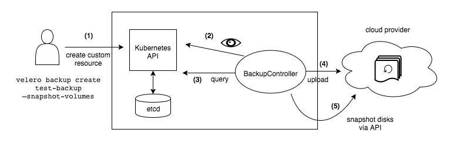

## k8s集群备份方案对比

先想清楚"备份集群"到底在备份什么：**① 集群自身的状态**（etcd 里的资源对象：Deployment、Service、Secret...）、**② 应用数据的持久卷**（PVC 挂的存储卷）。三套方案覆盖面完全不同：

| 方案 | 备份什么 | 粒度 | 跨集群恢复 | 典型场景 |
|---|---|---|---|---|
| etcd 备份 | 整个集群的元数据快照 | 仅全量 | 不支持 | 机房级灾难重建集群 |
| GitOps | Git 管理的资源 YAML | 单资源（前提：进了 Git） | 天然支持 | 日常配置管理、审计合规 |
| Velero | 资源对象 + 可选 PVC 数据 | 任意粒度（集群/命名空间/单资源） | 支持 | 按需备份、迁移、定时灾备 |

### 1. etcd 备份

**原理**：直接快照 etcd 数据库——集群所有命名空间的所有资源都存在里面，不依赖任何 K8s API，和 K8s 版本无关（1.32 / 1.40 都一样）。

**灾难恢复场景**：机房级灾难（水灾火灾）后重建集群——新机房搭一套**一模一样**的集群（节点 IP、主机名、证书配置都要保持统一），再全量灌回数据。

**恢复限制（关键）**：
- **只支持全量恢复**：想从快照里单独捞出一个 Deployment？得去 etcd 里找到对应 key 手工抠出来，操作极其复杂，实际不可行
- **不支持迁移**：A 集群的快照不能恢复到 B 集群当增量数据——恢复出来就是 A 集群的完整复制品
- 恢复时建议 K8s 版本和备份时一致（备份本身对版本无要求）

**定位**：集群级"保命快照"，应对整集群报废重建；**解决不了"误删一个 ns 想找回"这种日常需求**。

### 2. GitOps

**原理**：资源声明文件（Deployment/Service 的 YAML）存 Git 仓库管理，GitLab/GitHub 平台做版本控制——配置本身就是"备份"，Git 历史就是"恢复点"。

**核心优势**：
- 符合 GitOps 规范，天然带审计：任何变更走 Merge Request 审批，谁改的、为什么改、改了什么全有记录
- 同一份 YAML 可重复部署到不同集群/命名空间（恢复 = 重新 apply）
- 回退便捷：`git revert` 一步到位

**主要缺陷**：
- **配置漂移**：有人图省事 `kubectl edit` 直接改线上资源，Git 里的"备份"和实际运行状态就对不上了——漂移检测（Argo CD 的 Sync Status）能发现，但防不住手
- **覆盖不全**：动态创建的资源不在 Git 里（如 Job 创建产生的 Pod、控制器运行时生成的对象、没纳管的 CRD）
- 管理复杂度高：每个资源一套 YAML，命名空间一多仓库管理成本上来了

**定位**：管"配置的期望状态"，适合日常变更管理和审计合规；不是完整的集群备份。

### 3. Velero

**原理**：用户态备份工具——调 K8s API 把资源对象导出存到对象存储（S3 兼容，如 MinIO/OSS/S3），可选调 VolumeSnapshotter/NodeAgent 备份 PVC 数据卷。

**备份能力（三者里最灵活）**：
- 粒度任意：按命名空间 / 资源类型 / 标签选择器备份，也能全集群
- 定时任务：分/时/日/月/周任意调度（`velero schedule create ... --schedule`）
- **跨集群恢复**：A 集群备份 → B 集群恢复（只要 B 装了 Velero 且连上同一个 S3）
- **细粒度恢复**：误删一个 Deployment、一个 ns，单独捞回来

**数据备份特性**：
- 能备份 PVC 关联的存储卷（快照或文件级拷贝）
- **但数据库别指望 Velero**：MySQL/PostgreSQL 用它备份卷可能拷到"写了一半"的不一致状态——数据库备份用专用工具（mysqldump / pg_dump + 定时持久化），Velero 只管资源对象层

**环境要求**：
依赖 S3 兼容存储存备份数据

**定位**：日常灾备主力——按需、定时、跨集群、细粒度全都要，就靠它。

### 怎么选

生产实践通常是**组合拳**，各管一层：
- **etcd 快照**：master 上开个 cron 每日打快照，应付"集群整个炸了重建"的保命场景
- **GitOps**：所有应部署的资源配置进 Git，管日常变更、审计、回滚
- **Velero**：定时备份核心命名空间 + PVC，应付误删、迁移、跨集群搬业务

一句话：**etcd 保底（全量、不能挑）、GitOps 管配置（期望状态、防漂移要靠流程）、Velero 干细活（任意粒度、跨集群）**。


## Velero介绍

**定义**：专为 K8s 设计的容灾工具，核心功能是备份/恢复/迁移集群资源。CS 架构——客户端 `velero` 是命令行工具，服务端跑在集群内（Deployment + DaemonSet），真正执行备份恢复的是服务端。

### 核心组件

**1）服务端（跑在集群内，真正干活的）**
- 组成：一个 `velero` Deployment（控制器）+ 可选的 node-agent DaemonSet（备份 PVC 卷数据时在每节点跑）
- 职责：监听备份/恢复请求（来自客户端），调 API Server 拉取资源对象打包上传到对象存储，恢复时反向下载重建
- 部署要求：**每个要备份的集群都必须独立部署一套服务端**，都要配上 S3 兼容存储——多集群场景就是各装各的，但可以指向同一个存储桶

**2）客户端（velero CLI，只负责发号施令）**
- 职责：与服务端通信，创建备份/恢复任务、管理调度策略、查看进度状态
- 部署方式：**不用装进集群**，任意一台能连上集群的管理机上放个二进制就行——下载、解压、配好 kubeconfig 即用
- 客户端本身不存数据、不执行备份，挂了也不影响服务端继续跑定时任务（策略存在服务端）

小结：**服务端是干活的（集群内、每集群一套、依赖对象存储），客户端是遥控器（随便哪台机器、一个二进制）**。

### 核心资源介绍

Velero 自己也是"声明式"的——每个备份/恢复任务都是一个 CR（自定义资源），`velero` 命令本质就是帮 `create` 这些资源对象，服务端控制器看着它们干活：

| 资源 | 作用 | 关键点 |
|---|---|---|
| Backup | 一次备份任务 | 可指定 ns/资源类型/排除项；`ttl` 配保留期（如 720h=30天），到期自动清理 |
| Schedule | 周期性备份 | cron 表达式（分时日月周），字段继承 Backup 全部配置；到点自动生成一个 Backup |
| Restore | 一次恢复任务 | `--from-backup` 指定源备份，可筛选资源类型/ns 做最小范围恢复 |
| BackupStorageLocation | 备份存哪 | 桶名 + 路径前缀；装 Velero 时自动创建，一般不用动 |

**1）Backup（备份任务）**
- 备份范围：特定命名空间或整个集群，可排除指定 ns/资源类型（`--exclude-namespaces` / `--exclude-resources`）
- 保留策略：`--ttl 720h` 配置保留时间（30 天/90 天），过期自动删除——对象存储里不会无限堆版本
- 创建方式：手动创建，或由 Schedule 到点自动创建

**2）Schedule（定时任务）**
- 本质：带 cron 的 Backup 模板——包含 Backup 资源的所有字段，调度时间到了就按模板生成一个 Backup
- 一个集群可以建多个 Schedule，典型生产用法一个全量任务就够了；需要差异化时可以给数据库 ns 和普通业务 ns 配不同周期

```bash
velero schedule create daily-prod --schedule="0 1 * * *" --include-namespaces prod --ttl 720h
# 生成的 Backup 名字自动带时间戳：daily-prod-20261029010000
```

**3）Restore（恢复任务）**
- 从指定 Backup 恢复，支持全量或最小范围（`--include-resources` / `--include-namespaces`）
- 时间点恢复 = 挑一个对应日期的 Backup 恢复（"回滚到昨日"就是找昨天的备份点）
- 典型场景：灾难恢复、特定版本回滚、给测试环境克隆生产数据

**4）BackupStorageLocation（存储位置）**
- 定义备份文件存哪：bucket + prefix 路径，本地 MinIO 或公有云 S3
- 通常 `velero install` 时自动创建，低频改动，保持默认即可

> 排障角度：这几个资源都能 `kubectl -n velero get backup/restore/schedule` 直接看——**任务状态就在 CR 的 status 里**，不用登服务端查日志，先看对象状态再深入。

### 备份还原执行流程



**备份流程**（上图 1-5 步）：

```text
(1) 客户端：velero backup create test-backup --snapshot-volumes
      → 帮你 create 一个 Backup 资源对象（声明式，和创建 Pod 一个套路）
(2) BackupController 监听到新的 Backup 对象，开始处理
(3) Controller 查询 API Server，把备份范围内的资源（Deployment/Service...）导出为 JSON 打包
      → 资源对象数据来自 etcd（经 API Server 读出）
(4) 把资源包 + 元数据（备份时间、资源清单、校验信息）上传到对象存储（MinIO/S3）
(5) 若带 --snapshot-volumes：调云厂商 API 对 PV 磁盘打快照（快照信息也写进备份元数据）
```

**还原流程**（备份的逆过程）：

```text
velero restore create --from-backup test-backup
  → create 一个 Restore 资源对象
  ▼
RestoreController 解析 Restore 声明：还原范围是什么、数据源是哪个 Backup
  ▼
从对象存储下载备份包（JSON 元数据 + 资源包）
  ▼
按范围筛选资源（如只还原 default ns → 自动提取该 ns 的全部关联资源）
  ▼
调 API Server 逐个 create 资源，重建进集群
  ▼
执行结果（成功/失败/警告）回写 Restore 对象的 status
```

**几个实操要点**：
- 备份产物 = **JSON 资源文件 + 压缩包**，元数据含备份时间、资源类型、校验信息——把备份包下载解压，甚至能手动 `kubectl create` 逐个还原（极端情况下的最后手段）
- 有状态应用备份前需要**钩子**：`--pre-hook` / `--post-hook` 在打快照前后执行命令（典型：数据库先讲内存数据刷盘，保证卷快照一致性）
- 备份文件在对象存储里按 Backup 名字分目录，天然形成多版本历史

### 实践
#### 部署 Velero

#### 周期性备份任务

**1）创建周期性备份任务**

```bash
velero schedule create daily-cluster-backup \
  --schedule="0 17 * * *" \
  --include-namespaces="*" \
  --exclude-namespaces="velero,kube-system" \
  --ttl=720h0m0s
```

- **命名**：见名知意，`daily-cluster-backup` 一看就知道是每日全集群备份
- **时间**：cron 是 **UTC 时间**（分 时 日 月 周）——北京时间凌晨 1 点 = UTC 17 点。换算技巧：`date` 看本地时间、`date -u` 看 UTC，本地减 8。生产建议备份窗口放凌晨 1-2 点
- **排除 ns**：排除 `velero` 和 `kube-system`，避免恢复时和集群自身组件冲突
- **保留期**：默认 720h（30 天），`--ttl` 调整

**这条命令备份了什么（关键，最易误解）**：

备的是**资源对象本身（元数据），不是应用数据**——所有 ns 的 Deployment/Service/ConfigMap/Secret/Ingress/PVC（对象本身）+ 集群级资源（CRD 等）。但 **PV 卷里的数据没备**：PVC 这个"对象"备了，它指向的存储卷里那几百 G 数据没有。恢复出来是"完整的空架子"——资源都在，Pod 起来后卷里是空的。

要连数据一起备，加参数二选一：

```bash
--snapshot-volumes                 # 云环境：调云 API 对磁盘打快照
--default-volumes-to-fs-backup     # 自建环境：node-agent 文件级拷贝到对象存储
# 注意：数据库依然走 mysqldump/xtrabackup，卷快照可能拷到"写一半"的不一致状态
```

**备份粒度**：三层筛选取交集，最小到"应用级"，到不了"单个对象"——

```text
├── 命名空间层：--include-namespaces / --exclude-namespaces    （最粗：整个 ns）
├── 资源类型层：--include-resources / --exclude-resources      （中：某类资源）
└── 标签选择器：--selector app=web                             （最细：带这个标签的一组资源）
```

| 粒度 | 能否做到 |
|---|---|
| 整个集群 | ✅（不加筛选，本例就是） |
| 整个命名空间 | ✅ `--include-namespaces test` |
| 某类资源 | ✅ 再加 `--include-resources deployments` |
| 一组同标签资源（≈一个应用） | ✅ `--selector app=web` |
| 单个具名资源（某个 Deployment） | ❌ 没有按名字选的参数 |
| 单个 Pod | ❌ 伪需求——Pod 是控制器派生的，恢复 Deployment 控制器自己会拉起新 Pod，备份它没意义 |

生产标准姿势：**按 ns 或 `app` 标签备**——粒度刚好对应"一个业务"，Deployment+SVC+CM+Secret+PVC 对象一起走，备份恢复都是完整闭环。

**2）备份任务管理**

```bash
velero schedule get                          # 查看所有调度任务及状态
velero schedule pause daily-cluster-backup   # 暂停（如变更窗口暂停备份）
velero schedule unpause daily-cluster-backup # 恢复
velero schedule delete daily-cluster-backup  # 删除
```

**3）基于调度立即出一次备份**

```bash
velero backup create --from-schedule daily-cluster-backup  # 不等调度点，立刻按模板备一次
velero backup get                                          # 看所有备份及状态
velero backup describe <backup-name>                       # 看某次备份详情
```

#### 资源恢复

**误删场景**：test ns 下的 Deployment 全被误删（`kubectl delete deploy -n test --all`），从最近备份捞回：

```bash
velero backup get                            # 挑最新的备份
velero restore create test-restore \
  --from-backup test-ns-backup \
  --include-namespaces=test \
  --include-resources=deployments \
  --preserve-nodeports

velero restore get                           # 看恢复任务状态
kubectl get deploy -n test                   # 验证资源回来了
kubectl get po -n test                       # 验证 Pod 正常
```

- `--include-resources` 用**复数**形式（deployments/services）
- **恢复不覆盖已有资源**：只创建缺失的资源，对现存服务零影响——恢复是"补缺"不是"重放"
- **粒度限制**：能按 ns + 资源类型恢复，**不能精确到"某一个 Deployment"**——会把这个 ns 下该类型的全部资源补齐

**保留 NodePort（生产必带参数）**：

- Velero 恢复时 Service 的 NodePort **默认会重新分配**——业务靠 NodePort 互联或对外暴露时，端口一变服务全挂
- `--preserve-nodeports` 保留原端口号，**生产环境每次还原都建议带上**
- 端口冲突时（目标集群该端口被占），手动改现有服务的端口，不用复杂参数去改备份里的端口
- 演示流程：`kubectl get svc -n test` 记下当前端口（如 30948）→ 备份 → 删 ns → 恢复 → 再看端口仍是原值（不带参数则变成新随机端口）

#### 重大变更提前备份，回滚

变更前全量备份（如版本上线前），失败了一键回滚：

```bash
# 1. 变更前备份（命名带上 ns 信息，如 test-ns-backup）
velero backup create test-ns-backup --include-namespaces test
# 等 STATUS 变成 Completed

# 2. 模拟变更翻车：镜像改成不存在的版本 + 误删 Service
kubectl set image deploy/xxx xxx=nginx:bad-tag -n test
kubectl delete svc xxx -n test

# 3. 还原
velero restore create rollback-test --from-backup test-ns-backup --include-namespaces test

# 4. 验证：Service 恢复了；但 Deployment 的镜像没回滚！
velero restore describe rollback-test
```

**关键坑——默认不覆盖已有资源**：
- Service 被删了 → 恢复（缺失资源，创建）
- Deployment 还在（只是镜像错了）→ **默认跳过**，status 里给警告 `resource already exists`
- 常见警告两类：Pod/Deployment 已存在、备份与恢复的集群版本不一致——前者就是这条限制的表现

**强制覆盖恢复**（真回滚必须加）：

```bash
velero restore create rollback-test2 \
  --from-backup test-ns-backup \
  --include-namespaces test \
  --existing-resource-policy=update   # 已存在的资源强制更新为备份时状态

# 验证：镜像回到备份时版本、Pod 重建正常
kubectl get deploy -n test -o wide
kubectl get po -n test
```

> 记住这条：**"恢复缺失"是默认行为，"回到备份时点"必须 `--existing-resource-policy=update`**。回滚场景不加这个参数等于白滚。

#### 多集群备份

**前提**：两个集群的 Velero 服务端都指向**同一个 S3 桶**（可用不同 prefix 区分集群），客户端用各自的 kubeconfig 切换集群。

```text
clusterA（生产）──velero服务端──┐
                                ├──同一个 MinIO/S3 桶（按 prefix 分目录）
clusterB（灾备）──velero服务端──┘
```

流程：
1. clusterA 备份：`velero backup create --include-namespaces prod`（存进共享桶）
2. clusterB 直接可见：`velero backup get` 能列出 clusterA 的备份
3. clusterB 恢复：`velero restore create --from-backup <clusterA的备份>`

#### 多集群迁移和恢复

和"多集群备份"同一条链路，重点在**迁移前的检查**：

1. **存储类**：源集群 PV 用的 StorageClass，目标集群有没有（有 PVC 的业务必须先确认）
2. **端口占用**：NodePort 服务迁移前，检查目标集群端口是否被占（`kubectl get svc -A | grep <port>`），冲突的手动调整
3. **CRD 依赖**：源集群装了自定义 CRD 的，目标集群要先装同款 CRD，否则那些资源恢复失败
4. **镜像可达**：目标集群的节点要能拉到业务镜像（私有仓库要配 secret）
5. 执行恢复后逐项验证：`kubectl get all -n <ns>` + Pod 状态 + Service 连通性

> 迁移恢复后 **NodePort 默认会变**（除非 `--preserve-nodeports`），镜像/存储类/CRD 这三类缺失是最常见的恢复失败原因——迁移前对一遍清单，比恢复完再补省事得多。 